# Architectural Rule: Obsidian Vault vs. Work Repository Separation

> **Status:** MANDATORY & PERMANENT  
> **Applies to:** Mohamed & All AI Agents (Antigravity, Claude Code, Cursor, Kiro, Codex, Devin)

---

## 1. Core Division of Responsibilities

```mermaid
flowchart LR
    subgraph Obsidian ["Obsidian Vault (Brain/AWS)\nPrivate Second Brain"]
        V1["Comprehensive Knowledge Base"]
        V2["Full Documentation & Deep Dives"]
        V3["Detailed Technical Tutorials"]
        V4["Architectural Foundations"]
        V5["Zero-Duplication Cross-Linking"]
    end

    subgraph WorkRepo ["Work Directory (Desktop/Work/aws)\nPublic GitHub Repo: fakhruldeen/AWS"]
        W1["High-Yield Exam Notes & Cheat Sheets"]
        W2["Student Lecture Slides (Marp)"]
        W3["Hands-On Free-Tier Labs"]
        W4["Course Syllabi & Exam Roadmaps"]
        W5["Local Questions Bank (GitIgnored)"]
    end

    Obsidian -.->|Condenses into| WorkRepo
```

---

## 2. Obsidian Vault (`/home/mohamed/Documents/Obsidian Vault/Brain/AWS`)
**Primary Mission:** The authoritative, comprehensive, single source of truth for all AWS knowledge.

* **What Resides Here:**
  * Full, unabridged documentation for every AWS service (`03_Services/`).
  * Deep-dive conceptual essays, algorithms, mathematical formulations, and mechanics (`02_Concepts/`).
  * Full-length tutorials, configuration guides, and design patterns.
  * Cross-certification mapping maintaining **zero redundancy** across exam boundaries.
  * Vault metadata, index graphs, and master links (`00_Meta/`).
* **Rule:** When drafting deep theoretical explanations, detailed service specifications, or comprehensive architectural references, they **MUST** be written into the Obsidian Vault first.

---

## 3. Work Directory (`/home/mohamed/Desktop/Work/aws`)
**Primary Mission:** The lean, public-facing delivery and exam success repository (synced to GitHub `fakhruldeen/AWS`).

* **What Resides Here:**
  * **Exam-Focused Notes (`notes/`):** High-yield summaries, decision matrices ("X vs Y"), and memory cheat sheets focused directly on passing the target certification.
  * **Presentation Slides (`slides/`):** Pedagogically structured slide decks in Marp markdown format for classroom student teaching.
  * **Hands-on Student Labs (`labs/`):** Tested, step-by-step lab manuals engineered for 100% Free-Tier or minimal-cost execution.
  * **Course Syllabi (`syllabus/`):** Course pacing guides, official blueprint domain weightings, and learning outcomes.
  * **Offline Question Banks (`questions_bank/`):** Practice questions and audit reports (**strictly GitIgnored**).
  * **Reference Textbooks (`sources/`):** Offline reference literature (**strictly GitIgnored**).
* **Rule:** Do NOT dump raw, verbose encyclopedic documentation here. Keep materials focused on actionable student learning, exam passing, and lab delivery.
