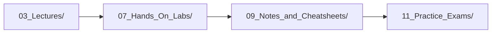

# 🧠 AWS Certified Machine Learning Engineer - Associate (MLA-C01) — Student Dashboard

> **Target Exam:** AWS Certified Machine Learning Engineer - Associate (`MLA-C01`)  
> **Passing Score:** `720 / 1000` (Scaled Scoring)  
> **Exam Format:** 65 Scenario Questions | 130 Minutes  
> **Course Mission:** Master production MLOps, SageMaker Pipelines, Model Registry, Inference Hosting, PEFT/LoRA Fine-Tuning, and Drift Monitoring.

---

## 🧭 Your Study Roadmap

---

## ⚡ Recommended 4-Week Study Schedule

| Week | Focus Area | 📖 Study Materials | 💻 Practice Command |
|:---:|:---|:---|:---|
| **Week 1** | **Domain 1: Data Preparation for ML (28%)** | [Lecture 01](./03_Lectures/Lecture_01_Data_Preparation_and_Feature_Engineering.md) | `python3 scripts/aws_revision_runner.py --cert MLA --mode practice --domain 1 -n 20 --tricks` |
| **Week 2** | **Domain 2: ML Model Development & PEFT (26%)** | [Lecture 02](./03_Lectures/Lecture_02_Model_Development_and_PEFT_Adaptation.md) [Lab 04: PEFT/LoRA Fine-Tuning](./07_Hands_On_Labs/lab_04_peft_lora_fine_tuning_foundation_models.md) | `python3 scripts/aws_revision_runner.py --cert MLA --mode practice --domain 2 -n 20 --tricks` |
| **Week 3** | **Domain 3: Deployment & Orchestration (22%)** | [Lecture 03](./03_Lectures/Lecture_03_Inference_Hosting_and_MLOps_Pipelines.md) [Lab 01: SageMaker Pipelines](./07_Hands_On_Labs/lab_01_sagemaker_pipelines_mlops_and_model_registry.md) [Lab 02: Inference Types](./07_Hands_On_Labs/lab_02_sagemaker_inference_endpoints_comparison.md) | `python3 scripts/aws_revision_runner.py --cert MLA --mode practice --domain 3 -n 20 --tricks` |
| **Week 4** | **Domain 4: Monitoring, Drift & Governance (24%)** | [Lecture 04](./03_Lectures/Lecture_04_Monitoring_Explainability_and_Governance.md) [Lab 03: Model Monitor](./07_Hands_On_Labs/lab_03_automated_drift_detection_model_monitor.md) [Lab 05: Clarify Bias/SHAP](./07_Hands_On_Labs/lab_05_model_fairness_bias_shap_explainability.md) | `python3 scripts/aws_revision_runner.py --cert MLA --community --mode practice -n 20` `python3 scripts/aws_revision_runner.py --cert MLA --mode mock` |

---

## 🎯 Progress Checklist

- [ ] **Domain 1:** Completed Lecture 01 (Glue, Kinesis, EMR, Feature Store, vector chunking)
- [ ] **Domain 2:** Completed Lecture 02 & Lab 04 (PEFT, LoRA, Continued Pre-training, HPO)
- [ ] **Domain 3:** Completed Lecture 03, Lab 01 (SageMaker Pipelines) & Lab 02 (4 Inference Modes)
- [ ] **Domain 4:** Completed Lecture 04, Lab 03 (Model Monitor Drift) & Lab 05 (Clarify SHAP)
- [ ] **106Q Community Practice Pool:** Completed drills with `--community`
- [ ] **Full Timed Mock Simulation:** Scored $\ge 80\%$ on the 65-question timed mock exam (`--mode mock`)
