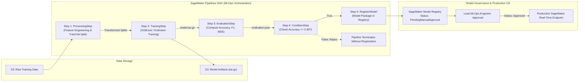

# Lab 01: End-to-End MLOps Pipeline with Amazon SageMaker Pipelines & Model Registry

> **Track:** AWS Certified Machine Learning Engineer - Associate (MLA-C01)  
> **Domain:** Domain 3: Deployment and Orchestration of ML Workflows & Domain 4: Monitoring and Maintenance  
> **Level:** Associate (Hands-on Engineering Lab)  
> **Estimated Time:** 45 minutes  
> **Cost Profile:** Low Cost / Free-Tier Eligible

---

## 🏗️ 1. Architecture Overview

In enterprise machine learning engineering, manual training and deployment scripts are replaced with automated, reproducible Directed Acyclic Graphs (DAGs) using **Amazon SageMaker Pipelines**, governed by the **SageMaker Model Registry**.



### Key Engineering Tenets:
1. **Pipelines as Code:** Entire ML workflows (data ingestion, feature engineering, distributed training, metric evaluation, conditional gating, and registration) are defined declaratively in Python.
2. **Automated Lineage & Artifact Tracking:** SageMaker automatically tracks input S3 URIs, container images, parameters, code commits, and output artifacts for full regulatory auditability.
3. **Model Registry Gatekeeping:** New models are registered in a `PendingManualApproval` state. Automated deployment pipelines trigger only when an approved status is committed, preventing rogue or degraded models from reaching production.

---

## 📋 2. Prerequisites & Environment Setup

- AWS CLI v2 configured.
- IAM Role with `AmazonSageMakerFullAccess` and S3 bucket read/write permissions.
- Python 3.10+ with `boto3` and `sagemaker` SDK installed.

---

## 🛠️ 3. Step-by-Step Guided Implementation

### Step 3.1: Define Pipeline Parameters & Processing Step

1. **Parameters:** Define runtime inputs:
   - `ProcessingInstanceType`: e.g., `ml.m5.xlarge`
   - `TrainingInstanceType`: e.g., `ml.m5.xlarge`
   - `ModelApprovalStatus`: default `"PendingManualApproval"`
   - `InputDataUrl`: S3 URI pointing to raw dataset.

2. **ProcessingStep (Data Preprocessing):**
   - Instantiates an `SKLearnProcessor` with a Python script (`preprocess.py`).
   - Inputs: Raw CSV from S3.
   - Outputs: `train.csv`, `validation.csv`, and `test.csv` written to designated S3 processing output channels.

---

### Step 3.2: Configure TrainingStep with Built-in XGBoost

1. Configure an `Estimator` using the AWS managed XGBoost container image.
2. Set hyperparameters:
   - `objective: "binary:logistic"`
   - `max_depth: 5`
   - `eta: 0.2`
   - `num_round: 100`
3. Bind the `TrainingStep` inputs directly to the outputs of the previous `ProcessingStep`:
   ```python
   inputs={
       "train": TrainingInput(s3_data=step_process.properties.ProcessingOutputConfig.Outputs["train"].S3Output.S3Uri, content_type="text/csv"),
       "validation": TrainingInput(s3_data=step_process.properties.ProcessingOutputConfig.Outputs["validation"].S3Output.S3Uri, content_type="text/csv")
   }
   ```

---

### Step 3.3: Implement EvaluationStep & ConditionStep

1. **EvaluationStep:** Runs a lightweight script (`evaluate.py`) that loads the trained model from `step_train.properties.ModelArtifacts.S3ModelArtifacts`, scores the test dataset, and outputs an `evaluation.json` report containing metrics (e.g., `{"binary_classification_metrics": {"accuracy": {"value": 0.88}}}`).
2. **ConditionStep:**
   - Evaluates a condition: Is `accuracy >= 0.80`?
   - **If True:** Execute `RegisterModel` step.
   - **If False:** Terminate pipeline execution without registering the model.

---

### Step 3.4: Register in Model Registry

1. In the `RegisterModel` step:
   - **Model Package Group Name:** `CustomerChurnModelGroup`
   - **Model Metrics:** Attach `evaluation.json`.
   - **Approval Status:** `PendingManualApproval`.
   - **Inference Specification:** Container image, model data S3 URI, supported content types (`text/csv`).

---

## 💻 4. AWS CLI v2 Executable Runbook

### Step 4.1: Inspect and Manage SageMaker Pipelines via CLI
```bash
# 1. List all active SageMaker Pipelines in the region
aws sagemaker list-pipelines \
  --max-items 10 \
  --output table

# 2. Describe specific pipeline details and parameter schemas
aws sagemaker describe-pipeline \
  --pipeline-name churn-prediction-pipeline \
  --query '{Name:PipelineName,Status:PipelineStatus,Role:RoleArn,Creation:CreationTime}' \
  --output json

# 3. Start a pipeline execution with custom parameters
EXECUTION_ARN=$(aws sagemaker start-pipeline-execution \
  --pipeline-name churn-prediction-pipeline \
  --pipeline-execution-display-name "nightly-retrain-run-01" \
  --pipeline-parameters Name=ProcessingInstanceType,Value=ml.m5.xlarge \
  --query 'PipelineExecutionArn' --output text)
echo "Started Execution: $EXECUTION_ARN"

# 4. Track status of all steps in the execution DAG
aws sagemaker list-pipeline-execution-steps \
  --pipeline-execution-arn $EXECUTION_ARN \
  --query 'PipelineExecutionSteps[*].{StepName:StepName,Status:StepStatus,StartTime:StartTime}' \
  --output table
```

### Step 4.2: Inspect and Approve Models in Model Registry via CLI
```bash
# 1. List Model Package Groups
aws sagemaker list-model-package-groups \
  --query 'ModelPackageGroupSummaryList[*].ModelPackageGroupName' \
  --output table

# 2. List versions under a model group
aws sagemaker list-model-packages \
  --model-package-group-name CustomerChurnModelGroup \
  --query 'ModelPackageSummaryList[*].{Arn:ModelPackageArn,Version:ModelPackageVersion,Status:ModelApprovalStatus}' \
  --output table

# 3. Approve a Model Package for Production Deployment
LATEST_MODEL_ARN=$(aws sagemaker list-model-packages \
  --model-package-group-name CustomerChurnModelGroup \
  --max-items 1 \
  --query 'ModelPackageSummaryList[0].ModelPackageArn' --output text)

aws sagemaker update-model-package \
  --model-package-arn $LATEST_MODEL_ARN \
  --model-approval-status "Approved" \
  --approval-description "Validated against compliance benchmarks and accuracy >= 85%"

echo "Model $LATEST_MODEL_ARN approved for automated production deployment."
```

---

## 🎯 5. Exam Practice: Scenarios & Traps (MLA-C01)

| Scenario / Exam Trap | What the Exam Asks | Architecturally Correct Decision | Why Alternatives Are Traps |
|---|---|---|---|
| **Trap 1: Hardcoding S3 Paths Between Steps** | *"In a SageMaker Pipeline, Step 2 (Training) fails to find the output from Step 1 (Processing) during concurrent scheduled runs."* | Reference outputs dynamically using **`step_process.properties.ProcessingOutputConfig.Outputs[...]`**, never hardcode static S3 string paths. | Static paths cause race conditions when multiple pipeline runs execute concurrently or overwrite previous runs. |
| **Trap 2: Direct Production Deployment from Training** | *"An ML engineer wants training jobs to automatically deploy to production real-time endpoints when training finishes."* | Route trained models through the **SageMaker Model Registry** with an approval step (`PendingManualApproval` $\rightarrow$ `Approved`). Deploy from the approved model package. | Direct automated endpoint deployment bypasses governance, lineage tracking, and compliance sign-offs. |
| **Trap 3: Model Evaluation in Training vs Processing** | *"Where should multi-class evaluation metric calculations (AUC, confusion matrix, F1) be executed in a SageMaker pipeline?"* | Use a **ProcessingStep** or **EvaluationStep** with custom evaluation scripts, not within the training job itself. | Training jobs optimize for internal loss functions; downstream evaluation requires separate hold-out test sets and generates structured reports for the ConditionStep. |
| **Trap 4: Multi-Model Endpoints (MME) vs SageMaker Pipelines** | *"A company wants to manage the end-to-end retraining and conditional deployment lifecycle of 50 customer models."* | Use **SageMaker Pipelines** for the training DAG and **SageMaker Model Registry** to track packages. Use Multi-Model Endpoints (MME) only for inference hosting. | MME is an inference hosting technique, not a pipeline workflow orchestrator. |
| **Trap 5: Lineage Tracking Verification** | *"A healthcare auditor demands proof of the exact Docker container image, dataset version, and hyperparameters used to train an active model."* | SageMaker Pipelines and Model Registry provide built-in **SageMaker ML Lineage Tracking**, recording entities (`Artifact`, `TrialComponent`, `Action`, `Context`). | Storing this information in CloudWatch logs or manual Git commits does not link artifacts to the actual SageMaker inference endpoint. |

---

## 🧹 6. Resource Cleanup

```bash
# Delete model package and pipeline to prevent recurring costs
aws sagemaker delete-pipeline --pipeline-name churn-prediction-pipeline
# Clean up temporary S3 artifacts in processing and model output buckets
echo "SageMaker Pipeline cleanup complete."
```
