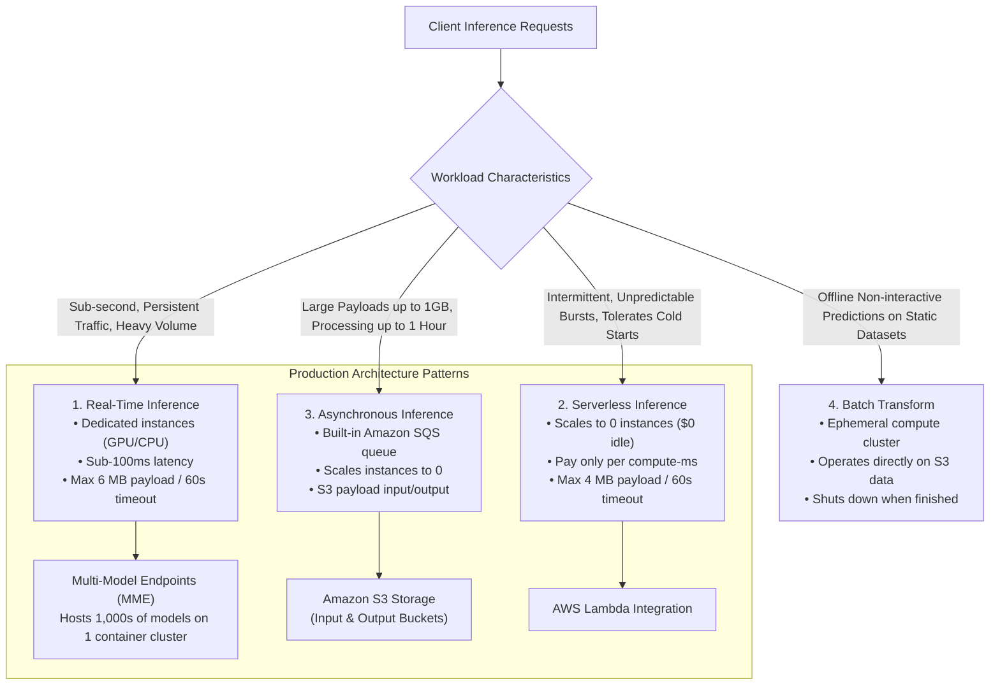

# Lab 02: SageMaker Inference Architecture: Real-Time vs. Serverless vs. Asynchronous vs. Batch

> **Track:** AWS Certified Machine Learning Engineer - Associate (MLA-C01)  
> **Domain:** Domain 3: Deployment and Orchestration of ML Workflows  
> **Level:** Associate (Hands-on Engineering Lab)  
> **Estimated Time:** 45 minutes  
> **Cost Profile:** Low Cost / Free-Tier Eligible

---

## 🏗️ 1. Architecture Overview

Choosing the correct inference hosting architecture is one of the most critical decisions for a Machine Learning Engineer. This lab compares the four distinct Amazon SageMaker deployment options:



### Architectural Comparison Matrix:

| Feature / Metric | Real-Time Inference | Serverless Inference | Asynchronous Inference | Batch Transform |
|---|---|---|---|---|
| **Latency Profile** | Sub-second (milliseconds) | Low ms, but subject to cold starts | Minutes to 1 hour | Hours / Offline batch |
| **Idle Cost** | Ongoing hourly instance cost | **$0 (Scales to 0)** | **$0 (Scales to 0)** | **$0 (Terminates on finish)** |
| **Max Payload Size** | 6 MB | 4 MB | **1 GB** | **Petabytes (S3 chunks)** |
| **Max Processing Timeout** | 60 seconds | 60 seconds | **3,600 seconds (1 hour)** | Days (unconstrained) |
| **Ideal Workload** | High-volume fraud detection, recommendations | Infrequent internal tools, dev/test | Large image/video segmentation, audio transcription | Monthly risk scoring, catalog vectorization |

---

## 📋 2. Prerequisites & Environment Setup

- AWS CLI v2 configured with SageMaker permissions.
- Pre-trained model artifact (`model.tar.gz`) stored in Amazon S3.
- Target Region: `eu-north-1`.

---

## 🛠️ 3. Step-by-Step Guided Implementation

### Step 3.1: Deploy a Real-Time SageMaker Endpoint with Auto Scaling

1. **Create Model Definition:**
   - Go to **SageMaker Console > Inference > Models > Create model**.
   - **Model name:** `churn-realtime-model`
   - **Primary container:** AWS managed XGBoost container image URI.
   - **Model artifacts:** `s3://YOUR_BUCKET/model.tar.gz`.
2. **Create Endpoint Configuration:**
   - Under **Inference > Endpoint configurations > Create endpoint configuration**.
   - **Name:** `churn-realtime-config`
   - **Production variants:** Add model `churn-realtime-model`.
   - **Instance type:** `ml.m5.large`, initial instance count: `2` (Multi-AZ resilience).
3. **Deploy Endpoint:**
   - Under **Inference > Endpoints > Create endpoint**.
   - **Endpoint name:** `churn-realtime-endpoint`.
   - Select `churn-realtime-config`.
4. **Configure Target Tracking Auto Scaling:**
   - Attach a scaling policy: Target `SageMakerVariantInvocationsPerInstance = 1000`.

---

### Step 3.2: Deploy a Cost-Optimized Serverless Endpoint (Scale-to-Zero)

1. Under **Endpoint configurations > Create endpoint configuration**:
   - **Type:** Select **Serverless**.
   - **Memory size:** `2048 MB` (options range from 1024 MB to 6144 MB).
   - **Max concurrency:** `10` concurrent invocations.
2. Under **Endpoints > Create endpoint**:
   - **Endpoint name:** `churn-serverless-endpoint`.
   - Attach the serverless endpoint configuration.
   - *Result:* When zero requests arrive, AWS charges \$0.00 for compute!

---

### Step 3.3: Deploy an Asynchronous Endpoint for Large Payloads

1. Under **Endpoint configurations > Create endpoint configuration**:
   - **Type:** Select **Asynchronous**.
   - **Asynchronous invocation settings:**
     - Output S3 path: `s3://YOUR_BUCKET/async-outputs/`
     - Status notification (optional): SNS Topic ARN.
     - Max concurrent invocations: `5`.
2. Under **Endpoints > Create endpoint**:
   - Name: `churn-async-endpoint`.
   - *How to invoke:* Applications upload payloads up to 1 GB to S3 and invoke the endpoint with the S3 URI. SageMaker queues the request, processes it, writes results to S3, and notifies the caller via SNS!

---

## 💻 4. AWS CLI v2 Executable Runbook

### Step 4.1: Deploy Real-Time and Serverless Endpoints via CLI
```bash
# 1. Create SageMaker Model
aws sagemaker create-model \
  --model-name churn-model-cli \
  --primary-container Image=683313688378.dkr.ecr.eu-north-1.amazonaws.com/sagemaker-xgboost:1.7-1,ModelDataUrl=s3://$BUCKET_NAME/model.tar.gz \
  --execution-role-arn $SAGEMAKER_ROLE_ARN

# 2. Create Real-Time Endpoint Config (2 instances for Multi-AZ)
aws sagemaker create-endpoint-config \
  --endpoint-config-name realtime-config-cli \
  --production-variants VariantName=AllTraffic,ModelName=churn-model-cli,InitialInstanceCount=2,InstanceType=ml.m5.large

# 3. Create Serverless Endpoint Config (Scale-to-Zero)
aws sagemaker create-endpoint-config \
  --endpoint-config-name serverless-config-cli \
  --production-variants '[{
    "VariantName": "ServerlessTraffic",
    "ModelName": "churn-model-cli",
    "ServerlessConfig": {
      "MemorySizeInMB": 2048,
      "MaxConcurrency": 5
    }
  }]'

# 4. Create Serverless Endpoint
aws sagemaker create-endpoint \
  --endpoint-name serverless-churn-endpoint \
  --endpoint-config-name serverless-config-cli

# 5. Invoke Real-Time / Serverless Endpoint
aws sagemaker-runtime invoke-endpoint \
  --endpoint-name serverless-churn-endpoint \
  --content-type text/csv \
  --body "0.45,-1.2,0.88,1.4,0.02,1,0" \
  output.txt
cat output.txt
```

---

## 🎯 5. Exam Practice: Scenarios & Traps (MLA-C01)

| Scenario / Exam Trap | What the Exam Asks | Architecturally Correct Decision | Why Alternatives Are Traps |
|---|---|---|---|
| **Trap 1: Sporadic Unpredictable Traffic with Idle Costs** | *"A company runs an internal classification tool that is used only a few times a day by analysts. Management demands zero compute costs when idle."* | Deploy a **SageMaker Serverless Inference Endpoint**. Serverless automatically scales down to zero instances, charging only for the compute milliseconds consumed during request processing. | Real-Time endpoints keep instances running 24/7, incurring ongoing hourly fees even with 0 incoming requests. |
| **Trap 2: Large Payload Limits (Payload Exceeds 6 MB)** | *"A computer vision model receives 25 MB high-resolution medical CT scans for diagnostic analysis. The real-time endpoint returns HTTP 413 Payload Too Large."* | Migrate to **SageMaker Asynchronous Inference**. Asynchronous inference accepts payloads up to **1 GB** stored in S3 and processes requests for up to **1 hour**. | Real-Time endpoints enforce an absolute hard ceiling of **6 MB** per request that cannot be increased. |
| **Trap 3: Massive Offline Dataset Scoring** | *"At the end of every quarter, a bank must run fraud risk predictions on 500 million historical credit card records stored in Amazon S3. No real-time API is needed."* | Use **Amazon SageMaker Batch Transform**. Spawns an ephemeral compute cluster that reads directly from S3, distributes processing across instances, writes results back to S3, and immediately shuts down. | Deploying an endpoint for offline batch jobs wastes management overhead and requires writing custom queue client code. |
| **Trap 4: Multi-Model Endpoints (MME) vs 1,000 Dedicated Endpoints** | *"A SaaS company hosts 2,000 distinct, personalized customer models. Most models are invoked infrequently, but hosting 2,000 real-time endpoints is cost-prohibitive."* | Deploy a **SageMaker Multi-Model Endpoint (MME)**. Hosts thousands of models on a single shared endpoint container fleet, dynamically loading models into memory from S3 upon request. | Creating 2,000 individual endpoints requires at least 2,000 instances, leading to astronomical and unsustainable hosting costs. |
| **Trap 5: Asynchronous Endpoint Autoscaling to Zero** | *"Can SageMaker Asynchronous Inference scale the instance count completely to 0 when the built-in SQS queue is empty?"* | **Yes.** Asynchronous inference integrates with Application Auto Scaling to scale instance capacity down to 0 when `ApproximateNumberOfMessagesVisible == 0`. | Believing that only Serverless can scale to 0 is an exam trap; Asynchronous endpoints also scale to 0 instances. |

---

## 🧹 6. Resource Cleanup

```bash
# Delete endpoints and configurations to prevent ongoing charges
aws sagemaker delete-endpoint --endpoint-name serverless-churn-endpoint
aws sagemaker delete-endpoint-config --endpoint-config-name serverless-config-cli
aws sagemaker delete-endpoint-config --endpoint-config-name realtime-config-cli
aws sagemaker delete-model --model-name churn-model-cli
echo "Lab 02 cleanup complete."
```
