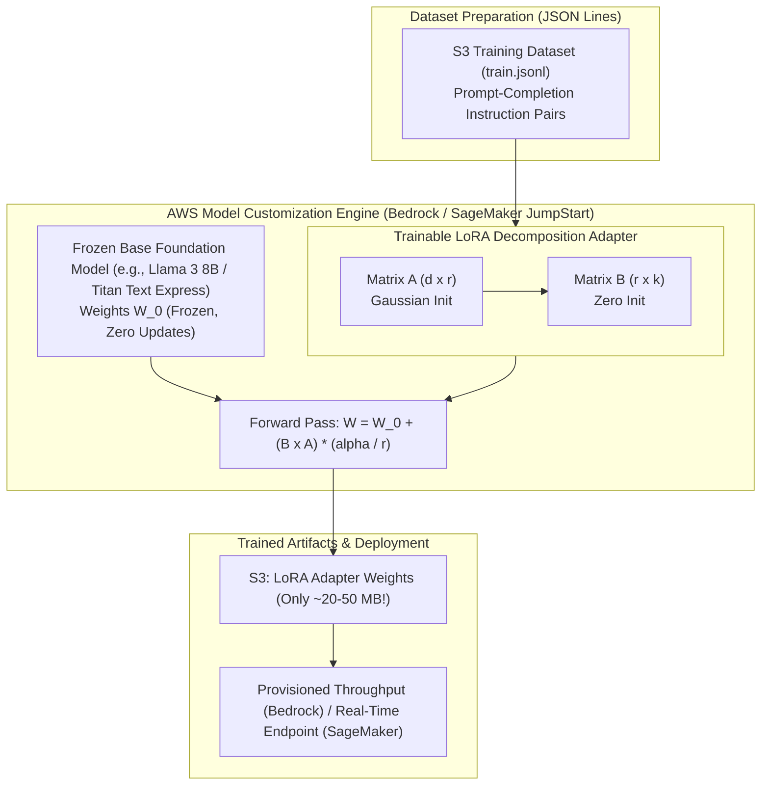

# Lab 04: Parameter-Efficient Fine-Tuning (PEFT/LoRA) of Foundation Models on AWS

> **Track:** AWS Certified Machine Learning Engineer - Associate (MLA-C01)  
> **Domain:** Domain 2: ML Model Development & Domain 3: Deployment and Orchestration  
> **Level:** Associate (Hands-on Engineering Lab)  
> **Estimated Time:** 45 minutes  
> **Cost Profile:** Low Cost / Free-Tier Eligible

---

## 🏗️ 1. Architecture Overview

Full fine-tuning of multi-billion parameter Large Language Models (LLMs) requires massive GPU memory clusters, is financially cost-prohibitive, and frequently causes **catastrophic forgetting**. This lab demonstrates how to execute **Parameter-Efficient Fine-Tuning (PEFT)** using **Low-Rank Adaptation (LoRA)** on AWS, freezing the base foundation model and training lightweight low-rank decomposition adapter matrices.



### Mathematical & Architectural Mechanics:
- Instead of updating the full weight matrix $W_0 \in \mathbb{R}^{d \times k}$ (which contains billions of weights), LoRA decomposes the weight update ΔW into two low-rank matrices:
  $$\Delta W = B \times A, \quad \text{where } B \in \mathbb{R}^{d \times r}, A \in \mathbb{R}^{r \times k}, \text{ with rank } r \ll \min(d, k)$$
- **Memory Savings:** Reduces trainable parameters by >99%, allowing fine-tuning of 7B–13B models on a single GPU instance.
- **Hot-Swapping:** A single frozen base model in memory can serve dozens of different domain tasks simply by swapping the tiny 20 MB LoRA adapter weights!

---

## 📋 2. Prerequisites & Environment Setup

- AWS CLI v2 configured.
- S3 bucket for training and validation datasets in `.jsonl` format.
- Bedrock Model Customization access granted (or SageMaker JumpStart access).
- Target Region: `eu-north-1` (or assigned project region).

---

## 🛠️ 3. Step-by-Step Guided Implementation

### Step 3.1: Format the Fine-Tuning Dataset (JSONL)

1. Create a training file `train.jsonl` containing instruction-response pairs:
   ```json
   {"prompt": "Summarize the customer support interaction:\nCustomer: My router will not connect to the internet.\nAgent: Please reboot the power supply for 30 seconds.\nCustomer: That fixed it, thank you!\nSummary:", "completion": "Customer router connectivity issue resolved by power cycling the device."}
   {"prompt": "Summarize the customer support interaction:\nCustomer: I was double billed on my June invoice.\nAgent: I have issued an immediate refund of $45.00.\nCustomer: Appreciated.\nSummary:", "completion": "Billing dispute resolved with immediate $45.00 refund."}
   ```
2. Upload `train.jsonl` and `validation.jsonl` to your S3 bucket:
   ```bash
   aws s3 cp train.jsonl s3://$BUCKET_NAME/fine-tuning-data/train.jsonl
   aws s3 cp validation.jsonl s3://$BUCKET_NAME/fine-tuning-data/validation.jsonl
   ```

---

### Step 3.2: Configure Hyperparameters for LoRA Fine-Tuning

In model customization jobs, key hyperparameters govern training:
1. **LoRA Rank ($r$):** The rank of the low-rank update matrices (typically `8`, `16`, or `32`). Higher rank captures more complex domain knowledge, but increases memory and adapter size.
2. **LoRA Alpha (α):** A scaling factor for the weight updates (typically 2 × r, e.g., α = 32 when r = 16).
3. **LoRA Dropout:** Regularization probability (typically `0.05` to `0.10`) to prevent overfitting on small domain datasets.
4. **Learning Rate:** Typically `1e-4` to `5e-4` (substantially higher than full fine-tuning because base weights are frozen).
5. **Epochs:** Typically `3` to `5` epochs to prevent overfitting.

---

### Step 3.3: Launch Bedrock Model Customization Job

1. In the **Amazon Bedrock Console**, navigate to **Foundation models > Custom models > Customize model**.
2. **Method:** Select **Fine-tuning** (or Continued pre-training).
3. **Model details:**
   - **Custom model name:** `customer-support-lora-v1`
   - **Base model:** Select `Amazon Titan Text G1 - Express` (or `Meta Llama 3 8B Instruct`).
4. **Training data:** S3 URI `s3://YOUR_BUCKET/fine-tuning-data/train.jsonl`.
5. **Validation data:** S3 URI `s3://YOUR_BUCKET/fine-tuning-data/validation.jsonl`.
6. **Hyperparameters:** Epochs: `3`, Batch size: `8`, Learning rate: `0.0001`.
7. Click **Customize model**. SageMaker/Bedrock provisions compute, trains adapter weights, records loss curves in CloudWatch, and saves model artifacts to S3.

---

### Step 3.4: Deploy and Invoke the Custom Model

1. **Deploying on Amazon Bedrock:** Custom fine-tuned models on Bedrock require purchasing **Provisioned Throughput** (at least 1 Model Unit).
2. **Deploying on Amazon SageMaker JumpStart:** Deploy the merged model directly to a SageMaker Real-Time or Serverless endpoint.
3. Test inference by submitting a novel support transcript and verifying that the model adheres strictly to the learned summary formatting style.

---

## 💻 4. AWS CLI v2 Executable Runbook

### Step 4.1: Launch Model Customization Job via CLI
```bash
# 1. Create Model Customization Job in Amazon Bedrock
JOB_ARN=$(aws bedrock create-model-customization-job \
  --job-name "support-summarizer-lora-01" \
  --custom-model-name "support-summarizer-v1" \
  --role-arn "$BEDROCK_ROLE_ARN" \
  --base-model-identifier "amazon.titan-text-express-v1" \
  --customization-type "FINE_TUNING" \
  --training-data-config "{\"s3Uri\":\"s3://$BUCKET_NAME/fine-tuning-data/train.jsonl\"}" \
  --validation-data-config "{\"validators\":[{\"s3Uri\":\"s3://$BUCKET_NAME/fine-tuning-data/validation.jsonl\"}]}" \
  --output-data-config "{\"s3Uri\":\"s3://$BUCKET_NAME/model-output/\"}" \
  --hyper-parameters "{\"epochCount\":\"3\",\"batchSize\":\"8\",\"learningRate\":\"0.0001\"}" \
  --query 'jobArn' --output text)
echo "Launched Bedrock Customization Job: $JOB_ARN"

# 2. Monitor Customization Job Status
aws bedrock get-model-customization-job \
  --job-identifier "$JOB_ARN" \
  --query '{Status:status,CreationTime:creationTime,EndTime:endTime,Metrics:trainingMetrics}' \
  --output json
```

---

## 🎯 5. Exam Practice: Scenarios & Traps (MLA-C01)

| Scenario / Exam Trap | What the Exam Asks | Architecturally Correct Decision | Why Alternatives Are Traps |
|---|---|---|---|
| **Trap 1: Catastrophic Forgetting Mitigation** | *"An ML engineer fine-tunes a base foundation model for specialized medical diagnosis. The model now produces excellent medical advice but has completely forgotten basic conversational skills and English grammar."* | Use **Parameter-Efficient Fine-Tuning (PEFT / LoRA)** instead of full fine-tuning. LoRA freezes base weights W₀, completely eliminating catastrophic forgetting of the model's core pre-trained knowledge. | Full fine-tuning overwrites base parametric weights, degrading general capabilities on out-of-domain tasks. |
| **Trap 2: Fine-Tuning vs RAG for Dynamic Real-Time Data** | *"A company wants an LLM to answer questions about daily product inventory and stock prices that update every 15 minutes. An engineer proposes fine-tuning the model hourly."* | Fine-tuning is the **wrong architectural choice**. Implement **Retrieval-Augmented Generation (RAG)** using Bedrock Knowledge Bases. Fine-tuning teaches *style, formatting, and domain dialect*, while RAG provides *real-time factual knowledge*. | Fine-tuning cannot keep up with rapidly changing data, is computationally expensive, and hallucinates without live citations. |
| **Trap 3: Bedrock Custom Model Hosting Prerequisite** | *"What purchasing option is strictly required to deploy and invoke a custom fine-tuned model on Amazon Bedrock?"* | **Provisioned Throughput (Model Units)**. Custom fine-tuned models on Bedrock cannot be invoked using on-demand token pricing. | Attempting to invoke a custom model via on-demand pay-per-token APIs will fail with validation errors. |
| **Trap 4: Continued Pre-training vs Supervised Fine-Tuning** | *"A legal firm has 500,000 raw, unannotated PDF legal briefs and wants an LLM to learn specialized legal vocabulary and Latin terminology."* | Use **Continued Pre-training** (domain adaptation). Continued pre-training ingests **unlabeled raw text** using next-token self-supervision. Fine-tuning requires **labeled prompt-completion pairs**. | Attempting supervised fine-tuning on raw documents without prompt-response structures will corrupt the model's instruction-following abilities. |
| **Trap 5: LoRA Adapter Storage Efficiency** | *"Why is LoRA preferred for multi-tenant SaaS applications serving different enterprise clients?"* | LoRA adapters are tiny (typically **20–50 MB** compared to 30 GB for full base models). Multiple tenant adapters can be hot-swapped onto a single frozen base model instance in GPU memory. | Deploying separate full fine-tuned 70B models for 100 enterprise clients requires 100 dedicated GPU clusters, causing unsustainable costs. |

---

## 🧹 6. Resource Cleanup

```bash
# Clean up temporary training datasets and output weights in S3
aws s3 rm s3://$BUCKET_NAME/fine-tuning-data/ --recursive
echo "Lab 04 cleanup complete."
```
