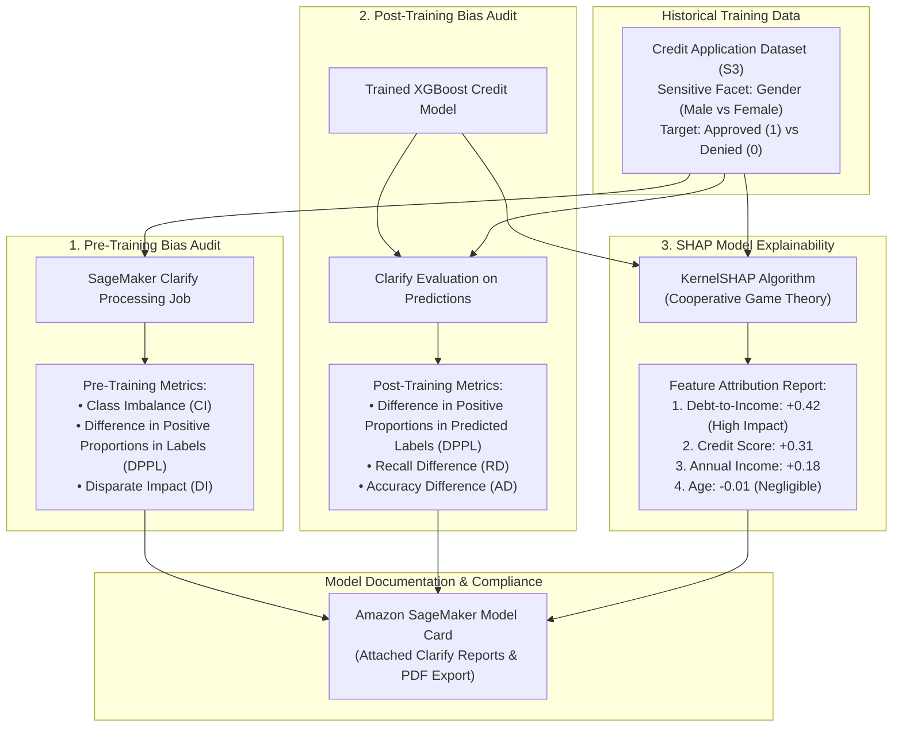

# Lab 05: Model Fairness, Bias Detection, and SHAP Explainability with Amazon SageMaker Clarify

> **Track:** AWS Certified Machine Learning Engineer - Associate (MLA-C01)  
> **Domain:** Domain 4: ML Solution Monitoring and Maintenance  
> **Level:** Associate (Hands-on Engineering Lab)  
> **Estimated Time:** 45 minutes  
> **Cost Profile:** Low Cost / Free-Tier Eligible

---

## 🏗️ 1. Architecture Overview

Responsible AI and regulatory compliance require machine learning practitioners to identify and mitigate demographic bias across the model lifecycle and explain individual model predictions in human-interpretable terms. This lab guides the execution of **Amazon SageMaker Clarify** to evaluate **Pre-training Bias**, **Post-training Bias**, and **Feature Attribution Explainability** using **SHAP (Shapley Additive Explanations)** values.



### Core Bias & Explainability Metrics Explained:
1. **Class Imbalance (CI):** Measures the disparity in representation between facet values (e.g., if 85% of applicants are Male and 15% Female, CI > 0).
2. **Difference in Positive Proportions in Labels (DPPL):** Evaluates whether the historical training labels favored one group over another:
   $$\text{DPPL} = q_a - q_d, \quad \text{where } q_a \text{ is acceptance rate of favored group, } q_d \text{ of disfavored group}$$
3. **Disparate Impact (DI):** The ratio of positive outcomes between groups. DI < 0.80 typically triggers regulatory legal scrutiny (the 80% four-fifths rule).
4. **SHAP (Shapley Additive Explanations):** Derives from cooperative game theory to quantify the exact marginal contribution of each feature to pushing a prediction away from the baseline average.

---

## 📋 2. Prerequisites & Environment Setup

- AWS CLI v2 configured with SageMaker permissions.
- S3 bucket for tabular credit dataset and Clarify output reports.
- IAM Execution Role with `AmazonSageMakerFullAccess`.
- Target Region: `eu-north-1`.

---

## 🛠️ 3. Step-by-Step Guided Implementation

### Step 3.1: Prepare Tabular Dataset with Sensitive Facets

1. Prepare `credit_risk.csv` with demographic columns:
   - Features: `Age`, `AnnualIncome`, `DebtToIncomeRatio`, `CreditScore`, `Gender` (`0` for Female, `1` for Male).
   - Target Label: `Approved` (`1` for approved, `0` for denied).
2. Upload dataset to S3:
   ```bash
   aws s3 cp credit_risk.csv s3://$BUCKET_NAME/clarify-lab/credit_risk.csv
   ```

---

### Step 3.2: Configure SageMaker Clarify Pre-Training Bias Check

1. Using SageMaker Python SDK (or Clarify Processing Job):
   - **DataConfig:** S3 input path, output path, target label column name (`Approved`).
   - **BiasConfig:**
     - Facet name: `Gender`.
     - Facet value (favored group): `1` (Male).
     - Label value (positive outcome): `1` (Approved).
2. Launch the Clarify processing job.
3. **Review Output Report:** Download `analysis.json` and review:
   - If historical data has DPPL = 0.28, it indicates that men received loan approvals 28% more frequently than women in the historical training data. Mitigation: Apply SMOTE oversampling or sample re-weighting before training!

---

### Step 3.3: Configure Post-Training Bias and SHAP Explainability

1. **ModelConfig:** Specify the deployed SageMaker model name, instance type, and content type (`text/csv`).
2. **SHAPConfig:**
   - Baseline dataset: Synthetic average background dataset (or clustered sample from training set).
   - Number of samples: `100`.
   - Aggregation method: `mean_abs` (mean absolute SHAP values for global ranking).
3. **Run Clarify Analysis:** SageMaker spins up a managed compute container, perturbs feature inputs, sends thousands of sample invocations through the model endpoint, calculates coalitional game values, and renders:
   - Global Feature Importance bar charts.
   - Individual local prediction waterfalls (showing exactly why Jane Doe was approved or John Smith was denied).

---

### Step 3.4: Document in SageMaker Model Cards

1. Navigate to **SageMaker Console > Governance > Model cards > Create model card**.
2. **Model details:** Enter model architecture, framework (XGBoost 1.7), and intended business use.
3. **Attach Clarify Evaluation:** Link the S3 output URI from the Clarify job.
4. **Export:** Export the Model Card as a standardized PDF for submission to regulatory risk committees.

---

## 💻 4. AWS CLI v2 Executable Runbook

### Step 4.1: Launch Clarify Processing Job via CLI
```bash
# 1. Prepare Clarify Analysis Configuration JSON
cat <<EOF > clarify_config.json
{
  "dataset_type": "text/csv",
  "headers": ["Age", "AnnualIncome", "DebtToIncome", "CreditScore", "Gender", "Approved"],
  "label": "Approved",
  "features": ["Age", "AnnualIncome", "DebtToIncome", "CreditScore", "Gender"],
  "facet_name": "Gender",
  "facet_values_or_threshold": [1],
  "label_values_or_threshold": [1],
  "methods": {
    "pre_training_bias": {"methods": "all"},
    "post_training_bias": {"methods": "all"},
    "shap": {
      "baseline": [[35, 65000, 0.25, 720, 1]],
      "num_samples": 50,
      "agg_method": "mean_abs"
    }
  }
}
EOF
aws s3 cp clarify_config.json s3://$BUCKET_NAME/clarify-lab/clarify_config.json

# 2. Launch SageMaker Processing Job using Clarify container
aws sagemaker create-processing-job \
  --processing-job-name "clarify-credit-audit-01" \
  --processing-resources '{"ClusterConfig":{"InstanceCount":1,"InstanceType":"ml.m5.xlarge","VolumeSizeInGB":20}}' \
  --app-specification '{"ImageUri":"683313688378.dkr.ecr.eu-north-1.amazonaws.com/sagemaker-clarify-processing:1.0"}' \
  --processing-inputs '[
    {
      "InputName": "dataset",
      "AppManaged": false,
      "S3Input": {
        "S3Uri": "s3://'$BUCKET_NAME'/clarify-lab/credit_risk.csv",
        "LocalPath": "/opt/ml/processing/input/data",
        "S3DataType": "S3Prefix",
        "S3InputMode": "File"
      }
    },
    {
      "InputName": "analysis_config",
      "AppManaged": false,
      "S3Input": {
        "S3Uri": "s3://'$BUCKET_NAME'/clarify-lab/clarify_config.json",
        "LocalPath": "/opt/ml/processing/input/config",
        "S3DataType": "S3Prefix",
        "S3InputMode": "File"
      }
    }
  ]' \
  --processing-output-config '{
    "Outputs": [{
      "OutputName": "analysis_result",
      "S3Output": {
        "S3Uri": "s3://'$BUCKET_NAME'/clarify-lab/output",
        "LocalPath": "/opt/ml/processing/output",
        "S3UploadMode": "EndOfJob"
      }
    }]
  }' \
  --role-arn $SAGEMAKER_ROLE_ARN
echo "Clarify processing job initiated."
```

---

## 🎯 5. Exam Practice: Scenarios & Traps (MLA-C01)

| Scenario / Exam Trap | What the Exam Asks | Architecturally Correct Decision | Why Alternatives Are Traps |
|---|---|---|---|
| **Trap 1: Pre-Training vs Post-Training Bias Trigger** | *"When should an ML engineer evaluate Disparate Impact and Class Imbalance?"* | Evaluate **Pre-training bias** during exploratory data analysis (EDA) *before* training begins. Evaluate **Post-training bias** on model predictions *after* the model is trained. | Waiting until after deployment to check for class imbalance wastes compute and trains inherently biased models. |
| **Trap 2: Removing Sensitive Features vs Proxy Features** | *"To prevent gender discrimination in loan approvals, an engineer drops the 'Gender' column. The model still exhibits severe gender bias in production."* | Dropping the protected attribute fails because other correlated features act as **proxy variables** (e.g., zip code, club memberships, shopping habits). Use **SageMaker Clarify** to audit disparate impact and evaluate proxy correlations. | Naively removing the protected column is the classic fairness trap; proxy variables reproduce the bias. |
| **Trap 3: SHAP Baseline Selection** | *"Why is the choice of baseline dataset critical when calculating KernelSHAP feature attributions in SageMaker Clarify?"* | SHAP measures the marginal difference in prediction relative to the baseline. If the baseline is unrepresentative (e.g., all zeros or an extreme outlier), SHAP values will be distorted and mathematically misleading. | Using random noise or unrepresentative records distorts feature attribution weights. |
| **Trap 4: Local vs Global Explainability** | *"A customer denied a credit card demands an explanation of why their specific application was rejected, while executives want to know which features most influence approvals company-wide."* | Use **Local SHAP explanations** for the individual applicant (shows feature attributions for that specific prediction). Use **Global SHAP aggregation** (`mean_abs`) for the executive overview across the entire dataset. | Confusing local (individual row) with global (dataset-wide) explainability leads to incorrect regulatory reporting. |
| **Trap 5: SageMaker Model Cards vs CloudWatch Dashboards** | *"A compliance board requires a formal, auditable document detailing training datasets, evaluation metrics, limitations, and ethical reviews for external government auditors."* | Create and export an **Amazon SageMaker Model Card**. Model Cards provide standardized, governance-grade documentation that can be exported directly as verifiable PDF reports. | CloudWatch Dashboards display transient time-series hardware metrics, not formal governance documentation. |

---

## 🧹 6. Resource Cleanup

```bash
# Clean up temporary Clarify datasets and report outputs in S3
aws s3 rm s3://$BUCKET_NAME/clarify-lab/ --recursive
echo "Lab 05 cleanup complete."
```
