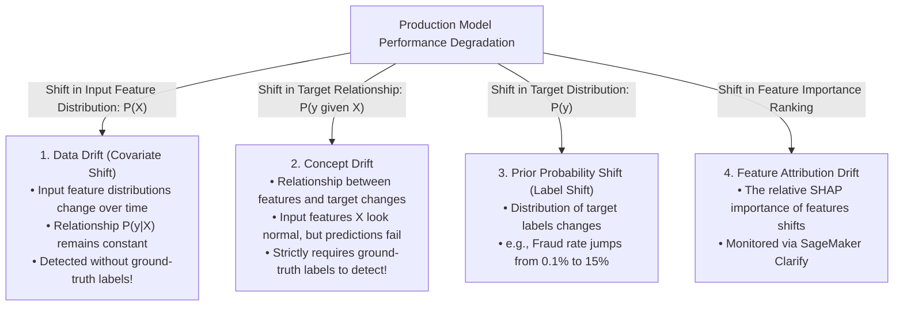

# Data Drift vs. Concept Drift Architecture Cheat Sheet (MLA-C01)

> **Track:** AWS Certified Machine Learning Engineer - Associate (MLA-C01)  
> **Topic:** Model Monitoring, Drift Detection & Automated Retraining Triggers

---

## 🧭 Executive Drift Taxonomy

In production ML systems, model accuracy decays over time. Understanding the exact statistical nature of the decay dictates the correct monitoring and retraining remedy.

---

## 📊 Comprehensive Drift Comparison Matrix

| Drift Dimension | Mathematical Formulation | Real-World Scenario | Detection Methodology in AWS | Remediation Strategy |
|---|---|---|---|---|
| **Data Drift (Covariate Shift)** | P(X) changes, P(y‖X) constant | A real estate model was trained on suburban homes, but the company begins advertising heavily in urban high-rises. | **SageMaker Model Monitor (Data Quality)** comparing captured inference inputs against baseline `statistics.json` and `constraints.json`. | Collect representative data from new distributions, augment training set, and retrain model. |
| **Concept Drift** | P(y‖X) changes, P(X) constant | Macroeconomic interest rates spike from 2% to 8%. The same applicant profile (same income and debt) now defaults at twice the historical rate. | **SageMaker Model Monitor (Model Quality)** comparing inference predictions against ground-truth labels uploaded to S3. | Update target labels, retrain model on recent temporal split, adjust feature weights, or update model architecture. |
| **Prior Probability Shift** | P(y) changes, P(X‖y) constant | During a cyberattack, the proportion of fraudulent login attempts jumps from 0.05% to 25%. | Analyzing prediction distribution histograms in Model Monitor. | Adjust decision thresholds or apply sample re-weighting during training. |
| **Feature Attribution Drift** | Feature SHAP values $\Delta \phi_i$ exceed threshold | A credit model previously relied heavily on "Years at Job", but now decisions are driven almost entirely by "Recent Revolving Balance". | **SageMaker Model Monitor (Feature Attribution)** using KernelSHAP baseline comparisons. | Audit business logic, investigate upstream data pipeline integrity, verify regulatory explainability. |

---

## ⚡ High-Yield Exam Traps & Distinctions

1. **Ground Truth Dependency Rule:**
   - **Data Quality Monitoring:** Does **NOT** require ground truth. Operates exclusively on incoming request payloads $X$. Can detect null values, out-of-bounds values, and statistical distribution shifts immediately in real time.
   - **Model Quality Monitoring:** **STRICTLY REQUIRES** ground truth labels $y$. You cannot calculate Precision, Recall, F1, or MAE without knowing the true real-world outcome.
2. **Delayed Ground Truth Latency:**
   - In many enterprise applications (e.g., 30-year mortgage defaults or customer 12-month churn), ground truth labels arrive months after the initial inference. In these environments, **Data Drift Monitoring acts as the leading early-warning indicator** of model degradation before ground truth arrives.
3. **Statistical Tests Used by Model Monitor:**
   - **Kolmogorov-Smirnov (KS) Test:** Non-parametric statistical test used for continuous numerical features to determine if two 1D distributions differ significantly.
   - **L-Infinity Distance / Chi-Square Test:** Used for categorical features to measure differences in category frequencies between baseline and live traffic.
4. **Automated Retraining Architecture Pattern:**
   - Model Monitor emits metrics to CloudWatch → CloudWatch Alarm triggers on `feature_baseline_drift > threshold` → Alarm state change routes to **Amazon EventBridge** → EventBridge triggers **AWS Step Functions** or **SageMaker Pipelines** to run automated preprocessing, retraining, evaluation, and registration!
