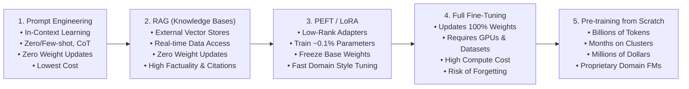

# Model Customization & PEFT/LoRA Mechanics Architecture Cheat Sheet (MLA-C01)

> **Track:** AWS Certified Machine Learning Engineer - Associate (MLA-C01)  
> **Topic:** Foundation Model Adaptation Spectrum (Prompt vs RAG vs PEFT/LoRA vs Full Fine-Tuning)

---

## 🧭 Executive Customization Spectrum

---

## 📊 Comprehensive Customization Decision Matrix

| Dimension | Prompt Engineering | RAG (Knowledge Bases) | PEFT / LoRA (Fine-Tuning) | Full Fine-Tuning | Continued Pre-training |
|---|---|---|---|---|---|
| **Weight Modification** | None (0%) | None (0%) | **~0.1% to 1% (Adapter layers)** | 100% of weights | 100% of weights |
| **Primary Goal** | Guiding output format, persona, instructions | Injecting dynamic, external factual knowledge with citations | Teaching specialized task style, tone, domain terminology | Fundamental task adaptation across wide behaviors | Ingesting massive unannotated domain-specific vocabulary |
| **Compute Cost** | Inference-only token cost | Embedding + Vector search query cost | Moderate (Hours on single GPU) | High (Days on multi-GPU cluster) | Very High (Weeks on multi-node clusters) |
| **Data Requirements** | Instructions + 2–5 examples | Unstructured documents (PDF, DOCX) in S3 | **Hundreds to thousands of prompt-response pairs** | Tens of thousands of instruction pairs | Millions/billions of raw text tokens |
| **Catastrophic Forgetting Risk** | Zero | Zero | **Zero (Base model is frozen)** | **High Risk** | Moderate Risk |
| **Real-Time Data Updates** | Yes (via prompt) | **Yes (Sync S3 data source)** | No (Requires retraining) | No (Requires retraining) | No (Requires retraining) |

---

## 🔬 Mathematical Deep Dive: Low-Rank Adaptation (LoRA)

### 1. The Core Formulation
In standard full fine-tuning, the updated weight matrix is:

$$
W = W_0 + \Delta W, \quad \text{where } W_0, \Delta W \in \mathbb{R}^{d \times k}
$$

Because $d$ and $k$ are large (e.g., d = 4096, k = 4096 ⇒ 16.7 million weights per matrix), updating ΔW across dozens of transformer layers consumes massive VRAM to store optimizer states (AdamW requires 8 bytes per parameter).

### 2. Low-Rank Decomposition
LoRA hypothesizes that the weight updates during task adaptation have a **low intrinsic rank**. It decomposes ΔW into the product of two low-rank matrices:

$$
\Delta W = B \times A, \quad \text{where } B \in \mathbb{R}^{d \times r}, A \in \mathbb{R}^{r \times k}, \text{ with rank } r \ll \min(d, k)
$$

- **Initialization:** Matrix $A$ is initialized from a Gaussian distribution $\mathcal{N}(0, \sigma^2)$, and Matrix $B$ is initialized to $0$. Therefore, at the start of training:

  $$
  \Delta W = B \times A = 0 \times A = 0
  $$

  The model begins with exactly the pre-trained base model behavior!
- **Scaling Factor:** The forward pass computes:

  $$
  h = W_0 x + \Delta W x = W_0 x + \frac{\alpha}{r} (B A) x
  $$

  where α is a constant scaling hyperparameter (typically α = 2 × r).

---

## ⚡ High-Yield Exam Traps & Distinctions

1. **RAG vs Fine-Tuning for Hallucinations:**
   - **Fine-tuning does NOT reliably eliminate hallucinations.** Fine-tuned models still generate fluent, plausible-sounding false information because they lack explicit source citations.
   - **RAG is the primary architectural pattern to eliminate hallucinations and enforce factuality**, because answers are grounded directly in retrieved context chunks accompanied by source URLs.
2. **LoRA Adapter Portability:**
   - Because base weights W₀ remain untouched, a single base model (e.g., Llama 3 8B) loaded in GPU memory can serve:
     - Tenant A using Adapter A (Legal extraction, 25 MB).
     - Tenant B using Adapter B (Medical summary, 25 MB).
     - Tenant C using Adapter C (Code generation, 25 MB).
3. **Quantized LoRA (QLoRA):**
   - Compresses the frozen base model weights W₀ to **4-bit precision (NF4 - NormalFloat4)** while keeping LoRA adapter matrices in 16-bit Brain Floating Point (BF16). Enables fine-tuning a 70B parameter model on a single 48 GB GPU instance (like an AWS `g5.12xlarge`).
