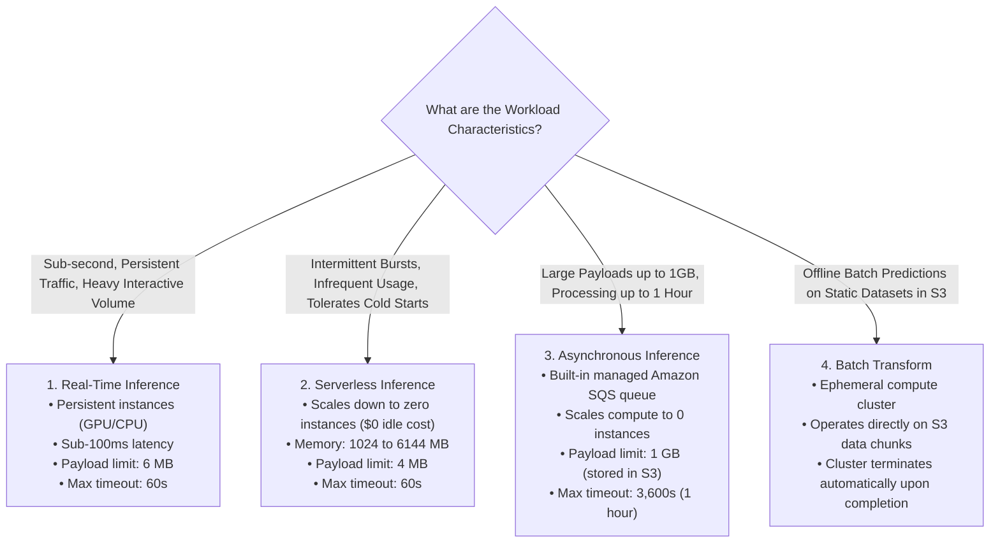

# SageMaker Inference Options Architecture Comparison (MLA-C01)

> **Track:** AWS Certified Machine Learning Engineer - Associate (MLA-C01)  
> **Topic:** Production Inference Hosting & Deployment Options

---

## 🧭 Executive Decision Framework

---

## 📊 Comprehensive Comparison Matrix

| Deployment Type | Latency Profile | Max Payload Limit | Max Request Timeout | Scales to 0 Instances? | Billing Model | Typical MLA-C01 Scenario |
|---|---|---|---|---|---|---|
| **Real-Time Inference** | **Sub-second (ms)** | 6 MB | 60 seconds | No (Min instance = 1) | Hourly instance rate 24/7 | High-volume fraud detection, real-time user recommendations, search ranking. |
| **Serverless Inference** | Low ms (+ cold start) | 4 MB | 60 seconds | **Yes ($0 when idle)** | Per-millisecond compute + data processed | Internal document processing tool used sporadically during business hours. |
| **Asynchronous Inference** | Minutes to 1 hour | **1 GB** | **3,600 seconds (1 hr)** | **Yes ($0 when queue is empty)** | Hourly instance rate when queue has work | Large video segmentation, high-resolution medical imaging, transcription pipelines. |
| **Batch Transform** | Hours (Offline) | **Petabytes (S3)** | Unlimited | **Yes (Terminates on completion)** | Billed only for exact duration of batch job | Monthly customer churn scoring across 50 million records; catalog embedding generation. |

---

## ⚙️ Advanced Endpoint Hosting Patterns

### 1. Multi-Model Endpoints (MME)
- **Problem:** Hosting 1,000 personalized customer models on individual real-time endpoints requires at least 1,000 instances, resulting in prohibitive infrastructure costs.
- **Solution:** A **Multi-Model Endpoint (MME)** hosts multiple models on a single shared container fleet.
- **Mechanics:** Models are stored in an S3 bucket. SageMaker dynamically downloads the model into container memory upon invocation and unloads it via LRU (Least Recently Used) cache when memory pressure occurs.
- **Cost Impact:** Slashes hosting costs by up to **90%** for applications with a long tail of infrequently accessed models.

### 2. Multi-Container Endpoints (MCE)
- **Problem:** A production pipeline requires serial preprocessing (e.g., Scikit-Learn feature scaling) followed by inference (e.g., PyTorch deep network) followed by postprocessing.
- **Solution:** An **Inference Pipeline (Serial Multi-Container Endpoint)** chains 2 to 15 containers co-located on the same instance, passing data between containers in-memory over high-speed localhost without writing intermediate results to S3.

---

## ⚡ High-Yield Exam Traps & Distinctions

1. **Cold Start Latency:** Serverless inference instances scale to 0 when idle. The first request after an idle period incurs a **cold start latency penalty** (seconds) while the container image is loaded. Do NOT recommend Serverless for mission-critical sub-100ms real-time trading or fraud APIs.
2. **Payload Ceiling Workaround:** When an incoming client request exceeds the 6 MB Real-Time payload limit, do NOT attempt to increase API Gateway limits. The correct architectural solution is **SageMaker Asynchronous Inference**, which accepts S3 pointers to 1 GB files.
3. **Shadow Endpoints (Testing in Production):**
   - **Canary / Blue-Green:** Traffic is shifted incrementally (e.g., 10% to new variant, 90% to current).
   - **Shadow Deployment:** 100% of live traffic is routed to the production model AND duplicated in the background to the shadow model without returning the shadow prediction to the user. Evaluates performance, latency, and error rates under real production load with zero user risk.
