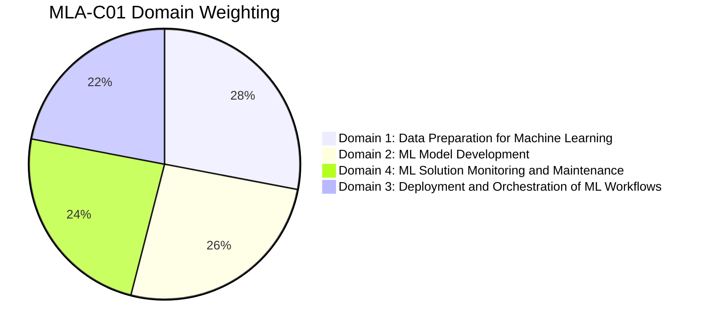

# AWS Certified Machine Learning Engineer - Associate (MLA-C01) Training Suite

> **Exam Code:** `MLA-C01`  
> **Level:** Associate (Machine Learning Engineering & Generative AI)  
> **Passing Score:** `720 / 1000` (Scaled scoring)  
> **Questions:** 65 scenario-based questions, 130 minutes.  
>
> 🚀 **New to MLA-C01? Start Here:** [**Student Study Dashboard & MLOps Roadmap**](./00_START_HERE.md)

---

## 📂 Pedagogical Phase Architecture (12 Steps)

```
AI/Associate/MLA-C01/
├── 01_Syllabus/             # Official blueprint, domain weighting, MLOps competencies
├── 02_Prerequisites/          # Linear algebra, calculus, statistics, Python & PyTorch foundations
├── 03_Lectures/               # Instructor delivery lesson plans and classroom talking points
├── 04_Slides/                 # Marp slide decks for classroom delivery
├── 05_Diagrams/               # Standalone production MLOps & GenAI pipeline blueprints
├── 06_Explanations/           # In-depth architectural mechanics & trade-off breakdowns
├── 07_Hands_On_Labs/                   # Guided engineering labs (SageMaker, Bedrock, Clarify) with CLI runbooks
├── 08_Tutorials/              # Production multi-service MLOps build tutorials
├── 09_Notes_and_Cheatsheets/                  # High-yield engineering cheat sheets (Inference types, drift, PEFT)
├── 10_Knowledge_Checks/       # Rapid diagnostic retention quizzes per domain
├── 11_Practice_Exams/     # Curated scenario questions + 106Q Community Practice Pool
└── 12_Sources/                # Academic references, whitepapers, documentation indexes
```

---

## 🎯 Exam Domains & Weightings



1. **[Domain 1: Data Preparation for Machine Learning (28%)](01_Syllabus/MLA-C01_Official_Blueprint.md#domain-1-data-preparation-for-machine-learning-28):** Ingestion pipelines (Glue, Kinesis, EMR), feature engineering, handling data imbalances, chunking & vector embeddings.
2. **[Domain 2: ML Model Development (26%)](01_Syllabus/MLA-C01_Official_Blueprint.md#domain-2-ml-model-development-26):** Algorithm selection (tabular, CV, NLP), foundation model adaptation (PEFT/LoRA, Continued Pre-training), hyperparameter tuning (HPO), model evaluation.
3. **[Domain 3: Deployment and Orchestration of ML Workflows (22%)](01_Syllabus/MLA-C01_Official_Blueprint.md#domain-3-deployment-and-orchestration-of-ml-workflows-22):** SageMaker 4 inference deployment types (Real-Time, Serverless, Async, Batch Transform), SageMaker Pipelines CI/CD, container packaging.
4. **[Domain 4: ML Solution Monitoring and Maintenance (24%)](01_Syllabus/MLA-C01_Official_Blueprint.md#domain-4-ml-solution-monitoring-and-maintenance-24):** Detecting data & concept drift (Model Monitor), bias detection and explainability (Clarify / SHAP), model cards, safety guardrails, cost management.

---

## 🛠️ Interactive Tools

- **CLI Revision Engine:** Run interactive drills, practice pools, and simulated exams:
  ```bash
  # Practice by domain
  python3 scripts/aws_revision_runner.py --cert MLA --mode practice --domain 2

  # Practice authentic Community Practice Pool (106 questions)
  python3 scripts/aws_revision_runner.py --cert MLA --community --mode practice -n 15 --tricks

  # Timed 65-question mock exam
  python3 scripts/aws_revision_runner.py --cert MLA --mode mock
  ```
- **Integrity Validation:** Run test suite across repositories:
  ```bash
  python3 tests/verify_ecosystem_integrity.py
  ```
