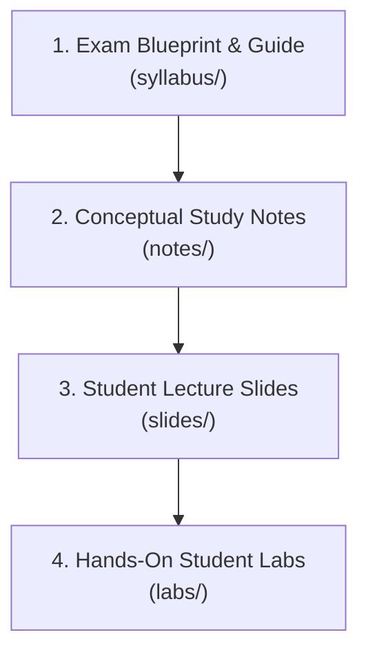

# AWS AI Foundation: AIF-C01 Course Portal

> **Domain / Track:** AI / Foundation  
> **Exam Code:** `AIF-C01` (AWS Certified AI Practitioner)  
> **Course Author & Lead Trainer:** Mohamed Fakhruldeen  
> **Repository Path:** `AI/Foundation/AIF-C01/`  
> **Version:** 1.5.0

---

## 🎯 Course Overview & Learning Architecture

The AI Foundation (AIF-C01) curriculum equips learners with foundational machine learning, generative AI, foundation model deployment, and responsible AI governance skills centered around Amazon Bedrock and Amazon SageMaker AI:



---

## 📁 Directory Structure

```text
AI/Foundation/AIF-C01/
├── README.md                                  <-- Course Portal (This File)
│
├── syllabus/                                  <-- Official Blueprint & Course Syllabus
│   ├── AIF-C01_Course_Syllabus.md
│   └── AIF-C01_Exam_Guide_and_Blueprint.md
│
├── prerequisites/                             <-- Machine Learning & Data Science Foundations
│   ├── README.md                              (Prerequisites overview)
│   ├── 01_Machine_Learning_Fundamentals.md    (Supervised/Unsupervised, Metrics, Overfitting)
│   └── 02_Generative_AI_and_Transformers.md   (Attention, Tokens, Context Windows, Embeddings)
│
├── lectures/                                  <-- Instructor Delivery Guides & Lesson Plans
│   ├── README.md                              (Lecture delivery catalog)
│   ├── Lecture_01_AI_ML_Fundamentals_and_AWS_Ecosystem.md
│   ├── Lecture_02_Generative_AI_and_Amazon_Bedrock.md
│   ├── Lecture_03_Prompt_Engineering_and_RAG_Architecture.md
│   └── Lecture_04_Responsible_AI_and_Model_Governance.md
│
├── slides/                                    <-- Student Lecture Decks (Marp Format)
│   ├── Module_01_AI_and_GenAI_Foundations_Slides.md
│   └── Module_02_Amazon_Bedrock_and_RAG_Slides.md
│
├── notes/                                     <-- Atomic Study Notes & Exam Cheat Sheets
│   ├── 01_GenAI_Fundamentals.md
│   ├── 02_Prompt_Engineering_Guide.md
│   ├── 03_Amazon_Bedrock_and_RAG.md
│   ├── 04_Amazon_SageMaker_Suite.md
│   ├── 05_Responsible_AI_and_Governance.md
│   └── 06_AIF-C01_Exam_CheatSheet.md
│
├── labs/                                      <-- Hands-On Student Lab Manuals
│   ├── Lab_01_Amazon_Bedrock_Playground_and_Prompt_Engineering.md
│   ├── Lab_02_Building_RAG_with_Bedrock_Knowledge_Bases.md
│   └── Lab_03_Responsible_AI_Bedrock_Guardrails.md
│
├── revision_questions/                        <-- Curated Student Revision Question Sets
│   ├── README.md                              (Revision questions index)
│   └── AIF_C01_Domains_1_to_5_Revision_Questions.md
│
└── knowledge_checks/                          <-- End-of-Module Diagnostic Quizzes
    ├── README.md                              (Knowledge checks catalog)
    ├── Module_01_AI_Foundations_Knowledge_Check.md
    ├── Module_02_Bedrock_and_RAG_Knowledge_Check.md
    └── Module_03_Responsible_AI_Knowledge_Check.md
```

---

## 🧭 Exam Blueprint Alignment (5 Domains)

| Domain | Domain Title | Exam Weight | Core Services Covered | Hands-On Student Lab |
|:---:|:---|:---:|:---|:---|
| **Domain 1** | Fundamentals of AI and ML | **20%** | SageMaker Studio, Canvas, Data Wrangler, Ground Truth, 4 Deployment Modes | [Lab 1: Bedrock Playgrounds](./labs/Lab_01_Amazon_Bedrock_Playground_and_Prompt_Engineering.md) |
| **Domain 2** | Fundamentals of Generative AI | **24%** | Foundation Models, Tokens, Context Window, Embeddings, Inference Tuning | [Lab 1: Prompt Engineering](./labs/Lab_01_Amazon_Bedrock_Playground_and_Prompt_Engineering.md) |
| **Domain 3** | Applications of Foundation Models | **28%** | Amazon Bedrock, Knowledge Bases (RAG), Agents, Prompt Flows, Amazon Q | [Lab 2: Bedrock RAG KB](./labs/Lab_02_Building_RAG_with_Bedrock_Knowledge_Bases.md) |
| **Domain 4** | Guidelines for Responsible AI | **14%** | SageMaker Clarify (Bias & SHAP), Bedrock Guardrails, Model Cards | [Lab 3: Bedrock Guardrails](./labs/Lab_03_Responsible_AI_Bedrock_Guardrails.md) |
| **Domain 5** | Security, Compliance, and Governance | **14%** | Bedrock Data Privacy, KMS encryption, PrivateLink, CloudTrail, Invocation Logs | [Lab 3: PII Masking](./labs/Lab_03_Responsible_AI_Bedrock_Guardrails.md) |
