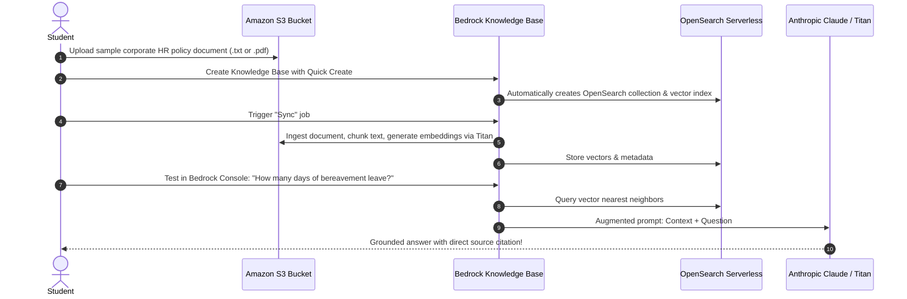

# Lab 02: Building a RAG Chatbot with Amazon Bedrock Knowledge Bases

> **Course:** AWS Certified AI Practitioner (AIF-C01) Track  
> **Module:** Module 2: Amazon Bedrock & RAG Architecture  
> **Estimated Duration:** 60 minutes  
> **AWS Services Used:** Amazon S3, Amazon Bedrock Knowledge Bases, Titan Embeddings V2, OpenSearch Serverless, Anthropic Claude  
> **AWS Region:** `us-east-1` (N. Virginia) or `us-west-2` (Oregon)

---

## Lab Architecture Overview



---

## Step 1: Create Sample Enterprise Policy Document

1. On your local machine or text editor, create a file named `company_hr_policy_2026.txt` with the following content:
   ```text
   Acme Global Innovations - Employee Handbook 2026
   
   1. Remote Work Policy:
   Employees in engineering and cloud architecture roles are eligible for 100% remote work within their country of residence. Employees working remotely receive a one-time equipment stipend of $1,500 USD upon hire and an annual internet reimbursement of $600 USD.
   
   2. Leave and Time Off:
   All full-time employees receive 25 days of Paid Time Off (PTO) annually, accrued monthly. 
   Bereavement leave is granted up to 10 consecutive paid business days for immediate family members.
   Parental leave provides 16 weeks of fully paid leave for all new parents (birth, adoption, or foster placement).
   
   3. Continuing Education and Certification Reimbursement:
   Acme Global reimburses 100% of exam fees for approved industry certifications, including AWS Certified Cloud Practitioner (CLF-C02) and AWS Certified AI Practitioner (AIF-C01). Upon passing an AWS certification, employees receive a one-time recognition bonus of $500 USD.
   ```
2. Save the file.

---

## Step 2: Upload Document to Amazon S3

1. In the AWS Management Console, navigate to **Amazon S3**.
2. Click **Create bucket**.
3. Set **Bucket name** to a globally unique name (e.g., `acme-hr-knowledge-base-yourname-2026`).
4. Keep all default settings (Keep **Block all public access** enabled). Click **Create bucket**.
5. Click on your newly created bucket and click **Upload**.
6. Upload `company_hr_policy_2026.txt`.

---

## Step 3: Create the Bedrock Knowledge Base

1. Navigate to **Amazon Bedrock**.
2. In the left navigation pane, under **Builder tools**, click **Knowledge bases**.
3. Click **Create knowledge base**.
4. **Step 1: Provide knowledge base details:**
   * Knowledge base name: `acme-hr-kb`.
   * IAM Permissions: Select **Create and use a new service role**.
   * Click **Next**.
5. **Step 2: Set up data source:**
   * Data source name: `acme-hr-docs`.
   * S3 URI: Click **Browse S3** and select your bucket `s3://acme-hr-knowledge-base-yourname-2026/`.
   * Advanced chunking settings: Keep default **Default chunking** (300 tokens, 20% overlap).
   * Click **Next**.
6. **Step 3: Select embeddings model and vector store:**
   * Embeddings model: Select **Titan Text Embeddings V2**.
   * Vector store: Select **Quick create a new vector store - Recommended** (Amazon OpenSearch Serverless).
   * Click **Next**.
7. **Step 4: Review and create:**
   * Review configuration and click **Create knowledge base**.
   * *Note:* OpenSearch Serverless collection provisioning takes 2–3 minutes.

---

## Step 4: Sync Data Source & Test Queries

1. Once the Knowledge Base status displays **Ready**, locate the **Data source** section and click **Sync**.
2. Wait for the status to show **Complete**.
3. On the right side of the screen, find the **Test knowledge base** panel.
4. Click **Select model**. Choose **Anthropic** $\rightarrow$ **Claude 3 Haiku** (or **Amazon** $\rightarrow$ **Titan Text G1 - Express**). Click **Apply**.
5. Submit the test query:
   ```text
   What is the bonus for passing the AWS Certified AI Practitioner exam?
   ```
6. Observe the response:
   * The model responds with: *"Employees receive a one-time recognition bonus of $500 USD upon passing an AWS certification such as the AWS Certified AI Practitioner."*
   * Click on the **Footnote / Citation** link. Notice that Bedrock displays the exact source chunk extracted from `company_hr_policy_2026.txt`!
7. Try an out-of-context query:
   ```text
   What is the company stock ticker symbol?
   ```
8. The model accurately notes that the provided context contains no information about the company's stock ticker symbol, demonstrating **zero hallucination**.

---

## Step 5: Clean Up Resources (Important for Cost Management)

1. In the Bedrock console, click **Knowledge bases**, select `acme-hr-kb`, and click **Delete**.
2. Navigate to **Amazon OpenSearch Service** $\rightarrow$ **Serverless collections**. Select the auto-generated collection (named `bedrock-sample-...` or similar) and click **Delete**.
3. Navigate to **Amazon S3**, empty your bucket `acme-hr-knowledge-base-yourname-2026`, and delete the bucket.
