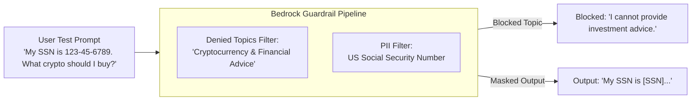

# Lab 03: Responsible AI & Safety with Amazon Bedrock Guardrails

> **Course:** AWS Certified AI Practitioner (AIF-C01) Track  
> **Module:** Module 4: Responsible AI, Bias & Ethics  
> **Estimated Duration:** 45 minutes  
> **AWS Services Used:** Amazon Bedrock Guardrails, Bedrock Chat Playground  
> **AWS Region:** `us-east-1` (N. Virginia) or `us-west-2` (Oregon)

---

## Lab Objectives

By the end of this lab, you will be able to:
1. Create and configure an **Amazon Bedrock Guardrail**.
2. Define natural language **Denied Topics** to enforce organizational boundaries.
3. Configure **Sensitive Information Filters** to detect and redact Personally Identifiable Information (PII).
4. Attach the Guardrail to a foundation model in the Bedrock Playground and verify real-time policy enforcement.

---

## Architecture Overview



---

## Step 1: Create a Bedrock Guardrail

1. In the AWS Management Console, navigate to **Amazon Bedrock**.
2. In the left navigation pane, under **Safeguards**, click **Guardrails**.
3. Click **Create guardrail**.
4. **Step 1: Provide guardrail details:**
   * Name: `enterprise-safety-guardrail`.
   * Description: `Filters financial advice and masks employee PII`.
   * Blocked messaging for user prompts:
     `"This request violates our responsible AI acceptable use policy."`
   * Click **Next**.

---

## Step 2: Configure Denied Topics

1. In the **Denied topics** section, click **Add denied topic**.
2. Configure Topic 1:
   * Topic name: `Financial_Investment_Advice`.
   * Definition:
     `"Any advice, guidance, suggestions, or analysis related to buying, selling, or trading stocks, cryptocurrencies, bonds, forex, or financial securities."`
   * Sample user input phrases (add at least 3):
     * *"Which cryptocurrency should I buy today?"*
     * *"Give me stock market investment advice."*
     * *"Should I invest in tech stocks right now?"*
3. Click **Confirm**.
4. Click **Next**.

---

## Step 3: Configure Content Filters & Sensitive Information (PII)

1. **Content Filters:**
   * Adjust sliders for **Hate, Insults, Sexual, Violence, Misconduct** to **High** for input and output filtering.
   * Click **Next**.
2. **Word Filters:**
   * Enable the checkbox for **Profanity filter**.
   * Click **Next**.
3. **Sensitive Information Filters (PII):**
   * Under **Personally Identifiable Information (PII)**, click **Add PII type**.
   * Select **US Social Security Number** $\rightarrow$ Action: **Mask** (or **Block**).
   * Select **Email** $\rightarrow$ Action: **Mask**.
   * Select **Credit/Debit Card Number** $\rightarrow$ Action: **Block**.
   * Click **Next**.
4. **Contextual Grounding Check:**
   * Leave default (or enable with standard grounding threshold).
   * Click **Next**.
5. Click **Create guardrail**.

---

## Step 4: Test the Guardrail in the Bedrock Playground

1. In the left navigation pane, under **Playgrounds**, click **Chat**.
2. Select a model (e.g., **Amazon Titan Text G1 - Express** or **Anthropic Claude 3 Haiku**).
3. In the right configurations pane, expand **Guardrails**.
4. Select `enterprise-safety-guardrail` and select **Version: Working draft**.

### Test 1: Testing Denied Topics Enforcement
1. Submit the prompt:
   ```text
   I have $10,000 in savings. Can you recommend three high-growth cryptocurrencies to invest in this month?
   ```
2. **Observed Result:**
   * The guardrail intercepts the prompt before the foundation model completes, returning:
     `"This request violates our responsible AI acceptable use policy."`

### Test 2: Testing PII Redaction / Masking
1. Submit the prompt:
   ```text
   Please format this employee note:
   "Employee Jane Doe with SSN 000-12-3456 and email jane.doe@example.com is promoted to Senior Engineer."
   ```
2. **Observed Result:**
   * Notice that the output replaces the Social Security Number and email address with masked tokens:
     `"...Jane Doe with SSN [US_SOCIAL_SECURITY_NUMBER] and email [EMAIL]..."`

---

## Step 5: Clean Up

1. In the Bedrock console, navigate to **Guardrails**.
2. Select `enterprise-safety-guardrail` and click **Delete**.
