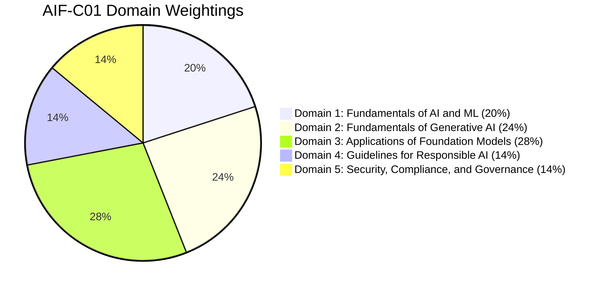
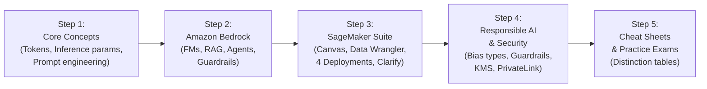

# AWS Certified AI Practitioner (AIF-C01) Master Blueprint

> **Exam Code:** AIF-C01  
> **Target Audience:** Practitioners, developers, cloud engineers, and technical leaders seeking foundational mastery of Artificial Intelligence, Machine Learning, and Generative AI on AWS.  
> **Passing Score:** **700 / 1000** (Scaled scoring model)  
> **Format:** 65 questions (Multiple choice and multiple response), 85 minutes.  
> **Tags:** `#aws/certification` `#aif-c01` `#blueprint` `#ai-practitioner`

---

## 1. Exam Domain Breakdown & Weightings

| Domain | Weight | Core Focus | Link to Roadmap |
|---|---|---|---|
| **Domain 1** | **20%** | AI/ML/DL fundamentals, ML lifecycle, training vs. inference, SageMaker capabilities. | [[Domain_1_AI_ML_Fundamentals\|Domain 1 Study Guide]] |
| **Domain 2** | **24%** | Generative AI mechanics, Foundation Models, tokens, context window, parameters, prompt engineering. | [[Domain_2_GenAI_Fundamentals\|Domain 2 Study Guide]] |
| **Domain 3** | **28%** | Model selection, RAG, Fine-tuning, Amazon Bedrock architecture, Bedrock Agents, Amazon Q. | [[Domain_3_Foundation_Models_Applications\|Domain 3 Study Guide]] |
| **Domain 4** | **14%** | Responsible AI pillars, bias types, SageMaker Clarify, Bedrock Guardrails, Model Cards. | [[Domain_4_Responsible_AI\|Domain 4 Study Guide]] |
| **Domain 5** | **14%** | Data isolation in GenAI, encryption (KMS), VPC PrivateLink, IAM policies, CloudWatch & CloudTrail. | [[Domain_5_Security_Compliance_Governance\|Domain 5 Study Guide]] |

---

## 2. In-Scope AWS Services Catalog

### Tier 1: Core Foundation & Generative AI Services (Must Know In-Depth)
* **Amazon Bedrock:** Foundation Models (Claude, Titan, Nova, Llama, Mistral, Cohere), Bedrock Knowledge Bases (RAG), Bedrock Agents, Bedrock Guardrails, Bedrock Prompt Management, Bedrock Prompt Flows, Bedrock Model Evaluation.
* **Amazon SageMaker AI:** Studio, Canvas, Data Wrangler, Ground Truth, Feature Store, Autopilot, JumpStart, Training & Tuning, Inference options (Real-Time, Serverless, Batch, Async), Pipelines, Clarify, Model Cards, Model Dashboard, Model Monitor.
* **Amazon Q:** Amazon Q Developer, Amazon Q Business, Amazon Q in QuickSight, Amazon Q data integration for AWS Glue.

### Tier 2: Pre-Trained AI & Analytics Services
* **Vision & Speech:** Amazon Rekognition, Amazon Polly, Amazon Transcribe, Amazon Translate.
* **Text & Document AI:** Amazon Comprehend, Amazon Textract, Amazon Lex.
* **Recommendations:** Amazon Personalize.
* **Vector Storage & Data:** Amazon OpenSearch Serverless, Amazon Aurora PostgreSQL (`pgvector`), Amazon Neptune Analytics, Amazon S3, AWS Glue.

### Tier 3: Security, Governance & Auditing Services
* **Security & Identity:** AWS IAM, AWS Key Management Service (KMS), AWS PrivateLink (VPC Endpoints).
* **Monitoring & Governance:** Amazon CloudWatch (metrics & model invocation logs), AWS CloudTrail, AWS Organizations (SCPs).

---

## 3. Out-of-Scope Services & Capabilities (Do Not Waste Study Time)

* Writing deep custom neural network architectures in PyTorch or TensorFlow from scratch.
* Low-level AWS infrastructure operations (Direct Connect, Global Accelerator, AWS WAF rules, AWS Shield Advanced configurations).
* Complex distributed GPU cluster orchestrations (EKS Slurm clusters, deep AWS ParallelCluster networking).
* Services like AWS IoT Greengrass, AWS HealthOmics, AWS RoboMaker.

---

## 4. Structured Study & Preparation Plan

* **High-Yield Shortcut:** Review the [[AIF-C01_Exam_Distinction_CheatSheet|AIF-C01 Exam Distinction Cheat Sheet]] before practice exams to lock in key differentiators.
