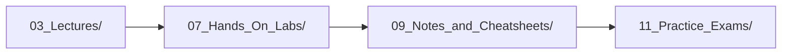

# 🤖 AWS Certified AI Practitioner (AIF-C01) — Student Dashboard

> **Target Exam:** AWS Certified AI Practitioner (`AIF-C01`)  
> **Passing Score:** `700 / 1000` (Scaled Scoring)  
> **Exam Format:** 65 Questions | 90 Minutes  
> **Course Mission:** Master Artificial Intelligence, Machine Learning lifecycles, Generative AI architecture, Amazon Bedrock, Prompt Engineering, and Responsible AI Governance.

---

## 🧭 Your Study Roadmap

---

## ⚡ Recommended 10-Day Study Schedule

| Day | Focus Area | 📖 Study Materials | 💻 Practice Command |
|:---:|:---|:---|:---|
| **Day 1-2** | **Domain 1: Fundamentals of AI & ML (20%)** | [Lecture 01](./03_Lectures/Lecture_01_AI_ML_Fundamentals_and_Terminology.md) | `python3 scripts/aws_revision_runner.py --cert AIF --mode practice --domain 1 -n 15 --tricks` |
| **Day 3-4** | **Domain 2: Generative AI Fundamentals (24%)** | [Lecture 02](./03_Lectures/Lecture_02_Generative_AI_and_Foundation_Models.md) [Lab 01: Prompt Engineering](./07_Hands_On_Labs/Lab_01_Amazon_Bedrock_Playground_and_Prompt_Engineering.md) | `python3 scripts/aws_revision_runner.py --cert AIF --mode practice --domain 2 -n 15 --tricks` |
| **Day 5-6** | **Domain 3: Applications of FMs (28%)** | [Lecture 03](./03_Lectures/Lecture_03_Applications_of_Foundation_Models_and_Bedrock.md) [Lab 02: Bedrock RAG KB](./07_Hands_On_Labs/Lab_02_Building_RAG_with_Bedrock_Knowledge_Bases.md) | `python3 scripts/aws_revision_runner.py --cert AIF --mode practice --domain 3 -n 20 --tricks` |
| **Day 7-8** | **Domain 4 & 5: Responsible AI & Security (28%)** | [Lecture 04](./03_Lectures/Lecture_04_Responsible_AI_Guidelines.md) [Lab 03: Bedrock Guardrails](./07_Hands_On_Labs/Lab_03_Responsible_AI_Bedrock_Guardrails.md) | `python3 scripts/aws_revision_runner.py --cert AIF --mode practice --domain 4 -n 15 --tricks` `python3 scripts/aws_revision_runner.py --cert AIF --mode practice --domain 5 -n 15 --tricks` |
| **Day 9-10**| **233Q Community Pool & Timed Mocks** | [Prompt Engineering Guide](./09_Notes_and_Cheatsheets/02_Prompt_Engineering_Guide.md) | `python3 scripts/aws_revision_runner.py --cert AIF --community --mode practice -n 25` `python3 scripts/aws_revision_runner.py --cert AIF --mode mock` |

---

## 🎯 Progress Checklist

- [ ] **Domain 1:** Mastered Supervised vs Unsupervised vs Reinforcement learning
- [ ] **Domain 2:** Completed Lab 01 (Bedrock Playgrounds, Temperature, Top-P, Prompting)
- [ ] **Domain 3:** Completed Lab 02 (Building RAG with Bedrock Knowledge Bases & OpenSearch)
- [ ] **Domain 4:** Completed Lab 03 (Responsible AI, PII Redaction, Bedrock Guardrails)
- [ ] **Domain 5:** Mastered Bedrock Data Privacy, Encryption with KMS, and PrivateLink
- [ ] **233-Question Community Pool:** Drilled 50+ questions with `--community`
- [ ] **Full Timed Mock Simulation:** Scored $\ge 85\%$ on the 65-question timed mock exam (`--mode mock`)
