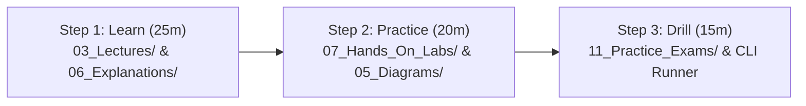
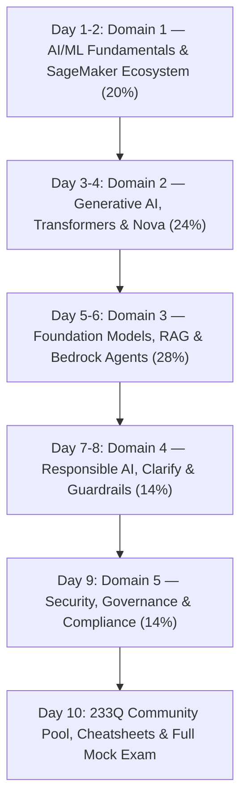

# 🤖 AWS Certified AI Practitioner (AIF-C01) — Student Study Dashboard

> **Target Exam:** AWS Certified AI Practitioner (`AIF-C01`)  
> **Passing Score:** `700 / 1000` (Scaled Scoring)  
> **Exam Format:** 65 Questions | 90 Minutes  
> **Course Mission:** Zero-to-Certified in 1 to 2 Weeks with high-yield concepts, hands-on labs, Amazon Bedrock, Prompt Engineering, Agentic AI, and verified question drills.

---

## 🧭 Your Study Roadmap: The 3-Step Daily Routine

Follow this cycle every day for rapid, stress-free retention:



---

## ⚡ 10-Day Structured Day-by-Day Study Roadmap

Follow the links below **file by file in sequential order**. Check off each item as you complete it:



---

### 📅 Day 1–2: Fundamentals of AI and Machine Learning (Domain 1 — 20%)
*Master core AI vs ML vs DL vs GenAI hierarchy, Supervised vs Unsupervised vs Reinforcement learning, the 5-stage ML lifecycle, Overfitting/Underfitting, the Confusion Matrix, Precision vs Recall, and the Amazon SageMaker predictive suite.*

- [ ] **Step 1 (Orientation):** Read [`01_Syllabus/AIF-C01_Course_Syllabus.md`](./01_Syllabus/AIF-C01_Course_Syllabus.md) & [`01_Syllabus/AIF-C01_Exam_Guide_and_Blueprint.md`](./01_Syllabus/AIF-C01_Exam_Guide_and_Blueprint.md)
- [ ] **Step 2 (Prerequisites):** Study [`02_Prerequisites/01_Machine_Learning_Fundamentals.md`](./02_Prerequisites/01_Machine_Learning_Fundamentals.md)
- [ ] **Step 3 (Core Lecture):** Study [`03_Lectures/Lecture_01_AI_ML_Fundamentals_and_AWS_Ecosystem.md`](./03_Lectures/Lecture_01_AI_ML_Fundamentals_and_AWS_Ecosystem.md)
- [ ] **Step 4 (Slide Deck):** Review [`04_Slides/Module_01_AI_and_GenAI_Foundations_Slides.md`](./04_Slides/Module_01_AI_and_GenAI_Foundations_Slides.md)
- [ ] **Step 5 (Architecture Diagrams):**
  - [ ] [`05_Diagrams/Diagram_01_Traditional_ML_vs_GenAI_Lifecycle.md`](./05_Diagrams/Diagram_01_Traditional_ML_vs_GenAI_Lifecycle.md) (Predictive vs Generative Pipelines)
  - [ ] [`05_Diagrams/Diagram_08_SageMaker_AI_Ecosystem_Canvas_JumpStart_Clarify.md`](./05_Diagrams/Diagram_08_SageMaker_AI_Ecosystem_Canvas_JumpStart_Clarify.md) (SageMaker Ecosystem)
- [ ] **Step 6 (Deep-Dive Guide & MCQ Blueprint):**
  - [ ] [`06_Explanations/01_Domain_1_Fundamentals_of_AI_and_ML.md`](./06_Explanations/01_Domain_1_Fundamentals_of_AI_and_ML.md)
- [ ] **Step 7 (Hands-On Labs & Tutorials):**
  - [ ] [`07_Hands_On_Labs/Lab_06_No_Code_Predictive_ML_with_Amazon_SageMaker_Canvas.md`](./07_Hands_On_Labs/Lab_06_No_Code_Predictive_ML_with_Amazon_SageMaker_Canvas.md)
  - [ ] [`07_Hands_On_Labs/Lab_07_Data_Preparation_and_Feature_Engineering_with_SageMaker_Data_Wrangler.md`](./07_Hands_On_Labs/Lab_07_Data_Preparation_and_Feature_Engineering_with_SageMaker_Data_Wrangler.md)
  - [ ] [`08_Tutorials/Tutorial_05_Complete_Machine_Learning_Lifecycle_with_SageMaker_AI.md`](./08_Tutorials/Tutorial_05_Complete_Machine_Learning_Lifecycle_with_SageMaker_AI.md)
- [ ] **Step 8 (Distinction Tables & Cheatsheets):**
  - [ ] [`09_Notes_and_Cheatsheets/distinctions/03_SageMaker_Deployment_Modes_RealTime_vs_Serverless_vs_Async_vs_Batch.md`](./09_Notes_and_Cheatsheets/distinctions/03_SageMaker_Deployment_Modes_RealTime_vs_Serverless_vs_Async_vs_Batch.md)
  - [ ] [`09_Notes_and_Cheatsheets/distinctions/09_Learning_Paradigms_Supervised_vs_Unsupervised_vs_Reinforcement_Learning.md`](./09_Notes_and_Cheatsheets/distinctions/09_Learning_Paradigms_Supervised_vs_Unsupervised_vs_Reinforcement_Learning.md)
  - [ ] [`09_Notes_and_Cheatsheets/04_Amazon_SageMaker_Suite.md`](./09_Notes_and_Cheatsheets/04_Amazon_SageMaker_Suite.md)
- [ ] **Step 9 (Knowledge Check):** Complete [`10_Knowledge_Checks/Module_01_AI_Foundations_Knowledge_Check.md`](./10_Knowledge_Checks/Module_01_AI_Foundations_Knowledge_Check.md)
- [ ] **Step 10 (Exam Question Drill):**
  - Read [`11_Practice_Exams/Domain_1_AI_ML_Fundamentals_Revision.md`](./11_Practice_Exams/Domain_1_AI_ML_Fundamentals_Revision.md)
  - Run interactive CLI drill:
    ```bash
    python3 scripts/aws_revision_runner.py --cert AIF --mode practice --domain 1 -n 15 --tricks
    ```

---

### 📅 Day 3–4: Fundamentals of Generative AI (Domain 2 — 24%)
*Master the Transformer architecture, scaled dot-product self-attention, token mechanics, context windows, multi-modal foundation models, Amazon Nova, sampling parameters (Temperature, Top-P, Top-K), ROUGE vs BLEU evaluation, and PartyRock.*

- [ ] **Step 1 (Prerequisites):** Study [`02_Prerequisites/02_Generative_AI_and_Transformers.md`](./02_Prerequisites/02_Generative_AI_and_Transformers.md)
- [ ] **Step 2 (Core Lecture):** Study [`03_Lectures/Lecture_02_Generative_AI_and_Amazon_Bedrock.md`](./03_Lectures/Lecture_02_Generative_AI_and_Amazon_Bedrock.md)
- [ ] **Step 3 (Slide Deck):** Review [`04_Slides/Module_02_Amazon_Bedrock_and_RAG_Slides.md`](./04_Slides/Module_02_Amazon_Bedrock_and_RAG_Slides.md)
- [ ] **Step 4 (Architecture Diagrams):**
  - [ ] [`05_Diagrams/Diagram_02_Transformer_Architecture_and_Tokenization.md`](./05_Diagrams/Diagram_02_Transformer_Architecture_and_Tokenization.md) (Self-Attention & Positional Encodings)
  - [ ] [`05_Diagrams/Diagram_03_Amazon_Bedrock_Serverless_Topology_and_Nova_Models.md`](./05_Diagrams/Diagram_03_Amazon_Bedrock_Serverless_Topology_and_Nova_Models.md) (Bedrock & Nova Family)
- [ ] **Step 5 (Deep-Dive Guide & MCQ Blueprint):**
  - [ ] [`06_Explanations/02_Domain_2_Fundamentals_of_Generative_AI.md`](./06_Explanations/02_Domain_2_Fundamentals_of_Generative_AI.md)
- [ ] **Step 6 (Hands-On Labs):**
  - [ ] [`07_Hands_On_Labs/Lab_01_Amazon_Bedrock_Model_Access_Playgrounds_and_Prompt_Engineering.md`](./07_Hands_On_Labs/Lab_01_Amazon_Bedrock_Model_Access_Playgrounds_and_Prompt_Engineering.md)
  - [ ] [`07_Hands_On_Labs/Lab_02_Multi_Modal_Generation_with_Amazon_Nova_and_Titan_Image.md`](./07_Hands_On_Labs/Lab_02_Multi_Modal_Generation_with_Amazon_Nova_and_Titan_Image.md)
- [ ] **Step 7 (Distinction Tables & Cheatsheets):**
  - [ ] [`09_Notes_and_Cheatsheets/distinctions/04_Inference_Parameters_Temperature_vs_TopP_vs_TopK.md`](./09_Notes_and_Cheatsheets/distinctions/04_Inference_Parameters_Temperature_vs_TopP_vs_TopK.md)
  - [ ] [`09_Notes_and_Cheatsheets/distinctions/05_Bedrock_Model_Families_Claude_vs_Titan_vs_Nova_vs_Llama_vs_Mistral.md`](./09_Notes_and_Cheatsheets/distinctions/05_Bedrock_Model_Families_Claude_vs_Titan_vs_Nova_vs_Llama_vs_Mistral.md)
  - [ ] [`09_Notes_and_Cheatsheets/01_GenAI_Fundamentals.md`](./09_Notes_and_Cheatsheets/01_GenAI_Fundamentals.md)
- [ ] **Step 8 (Knowledge Check):** Complete [`10_Knowledge_Checks/Module_02_Generative_AI_and_Nova_Knowledge_Check.md`](./10_Knowledge_Checks/Module_02_Generative_AI_and_Nova_Knowledge_Check.md)
- [ ] **Step 9 (Exam Question Drill):**
  - Read [`11_Practice_Exams/Domain_2_Generative_AI_Fundamentals_Revision.md`](./11_Practice_Exams/Domain_2_Generative_AI_Fundamentals_Revision.md)
  - Run interactive CLI drill:
    ```bash
    python3 scripts/aws_revision_runner.py --cert AIF --mode practice --domain 2 -n 15 --tricks
    ```

---

### 📅 Day 5–6: Applications of Foundation Models, RAG & Agents (Domain 3 — 28%)
*Master Prompt Engineering techniques (Zero-shot, Few-shot, Chain-of-Thought), Retrieval-Augmented Generation (RAG) with Bedrock Knowledge Bases and vector databases, Fine-Tuning and PEFT/LoRA, Autonomous AI Agents with Action Groups, and the Model Context Protocol (MCP).*

- [ ] **Step 1 (Prerequisites):** Study [`02_Prerequisites/03_Agentic_AI_Multi_Agent_Systems_and_Model_Context_Protocol_MCP.md`](./02_Prerequisites/03_Agentic_AI_Multi_Agent_Systems_and_Model_Context_Protocol_MCP.md)
- [ ] **Step 2 (Core Lecture):** Study [`03_Lectures/Lecture_03_Prompt_Engineering_and_RAG_Architecture.md`](./03_Lectures/Lecture_03_Prompt_Engineering_and_RAG_Architecture.md)
- [ ] **Step 3 (Slide Deck):** Review [`04_Slides/Module_03_Applications_of_FMs_RAG_and_Agents_Slides.md`](./04_Slides/Module_03_Applications_of_FMs_RAG_and_Agents_Slides.md)
- [ ] **Step 4 (Architecture Diagrams):**
  - [ ] [`05_Diagrams/Diagram_04_Enterprise_RAG_Ingestion_and_Retrieval_Flow.md`](./05_Diagrams/Diagram_04_Enterprise_RAG_Ingestion_and_Retrieval_Flow.md) (RAG Flow)
  - [ ] [`05_Diagrams/Diagram_05_Agentic_AI_Workflow_and_Model_Context_Protocol_MCP.md`](./05_Diagrams/Diagram_05_Agentic_AI_Workflow_and_Model_Context_Protocol_MCP.md) (AI Agents & MCP)
  - [ ] [`05_Diagrams/Diagram_06_Model_Customization_Spectrum_Prompt_to_Pretraining.md`](./05_Diagrams/Diagram_06_Model_Customization_Spectrum_Prompt_to_Pretraining.md) (Adaptation Spectrum)
- [ ] **Step 5 (Deep-Dive Guide & MCQ Blueprint):**
  - [ ] [`06_Explanations/03_Domain_3_Applications_of_Foundation_Models.md`](./06_Explanations/03_Domain_3_Applications_of_Foundation_Models.md)
- [ ] **Step 6 (Hands-On Labs & Tutorials):**
  - [ ] [`07_Hands_On_Labs/Lab_03_Enterprise_RAG_with_Bedrock_Knowledge_Bases_and_OpenSearch_Serverless.md`](./07_Hands_On_Labs/Lab_03_Enterprise_RAG_with_Bedrock_Knowledge_Bases_and_OpenSearch_Serverless.md)
  - [ ] [`07_Hands_On_Labs/Lab_04_Autonomous_AI_Agents_with_Bedrock_AgentCore_Action_Groups_and_MCP.md`](./07_Hands_On_Labs/Lab_04_Autonomous_AI_Agents_with_Bedrock_AgentCore_Action_Groups_and_MCP.md)
  - [ ] [`07_Hands_On_Labs/Lab_08_Pre_Trained_Foundation_Model_Deployment_with_SageMaker_JumpStart.md`](./07_Hands_On_Labs/Lab_08_Pre_Trained_Foundation_Model_Deployment_with_SageMaker_JumpStart.md)
  - [ ] [`08_Tutorials/Tutorial_01_Enterprise_RAG_Knowledge_Base_Architecture.md`](./08_Tutorials/Tutorial_01_Enterprise_RAG_Knowledge_Base_Architecture.md)
  - [ ] [`08_Tutorials/Tutorial_02_Multi_Agent_Autonomous_System_with_Bedrock_AgentCore_and_MCP.md`](./08_Tutorials/Tutorial_02_Multi_Agent_Autonomous_System_with_Bedrock_AgentCore_and_MCP.md)
- [ ] **Step 7 (Distinction Tables & Cheatsheets):**
  - [ ] [`09_Notes_and_Cheatsheets/distinctions/01_Model_Adaptation_Prompting_vs_RAG_vs_FineTuning_vs_Pretraining.md`](./09_Notes_and_Cheatsheets/distinctions/01_Model_Adaptation_Prompting_vs_RAG_vs_FineTuning_vs_Pretraining.md)
  - [ ] [`09_Notes_and_Cheatsheets/distinctions/08_Vector_Databases_OpenSearch_Serverless_vs_Aurora_pgvector_vs_Neptune.md`](./09_Notes_and_Cheatsheets/distinctions/08_Vector_Databases_OpenSearch_Serverless_vs_Aurora_pgvector_vs_Neptune.md)
  - [ ] [`09_Notes_and_Cheatsheets/02_Prompt_Engineering_Guide.md`](./09_Notes_and_Cheatsheets/02_Prompt_Engineering_Guide.md)
  - [ ] [`09_Notes_and_Cheatsheets/03_Amazon_Bedrock_and_RAG.md`](./09_Notes_and_Cheatsheets/03_Amazon_Bedrock_and_RAG.md)
- [ ] **Step 8 (Knowledge Check):** Complete [`10_Knowledge_Checks/Module_03_Applications_of_FMs_and_RAG_Knowledge_Check.md`](./10_Knowledge_Checks/Module_03_Applications_of_FMs_and_RAG_Knowledge_Check.md)
- [ ] **Step 9 (Exam Question Drill):**
  - Read [`11_Practice_Exams/Domain_3_Applications_of_Foundation_Models_Revision.md`](./11_Practice_Exams/Domain_3_Applications_of_Foundation_Models_Revision.md)
  - Run interactive CLI drill:
    ```bash
    python3 scripts/aws_revision_runner.py --cert AIF --mode practice --domain 3 -n 20 --tricks
    ```

---

### 📅 Day 7–8: Guidelines for Responsible AI (Domain 4 — 14%)
*Master algorithmic bias detection, SageMaker Clarify (Class Imbalance, Disparate Impact, SHAP explainability), Amazon Bedrock Guardrails (Denied Topics, Content Filters, Sensitive Info/PII redaction, Contextual Grounding), SageMaker Model Cards, and Model Dashboard.*

- [ ] **Step 1 (Core Lecture):** Study [`03_Lectures/Lecture_04_Responsible_AI_and_Model_Governance.md`](./03_Lectures/Lecture_04_Responsible_AI_and_Model_Governance.md)
- [ ] **Step 2 (Slide Deck):** Review [`04_Slides/Module_04_Responsible_Transparent_and_Explainable_AI_Slides.md`](./04_Slides/Module_04_Responsible_Transparent_and_Explainable_AI_Slides.md)
- [ ] **Step 3 (Architecture Diagram):** Study [`05_Diagrams/Diagram_07_Bedrock_Guardrails_Multi_Layered_Perimeter.md`](./05_Diagrams/Diagram_07_Bedrock_Guardrails_Multi_Layered_Perimeter.md)
- [ ] **Step 4 (Deep-Dive Guide & MCQ Blueprint):**
  - [ ] [`06_Explanations/04_Domain_4_Guidelines_for_Responsible_AI.md`](./06_Explanations/04_Domain_4_Guidelines_for_Responsible_AI.md)
- [ ] **Step 5 (Hands-On Labs & Tutorials):**
  - [ ] [`07_Hands_On_Labs/Lab_05_Responsible_AI_and_PII_Masking_with_Amazon_Bedrock_Guardrails.md`](./07_Hands_On_Labs/Lab_05_Responsible_AI_and_PII_Masking_with_Amazon_Bedrock_Guardrails.md)
  - [ ] [`07_Hands_On_Labs/Lab_09_Model_Fairness_Bias_Detection_and_SHAP_Explainability_with_SageMaker_Clarify.md`](./07_Hands_On_Labs/Lab_09_Model_Fairness_Bias_Detection_and_SHAP_Explainability_with_SageMaker_Clarify.md)
  - [ ] [`07_Hands_On_Labs/Lab_10_Model_Governance_Lineage_Tracking_and_Auditing_with_SageMaker_Model_Cards.md`](./07_Hands_On_Labs/Lab_10_Model_Governance_Lineage_Tracking_and_Auditing_with_SageMaker_Model_Cards.md)
  - [ ] [`08_Tutorials/Tutorial_04_Enterprise_Responsible_AI_and_PII_Governance_Pipeline.md`](./08_Tutorials/Tutorial_04_Enterprise_Responsible_AI_and_PII_Governance_Pipeline.md)
- [ ] **Step 6 (Distinction Tables & Cheatsheets):**
  - [ ] [`09_Notes_and_Cheatsheets/distinctions/02_Evaluation_Metrics_ROUGE_vs_BLEU_vs_Perplexity_vs_BERTScore.md`](./09_Notes_and_Cheatsheets/distinctions/02_Evaluation_Metrics_ROUGE_vs_BLEU_vs_Perplexity_vs_BERTScore.md)
  - [ ] [`09_Notes_and_Cheatsheets/distinctions/06_Responsible_AI_Clarify_vs_Guardrails_vs_ModelCards_vs_ModelDashboard.md`](./09_Notes_and_Cheatsheets/distinctions/06_Responsible_AI_Clarify_vs_Guardrails_vs_ModelCards_vs_ModelDashboard.md)
  - [ ] [`09_Notes_and_Cheatsheets/05_Responsible_AI_and_Governance.md`](./09_Notes_and_Cheatsheets/05_Responsible_AI_and_Governance.md)
- [ ] **Step 7 (Knowledge Check):** Complete [`10_Knowledge_Checks/Module_04_Responsible_AI_Knowledge_Check.md`](./10_Knowledge_Checks/Module_04_Responsible_AI_Knowledge_Check.md)
- [ ] **Step 8 (Exam Question Drill):**
  - Read [`11_Practice_Exams/Domain_4_Responsible_AI_Guidelines_Revision.md`](./11_Practice_Exams/Domain_4_Responsible_AI_Guidelines_Revision.md)
  - Run interactive CLI drill:
    ```bash
    python3 scripts/aws_revision_runner.py --cert AIF --mode practice --domain 4 -n 15 --tricks
    ```

---

### 📅 Day 9: Security, Compliance & Governance for AI (Domain 5 — 14%)
*Master the Generative AI Security Scoping Framework (Scopes 1 to 4), Bedrock data privacy (customer data never trains base models), KMS encryption, AWS PrivateLink VPC endpoints, Bedrock Model Invocation Logging, CloudTrail audit logs, Amazon Macie, and Document AI pipelines.*

- [ ] **Step 1 (Core Lecture):** Study [`03_Lectures/Lecture_05_Security_Compliance_and_Governance_for_AI.md`](./03_Lectures/Lecture_05_Security_Compliance_and_Governance_for_AI.md)
- [ ] **Step 2 (Slide Deck):** Review [`04_Slides/Module_05_Security_Compliance_and_Governance_Slides.md`](./04_Slides/Module_05_Security_Compliance_and_Governance_Slides.md)
- [ ] **Step 3 (Architecture Diagrams):**
  - [ ] [`05_Diagrams/Diagram_09_Generative_AI_Security_Scoping_Matrix.md`](./05_Diagrams/Diagram_09_Generative_AI_Security_Scoping_Matrix.md) (Security Scopes 1-4)
  - [ ] [`05_Diagrams/Diagram_10_Enterprise_AI_Security_KMS_and_Audit_Loop.md`](./05_Diagrams/Diagram_10_Enterprise_AI_Security_KMS_and_Audit_Loop.md) (Auditing Loop)
- [ ] **Step 4 (Deep-Dive Guide & MCQ Blueprint):**
  - [ ] [`06_Explanations/05_Domain_5_Security_Compliance_and_Governance.md`](./06_Explanations/05_Domain_5_Security_Compliance_and_Governance.md)
- [ ] **Step 5 (Hands-On Labs & Tutorials):**
  - [ ] [`07_Hands_On_Labs/Lab_11_Applied_Document_Intelligence_with_Amazon_Textract_Comprehend_and_Bedrock.md`](./07_Hands_On_Labs/Lab_11_Applied_Document_Intelligence_with_Amazon_Textract_Comprehend_and_Bedrock.md)
  - [ ] [`07_Hands_On_Labs/Lab_12_Generative_AI_FinOps_Token_Pricing_Quotas_and_Provisioned_Throughput.md`](./07_Hands_On_Labs/Lab_12_Generative_AI_FinOps_Token_Pricing_Quotas_and_Provisioned_Throughput.md)
  - [ ] [`08_Tutorials/Tutorial_03_Automated_Document_Intelligence_Pipeline.md`](./08_Tutorials/Tutorial_03_Automated_Document_Intelligence_Pipeline.md)
- [ ] **Step 6 (Distinction Tables & Cheatsheets):**
  - [ ] [`09_Notes_and_Cheatsheets/distinctions/07_Generative_AI_Security_Scopes_1_vs_2_vs_3_vs_4.md`](./09_Notes_and_Cheatsheets/distinctions/07_Generative_AI_Security_Scopes_1_vs_2_vs_3_vs_4.md)
  - [ ] [`09_Notes_and_Cheatsheets/distinctions/10_Auditing_Trio_CloudTrail_Data_Events_vs_Bedrock_Invocation_Logs_vs_Macie.md`](./09_Notes_and_Cheatsheets/distinctions/10_Auditing_Trio_CloudTrail_Data_Events_vs_Bedrock_Invocation_Logs_vs_Macie.md)
- [ ] **Step 7 (Knowledge Check):** Complete [`10_Knowledge_Checks/Module_05_Security_Compliance_and_Governance_Knowledge_Check.md`](./10_Knowledge_Checks/Module_05_Security_Compliance_and_Governance_Knowledge_Check.md)
- [ ] **Step 8 (Exam Question Drill):**
  - Read [`11_Practice_Exams/Domain_5_Security_Compliance_Governance_Revision.md`](./11_Practice_Exams/Domain_5_Security_Compliance_Governance_Revision.md)
  - Run interactive CLI drill:
    ```bash
    python3 scripts/aws_revision_runner.py --cert AIF --mode practice --domain 5 -n 15 --tricks
    ```

---

### 📅 Day 10: Master Review, 233Q Community Pool & Timed Mocks
*Consolidate pattern recognition, drill high-yield trap questions, and sit for a full-length 65-question timed mock exam.*

- [ ] **Step 1 (Master Cheatsheets & Mnemonics):**
  - [ ] Read [`09_Notes_and_Cheatsheets/06_AIF-C01_Exam_CheatSheet.md`](./09_Notes_and_Cheatsheets/06_AIF-C01_Exam_CheatSheet.md)
  - [ ] Memorize [`09_Notes_and_Cheatsheets/Exam_Decryption_Playbook_and_Mnemonics.md`](./09_Notes_and_Cheatsheets/Exam_Decryption_Playbook_and_Mnemonics.md)
- [ ] **Step 2 (High-Yield Focus Sets):**
  - [ ] Review [`11_Practice_Exams/Community_High_Yield_Focus_Set.md`](./11_Practice_Exams/Community_High_Yield_Focus_Set.md)
  - [ ] Work through [`11_Practice_Exams/AIF_C01_Community_Practice_Pool_233Q.md`](./11_Practice_Exams/AIF_C01_Community_Practice_Pool_233Q.md)
  - [ ] Run community questions interactively:
    ```bash
    python3 scripts/aws_revision_runner.py --cert AIF --community --mode practice -n 25 --tricks
    ```
- [ ] **Step 3 (Full-Length Timed Mock Exam):**
  - [ ] Sit for the 65-question practice exam: [`11_Practice_Exams/AIF_C01_Full_Length_Mock_Exam.md`](./11_Practice_Exams/AIF_C01_Full_Length_Mock_Exam.md)
  - [ ] Execute the official timed exam simulation CLI:
    ```bash
    python3 scripts/aws_revision_runner.py --cert AIF --mode mock
    ```
- [ ] **Step 4 (Final Readiness Benchmark):**
  - Verify overall readiness score $\ge 85\%$ before taking the real Pearson VUE test.
