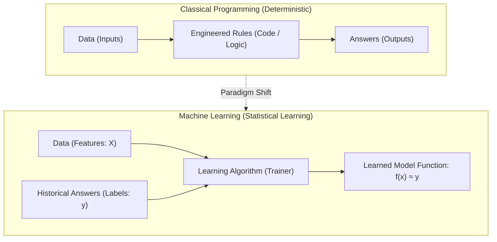
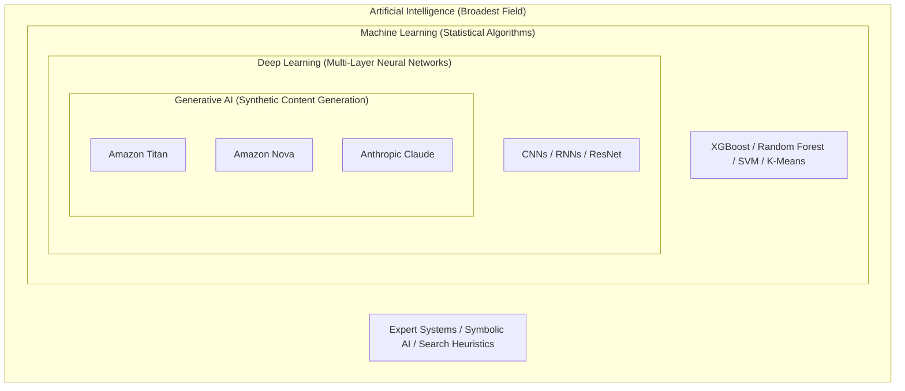
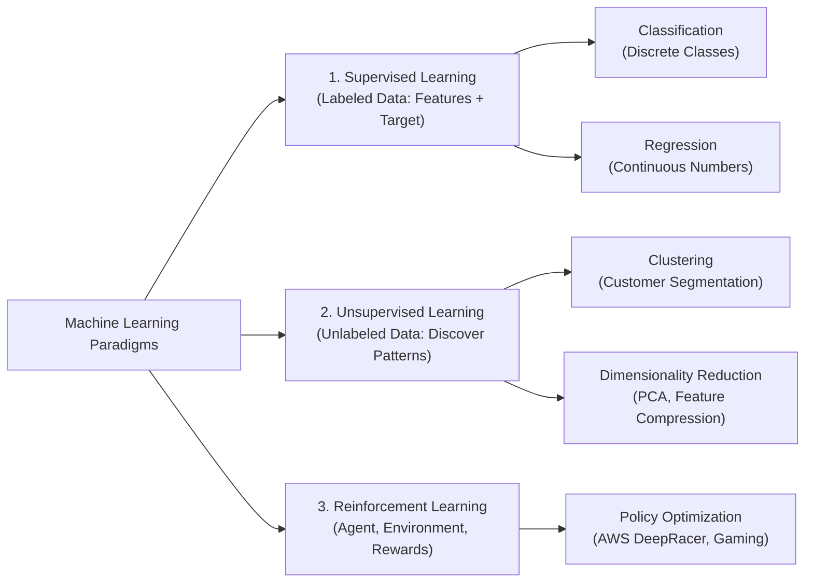
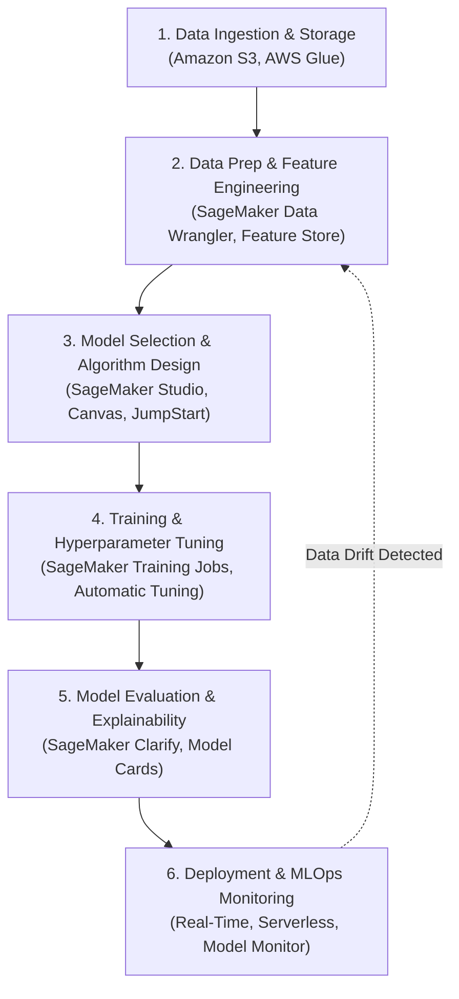
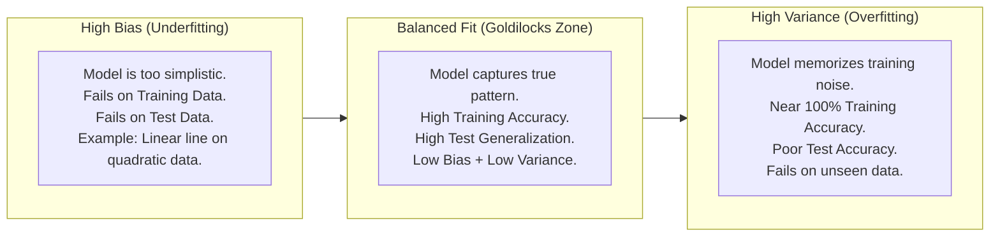
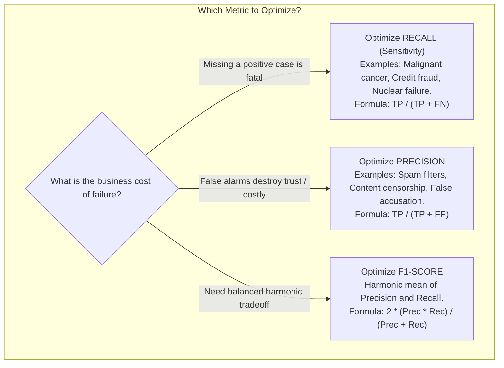
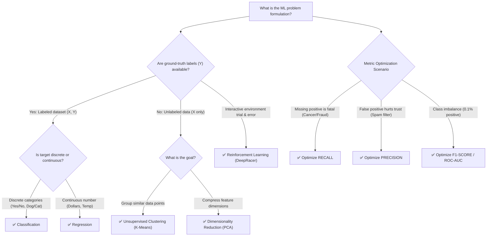

# Prerequisite 01: Machine Learning Fundamentals & Statistical Mechanics

> **Document:** `01_Machine_Learning_Fundamentals.md`  
> **Course Track:** AWS Certified AI Practitioner (`AIF-C01`)  
> **Target Exam Domain:** Domain 1: Fundamentals of AI and Machine Learning (20% Exam Weight)  
> **Prescribed Literature:** Vikram Elango et al. (*Wiley 2025*), Chapters 1 & 2; Tom Taulli (*O'Reilly 2025*), Chapter 2; CloudExamPro (*2026*), Section 1.  
> **Target Audience:** Practitioners, architects, and developers seeking deep conceptual mastery of statistical learning paradigms, the end-to-end ML lifecycle, evaluation metrics, and the bias-variance tradeoff before working with Amazon SageMaker AI.

---

## 🧭 Executive Summary: The Paradigm Shift in Computation

In classical software engineering, humans write explicit, deterministic algorithms (`if/else` rules, SQL queries, loops) that take data as input and compute answers as output. If a mortgage rule changes, a human programmer must manually update the business rule in code.

**Machine Learning (ML)** fundamentally reverses this paradigm: we feed historical data and observed answers (labels) into an algorithm, and the machine statistically learns the underlying mathematical function f(x) ≈ y mapping features to outcomes.

---

## 💡 The Real-World Analogy (ELI5)

> **The Culinary Apprenticeship (How Computers Learn):**
> - **Traditional Programming (The Rigid Kitchen Checklist):** A robot following a strictly typed instruction sheet: *"Bake chicken for exactly 45 minutes at 350°F."* If someone puts in a frozen turkey instead of chicken, or if the oven thermometer drifts by 20 degrees, the robot serves raw poultry because it cannot reason beyond hand-coded `if/else` conditions.
> - **Supervised Learning (The Apprentice with Flashcards):** An apprentice chef studying under a culinary master. The master shows the apprentice 10,000 labeled photographs of cakes: *"This is undercooked (raw),"* *"This is golden and perfect,"* *"This is burnt to a crisp."* Over time, the apprentice's brain maps visual cues (color, puffiness, crust cracks) to the correct baking status.
> - **Unsupervised Learning (Sorting the Mystery Spice Warehouse):** A truck unloads 500 unmarked, unlabeled barrels of exotic spices. Nobody provides names or instructions. The apprentice smells, touches, and sorts them into 5 distinct piles based on aroma, grain size, and moisture (clustering)—discovering natural hidden structures without ground-truth labels.
> - **Reinforcement Learning (The High-Stakes Tasting Menu):** An autonomous chef experimenting in a live dining room. When diners smile and leave a \$50 tip, the chef receives a positive reward; when a dish is returned with a grimace, the chef receives a negative penalty. Over thousands of trials, the chef discovers the optimal flavor profile to maximize cumulative tips.

---

## 🏛️ Historical IT Pain Points: The Brittle Deterministic Trap

Before machine learning, enterprises attempted to automate decision-making using sprawling, monolithic expert rule engines:
* **The "Rule Explosion" Dilemma:** A credit card fraud engine grew to 45,000 nested `if/else` statements. Adding one rule to catch a new overseas scam accidentally blocked 12,000 legitimate domestic customers on Black Friday.
* **Inability to Learn from Continuous Drift:** Consumer behavior, fraud techniques, and economic conditions change daily. Hard-coded rules become obsolete the day they are deployed, requiring months of manual developer updates.
* **The Machine Learning Revolution:** By shifting from hand-crafted rules to continuous mathematical model training, systems adapt automatically as new feature distributions arrive, decoupling software logic from shifting human realities.

---

---

## 🧠 1. The Core AI Taxonomy (The Russian Nesting Dolls)

Understanding the distinct boundaries between Artificial Intelligence, Machine Learning, Deep Learning, and Generative AI is critical for exam precision:

1. **Artificial Intelligence (AI):** The overarching discipline of computer science established in 1956 dedicated to creating systems capable of performing tasks that typically require human cognition (reasoning, perception, problem-solving, natural language understanding).
2. **Machine Learning (ML):** A subfield of AI focused on algorithms that automatically improve their performance through experience and statistical exposure to data without being explicitly programmed.
3. **Deep Learning (DL):** A subset of ML based on Artificial Neural Networks with representation learning across multiple hidden layers (>3 layers). DL algorithms (CNNs, RNNs, Transformers) automatically extract hierarchical features directly from raw, unstructured data (pixels, waveforms, characters) without manual feature engineering.
4. **Generative AI (GenAI):** A specialized frontier subset of Deep Learning that learns the joint probability distribution $P(X)$ of vast training corpora to generate brand-new, realistic, synthetic artifacts (coherent prose, photorealistic images, source code, synthesized voices).

---

## ⚙️ 2. The Three Primary Learning Paradigms

### 2.1 Supervised Learning (The Apprentice with an Answer Key)
The algorithm is supplied with an input feature matrix $X$ and ground-truth target vector $y$. The objective is to learn a mapping function y = f(X) + ε that generalizes accurately to unseen inputs.
* **Classification (Categorical Target):**
  * *Binary Classification:* Predicting one of two discrete classes (e.g., Transaction Fraudulent: Yes/No, Customer Churn: True/False, Tumor: Malignant/Benign).
  * *Multi-Class Classification:* Predicting one of three or more mutually exclusive classes (e.g., Routing an IT ticket to Hardware, Software, Network, or Billing).
  * *Multi-Label Classification:* Assigning multiple non-exclusive tags to a single sample (e.g., Tagging a blog post with both `#aws`, `#machine-learning`, and `#security`).
* **Regression (Continuous Numeric Target):**
  * Predicting a continuous quantitative number along a mathematical continuum.
  * Examples: Predicting real estate property prices in dollars, forecasting server CPU utilization percentages, predicting customer lifetime value (LTV), or projecting stock prices.

### 2.2 Unsupervised Learning (The Detective Finding Hidden Structure)
The dataset contains input features $X$ only, with zero ground-truth target labels ($y$ is unknown or non-existent). The algorithm discovers intrinsic geometric structures, clusterings, or latent distributions in high-dimensional feature space.
* **Clustering:**
  * Grouping unlabeled data points into clusters where points within a cluster share high similarity, while points across clusters share low similarity.
  * *Algorithms:* $K$-Means, Hierarchical Clustering, DBSCAN.
  * *Use Cases:* Retail market customer segmentation, anomaly detection, grouping news articles by topic.
* **Dimensionality Reduction:**
  * Compressing high-dimensional feature vectors (e.g., 500 columns) into a compact lower-dimensional space (e.g., 20 principal components) while retaining maximum statistical variance.
  * *Algorithms:* Principal Component Analysis (PCA), t-Distributed Stochastic Neighbor Embedding (t-SNE).
  * *Use Cases:* Data visualization, accelerating model training, eliminating collinear features.

### 2.3 Reinforcement Learning (Trial-and-Error Agent Learning)
An autonomous computational entity (**Agent**) takes sequential actions within an external dynamic environment (**Environment**) to transition across states ($S$) and maximize a cumulative numerical reward function ($R$).
* **Core Components:**
  * **State ($s_t$):** The current snapshot observation of the environment at time $t$.
  * **Action ($a_t$):** The move chosen by the agent from the available action space.
  * **Reward ($r_t$):** Immediate numerical feedback received from the environment (positive for beneficial actions, penalty for detrimental actions).
  * **Policy (π(a|s)):** The probabilistic strategy mapping states to optimal actions.
* **AWS Canonical Implementations:** **AWS DeepRacer** (autonomous 1/18th scale race car driving via RL) and **AWS DeepComposer**.

---

## 🔄 3. The 6-Stage End-to-End Machine Learning Lifecycle

1. **Stage 1: Business Framing & Data Ingestion:** Formulating the business problem into an ML objective; gathering raw data into centralized, encrypted storage (**Amazon S3**).
2. **Stage 2: Exploration & Feature Engineering:** Cleaning null values, imputing outliers, scaling numeric features (StandardScaler, MinMax), encoding categorical columns (One-Hot Encoding), and cataloging reusable vectors in **Amazon SageMaker Feature Store**.
3. **Stage 3: Model Selection:** Choosing the optimal statistical architecture based on dataset size, latency constraints, and modality (Tabular: XGBoost; Vision: ResNet; Text: Transformers).
4. **Stage 4: Training & Hyperparameter Tuning:** Splitting data into Training (70%), Validation (15%), and Test (15%) splits; optimizing model weights using gradient descent and tuning external hyperparameters (learning rate, tree depth) using **SageMaker Automatic Model Tuning (HPO)**.
5. **Stage 5: Evaluation & Governance:** Auditing performance metrics against holdout data; checking for algorithmic bias with **SageMaker Clarify**; documenting intended usage in **SageMaker Model Cards**.
6. **Stage 6: Deployment & Monitoring:** Hosting models on production endpoints (**Real-Time**, **Serverless**, **Asynchronous**, or **Batch Transform**); tracking inference drift and quality degradation over time with **Amazon SageMaker Model Monitor**.

---

## ⚖️ 4. The Bias-Variance Tradeoff: Overfitting vs. Underfitting

The ultimate goal of any machine learning model is **generalization**: performing accurately on previously unseen real-world test data rather than merely memorizing the training dataset.

The total prediction error of a model can be mathematically decomposed as:
$$\text{Total Expected Error} = \text{Bias}^2 + \text{Variance} + \sigma^2 \text{ (Irreducible Error)}$$

### High Bias (Underfitting)
* **Symptom:** High training error and high test error. The model fails to capture the underlying statistical trend.
* **Causes:** Model is too simple (e.g., trying to fit a straight linear regression line to complex non-linear relationships); insufficient or weak features; excessive regularization penalty.
* **Remedies:**
  1. Increase model capacity (e.g., switch from linear model to Random Forest or Deep Neural Network).
  2. Add more relevant features / domain feature engineering.
  3. Decrease regularization penalties (λ in L1/L2).

### High Variance (Overfitting)
* **Symptom:** Extremely low training error (e.g., 99.5% accuracy), but disastrously poor performance on validation and test data (e.g., 62% accuracy).
* **Causes:** Model is overly complex; model memorized idiosyncratic training noise and outliers rather than underlying generalizable distributions; insufficient training dataset size.
* **Remedies:**
  1. Collect more diverse training data.
  2. Apply **Regularization**: L1 Lasso (forces unimportant feature weights to zero, acting as feature selection) or L2 Ridge (shrinks feature weights smoothly).
  3. Prune decision trees (limit maximum depth, increase minimum samples per leaf).
  4. Apply **Dropout** in deep neural networks (randomly deactivating neurons during training).
  5. Implement **Early Stopping** (halting gradient descent when validation loss stops improving).

---

## 📊 5. Comprehensive Model Evaluation Metrics

### 5.1 Classification Metrics: The Confusion Matrix
For any binary classification problem, predictions fall into a 2 × 2 contingency table:

| | Predicted Positive | Predicted Negative |
| :--- | :---: | :---: |
| **Actual Positive** | **True Positive ($TP$)** | **False Negative ($FN$)** *(Type II Error)* |
| **Actual Negative** | **False Positive ($FP$)** *(Type I Error)* | **True Negative ($TN$)** |

#### Core Mathematical Formulas:
1. **Accuracy:** Overall proportion of correct predictions across all classes.
   $$\text{Accuracy} = \frac{TP + TN}{TP + TN + FP + FN}$$
   *Warning:* Accuracy is notoriously misleading on imbalanced datasets! If 99% of transactions are legitimate and 1% are fraud, a dumb model predicting "Legitimate" 100% of the time achieves 99% accuracy while catching 0% of fraud!
2. **Precision:** What fraction of predicted positive cases were actually positive?
   $$\text{Precision} = \frac{TP}{TP + FP}$$
   *Goal:* Minimize False Positives ($FP$).
3. **Recall (Sensitivity / True Positive Rate):** What fraction of actual positive cases did the model successfully identify?
   $$\text{Recall} = \frac{TP}{TP + FN}$$
   *Goal:* Minimize False Negatives ($FN$).
4. **Specificity (True Negative Rate):** What fraction of actual negative cases did the model correctly identify?
   $$\text{Specificity} = \frac{TN}{TN + FP}$$
5. **F1-Score:** The harmonic mean of Precision and Recall. Essential benchmark for class-imbalanced datasets.
   $$F_1 = 2 \times \frac{\text{Precision} \times \text{Recall}}{\text{Precision} + \text{Recall}} = \frac{2TP}{2TP + FP + FN}$$
6. **ROC-AUC (Receiver Operating Characteristic - Area Under Curve):** Plots True Positive Rate (Recall) against False Positive Rate (1 - Specificity) across all classification probability thresholds (0.0 ≤ τ ≤ 1.0). An AUC of 1.0 represents a perfect classifier; 0.5 represents random guessing.

---

### 5.2 Regression Metrics: Evaluating Continuous Numbers

| Metric | Full Name | Mathematical Formula | Key Characteristics & Exam Sweet Spot |
| :--- | :--- | :---: | :--- |
| **MAE** | Mean Absolute Error | $\frac{1}{n} \sum_{i=1}^n \|y_i - \hat{y}_i\|$ | Direct linear average error in natural units (e.g., dollars). Robust to extreme outliers. |
| **MSE** | Mean Squared Error | $\frac{1}{n} \sum_{i=1}^n (y_i - \hat{y}_i)^2$ | Penalizes large errors heavily due to squaring. In squared units (units², e.g. dollars²). |
| **RMSE** | Root Mean Squared Error | $\sqrt{\frac{1}{n} \sum_{i=1}^n (y_i - \hat{y}_i)^2}$ | Returns squared error penalty back to natural units. Highly sensitive to outliers; default loss for regression. |
| **R²** | Coefficient of Determination | $1 - \frac{\sum (y_i - \hat{y}_i)^2}{\sum (y_i - \bar{y})^2}$ | Explains proportion of variance in $y$ captured by the model (0 ≤ R² ≤ 1.0). 1.0 = perfect prediction. |

---

## 🎯 6. Key AWS Services & Capabilities Mapping

* **Amazon SageMaker Canvas:** Visual point-and-click AutoML interface enabling business analysts to generate accurate predictive models (regression, classification, time-series forecasting) with zero code.
* **Amazon SageMaker Data Wrangler:** Visual tool for importing, cleaning, normalizing, and feature engineering tabular and image data from 50+ data sources.
* **Amazon SageMaker Autopilot:** Automated machine learning (AutoML) for developers; automatically inspects tabular datasets, generates Python code notebooks, explores algorithms, and ranks models on a leaderboard.
* **Amazon SageMaker Clarify:** Detects statistical bias (pre-training Class Imbalance and post-training Disparate Impact) and computes SHAP feature importance for model explainability.
* **AWS Pre-Trained AI Services:**
  * Vision: **Amazon Rekognition** (face analysis, object detection, content moderation).
  * Speech: **Amazon Transcribe** (speech-to-text / ASR) and **Amazon Polly** (text-to-speech / neural TTS).
  * Language: **Amazon Comprehend** (sentiment, entity extraction), **Amazon Translate** (neural machine translation), **Amazon Textract** (document OCR, tables, key-value forms).

---

## 📝 Post-Topic Question Simulation & Retention Check

### Question 1
**A hospital data science team is developing a machine learning model to diagnose a rare, life-threatening form of cancer from patient MRI scans. Missing an active cancer case results in fatal patient outcomes, whereas a false alarm leads to a harmless secondary ultrasound check. Which classification metric should the team prioritize optimizing?**
- A) Precision
- B) Recall (Sensitivity)
- C) Specificity
- D) Accuracy

<b>Click to View Answer & Detailed Distractor Analysis</b>

**Correct Answer:** **B) Recall (Sensitivity)**

* **Why it's correct:** Recall measures the proportion of actual positive cases successfully identified by the model: $\text{Recall} = \frac{TP}{TP + FN}$. In medical diagnosis where False Negatives ($FN$) are fatal, the primary clinical imperative is to minimize $FN$ to near zero, which maximizes Recall.
* **Distractor Analysis:**
  - *A is incorrect:* Precision minimizes False Positives ($FP$). In this scenario, an $FP$ merely causes a secondary ultrasound, whereas an $FN$ causes patient death.
  - *C is incorrect:* Specificity measures the true negative rate (correctly identifying healthy patients), but does not guard against missed cancer cases.
  - *D is incorrect:* Accuracy is dangerously misleading in rare medical conditions (e.g., if only 0.1% of patients have the disease, a dummy model predicting "healthy" achieves 99.9% accuracy while missing every single cancer patient).

---

### Question 2
**A marketing analyst wants to group 500,000 retail customer purchase histories into distinct buyer personas for personalized email campaigns. The customer database has no historical labels, tags, or demographic groupings. Which machine learning paradigm is required?**
- A) Supervised Classification
- B) Supervised Regression
- C) Unsupervised Clustering
- D) Reinforcement Learning

<b>Click to View Answer & Detailed Distractor Analysis</b>

**Correct Answer:** **C) Unsupervised Clustering**

* **Why it's correct:** When data contains input features ($X$) with zero ground-truth labels ($Y$ is absent), unsupervised clustering algorithms (such as $K$-Means or Hierarchical Clustering) are used to discover natural mathematical clusters and segment customers based on behavioral similarity.
* **Distractor Analysis:**
  - *A is incorrect:* Classification requires pre-labeled target categories (e.g., "High Spender", "Bargain Hunter") during training.
  - *B is incorrect:* Regression predicts continuous numerical figures (e.g., predicting next month's total spend in dollars).
  - *D is incorrect:* Reinforcement learning trains an autonomous agent in an interactive environment via trial-and-error rewards, not grouping static tabular customer records.

---

### Question 3
**During model training, a deep neural network achieves 99.8% accuracy on the training dataset, but drops to 61.2% accuracy on the validation and test datasets. What phenomenon has occurred, and what is an appropriate remedy?**
- A) High Bias (Underfitting); decrease regularization penalties
- B) High Variance (Overfitting); apply L1/L2 regularization and dropout
- C) Data Leakage; remove target features from test data
- D) High Variance (Overfitting); increase model parameters and complexity

<b>Click to View Answer & Detailed Distractor Analysis</b>

**Correct Answer:** **B) High Variance (Overfitting); apply L1/L2 regularization and dropout**

* **Why it's correct:** A massive gap between stellar training accuracy (99.8%) and mediocre validation accuracy (61.2%) is the textbook definition of Overfitting (High Variance). The model has memorized training noise. Applying regularization (L1 Lasso, L2 Ridge), adding Dropout layers, or gathering more training data constrains model complexity and restores generalizability.
* **Distractor Analysis:**
  - *A is incorrect:* High Bias (Underfitting) yields poor accuracy on *both* training and validation sets.
  - *C is incorrect:* Data leakage usually produces artificially inflated, unrealistic test accuracy, not a dramatic drop in test performance.
  - *D is incorrect:* Increasing model parameters exacerbates overfitting by giving the model even more capacity to memorize noise.

---

## 🧠 Master MCQ Solving Blueprint: Pattern Decryption & Elimination Tricks

> *This blueprint distills recurring patterns, keyword triggers, and trap options extracted from over 350 questions on ML Fundamentals, Learning Paradigms, and Evaluation Metrics across the official AIF-C01 question bank.*

### 1. The "Clue-to-Service" Linguistic Decryption Matrix
When reading a question scenario, search for these exact phrasing triggers:

| If You See This Trigger Phrase in the Question Stem... | The Correct Concept / Metric Is... | Trap Distractor to Immediately Discard |
|---|---|---|
| *"Predict continuous numeric dollar value, temperature, or duration"* | **Regression** | *Classification* (Classification predicts discrete classes!) |
| *"Classify into discrete categories (Spam/Not Spam, Fraud/Legit)"* | **Classification** | *Regression* |
| *"Group unlabeled data by intrinsic similarity; customer segmentation"* | **Unsupervised Clustering ($K$-Means)** | *Supervised Classification* (No labels exist!) |
| *"Compress 300 features down to 15 while retaining maximum variance"* | **Dimensionality Reduction (PCA)** | *Linear Regression* |
| *"Agent learns through trial-and-error, actions, states, and rewards"* | **Reinforcement Learning (DeepRacer)** | *Supervised Learning* |
| *"Class-imbalanced dataset (0.1% fraud); overall accuracy is misleading"* | **F1-Score / ROC-AUC** | *Accuracy* (Accuracy is the classic exam trap!) |
| *"Missing a positive case is fatal (malignant cancer, critical defect)"* | **Optimize RECALL (Minimize False Negatives)** | *Precision* |
| *"False alarms cause catastrophic harm or destroy customer trust (spam filter)"* | **Optimize PRECISION (Minimize False Positives)** | *Recall* |
| *"Visual no-code predictive ML for business analysts and marketers"* | **Amazon SageMaker Canvas** | *SageMaker Data Wrangler* (Data Wrangler prepares data, Canvas builds models) |
| *"Clean, normalize, and engineer features visually with 300+ transforms"* | **Amazon SageMaker Data Wrangler** | *SageMaker Autopilot* |

### 2. The 3-Step Rapid Elimination Heuristic
When evaluating an ML Fundamentals question:
1. **Step 1: Check for Labels ($Y$):**
   - Are historical labels/targets provided? → **Supervised Learning**.
     - Is the target a **category**? → **Classification**.
     - Is the target a **continuous number**? → **Regression**.
   - Are there **NO labels** (unlabeled exploration)? → **Unsupervised Learning**.
   - Is an **agent interacting with an environment for rewards**? → **Reinforcement Learning**.
2. **Step 2: Check the Cost of Error (Precision vs. Recall):**
   - Did the prompt emphasize **"we cannot afford to miss a single positive occurrence"**? → **RECALL**.
   - Did the prompt emphasize **"we cannot afford to falsely accuse or flag an innocent sample"**? → **PRECISION**.
   - Are classes **heavily imbalanced** (e.g. 99% vs 1%)? → **ELIMINATE Accuracy immediately**; choose **F1-Score** or **ROC-AUC**.
3. **Step 3: Check Tooling Persona:**
   - Business analyst, zero Python code, drag-and-drop → **SageMaker Canvas**.
   - Visual data transformations and feature cleaning → **SageMaker Data Wrangler**.
   - Developer wanting automated models + transparent Python notebooks → **SageMaker Autopilot**.

### 3. High-Frequency Decoy Autopsy: Why AWS Tries to Trick You
* **Decoy #1: "Accuracy" in Class-Imbalanced Problems**
  - *The Trap:* A bank wants to evaluate a credit card fraud model where 99.9% of transactions are legitimate. Which metric should they use?
  - *The Autopsy:* AWS questions constantly include "Accuracy" as option A or B. A model that predicts "Legitimate" for every transaction achieves 99.9% accuracy while being completely useless! In imbalanced problems, the correct answer is **F1-Score**, **Recall**, or **ROC-AUC**.
* **Decoy #2: "Precision" vs. "Recall"**
  - *The Trap:* Medical diagnosis vs. spam email filtering.
  - *The Autopsy:* Memorize the penalty:
    - **Cancer / Fraud / Safety:** Missed positive ($FN$) is fatal → **Recall** ($\frac{TP}{TP + FN}$).
    - **Spam / Content Moderation / Innocent Accusation:** False alarm ($FP$) destroys trust → **Precision** ($\frac{TP}{TP + FP}$).
* **Decoy #3: "SageMaker Canvas" vs. "SageMaker Data Wrangler"**
  - *The Trap:* A business analyst needs to prepare data and train a churn model without code.
  - *The Autopsy:* If the task is strictly **data import, cleaning, and feature engineering**, choose **Data Wrangler**. If the task is **building, training, and generating predictive models with a point-and-click UI**, choose **SageMaker Canvas**.

### 4. 10-Second Visual Decision Flowchart

