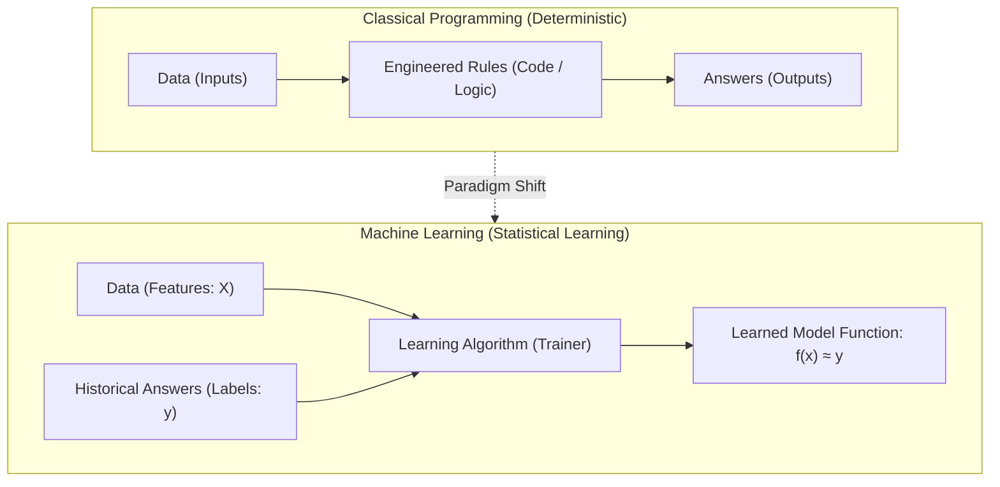
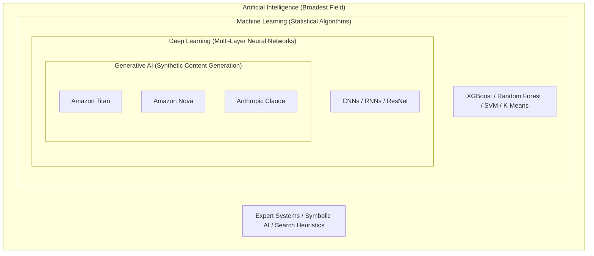
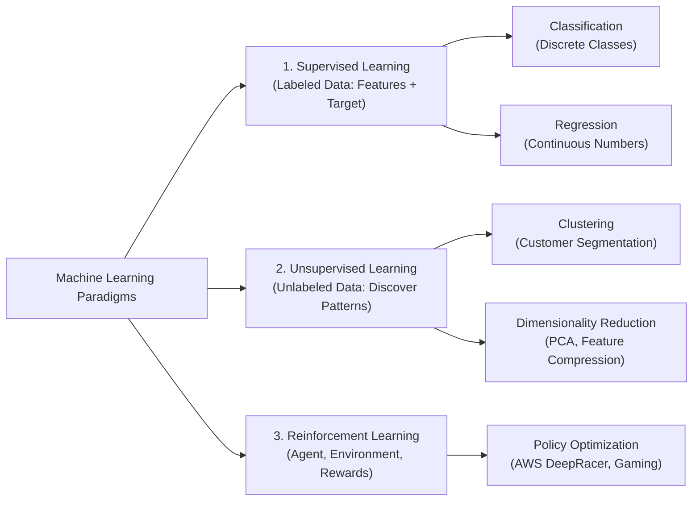
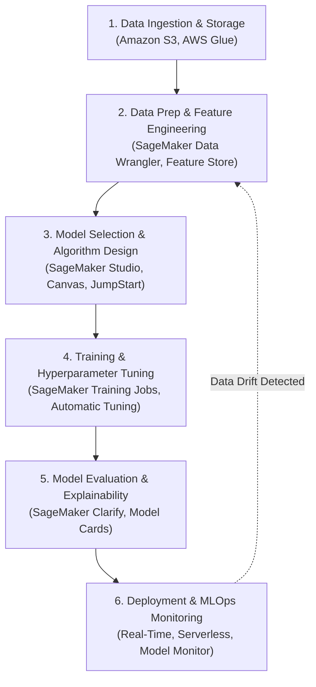
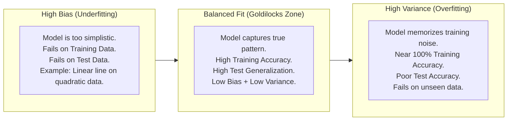
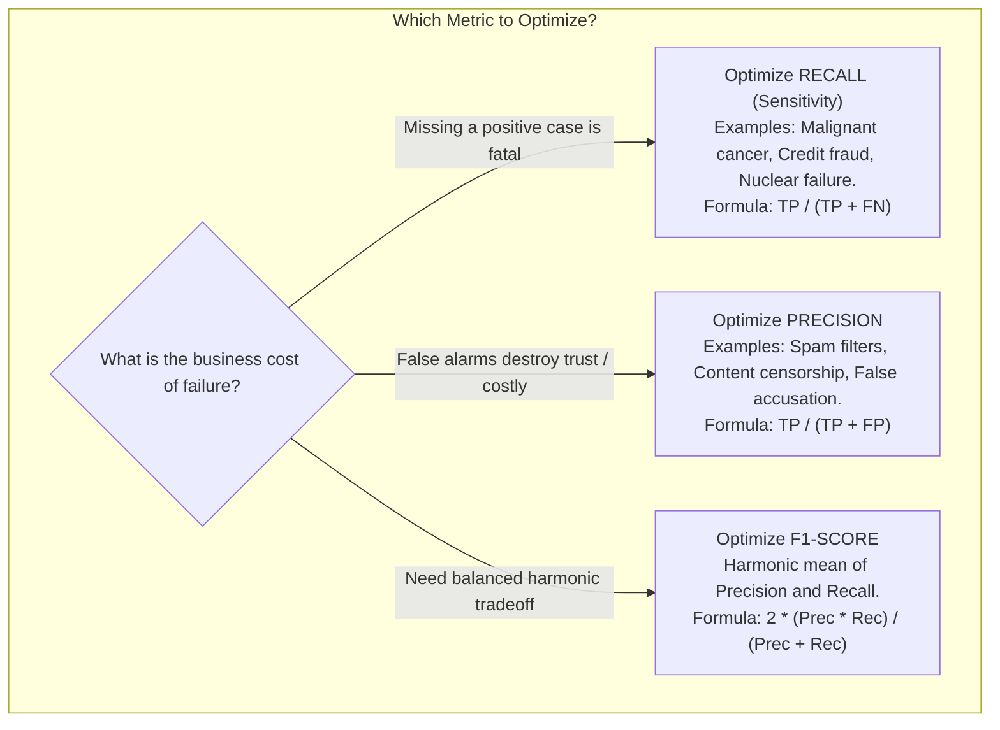

# Prerequisite 01: Machine Learning Fundamentals & Statistical Mechanics

> **Document:** `01_Machine_Learning_Fundamentals.md`  
> **Course Track:** AWS Certified AI Practitioner (`AIF-C01`)  
> **Target Exam Domain:** Domain 1: Fundamentals of AI and Machine Learning (20% Exam Weight)  
> **Prescribed Literature:** Vikram Elango et al. (*Wiley 2025*), Chapters 1 & 2; Tom Taulli (*O'Reilly 2025*), Chapter 2; CloudExamPro (*2026*), Section 1.  
> **Target Audience:** Practitioners, architects, and developers seeking deep conceptual mastery of statistical learning paradigms, the end-to-end ML lifecycle, evaluation metrics, and the bias-variance tradeoff before working with Amazon SageMaker AI.

---

## 🧭 Executive Summary: The Paradigm Shift in Computation

In classical software engineering, humans write explicit, deterministic algorithms (`if/else` rules, SQL queries, loops) that take data as input and compute answers as output. If a mortgage rule changes, a human programmer must manually update the business rule in code.

**Machine Learning (ML)** fundamentally reverses this paradigm: we feed historical data and observed answers (labels) into an algorithm, and the machine statistically learns the underlying mathematical function $f(x) \approx y$ mapping features to outcomes.

---

## 🧠 1. The Core AI Taxonomy (The Russian Nesting Dolls)

Understanding the distinct boundaries between Artificial Intelligence, Machine Learning, Deep Learning, and Generative AI is critical for exam precision:

1. **Artificial Intelligence (AI):** The overarching discipline of computer science established in 1956 dedicated to creating systems capable of performing tasks that typically require human cognition (reasoning, perception, problem-solving, natural language understanding).
2. **Machine Learning (ML):** A subfield of AI focused on algorithms that automatically improve their performance through experience and statistical exposure to data without being explicitly programmed.
3. **Deep Learning (DL):** A subset of ML based on Artificial Neural Networks with representation learning across multiple hidden layers ($>3$ layers). DL algorithms (CNNs, RNNs, Transformers) automatically extract hierarchical features directly from raw, unstructured data (pixels, waveforms, characters) without manual feature engineering.
4. **Generative AI (GenAI):** A specialized frontier subset of Deep Learning that learns the joint probability distribution $P(X)$ of vast training corpora to generate brand-new, realistic, synthetic artifacts (coherent prose, photorealistic images, source code, synthesized voices).

---

## ⚙️ 2. The Three Primary Learning Paradigms

### 2.1 Supervised Learning (The Apprentice with an Answer Key)
The algorithm is supplied with an input feature matrix $X$ and ground-truth target vector $y$. The objective is to learn a mapping function $y = f(X) + \epsilon$ that generalizes accurately to unseen inputs.
* **Classification (Categorical Target):**
  * *Binary Classification:* Predicting one of two discrete classes (e.g., Transaction Fraudulent: Yes/No, Customer Churn: True/False, Tumor: Malignant/Benign).
  * *Multi-Class Classification:* Predicting one of three or more mutually exclusive classes (e.g., Routing an IT ticket to Hardware, Software, Network, or Billing).
  * *Multi-Label Classification:* Assigning multiple non-exclusive tags to a single sample (e.g., Tagging a blog post with both `#aws`, `#machine-learning`, and `#security`).
* **Regression (Continuous Numeric Target):**
  * Predicting a continuous quantitative number along a mathematical continuum.
  * Examples: Predicting real estate property prices in dollars, forecasting server CPU utilization percentages, predicting customer lifetime value (LTV), or projecting stock prices.

### 2.2 Unsupervised Learning (The Detective Finding Hidden Structure)
The dataset contains input features $X$ only, with zero ground-truth target labels ($y$ is unknown or non-existent). The algorithm discovers intrinsic geometric structures, clusterings, or latent distributions in high-dimensional feature space.
* **Clustering:**
  * Grouping unlabeled data points into clusters where points within a cluster share high similarity, while points across clusters share low similarity.
  * *Algorithms:* $K$-Means, Hierarchical Clustering, DBSCAN.
  * *Use Cases:* Retail market customer segmentation, anomaly detection, grouping news articles by topic.
* **Dimensionality Reduction:**
  * Compressing high-dimensional feature vectors (e.g., 500 columns) into a compact lower-dimensional space (e.g., 20 principal components) while retaining maximum statistical variance.
  * *Algorithms:* Principal Component Analysis (PCA), t-Distributed Stochastic Neighbor Embedding (t-SNE).
  * *Use Cases:* Data visualization, accelerating model training, eliminating collinear features.

### 2.3 Reinforcement Learning (Trial-and-Error Agent Learning)
An autonomous computational entity (**Agent**) takes sequential actions within an external dynamic environment (**Environment**) to transition across states ($S$) and maximize a cumulative numerical reward function ($R$).
* **Core Components:**
  * **State ($s_t$):** The current snapshot observation of the environment at time $t$.
  * **Action ($a_t$):** The move chosen by the agent from the available action space.
  * **Reward ($r_t$):** Immediate numerical feedback received from the environment (positive for beneficial actions, penalty for detrimental actions).
  * **Policy ($\pi(a|s)$):** The probabilistic strategy mapping states to optimal actions.
* **AWS Canonical Implementations:** **AWS DeepRacer** (autonomous 1/18th scale race car driving via RL) and **AWS DeepComposer**.

---

## 🔄 3. The 6-Stage End-to-End Machine Learning Lifecycle

1. **Stage 1: Business Framing & Data Ingestion:** Formulating the business problem into an ML objective; gathering raw data into centralized, encrypted storage (**Amazon S3**).
2. **Stage 2: Exploration & Feature Engineering:** Cleaning null values, imputing outliers, scaling numeric features (StandardScaler, MinMax), encoding categorical columns (One-Hot Encoding), and cataloging reusable vectors in **Amazon SageMaker Feature Store**.
3. **Stage 3: Model Selection:** Choosing the optimal statistical architecture based on dataset size, latency constraints, and modality (Tabular: XGBoost; Vision: ResNet; Text: Transformers).
4. **Stage 4: Training & Hyperparameter Tuning:** Splitting data into Training (70%), Validation (15%), and Test (15%) splits; optimizing model weights using gradient descent and tuning external hyperparameters (learning rate, tree depth) using **SageMaker Automatic Model Tuning (HPO)**.
5. **Stage 5: Evaluation & Governance:** Auditing performance metrics against holdout data; checking for algorithmic bias with **SageMaker Clarify**; documenting intended usage in **SageMaker Model Cards**.
6. **Stage 6: Deployment & Monitoring:** Hosting models on production endpoints (**Real-Time**, **Serverless**, **Asynchronous**, or **Batch Transform**); tracking inference drift and quality degradation over time with **Amazon SageMaker Model Monitor**.

---

## ⚖️ 4. The Bias-Variance Tradeoff: Overfitting vs. Underfitting

The ultimate goal of any machine learning model is **generalization**: performing accurately on previously unseen real-world test data rather than merely memorizing the training dataset.

The total prediction error of a model can be mathematically decomposed as:
$$\text{Total Expected Error} = \text{Bias}^2 + \text{Variance} + \sigma^2 \text{ (Irreducible Error)}$$

### High Bias (Underfitting)
* **Symptom:** High training error and high test error. The model fails to capture the underlying statistical trend.
* **Causes:** Model is too simple (e.g., trying to fit a straight linear regression line to complex non-linear relationships); insufficient or weak features; excessive regularization penalty.
* **Remedies:**
  1. Increase model capacity (e.g., switch from linear model to Random Forest or Deep Neural Network).
  2. Add more relevant features / domain feature engineering.
  3. Decrease regularization penalties ($\lambda$ in $L_1/L_2$).

### High Variance (Overfitting)
* **Symptom:** Extremely low training error (e.g., 99.5% accuracy), but disastrously poor performance on validation and test data (e.g., 62% accuracy).
* **Causes:** Model is overly complex; model memorized idiosyncratic training noise and outliers rather than underlying generalizable distributions; insufficient training dataset size.
* **Remedies:**
  1. Collect more diverse training data.
  2. Apply **Regularization**: $L_1$ Lasso (forces unimportant feature weights to zero, acting as feature selection) or $L_2$ Ridge (shrinks feature weights smoothly).
  3. Prune decision trees (limit maximum depth, increase minimum samples per leaf).
  4. Apply **Dropout** in deep neural networks (randomly deactivating neurons during training).
  5. Implement **Early Stopping** (halting gradient descent when validation loss stops improving).

---

## 📊 5. Comprehensive Model Evaluation Metrics

### 5.1 Classification Metrics: The Confusion Matrix
For any binary classification problem, predictions fall into a $2 \times 2$ contingency table:

| | Predicted Positive | Predicted Negative |
| :--- | :---: | :---: |
| **Actual Positive** | **True Positive ($TP$)** | **False Negative ($FN$)** *(Type II Error)* |
| **Actual Negative** | **False Positive ($FP$)** *(Type I Error)* | **True Negative ($TN$)** |

#### Core Mathematical Formulas:
1. **Accuracy:** Overall proportion of correct predictions across all classes.
   $$\text{Accuracy} = \frac{TP + TN}{TP + TN + FP + FN}$$
   *Warning:* Accuracy is notoriously misleading on imbalanced datasets! If 99% of transactions are legitimate and 1% are fraud, a dumb model predicting "Legitimate" 100% of the time achieves 99% accuracy while catching 0% of fraud!
2. **Precision:** What fraction of predicted positive cases were actually positive?
   $$\text{Precision} = \frac{TP}{TP + FP}$$
   *Goal:* Minimize False Positives ($FP$).
3. **Recall (Sensitivity / True Positive Rate):** What fraction of actual positive cases did the model successfully identify?
   $$\text{Recall} = \frac{TP}{TP + FN}$$
   *Goal:* Minimize False Negatives ($FN$).
4. **Specificity (True Negative Rate):** What fraction of actual negative cases did the model correctly identify?
   $$\text{Specificity} = \frac{TN}{TN + FP}$$
5. **$F_1$-Score:** The harmonic mean of Precision and Recall. Essential benchmark for class-imbalanced datasets.
   $$F_1 = 2 \times \frac{\text{Precision} \times \text{Recall}}{\text{Precision} + \text{Recall}} = \frac{2TP}{2TP + FP + FN}$$
6. **ROC-AUC (Receiver Operating Characteristic - Area Under Curve):** Plots True Positive Rate (Recall) against False Positive Rate ($1 - \text{Specificity}$) across all classification probability thresholds ($0.0 \le \tau \le 1.0$). An AUC of 1.0 represents a perfect classifier; 0.5 represents random guessing.

---

### 5.2 Regression Metrics: Evaluating Continuous Numbers

| Metric | Full Name | Mathematical Formula | Key Characteristics & Exam Sweet Spot |
| :--- | :--- | :---: | :--- |
| **MAE** | Mean Absolute Error | $\frac{1}{n} \sum_{i=1}^n \|y_i - \hat{y}_i\|$ | Direct linear average error in natural units (e.g., dollars). Robust to extreme outliers. |
| **MSE** | Mean Squared Error | $\frac{1}{n} \sum_{i=1}^n (y_i - \hat{y}_i)^2$ | Penalizes large errors heavily due to squaring. In squared units ($\$^{2}$). |
| **RMSE** | Root Mean Squared Error | $\sqrt{\frac{1}{n} \sum_{i=1}^n (y_i - \hat{y}_i)^2}$ | Returns squared error penalty back to natural units. Highly sensitive to outliers; default loss for regression. |
| **$R^2$** | Coefficient of Determination | $1 - \frac{\sum (y_i - \hat{y}_i)^2}{\sum (y_i - \bar{y})^2}$ | Explains proportion of variance in $y$ captured by the model ($0 \le R^2 \le 1.0$). 1.0 = perfect prediction. |

---

## 🎯 6. Key AWS Services & Capabilities Mapping

* **Amazon SageMaker Canvas:** Visual point-and-click AutoML interface enabling business analysts to generate accurate predictive models (regression, classification, time-series forecasting) with zero code.
* **Amazon SageMaker Data Wrangler:** Visual tool for importing, cleaning, normalizing, and feature engineering tabular and image data from 50+ data sources.
* **Amazon SageMaker Autopilot:** Automated machine learning (AutoML) for developers; automatically inspects tabular datasets, generates Python code notebooks, explores algorithms, and ranks models on a leaderboard.
* **Amazon SageMaker Clarify:** Detects statistical bias (pre-training Class Imbalance and post-training Disparate Impact) and computes SHAP feature importance for model explainability.
* **AWS Pre-Trained AI Services:**
  * Vision: **Amazon Rekognition** (face analysis, object detection, content moderation).
  * Speech: **Amazon Transcribe** (speech-to-text / ASR) and **Amazon Polly** (text-to-speech / neural TTS).
  * Language: **Amazon Comprehend** (sentiment, entity extraction), **Amazon Translate** (neural machine translation), **Amazon Textract** (document OCR, tables, key-value forms).
