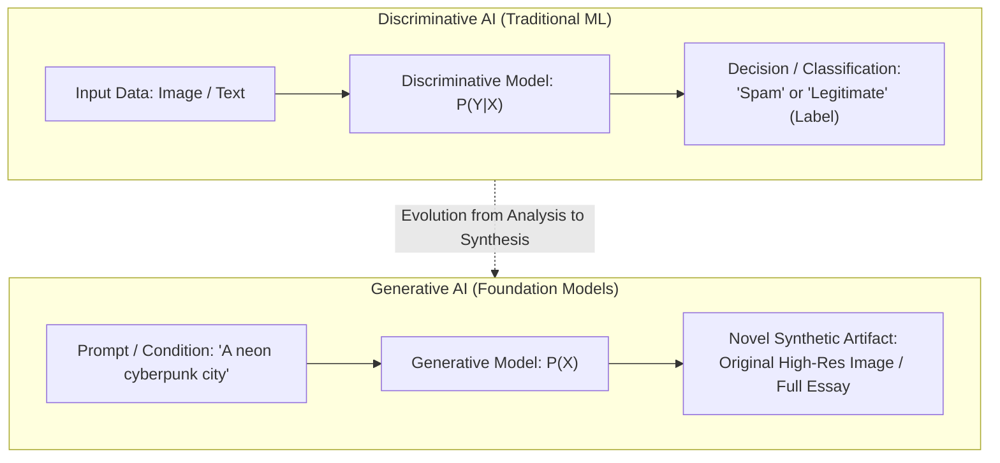
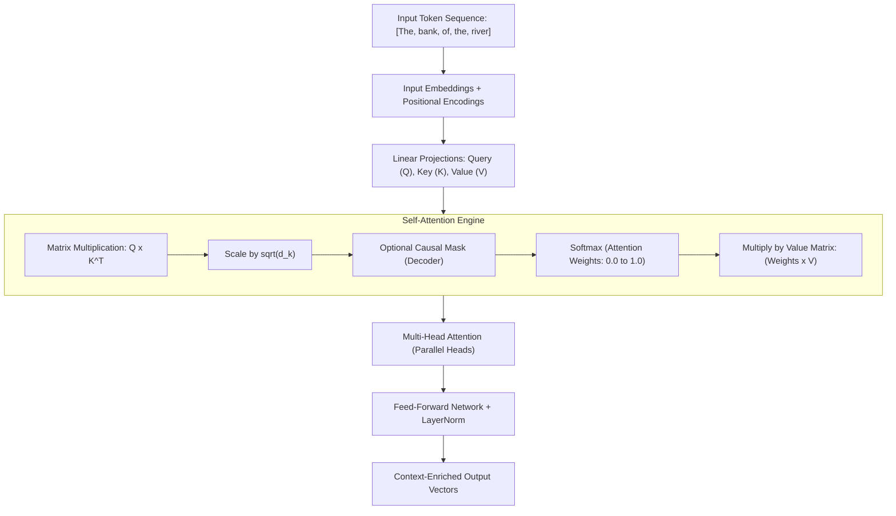
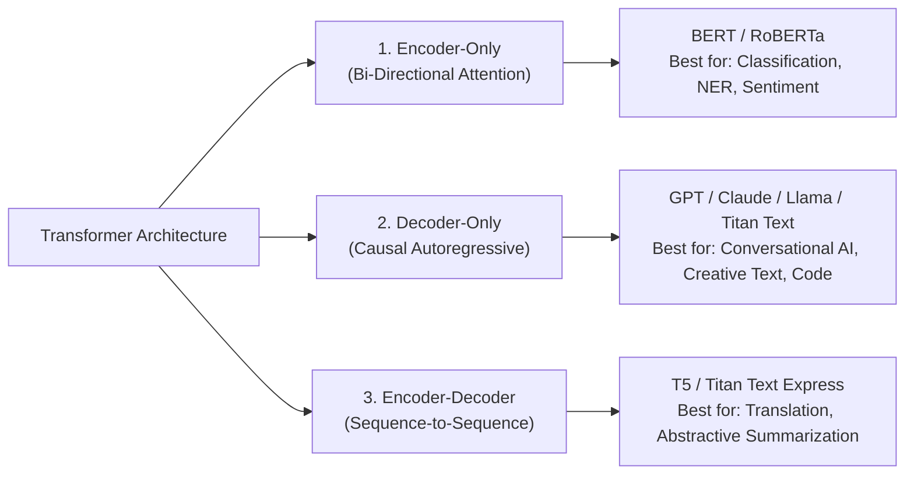
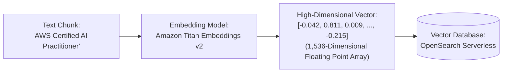
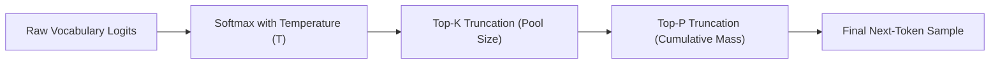
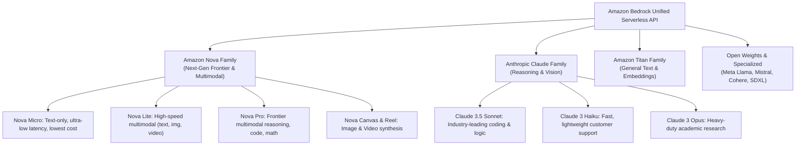
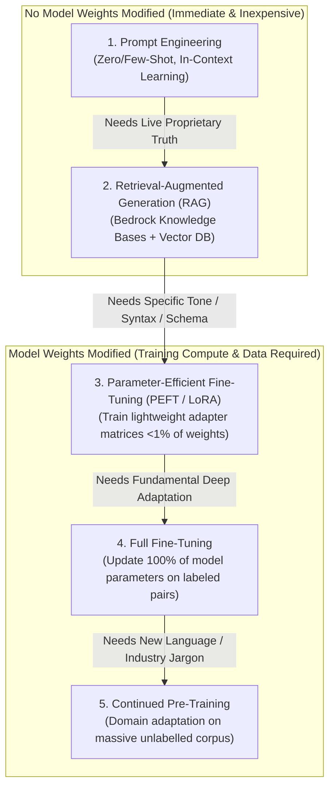

# Prerequisite 02: Generative AI, Transformers & Foundation Model Architectures

> **Document:** `02_Generative_AI_and_Transformers.md`  
> **Course Track:** AWS Certified AI Practitioner (`AIF-C01`)  
> **Target Exam Domains:** Domain 2: Fundamentals of Generative AI (24%) & Domain 3: Applications of Foundation Models (28%)  
> **Prescribed Literature:** Vikram Elango et al. (*Wiley 2025*), Chapters 3 & 4; Tom Taulli (*O'Reilly 2025*), Chapters 1 & 3; CloudExamPro (*2026*), Section 2; Notezio (*2026*), Chapters 4–8.  
> **Target Audience:** Practitioners, architects, and developers seeking deep conceptual mastery of the Transformer architecture, attention mechanisms, tokenization, embeddings, decoding parameters, and model customization before deploying Amazon Bedrock and Amazon Nova solutions.

---

## 🧭 Executive Summary: Discriminative vs. Generative Modeling

In traditional predictive machine learning, algorithms are primarily **discriminative**: they model the conditional probability $P(Y|X)$ of a label $Y$ given input features $X$. A discriminative model acts as an analytical judge—deciding whether an email is spam, whether a patient has pneumonia, or whether a credit card transaction is fraudulent.

**Generative AI (GenAI)** shifts computation from classification to creation by modeling the underlying joint probability distribution $P(X)$ or $P(X, Y)$ of high-dimensional data. Rather than merely distinguishing between cats and dogs, a generative model learns what constitutes the essence of an image or paragraph, enabling it to synthesize brand-new, realistic data points matching the training distribution.

---

## 🧠 1. The Transformer Revolution: Attention Is All You Need

Prior to 2017, natural language processing relied on **Recurrent Neural Networks (RNNs)** and **Long Short-Term Memory (LSTM)** networks. These architectures processed text sequentially, word by word from left to right.
* **The Fatal Flaws of Legacy RNNs/LSTMs:**
  1. *Vanishing / Exploding Gradients:* As sentences grew longer, information from early words was mathematically diluted, causing models to forget context across long paragraphs.
  2. *Sequential Bottleneck:* Because word $t$ could only be processed after word $t-1$, training could not be parallelized efficiently across modern GPU clusters.

In 2017, Vaswani et al. introduced the **Transformer architecture**, discarding recurrent loops entirely in favor of the **Self-Attention mechanism**.

### 1.1 The Mathematical Mechanics of Self-Attention
Self-attention enables the model to look at every word in a sequence simultaneously and calculate how strongly each word relates to every other word in that sentence.
For every input token vector, the model computes three distinct linear representations:
1. **Query ($Q$):** What the current token is looking for.
2. **Key ($K$):** What the current token contains (used to match against queries).
3. **Value ($V$):** The actual substantive information conveyed by the token.

The core scaled dot-product attention formula is:
$$\text{Attention}(Q, K, V) = \text{softmax}\left(\frac{Q K^T}{\sqrt{d_k}}\right) V$$

* **Why scale by $\sqrt{d_k}$?** When the vector dimension $d_k$ is large, dot products grow large, pushing the softmax function into regions with tiny gradients. Scaling prevents gradient vanishing.
* **The Analogy (The Library Catalog):**  
  * Query ($Q$) = Your search term in the library catalog.  
  * Key ($K$) = The book titles on the index cards.  
  * Softmax($QK^T$) = The relevance score ranking the best matching books.  
  * Value ($V$) = The actual text inside the matched books.

### 1.2 Multi-Head Attention (MHA)
Rather than computing attention once, the model projects $Q, K, V$ into $h$ distinct representation subspaces (e.g., 8 to 32 "heads"). One attention head may track grammatical syntax (subject-verb agreement), another tracks pronoun antecedents (*"it"* refers to *"the robot"*), while a third tracks spatial relationships.

### 1.3 Positional Encodings
Because the self-attention mechanism processes all tokens in parallel without an inherent sense of time or order, the transformer must inject positional information. Sinusoidal functions (sine and cosine waves of varying frequencies) or learned vectors are added directly to the token embeddings so the model knows that *"dog bites man"* is different from *"man bites dog"*.

---

## 🏛️ 2. Architectural Typologies of Foundation Models

| Architecture Typology | Attention Mechanism | Primary Pre-Training Objective | Sweet Spot & Primary Use Cases | AWS Canonical Examples |
| :--- | :--- | :--- | :--- | :--- |
| **Encoder-Only** | **Bi-directional:** Each token attends to words both to the left and right. | Masked Language Modeling (filling in missing `[MASK]` tokens). | Text classification, entity extraction, sentiment analysis, semantic search. | BERT, RoBERTa |
| **Decoder-Only** | **Causal (Unidirectional):** Each token can only attend to preceding tokens (left-to-right). Causal masking hides future words. | Next-Token Prediction (Autoregressive language modeling). | Open-ended text generation, conversational dialogue, reasoning, code synthesis. | Anthropic Claude, Meta Llama, Amazon Nova, Titan Text |
| **Encoder-Decoder** | Encoder is bi-directional; Decoder is causal and cross-attends to encoder outputs. | Masked text reconstruction or span corruption. | Language translation, document summarization, question answering. | T5, Amazon Titan Text G1 - Express |

---

## 🔤 3. Tokens, Tokenization & Context Windows

### 3.1 Subword Tokenization (BPE & WordPiece)
Large Language Models do not read whole words or raw characters; they break text into **tokens** using algorithms like Byte-Pair Encoding (BPE).
* Common words form single tokens: `apple` $\rightarrow$ `apple`
* Rare or compound words split into subwords: `unbreakable` $\rightarrow$ `un` + `break` + `able`
* **Rule of Thumb for Capacity Planning:**
  * **1 token $\approx 0.75$ English words**
  * **1,000 tokens $\approx 750$ English words**
  * **100 tokens $\approx 75$ English words**

### 3.2 Context Windows & KV Caching
The **Context Window** represents the maximum memory span an LLM can process in a single invocation, encompassing both the input prompt and the output completion.
$$\text{Total Tokens} = \text{Input Prompt Tokens} + \text{Output Completion Tokens} \le \text{Context Window Limit}$$
* Context window capacities have expanded exponentially: from 2,048 tokens in legacy GPT-3 to **200,000+ tokens** in Anthropic Claude 3.5 Sonnet and Amazon Nova Pro (enough to ingest an entire 500-page technical book in a single prompt).
* **KV Caching (Key-Value Caching):** Accelerates multi-turn chat by caching the computed Key ($K$) and Value ($V$) attention matrices of previous conversation turns in GPU memory, avoiding redundant matrix multiplications.
* **Prompt Caching in Bedrock:** Allows developers to cache large static system prompts or reference documents in Bedrock memory, slashing Time to First Token (TTFT) by up to 80% and input costs by up to 50%.

---

## 🧭 4. High-Dimensional Mathematical Embeddings & Vector Space

An **Embedding** is a learned, dense numerical vector representing the semantic meaning of text, audio, or images in continuous multi-dimensional space.
* **Semantic Proximity:** Words or concepts with similar meanings cluster closely together in vector space, allowing computers to compute mathematical relationships between ideas:
  $$\vec{\text{King}} - \vec{\text{Man}} + \vec{\text{Woman}} \approx \vec{\text{Queen}}$$

### Vector Distance / Similarity Metrics:
1. **Cosine Similarity:** Measures the cosine of the angle between two vectors. Normalized between -1.0 and +1.0 (1.0 = identical direction). Independent of vector magnitude; the gold standard for text semantic search.
   $$\text{Cosine Similarity} = \frac{A \cdot B}{\|A\| \|B\|}$$
2. **Dot Product:** Measures both angle and magnitude. Extremely fast to compute when vectors are pre-normalized to unit length ($\|A\| = 1$).
3. **Euclidean Distance ($L_2$ Distance):** Measures the straight-line geometric distance between two vector coordinates in Euclidean space. Lower distance indicates higher similarity.

---

## 🎛️ 5. Inference Decoding Hyperparameters

Foundation models do not produce text directly; they output unnormalized log-probabilities (**logits**) over their entire vocabulary (30,000 to 100,000+ candidate tokens). Decoding hyperparameters govern how the model samples the next token from this probability distribution:

| Hyperparameter | Value Range | Technical Mechanism | Low Value Effect | High Value Effect | Exam Clue / Use Case |
| :--- | :---: | :--- | :--- | :--- | :--- |
| **Temperature** | $0.0 - 1.0$ | Scales the logits prior to Softmax: $\frac{z_i}{T}$. | **Deterministic & Focused:** Sharpens distribution; selects highest-probability tokens. | **Creative & Diverse:** Flattens distribution; allows lower-probability tokens to emerge. | $T=0.0$: SQL, Code, Math, Financial audits. $T=0.8$: Creative writing, Marketing slogans. |
| **Top-P (Nucleus Sampling)** | $0.0 - 1.0$ | Dynamically sorts tokens and truncates candidates once cumulative probability reaches $P$. | Narrow candidate pool; eliminates tail tokens. | Wide candidate pool; considers diverse synonyms. | Recommended default: $0.90$. Adapts dynamically to distribution steepness. |
| **Top-K** | $1 - 500+$ | Statically restricts candidate sampling strictly to the top $K$ most probable tokens. | Extreme focus (e.g., $K=1$ is greedy decoding). | Considers up to $K$ alternatives. | Eliminates absurd low-probability hallucinations. |
| **Stop Sequences** | Strings | Pre-defined character patterns that signal the inference engine to halt generation immediately. | N/A | N/A | Prevents conversational runaway (e.g., `User:`, `\n\n`, `Observation:`). |
| **Max Tokens** | Integer | Hard upper bound on the maximum number of output tokens generated in the completion. | Truncated responses. | Full long-form responses. | Prevents unbounded compute and cost consumption. |

---

## 🌐 6. The Foundation Model Landscape on AWS

---

## 📈 7. The Model Customization Continuum

When off-the-shelf Foundation Models do not meet enterprise requirements, architects choose from five customization tiers based on cost, data requirements, and whether model weights are modified:

* **Core Decision Heuristic for the Exam:**
  * **Dynamic / Frequently Changing Enterprise Data:** $\rightarrow$ **RAG (Bedrock Knowledge Bases)**. Zero retraining required.
  * **Specialized Jargon, Consistent Tone, or Strict JSON Output Schema:** $\rightarrow$ **Fine-Tuning / PEFT (LoRA)**.
  * **Vast Unlabeled Internal Company Archive:** $\rightarrow$ **Continued Pre-Training**.
