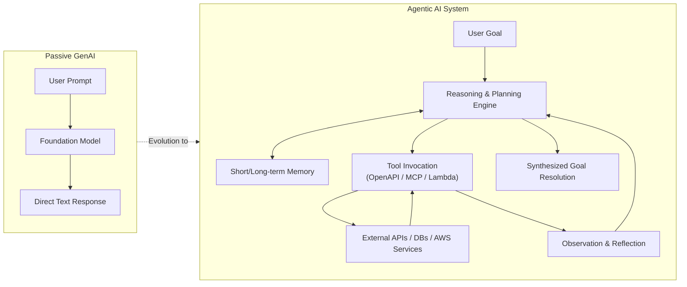
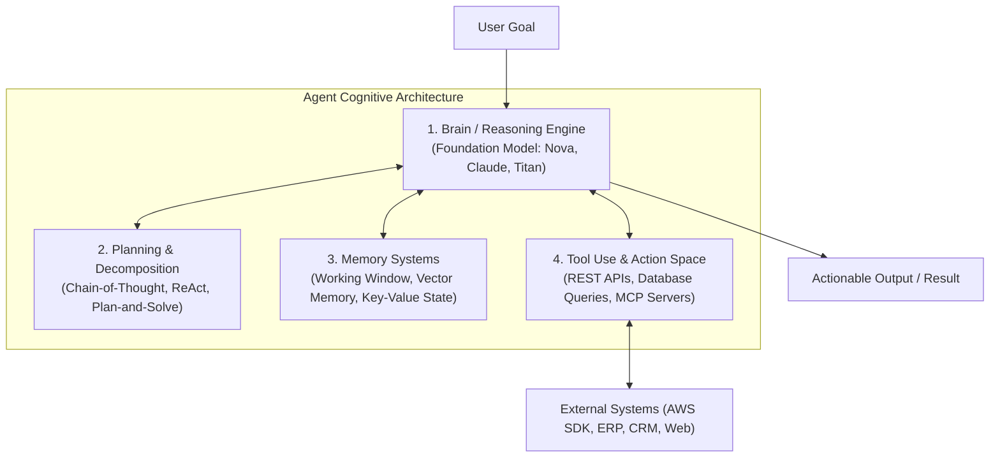
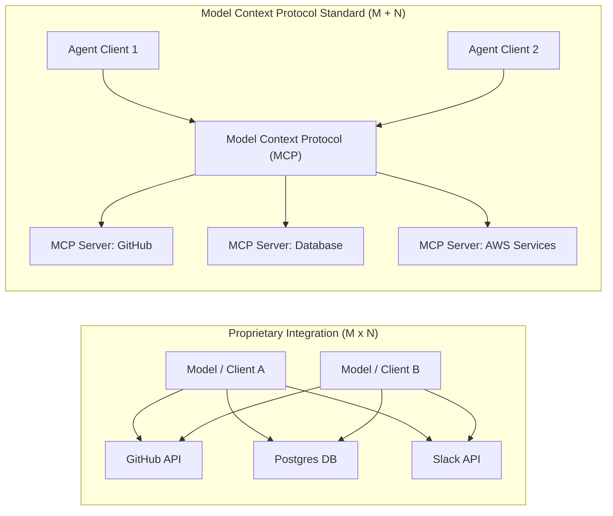
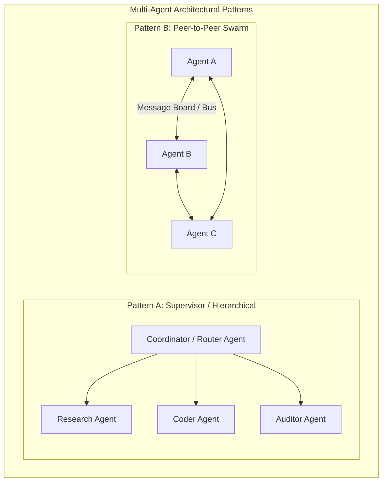
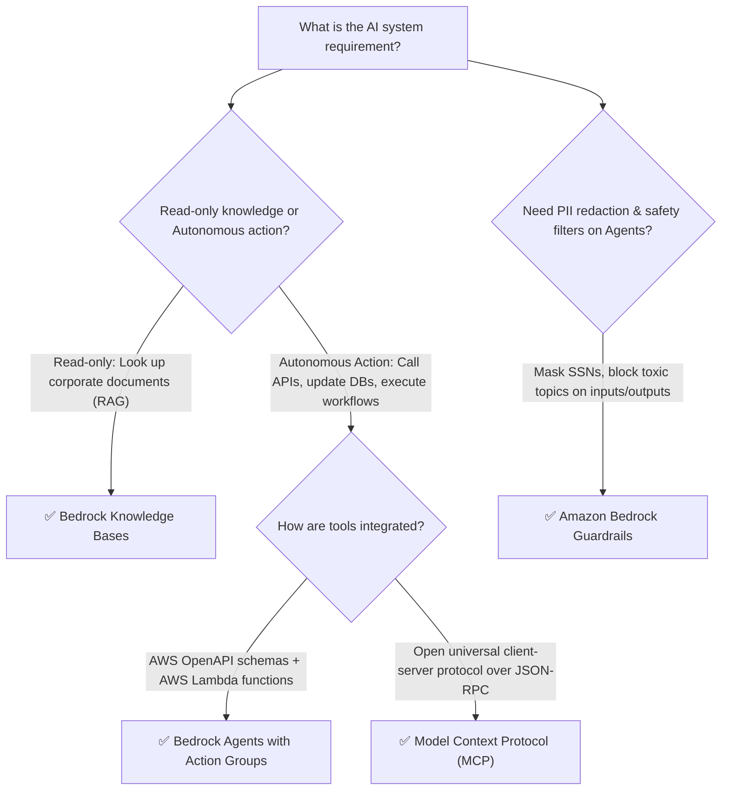

# Prerequisite 03: Agentic AI, Multi-Agent Systems, and Model Context Protocol (MCP)

> **Document:** `03_Agentic_AI_Multi_Agent_Systems_and_Model_Context_Protocol_MCP.md`  
> **Course Track:** AWS Certified AI Practitioner (`AIF-C01`)  
> **Exam Version Alignment:** Official v1.2 (October 2026 update - Agentic AI & MCP additions)  
> **Target Audience:** Practitioners, architects, and developers seeking deep conceptual mastery of autonomous reasoning loops, tool use, memory systems, and external protocol integration before configuring Amazon Bedrock Agents and AgentCore.

---

## 🧭 Executive Summary & Core Paradigm Shift

In traditional conversational Generative AI, a Foundation Model acts as a passive text generator: it accepts a user prompt, processes the context through its transformer layers, and returns a single token response. 

**Agentic AI** transforms this paradigm by granting the model **agency**: the capability to autonomously perceive user intent, formulate multi-step plans, interact with external environments via tools and APIs, observe the feedback, reflect on errors, and iterate until a complex goal is accomplished.

---

## 💡 The Real-World Analogy (ELI5)

> **The Static Encyclopedia vs. The Autonomous Executive Assistant:**
> - **Passive Generative AI (The Printed Encyclopedia):** You ask an encyclopedia on your shelf: *"Can you book a flight to Seattle for tomorrow morning and email my boss the receipt?"* The encyclopedia cannot move or touch the world. It can only generate text describing what Seattle looks like or explain how airline booking systems work.
> - **Agentic AI (The Autonomous Executive Assistant):** You give the same task to an executive assistant holding a smartphone, a calendar, and a corporate credit card. The assistant:
>   1. **Thinks (Reasoning):** *"First, I need to check the user's calendar to see when their meetings finish tomorrow."*
>   2. **Acts (Tool Use):** Calls the Google Calendar API.
>   3. **Observes:** *"User is free after 11:00 AM."*
>   4. **Acts:** Calls the Airline API to purchase the 11:45 AM flight.
>   5. **Acts:** Calls the Corporate Email API to dispatch the itinerary and receipt to the manager.
>   6. **Completes:** Reports back to the user: *"Flight 412 is booked and your boss has been notified."*

---

## 🏛️ Historical AI Pain Points: The Tool Integration Chaos

Before standardized Agentic protocols, connecting Large Language Models to enterprise software was notoriously fragile:
* **The M × N Integration Nightmare:** If an enterprise had 5 different AI models and 10 internal tools (Slack, Jira, GitHub, Postgres, Salesforce), engineers had to write and maintain 5 × 10 = 50 custom connector adapters.
* **Hallucinated API Parameters:** Models frequently invented non-existent API parameters or returned invalid JSON schemas that crashed downstream microservices.
* **The Solution (Bedrock Action Groups & Model Context Protocol):** By establishing formal OpenAPI schemas, AWS Lambda runtimes, and the open **Model Context Protocol (MCP)**, models discover and invoke standardized tools with guaranteed deterministic schemas and least-privilege security boundaries.

---

---

## 🧠 1. Cognitive Architecture of an AI Agent

An enterprise AI Agent consists of four interconnected core modules:

### 1.1 The Brain (Foundation Model)
The central reasoning engine. For agentic workloads, the model must possess strong instruction-following capabilities, high reasoning ability, and robust function-calling / tool-use output structuring (e.g., Anthropic Claude 3.5 Sonnet, Amazon Nova Pro).

### 1.2 Planning & Reasoning Frameworks
1. **ReAct (Reason + Act):** The agent generates a thought, selects an action, executes it, receives an observation, and repeats.

   $$
   \text{Thought} \rightarrow \text{Action} \rightarrow \text{Observation} \rightarrow \text{Thought} \dots
   $$

2. **Chain-of-Thought (CoT):** Breaks down complex multi-hop problems into intermediate reasoning steps.
3. **Plan-and-Solve:** The agent first outlines a global plan containing all sub-tasks, then executes each sub-task systematically.
4. **Self-Reflection & Critique:** After receiving tool execution errors or subpar results, the agent evaluates its progress and replans without requiring human intervention.

### 1.3 Memory Subsystems
* **Short-Term Memory:** The in-context conversation window (maintained across turn boundaries; optimized using prompt caching to reduce token overhead).
* **Long-Term Memory:** External persistent storage (vector databases such as Amazon OpenSearch Serverless, or key-value stores like Amazon DynamoDB) storing user preferences, historical interactions, and domain knowledge.
* **Working Memory:** Intermediate scratchpad state where intermediate tool responses and calculations reside during a multi-step execution loop.

### 1.4 Tool Use & Action Execution
Agents cannot perform arithmetic, query live stock levels, or execute infrastructure changes natively in model weights. They generate structured payloads (JSON schemas conforming to OpenAPI or Model Context Protocol) that a secure runtime executes against external systems.

---

## 🌐 2. The Model Context Protocol (MCP)

### 2.1 The Problem: The M × N Tool Integration Explosion
Historically, every AI platform (LangChain, AutoGen, Bedrock Agents, OpenAI Assistants) implemented its own proprietary format for connecting models to data sources and developer tools. Connecting $M$ models to $N$ tools required M × N distinct custom integrations.

### 2.2 What is MCP?
The **Model Context Protocol (MCP)** is an open, standardized protocol created to provide a universal mechanism for AI models to discover, inspect, and execute tools, read resources, and retrieve prompts from external servers over JSON-RPC 2.0.

### 2.3 Core Primitives of MCP
1. **Tools:** Executable functions that allow the model to perform side-effects or query data (e.g., `query_database`, `create_ticket`, `execute_bash`).
2. **Resources:** Read-only data endpoints providing static or dynamic file/context contents (e.g., `s3://bucket/report.pdf`, `git://repo/commit/sha`).
3. **Prompts:** Pre-defined interactive prompt templates and workflows exposed by the MCP server to guide the model.

### 2.4 MCP Architecture & Transports
* **Host / Client:** The application running the AI model (e.g., Amazon Bedrock Agent runtime, IDE, coding agent).
* **Server:** A lightweight process exposing tools, resources, or prompts through the protocol.
* **Transport Mechanisms:**
  * `stdio`: Standard input/output communication for local processes running on the same host.
  * `SSE` (Server-Sent Events) over HTTP: For remote and cloud-hosted MCP servers across private networks or API gateways.

---

## 👥 3. Multi-Agent Systems & Topologies

Complex enterprise workflows cannot be solved effectively by a single monolithic agent. Multi-agent systems decompose duties among specialized agents.

### 3.1 Supervisor / Router Pattern
* A central Coordinator Agent analyzes incoming user requests and delegates tasks to specialized sub-agents.
* The sub-agents report results back to the Coordinator, which synthesizes the final response.
* **AWS Implementation:** Amazon Bedrock Agent with multi-agent collaboration router routing to specialized collaborator agents.

### 3.2 Collaborative Mesh / Peer-to-Peer
* Agents communicate asynchronously over a shared event bus (e.g., Amazon EventBridge or SQS) or message board.
* Agents observe messages matching their capabilities, execute tasks, and post outcomes for peer verification.

---

## 🛡️ 4. Amazon Bedrock AgentCore & Enterprise Agent Governance

In AWS Certified AI Practitioner v1.2, agent governance and identity are critical:

1. **Amazon Bedrock AgentCore Identity:** Agents require distinct, least-privilege IAM service execution roles. An agent cannot inherit permissions from the end-user blindly; it operates under governed policies that strictly restrict which AWS Lambda functions, S3 buckets, or OpenSearch collections it can invoke.
2. **AgentCore Policy Controls:** Bedrock Guardrails intercept inputs *before* reaching the Agent's reasoning engine and inspect outputs *before* sending them to the user, stripping PII and blocking toxic content.
3. **Auditability & Traceability:** Every internal reasoning step (Thought, Action, Tool Input, Tool Output, Final Answer) is logged to Amazon CloudWatch and AWS CloudTrail for compliance audits and debugging.

---

## 📊 Summary Comparison: Agentic Components

| Component | Purpose | AWS Implementation | Standard Protocol |
|---|---|---|---|
| **Reasoning Engine** | Evaluates situation, plans actions | Amazon Bedrock (Nova Pro, Claude 3.5 Sonnet) | LLM Inference API |
| **Tool Execution** | Executes external actions | AWS Lambda, OpenAPI 3.0 schemas | REST / JSON-RPC |
| **External Interoperability** | Universal tool & resource discovery | Bedrock Agent tool connect | Model Context Protocol (MCP) |
| **Knowledge Retrieval** | Factual grounding | Amazon Bedrock Knowledge Bases | Vector Search (OpenSearch) |
| **Agent Identity & Safety** | Least privilege & content filtering | AgentCore IAM Roles + Bedrock Guardrails | IAM / Bedrock Policy Engine |

---

## 📝 Post-Topic Question Simulation & Retention Check

### Question 1
**An insurance company needs to build an AI application that automatically processes claims. The system must inspect customer damage photos, query policy coverage limits from a database, calculate eligible payout amounts, and invoke an external claims payment API to disburse funds. Which AWS service and capability is purpose-built to orchestrate this multi-step autonomous task?**
- A) Amazon Bedrock Knowledge Bases
- B) Amazon Bedrock Agents with Action Groups
- C) Amazon Comprehend Sentiment Analysis
- D) Amazon Bedrock Prompt Management

<b>Click to View Answer & Detailed Distractor Analysis</b>

**Correct Answer:** **B) Amazon Bedrock Agents with Action Groups**

* **Why it's correct:** Amazon Bedrock Agents extend foundation models with autonomous agency, using the ReAct (Reason + Act) loop to break down user requests into multi-step execution plans. Through **Action Groups** (defined via OpenAPI schemas and executed by AWS Lambda functions), Bedrock Agents can autonomously query databases and call external payment APIs to complete end-to-end business workflows.
* **Distractor Analysis:**
  - *A is incorrect:* Bedrock Knowledge Bases provides read-only document search (RAG) to ground responses, but cannot execute side-effect transactional API calls (like paying claims).
  - *C is incorrect:* Amazon Comprehend extracts sentiment and entities from text, but has zero orchestration, agentic planning, or API execution capabilities.
  - *D is incorrect:* Prompt Management saves, versions, and tracks prompt templates, but does not execute external business actions.

---

### Question 2
**What is the core architectural advantage of the Model Context Protocol (MCP) in multi-agent and tool-augmented AI systems?**
- A) It eliminates the need for foundation models to use token embeddings
- B) It provides an open, standardized protocol that reduces the tool integration complexity from M × N custom adapters to an open standard ($M + N$) over JSON-RPC
- C) It automatically replaces all AWS Lambda functions with physical servers
- D) It bypasses IAM permissions to allow agents unrestricted root database access

<b>Click to View Answer & Detailed Distractor Analysis</b>

**Correct Answer:** **B) It provides an open, standardized protocol that reduces the tool integration complexity from M × N custom adapters to an open standard ($M + N$) over JSON-RPC**

* **Why it's correct:** The Model Context Protocol (MCP) establishes a universal, open standard for AI models to discover tools, access resources, and execute functions. By standardizing communication over JSON-RPC 2.0 (via `stdio` or HTTP `SSE`), any MCP client can seamlessly interface with any MCP server, eliminating the need to write custom point-to-point connectors for every combination of model and tool.
* **Distractor Analysis:**
  - *A is incorrect:* MCP does not alter foundation model internal embedding or transformer architectures.
  - *C is incorrect:* MCP is an application-level communication protocol, not a server virtualization or hardware provisioning tool.
  - *D is incorrect:* MCP enforces strict security boundaries; agents must still operate under governed, least-privilege IAM credentials.

---

## 🧠 Master MCQ Solving Blueprint: Pattern Decryption & Elimination Tricks

> *This blueprint distills recurring patterns, keyword triggers, and trap options extracted from over 400 questions on Agentic AI, Bedrock Agents, Action Groups, and MCP across the official AIF-C01 question bank.*

### 1. The "Clue-to-Service" Linguistic Decryption Matrix
When reading a question scenario, search for these exact phrasing triggers:

| If You See This Trigger Phrase in the Question Stem... | The Correct Concept / Service Is... | Trap Distractor to Immediately Discard |
|---|---|---|
| *"Autonomous multi-step task execution; breaks down goals; calls external APIs and databases"* | **Amazon Bedrock Agents** | *Bedrock Knowledge Bases* (Knowledge Bases is read-only search!) |
| *"Connect Bedrock Agents to external enterprise systems using OpenAPI schemas and AWS Lambda"* | **Bedrock Action Groups** | *Prompt Engineering* |
| *"Open, universal standard for AI models to discover tools, resources, and prompts over JSON-RPC"* | **Model Context Protocol (MCP)** | *LangChain* or *REST API Gateway* |
| *"Dynamic factual knowledge injection without executing external transactional API actions"* | **Bedrock Knowledge Bases (RAG)** | *Bedrock Agents* (Agents are for taking actions!) |
| *"Agent cognitive loop: Thought → Action → Observation → Thought"* | **ReAct Framework** | *Chain-of-Thought* (CoT reasons, but does not act on tools) |
| *"Supervisor agent coordinates multiple specialized sub-agents and synthesizes results"* | **Hierarchical Multi-Agent Collaboration** | *Peer-to-Peer Swarm* |
| *"Intercept user inputs and model outputs in agent workflows to mask PII and block toxic content"* | **Amazon Bedrock Guardrails** | *AWS WAF* (WAF inspects HTTP packets, not semantic AI toxicity) |

### 2. The 3-Step Rapid Elimination Heuristic
When evaluating an Agentic AI or Bedrock Agent question:
1. **Step 1: Action vs. Information Retrieval:**
   - Does the workload need to **execute side-effects** (e.g. create a Jira ticket, book a hotel, execute a SQL update)? → **Amazon Bedrock Agents with Action Groups**.
   - Does the workload strictly need to **look up answers from internal PDF/Word documents**? → **Amazon Bedrock Knowledge Bases (RAG)**.
2. **Step 2: Check Tool Protocol:**
   - Proprietary AWS OpenAPI + Lambda integration → **Bedrock Action Groups**.
   - Universal open standard connecting models to developer tools & local processes → **Model Context Protocol (MCP)**.
3. **Step 3: Security & Governance Boundary:**
   - Agents require a dedicated **IAM execution role** with least privilege.
   - All tool calls and intermediate agent reasoning steps are audited via **Amazon CloudWatch** and **AWS CloudTrail**.

### 3. High-Frequency Decoy Autopsy: Why AWS Tries to Trick You
* **Decoy #1: "Bedrock Agents" vs. "Bedrock Knowledge Bases"**
  - *The Trap:* An AI assistant answers customer questions and updates their billing address.
  - *The Autopsy:* If the assistant only *read* the address, Knowledge Bases would suffice. But because it must **update (write) the address in an external database**, the system requires **Amazon Bedrock Agents with an Action Group**.
* **Decoy #2: "Chain-of-Thought (CoT)" vs. "ReAct"**
  - *The Trap:* The scenario describes an LLM reasoning step-by-step before invoking a calculator tool.
  - *The Autopsy:* **Chain-of-Thought** is pure text reasoning (*"Let's think step by step"*). **ReAct (Reason + Act)** explicitly combines reasoning with an **Action step** that invokes an external tool, and an **Observation step** that reads the tool's output.

### 4. 10-Second Visual Decision Flowchart

---

## 🔗 Related Resources
* Next: [Domain 2: Fundamentals of Generative AI](../06_Explanations/02_Domain_2_Fundamentals_of_Generative_AI.md)
* Hands-on Lab: [Lab 04: Autonomous AI Agents with Bedrock AgentCore, Action Groups & MCP](../07_Hands_On_Labs/Lab_04_Autonomous_AI_Agents_with_Bedrock_AgentCore_Action_Groups_and_MCP.md)
* Architecture Diagram: [Diagram 05: Agentic AI Workflow and Model Context Protocol](../05_Diagrams/Diagram_05_Agentic_AI_Workflow_and_Model_Context_Protocol_MCP.md)
