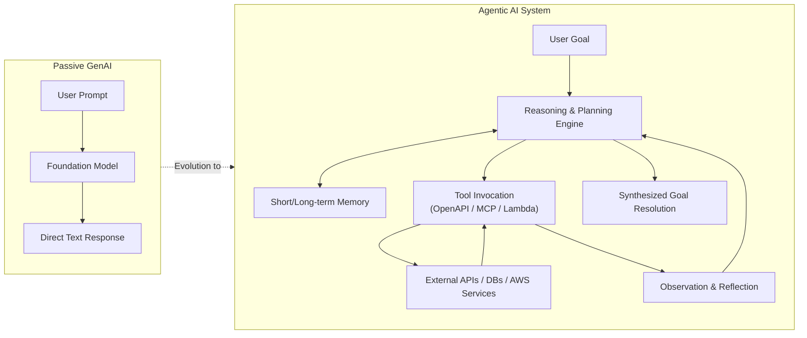
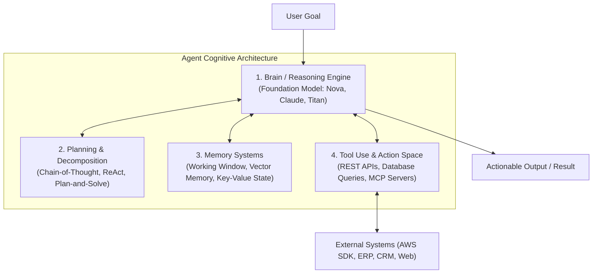
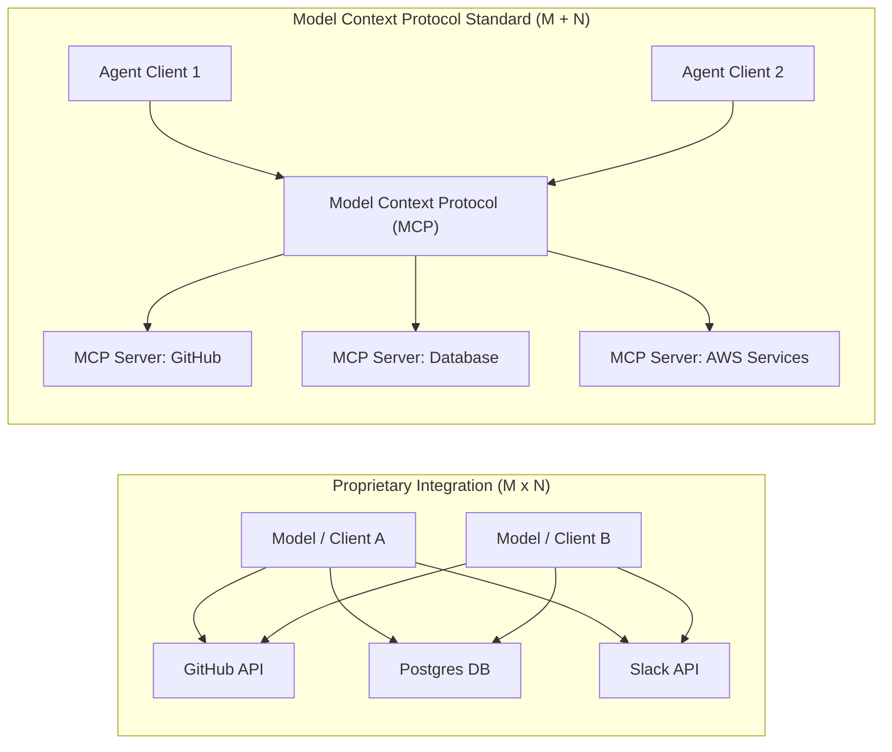
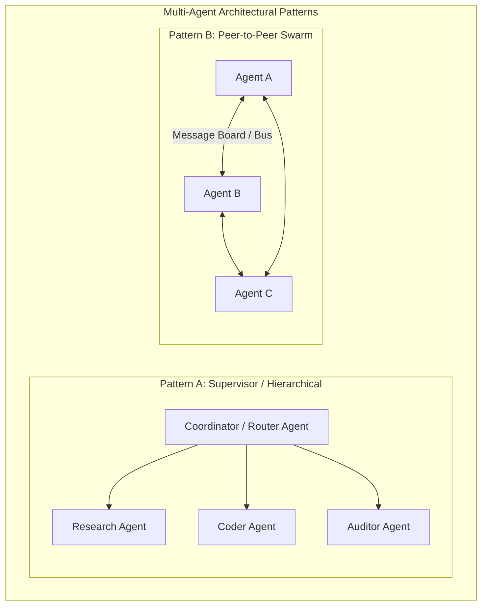

# Prerequisite 03: Agentic AI, Multi-Agent Systems, and Model Context Protocol (MCP)

> **Document:** `03_Agentic_AI_Multi_Agent_Systems_and_Model_Context_Protocol_MCP.md`  
> **Course Track:** AWS Certified AI Practitioner (`AIF-C01`)  
> **Exam Version Alignment:** Official v1.2 (October 2026 update - Agentic AI & MCP additions)  
> **Target Audience:** Practitioners, architects, and developers seeking deep conceptual mastery of autonomous reasoning loops, tool use, memory systems, and external protocol integration before configuring Amazon Bedrock Agents and AgentCore.

---

## 🧭 Executive Summary & Core Paradigm Shift

In traditional conversational Generative AI, a Foundation Model acts as a passive text generator: it accepts a user prompt, processes the context through its transformer layers, and returns a single token response. 

**Agentic AI** transforms this paradigm by granting the model **agency**: the capability to autonomously perceive user intent, formulate multi-step plans, interact with external environments via tools and APIs, observe the feedback, reflect on errors, and iterate until a complex goal is accomplished.

---

## 🧠 1. Cognitive Architecture of an AI Agent

An enterprise AI Agent consists of four interconnected core modules:

### 1.1 The Brain (Foundation Model)
The central reasoning engine. For agentic workloads, the model must possess strong instruction-following capabilities, high reasoning ability, and robust function-calling / tool-use output structuring (e.g., Anthropic Claude 3.5 Sonnet, Amazon Nova Pro).

### 1.2 Planning & Reasoning Frameworks
1. **ReAct (Reason + Act):** The agent generates a thought, selects an action, executes it, receives an observation, and repeats.
   $$\text{Thought} \rightarrow \text{Action} \rightarrow \text{Observation} \rightarrow \text{Thought} \dots$$
2. **Chain-of-Thought (CoT):** Breaks down complex multi-hop problems into intermediate reasoning steps.
3. **Plan-and-Solve:** The agent first outlines a global plan containing all sub-tasks, then executes each sub-task systematically.
4. **Self-Reflection & Critique:** After receiving tool execution errors or subpar results, the agent evaluates its progress and replans without requiring human intervention.

### 1.3 Memory Subsystems
* **Short-Term Memory:** The in-context conversation window (maintained across turn boundaries; optimized using prompt caching to reduce token overhead).
* **Long-Term Memory:** External persistent storage (vector databases such as Amazon OpenSearch Serverless, or key-value stores like Amazon DynamoDB) storing user preferences, historical interactions, and domain knowledge.
* **Working Memory:** Intermediate scratchpad state where intermediate tool responses and calculations reside during a multi-step execution loop.

### 1.4 Tool Use & Action Execution
Agents cannot perform arithmetic, query live stock levels, or execute infrastructure changes natively in model weights. They generate structured payloads (JSON schemas conforming to OpenAPI or Model Context Protocol) that a secure runtime executes against external systems.

---

## 🌐 2. The Model Context Protocol (MCP)

### 2.1 The Problem: The $M \times N$ Tool Integration Explosion
Historically, every AI platform (LangChain, AutoGen, Bedrock Agents, OpenAI Assistants) implemented its own proprietary format for connecting models to data sources and developer tools. Connecting $M$ models to $N$ tools required $M \times N$ distinct custom integrations.

### 2.2 What is MCP?
The **Model Context Protocol (MCP)** is an open, standardized protocol created to provide a universal mechanism for AI models to discover, inspect, and execute tools, read resources, and retrieve prompts from external servers over JSON-RPC 2.0.

### 2.3 Core Primitives of MCP
1. **Tools:** Executable functions that allow the model to perform side-effects or query data (e.g., `query_database`, `create_ticket`, `execute_bash`).
2. **Resources:** Read-only data endpoints providing static or dynamic file/context contents (e.g., `s3://bucket/report.pdf`, `git://repo/commit/sha`).
3. **Prompts:** Pre-defined interactive prompt templates and workflows exposed by the MCP server to guide the model.

### 2.4 MCP Architecture & Transports
* **Host / Client:** The application running the AI model (e.g., Amazon Bedrock Agent runtime, IDE, coding agent).
* **Server:** A lightweight process exposing tools, resources, or prompts through the protocol.
* **Transport Mechanisms:**
  * `stdio`: Standard input/output communication for local processes running on the same host.
  * `SSE` (Server-Sent Events) over HTTP: For remote and cloud-hosted MCP servers across private networks or API gateways.

---

## 👥 3. Multi-Agent Systems & Topologies

Complex enterprise workflows cannot be solved effectively by a single monolithic agent. Multi-agent systems decompose duties among specialized agents.

### 3.1 Supervisor / Router Pattern
* A central Coordinator Agent analyzes incoming user requests and delegates tasks to specialized sub-agents.
* The sub-agents report results back to the Coordinator, which synthesizes the final response.
* **AWS Implementation:** Amazon Bedrock Agent with multi-agent collaboration router routing to specialized collaborator agents.

### 3.2 Collaborative Mesh / Peer-to-Peer
* Agents communicate asynchronously over a shared event bus (e.g., Amazon EventBridge or SQS) or message board.
* Agents observe messages matching their capabilities, execute tasks, and post outcomes for peer verification.

---

## 🛡️ 4. Amazon Bedrock AgentCore & Enterprise Agent Governance

In AWS Certified AI Practitioner v1.2, agent governance and identity are critical:

1. **Amazon Bedrock AgentCore Identity:** Agents require distinct, least-privilege IAM service execution roles. An agent cannot inherit permissions from the end-user blindly; it operates under governed policies that strictly restrict which AWS Lambda functions, S3 buckets, or OpenSearch collections it can invoke.
2. **AgentCore Policy Controls:** Bedrock Guardrails intercept inputs *before* reaching the Agent's reasoning engine and inspect outputs *before* sending them to the user, stripping PII and blocking toxic content.
3. **Auditability & Traceability:** Every internal reasoning step (Thought, Action, Tool Input, Tool Output, Final Answer) is logged to Amazon CloudWatch and AWS CloudTrail for compliance audits and debugging.

---

## 📊 Summary Comparison: Agentic Components

| Component | Purpose | AWS Implementation | Standard Protocol |
|---|---|---|---|
| **Reasoning Engine** | Evaluates situation, plans actions | Amazon Bedrock (Nova Pro, Claude 3.5 Sonnet) | LLM Inference API |
| **Tool Execution** | Executes external actions | AWS Lambda, OpenAPI 3.0 schemas | REST / JSON-RPC |
| **External Interoperability** | Universal tool & resource discovery | Bedrock Agent tool connect | Model Context Protocol (MCP) |
| **Knowledge Retrieval** | Factual grounding | Amazon Bedrock Knowledge Bases | Vector Search (OpenSearch) |
| **Agent Identity & Safety** | Least privilege & content filtering | AgentCore IAM Roles + Bedrock Guardrails | IAM / Bedrock Policy Engine |

---

## 🔗 Related Resources
* Next: [Domain 2: Fundamentals of Generative AI](../06_Explanations/02_Domain_2_Fundamentals_of_Generative_AI.md)
* Hands-on Lab: [Lab 04: Autonomous AI Agents with Bedrock AgentCore, Action Groups & MCP](../07_Hands_On_Labs/Lab_04_Autonomous_AI_Agents_with_Bedrock_AgentCore_Action_Groups_and_MCP.md)
* Architecture Diagram: [Diagram 05: Agentic AI Workflow and Model Context Protocol](../05_Diagrams/Diagram_05_Agentic_AI_Workflow_and_Model_Context_Protocol_MCP.md)
