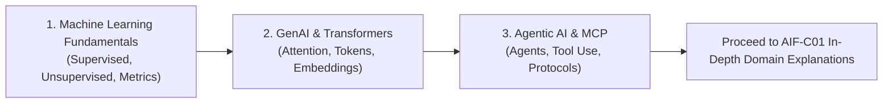

# 🤖 AI Practitioner (AIF-C01) Prerequisite Knowledge Guide

> **Module:** Prerequisites & Foundational Data Science Concepts  
> **Course:** AWS Certified AI Practitioner (`AIF-C01`)  
> **Exam Version Alignment:** Official v1.2 (October 2026 update)  
> **Target Audience:** Students, engineers, and architects entering Artificial Intelligence and Generative AI on AWS.

---

## 🗺️ Prerequisite Modules Index

| Document | Topic | Key Concepts Covered | Why It Matters in AWS |
| :--- | :--- | :--- | :--- |
| **[01_Machine_Learning_Fundamentals.md](./01_Machine_Learning_Fundamentals.md)** | Core Machine Learning | Supervised vs Unsupervised, Bias-Variance Tradeoff, Loss Functions, Metrics | Understand Amazon SageMaker Studio, Canvas, and Model Training pipelines |
| **[02_Generative_AI_and_Transformers.md](./02_Generative_AI_and_Transformers.md)** | GenAI & Architecture | Attention Mechanism, Tokens, Context Windows, Embeddings | Essential for configuring Amazon Bedrock foundation models, temperature, and RAG |
| **[03_Agentic_AI_Multi_Agent_Systems_and_Model_Context_Protocol_MCP.md](./03_Agentic_AI_Multi_Agent_Systems_and_Model_Context_Protocol_MCP.md)** | Agentic AI & MCP | Autonomous Loops (ReAct/CoT), Model Context Protocol (MCP), Multi-Agent Topologies, Memory Systems | Required for Amazon Bedrock AgentCore, Action Groups, and Tool Integration |

---

## 🎓 Recommended Study Order

