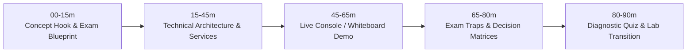

# 🎓 AWS Certified AI Practitioner (AIF-C01) Instructor Delivery Manuals

> **Module:** Classroom Delivery Plans & Instructor Notes  
> **Course:** AWS Certified AI Practitioner (`AIF-C01`)  
> **Exam Version Alignment:** Official v1.2 (October 2026)  
> **Target Audience:** Certified AWS Trainers, technical delivery instructors, and study group leaders.

---

## 🗺️ Master Lecture Index

| Lecture File | Domain Alignment | Exam Weight | Core Subjects & Demos | Associated Labs |
|:--- |:--- |:---:|---|:---:|
| **[Lecture 01](./Lecture_01_AI_ML_Fundamentals_and_AWS_Ecosystem.md)** | **Domain 1:** Fundamentals of AI & ML | 20% | AI/ML/DL taxonomy, supervised/unsupervised/RL, ML lifecycle, evaluation metrics, SageMaker Canvas & AI Services. | Lab 06, 07, 11 |
| **[Lecture 02](./Lecture_02_Generative_AI_and_Amazon_Bedrock.md)** | **Domain 2:** Fundamentals of Generative AI | 24% | Transformers, Self-Attention, tokens, embeddings, context windows, Amazon Nova family, Agentic AI & MCP. | Lab 01, 02, 04 |
| **[Lecture 03](./Lecture_03_Prompt_Engineering_and_RAG_Architecture.md)** | **Domain 3:** Applications of Foundation Models | 28% | Model selection criteria, Few-Shot & CoT, Prompt Caching, Enterprise RAG, Vector Search, LoRA, LLM-as-a-judge. | Lab 01, 03, 08 |
| **[Lecture 04](./Lecture_04_Responsible_AI_and_Model_Governance.md)** | **Domain 4:** Guidelines for Responsible AI | 14% | Responsible AI pillars, pre/post-training bias (CI, DPL, DI), SHAP explainability, Bedrock Guardrails, Model Cards. | Lab 05, 09, 10 |
| **[Lecture 05](./Lecture_05_Security_Compliance_and_Governance_for_AI.md)** | **Domain 5:** Security, Compliance & Governance | 14% | Generative AI Security Scoping Matrix, zero data retention, PrivateLink, IAM, Macie, CloudTrail, KMS CMKs. | Lab 05, 10, 12 |

---

## 🧭 Instructor Classroom Delivery Structure (Each 90-min Session)

