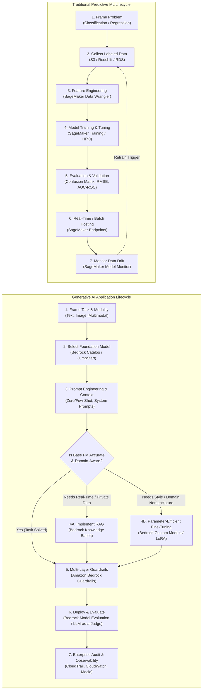

# Diagram 01: Traditional Machine Learning vs. Generative AI Lifecycle

> **Architecture Blueprint:** `Diagram_01_Traditional_ML_vs_GenAI_Lifecycle.md`  
> **Course:** AWS Certified AI Practitioner (`AIF-C01`)  
> **Domain Alignment:** Domain 1 & Domain 2

---

## 🏛️ Architectural Blueprint

---

## 🔍 Core Architectural Highlights

1. **Data Dependency:** Traditional ML requires thousands of curated, task-specific ground-truth labeled examples. Generative AI leverages massive pre-trained Foundation Models with zero-to-few task-specific examples.
2. **Feature Engineering vs Prompt Engineering:** In classical ML, humans explicitly craft mathematical features (one-hot encoding, PCA). In GenAI, practitioners engineer textual context, schemas, and system directives.
3. **Adaptation Mechanisms:** While traditional ML requires complete retraining to adjust to new tasks, GenAI adapts via prompt engineering, RAG, or PEFT/LoRA without altering base transformer architectures.
