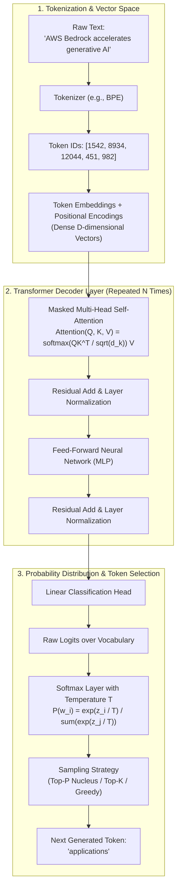

# Diagram 02: Transformer Architecture and Tokenization

> **Architecture Blueprint:** `Diagram_02_Transformer_Architecture_and_Tokenization.md`  
> **Course:** AWS Certified AI Practitioner (`AIF-C01`)  
> **Domain Alignment:** Domain 2 (Generative AI Fundamentals)

---

## 🏛️ Architectural Blueprint

---

## 🔍 Core Architectural Highlights

1. **Self-Attention Mechanics:** Allows each token to attend to every other token simultaneously using learned Query ($Q$), Key ($K$), and Value ($V$) projections.
2. **Causal Masking:** Ensures decoder-only foundation models (like Amazon Nova or Claude) can only look at past tokens, preventing future token leakage during text generation.
3. **Sampling Control:** 
   * Temperature T → 0 collapses the distribution into deterministic greedy argmax.
   * Higher $T$ flattens the distribution, increasing linguistic diversity.
   * Top-P restricts generation to the dynamic set of top tokens whose cumulative probability exceeds $P$.
