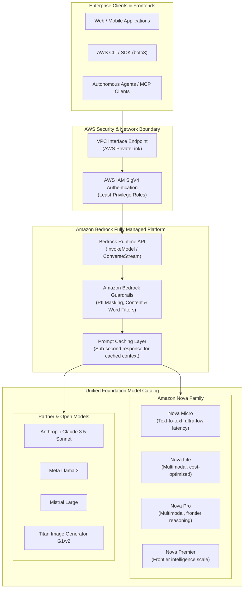

# Diagram 03: Amazon Bedrock Serverless Topology and Nova Models

> **Architecture Blueprint:** `Diagram_03_Amazon_Bedrock_Serverless_Topology_and_Nova_Models.md`  
> **Course:** AWS Certified AI Practitioner (`AIF-C01`)  
> **Domain Alignment:** Domain 2 & Domain 3

---

## 🏛️ Architectural Blueprint

---

## 🔍 Core Architectural Highlights

1. **Serverless Abstraction:** No EC2 instances, cluster auto-scaling, or GPU drivers to manage; developers call uniform REST APIs.
2. **PrivateLink Integration:** Client requests never traverse the public internet when routed through private VPC endpoints.
3. **Nova Family Tiers:** Spans from lightweight sub-second processing (Nova Micro) to multimodal frontier intelligence (Nova Pro/Premier).
