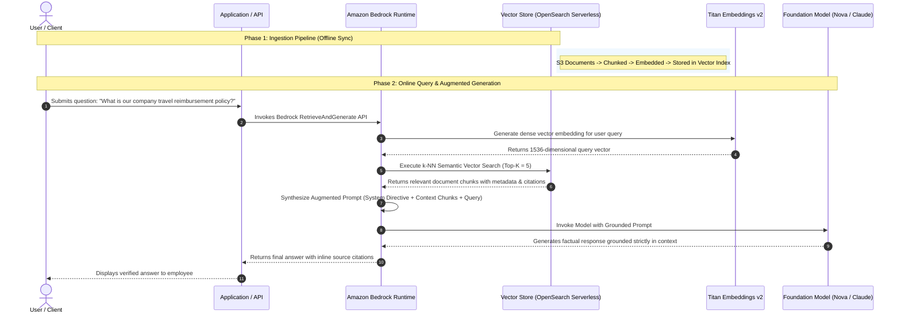

# Diagram 04: Enterprise RAG Ingestion and Retrieval Flow

> **Architecture Blueprint:** `Diagram_04_Enterprise_RAG_Ingestion_and_Retrieval_Flow.md`  
> **Course:** AWS Certified AI Practitioner (`AIF-C01`)  
> **Domain Alignment:** Domain 3 (Applications of Foundation Models)

---

## 🏛️ Architectural Blueprint

---

## 🔍 Core Architectural Highlights

1. **Dual-Phase Architecture:** Decouples heavy document ingestion (asynchronous parsing, chunking, and embedding) from low-latency online inference.
2. **Deterministic Grounding:** The LLM is constrained to respond using only retrieved snippets, mitigating hallucinations.
3. **Traceability:** Bedrock Knowledge Bases automatically appends S3 document citations (bucket, object, and page numbers) for auditable compliance.
