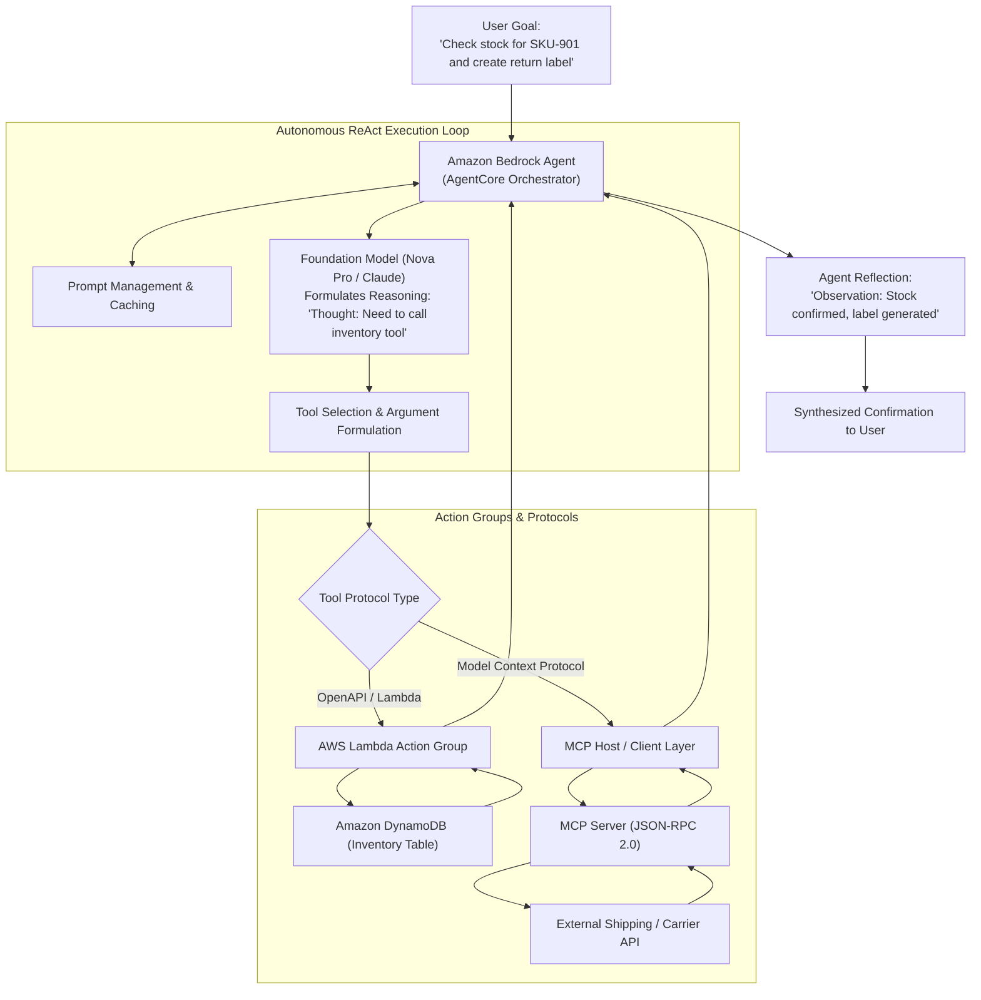

# Diagram 05: Agentic AI Workflow and Model Context Protocol (MCP)

> **Architecture Blueprint:** `Diagram_05_Agentic_AI_Workflow_and_Model_Context_Protocol_MCP.md`  
> **Course:** AWS Certified AI Practitioner (`AIF-C01`)  
> **Domain Alignment:** Domain 2 & Domain 3 (Agentic AI & MCP additions - v1.2)

---

## 🏛️ Architectural Blueprint

---

## 🔍 Core Architectural Highlights

1. **Autonomous Planning:** Bedrock Agents use ReAct (Reason + Act) prompting to break complex natural language goals into executable sub-actions.
2. **Standardized Tool Integration:** Interoperates seamlessly with native AWS Lambda action groups and industry-standard Model Context Protocol (MCP) servers.
3. **Auditability:** Internal execution traces (thoughts, tool inputs, execution results) are logged to Amazon CloudWatch for debugging and security auditing.
