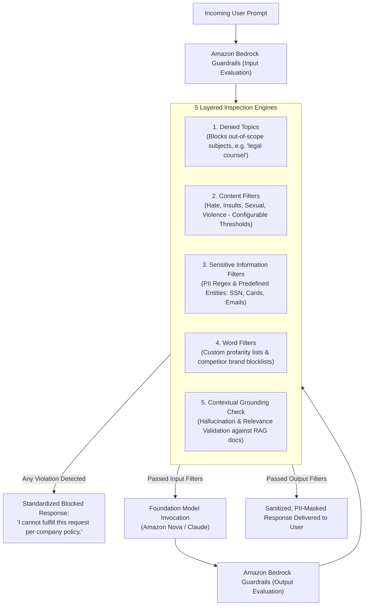

# Diagram 07: Amazon Bedrock Guardrails Multi-Layered Perimeter

> **Architecture Blueprint:** `Diagram_07_Bedrock_Guardrails_Multi_Layered_Perimeter.md`  
> **Course:** AWS Certified AI Practitioner (`AIF-C01`)  
> **Domain Alignment:** Domain 4 (Guidelines for Responsible AI)

---

## 🏛️ Architectural Blueprint

---

## 🔍 Core Architectural Highlights

1. **Independent Security Layer:** Guardrails operate independently of the underlying foundation model, ensuring consistent safety policies across different models (Nova, Claude, Titan).
2. **PII Masking vs. Blocking:** Sensitive information filters can either redact confidential data (e.g., transforming `4111-XXXX` to `[CREDIT_CARD]`) or terminate the conversation entirely.
3. **Contextual Grounding:** Specifically mitigates hallucinations in RAG architectures by verifying that generated claims are factually grounded in retrieved knowledge base chunks.
