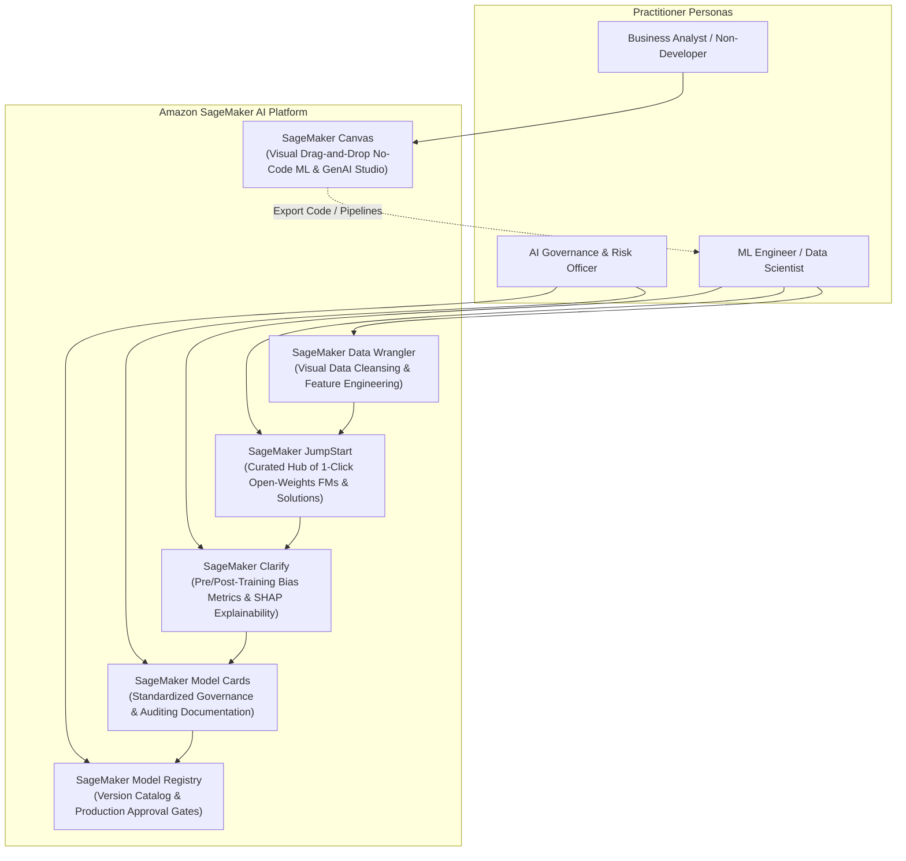

# Diagram 08: Amazon SageMaker AI Ecosystem (Canvas, JumpStart, Clarify)

> **Architecture Blueprint:** `Diagram_08_SageMaker_AI_Ecosystem_Canvas_JumpStart_Clarify.md`  
> **Course:** AWS Certified AI Practitioner (`AIF-C01`)  
> **Domain Alignment:** Domain 1 & Domain 4

---

## 🏛️ Architectural Blueprint

---

## 🔍 Core Architectural Highlights

1. **Canvas Democratization:** Empowers non-technical domain experts to train classification, regression, and time-series models without coding, while permitting data scientists to export models into automated production pipelines.
2. **JumpStart Foundation Hub:** Offers one-click deployment for hundreds of open-source models (Meta Llama, Mistral, Falcon) onto dedicated, secure SageMaker hosting endpoints.
3. **End-to-End Governance Loop:** SageMaker Clarify detects algorithmic bias and computes SHAP feature attributions, which are automatically embedded into SageMaker Model Cards and governed through SageMaker Model Registry.
