# Diagram 09: Generative AI Security Scoping Matrix

> **Architecture Blueprint:** `Diagram_09_Generative_AI_Security_Scoping_Matrix.md`  
> **Course:** AWS Certified AI Practitioner (`AIF-C01`)  
> **Domain Alignment:** Domain 5 (Security, Compliance, and Governance)

---

## 🏛️ Architectural Blueprint

```mermaid
flowchart TD
    subgraph Matrix["AWS Generative AI Security Scoping Matrix"]
        direction TB
        
        subgraph Scope1["Scope 1: Third-Party Consumer Applications"]
            S1Desc["Public AI Chatbots & Consumer Browser Extensions"]
            S1Cust["Customer Responsibility:\n- Data entered into prompts\n- Policy enforcement"]
            S1AWS["Provider Responsibility:\n- Infrastructure & model safety"]
        end

        subgraph Scope2["Scope 2: Enterprise Managed AI Services"]
            S2Desc["Amazon Bedrock (On-Demand) & Amazon Q"]
            S2Cust["Customer Responsibility:\n- IAM permissions & PrivateLink\n- Guardrail threshold configuration\n- Input classification"]
            S2AWS["AWS Responsibility:\n- Physical security, API uptime\n- Zero customer data used for base model training"]
        end

        subgraph Scope3["Scope 3: Custom Models, Fine-Tuning & RAG"]
            S3Desc["Bedrock Knowledge Bases, Custom LoRA Models, JumpStart"]
            S3Cust["Customer Responsibility:\n- Sanitizing S3 RAG & training data (Macie)\n- Vector DB access control\n- Model evaluation & bias auditing (Clarify)"]
            S3AWS["AWS Responsibility:\n- Hyperparameter execution isolation\n- Private tenant KMS weight storage"]
        end

        subgraph Scope4["Scope 4: Custom Foundation Models from Scratch"]
            S4Desc["Self-Trained Base Models on AWS Trainium / UltraClusters"]
            S4Cust["Customer Responsibility:\n- Full end-to-end dataset curation & filtering\n- Architectural design & pre-training\n- Complete legal copyright & ethical compliance"]
            S4AWS["AWS Responsibility:\n- Cloud hardware availability & hyper-scale networking"]
        end
    end

    Scope1 --> Scope2 --> Scope3 --> Scope4
```

---

## 🔍 Core Architectural Highlights

1. **Shift of Responsibility:** As organizations transition from Scope 1 to Scope 4, the security, compliance, and governance burden shifts dramatically from AWS onto the customer.
2. **Zero-Training Pledge (Scope 2):** In Amazon Bedrock, AWS guarantees that customer prompts and responses are **never** used to train the underlying foundation models.
3. **Data Sanitization Imperative (Scope 3):** When performing RAG or fine-tuning, customers must use tools like **Amazon Macie** to discover and redact PII before documents reach the model ingestion pipeline.
