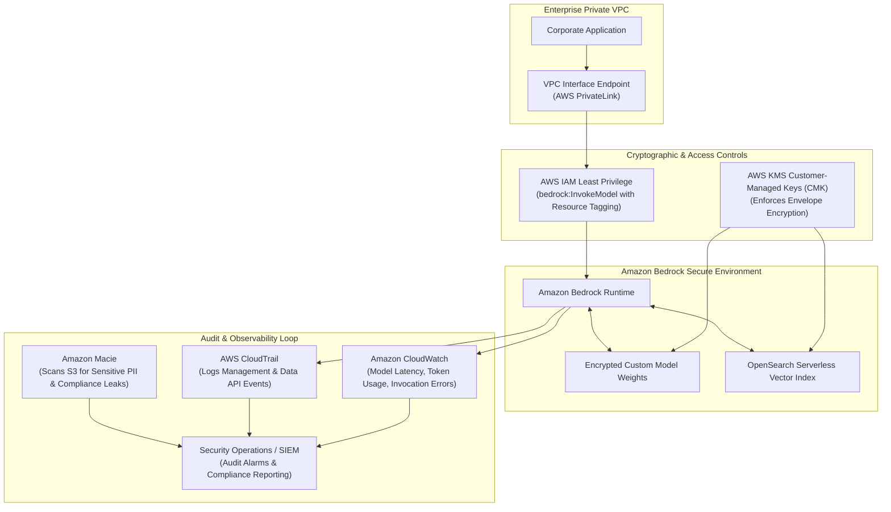

# Diagram 10: Enterprise AI Security, KMS, and Audit Loop

> **Architecture Blueprint:** `Diagram_10_Enterprise_AI_Security_KMS_and_Audit_Loop.md`  
> **Course:** AWS Certified AI Practitioner (`AIF-C01`)  
> **Domain Alignment:** Domain 5 (Security, Compliance, and Governance)

---

## 🏛️ Architectural Blueprint

---

## 🔍 Core Architectural Highlights

1. **Defense-in-Depth:** Combines network isolation (PrivateLink), access management (IAM SigV4), and cryptographic boundaries (KMS CMKs).
2. **Comprehensive Telemetry:** CloudTrail records every API call (who invoked what model at what timestamp), while CloudWatch tracks operational metrics (latency, token consumption, and errors).
3. **Proactive Sensitive Data Discovery:** Amazon Macie continuously monitors training and RAG data buckets in S3, alerting security operations before sensitive PII is exposed to generative pipelines.
