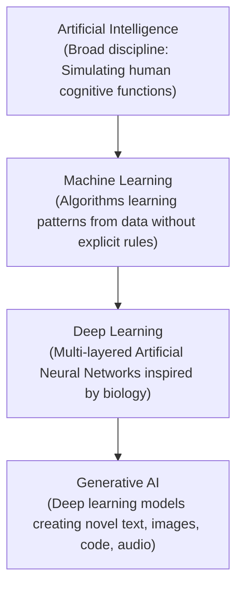
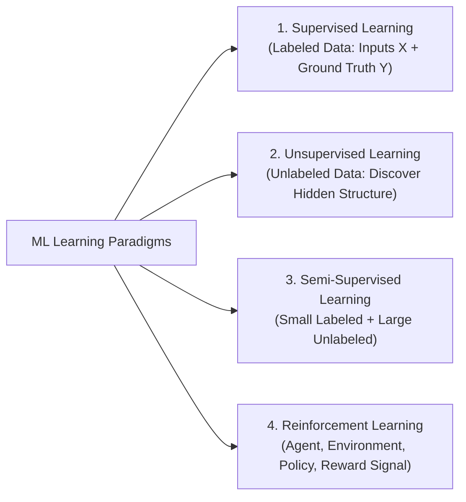
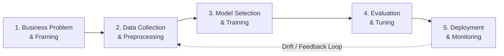
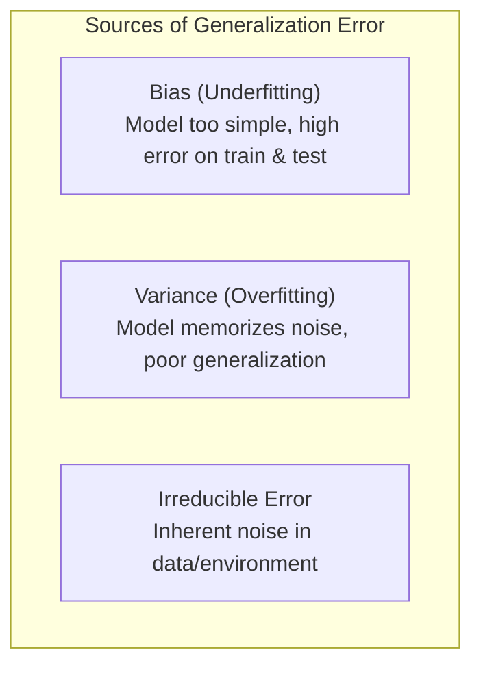
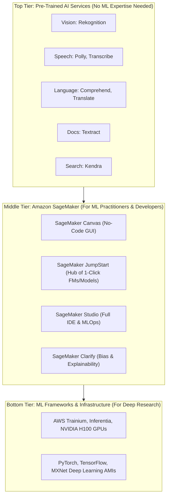
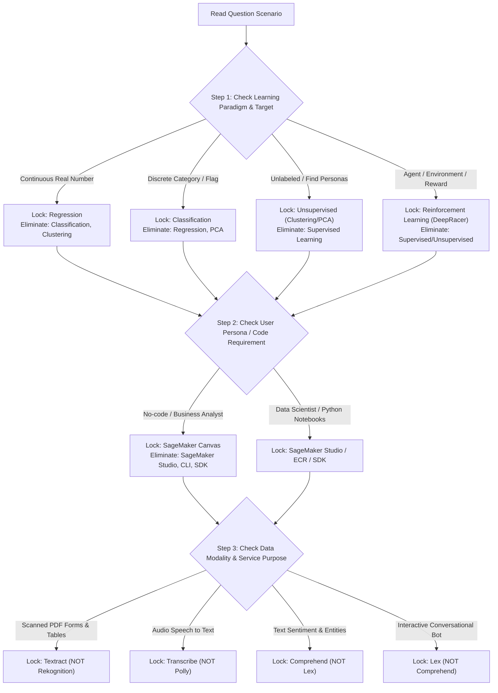
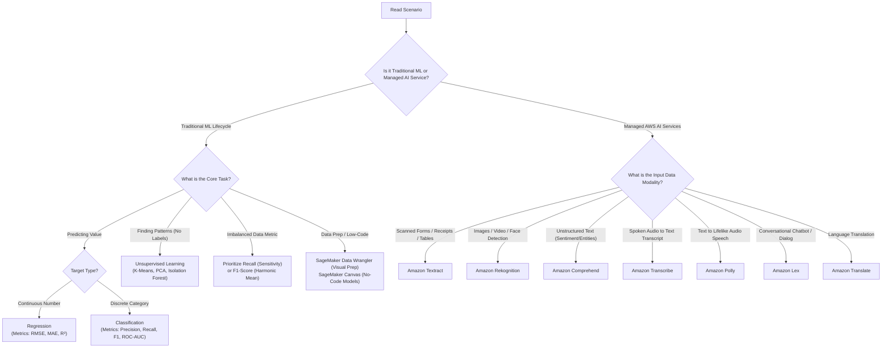

# Domain 1: Fundamentals of AI and Machine Learning

> **Weight:** 20% of Scored Exam Content  
> **Course:** AWS Certified AI Practitioner (`AIF-C01`)  
> **Exam Guide Baseline:** v1.2 (October 2026)  
> **Index:** `AI/Practitioner/AIF-C01/06_Explanations/01_Domain_1_Fundamentals_of_AI_and_ML.md`

---

## 🧭 Domain Overview

Domain 1 tests foundational understanding of core artificial intelligence (AI), machine learning (ML), and deep learning (DL) paradigms, their distinctions, mathematical problem formulations, the end-to-end ML lifecycle, evaluation metrics, and the native AWS service catalog for predictive AI.

---

## 💡 The Real-World Analogy (ELI5)

> **The Culinary Apprenticeship (How Computers Learn):**
> - **Traditional Rule-Based Software:** Following an unyielding, handwritten cookbook recipe. *"If oven timer == 45 minutes, turn off heat."* If the kitchen temperature changes or the chicken is frozen, the recipe fails blindly because it cannot adapt.
> - **Supervised Machine Learning:** An apprentice chef studying under a master. The master shows the apprentice 10,000 labeled photographs of cakes: *"This is undercooked,"* *"This is perfectly baked,"* *"This is burned."* The apprentice learns the mathematical relationship between oven temperature, pan size, and doneness.
> - **Unsupervised Machine Learning:** Unloading 500 crates of unlabeled, mysterious exotic spices into a warehouse. Nobody tells the apprentice what they are. The apprentice groups them by scent, grain texture, and color (clustering) discovering hidden patterns without labels.
> - **Reinforcement Learning:** A chef learning by trial and error in a live dining room. Every time customers applaud and tip $50, the chef receives a positive reward; every time a dish is sent back to the kitchen, the chef receives a negative penalty. Over thousands of meals, the chef optimizes a policy to maximize total tips.

---

## 🎯 Task Statement 1.1: Explain basic AI and ML concepts and terminologies

### 1. The Core Taxonomy
* **Artificial Intelligence (AI):** The overarching field of computer science dedicated to building machines capable of performing tasks requiring human intelligence (reasoning, problem-solving, perception, language).
* **Machine Learning (ML):** A subfield of AI focused on developing statistical algorithms that improve performance on a specific task through empirical data rather than rule-based programming.
* **Deep Learning (DL):** A subfield of ML utilizing Artificial Neural Networks (ANNs) with multiple hidden layers (deep architectures) capable of automatic hierarchical feature representation from raw unstructured data.
* **Generative AI (GenAI):** A subset of deep learning focused on synthesizing new content (text, images, audio, video, synthetic tabular data) that mirrors the distribution of its training corpus.

### 2. Machine Learning Paradigms

#### A. Supervised Learning
* **Definition:** Algorithms trained on input features paired with ground-truth target labels $(X, Y)$.
* **Sub-types:**
  * **Classification:** Predicting categorical discrete classes (binary: Spam vs Not Spam; multiclass: Dog vs Cat vs Bird; multilabel: document tagging).
  * **Regression:** Predicting continuous numerical values (house price, stock valuation, temperature, customer lifetime value).
* **Key Algorithms:** Linear Regression, Logistic Regression, Decision Trees, Random Forests, XGBoost/LightGBM, Support Vector Machines (SVM).

#### B. Unsupervised Learning
* **Definition:** Algorithms trained on unlabeled data $(X)$ to find intrinsic patterns, groupings, or compressed representations without explicit targets.
* **Sub-types:**
  * **Clustering:** Grouping similar items together (K-Means, Hierarchical clustering, DBSCAN) for customer segmentation or anomaly grouping.
  * **Dimensionality Reduction:** Compressing high-dimensional feature spaces while preserving variance (Principal Component Analysis - PCA, t-SNE) for visualization and noise reduction.
  * **Anomaly Detection:** Identifying data points that deviate significantly from standard distributions (Isolation Forest, Random Cut Forest in SageMaker).

#### C. Reinforcement Learning (RL)
* **Definition:** An autonomous agent learns an optimal behavior policy $\pi(s)$ by interacting with an environment through trial and error, receiving scalar numerical rewards or penalties.
* **Core Terminology:** Agent, Environment, State ($s$), Action ($a$), Reward ($r$), Policy ($\pi$), Value Function ($V(s)$).
* **AWS Service:** **AWS DeepRacer** (1/18th scale autonomous vehicle using RL to navigate tracks), **Amazon SageMaker RL**.

---

## 🎯 Task Statement 1.2: Identify the phases of the traditional machine learning lifecycle

The traditional MLOps lifecycle consists of five iterative stages:

### 1. Data Preparation & Feature Engineering
* **Data Ingestion:** Aggregating raw structured and unstructured data from Amazon S3, Amazon RDS, or Amazon Redshift.
* **Data Cleaning:** Handling missing values (mean/median imputation, deletion), removing duplicate records, filtering outliers.
* **Feature Engineering:** Transforming raw inputs into informative predictive signals:
  * **Scaling / Normalization:** Standardizing numerical ranges (Min-Max scaling, Z-score standardization).
  * **Encoding:** Converting categorical strings to numerical representations (One-Hot Encoding for nominal variables, Label/Ordinal Encoding for ordered categories).
  * **Feature Selection:** Removing redundant or uninformative features to reduce dimensionality and mitigate the "curse of dimensionality".
* **AWS Service:** **Amazon SageMaker Data Wrangler** (visual data prep with 300+ built-in transformations), **Amazon SageMaker Feature Store** (central repository for storing, discovering, and sharing curated ML features).

### 2. Model Training & Hyperparameter Tuning
* **Training Process:** The mathematical optimization algorithm minimizes a loss function $\mathcal{L}(\theta)$ across training epochs by updating model weights $\theta$ via gradient descent.
* **Parameters vs Hyperparameters:**
  * **Parameters:** Internal variables learned automatically during training (e.g., neural network weights, regression coefficients $\beta$).
  * **Hyperparameters:** External configuration settings set prior to training (e.g., learning rate $\alpha$, batch size, tree depth, number of estimators).
* **AWS Service:** **Amazon SageMaker Training Jobs**, **Amazon SageMaker Automatic Model Tuning (Hyperparameter Optimization - HPO)**.

### 3. Model Evaluation & Error Diagnostics
* **Generalization:** A model's ability to accurately predict on unseen out-of-sample data.
* **The Bias-Variance Tradeoff:**
  * **High Bias (Underfitting):** Model is overly simplistic; fails to capture underlying patterns in both training and test data. *Remedy:* Increase model complexity, add features, decrease regularization.
  * **High Variance (Overfitting):** Model memorizes noise and specifics of training data; performs well on training set but poorly on test set. *Remedy:* Add more training data, apply regularization ($L_1$/$L_2$), use dropout, prune decision trees, simplify architecture.

---

## 🎯 Task Statement 1.3: Select appropriate metrics for predictive model evaluation

### 1. Classification Metrics
The evaluation begins with the **Confusion Matrix**:

| | Predicted Positive | Predicted Negative |
|---|---|---|
| **Actual Positive** | True Positive (TP) | False Negative (FN) - Type II Error |
| **Actual Negative** | False Positive (FP) - Type I Error | True Negative (TN) |

$$\text{Accuracy} = \frac{\text{TP} + \text{TN}}{\text{TP} + \text{TN} + \text{FP} + \text{FN}}$$

$$\text{Precision} = \frac{\text{TP}}{\text{TP} + \text{FP}} \quad \text{(Quality of positive predictions; crucial when False Positives are expensive, e.g., Spam detection)}$$

$$\text{Recall (Sensitivity)} = \frac{\text{TP}}{\text{TP} + \text{FN}} \quad \text{(Completeness of positive predictions; crucial when False Negatives are catastrophic, e.g., Cancer detection)}$$

$$F_1\text{-Score} = 2 \times \frac{\text{Precision} \times \text{Recall}}{\text{Precision} + \text{Recall}} \quad \text{(Harmonic mean balancing precision and recall, especially for imbalanced datasets)}$$

* **AUC-ROC (Area Under Receiver Operating Characteristic Curve):** Measures performance across all classification thresholds, plotting True Positive Rate vs False Positive Rate. An AUC of $1.0$ is perfect; $0.5$ is random guessing.

### 2. Regression Metrics
* **Mean Absolute Error (MAE):** $\frac{1}{n} \sum |y_i - \hat{y}_i|$ (Linear penalty, robust to outliers).
* **Mean Squared Error (MSE):** $\frac{1}{n} \sum (y_i - \hat{y}_i)^2$ (Quadratic penalty, heavily penalizes large errors).
* **Root Mean Squared Error (RMSE):** $\sqrt{\text{MSE}}$ (Interpreted in the original units of the target variable).
* **$R^2$ (Coefficient of Determination):** Proportion of variance in the dependent variable predictable from the independent variables (scale: $-\infty$ to $1.0$).

---

## 🎯 Task Statement 1.4: Map business use cases to AWS Machine Learning Services

AWS provides three tiers of the Machine Learning Stack:

### Specialized AWS AI Services Cheatsheet
| Service | Primary Functionality | Common Exam Scenarios |
|---|---|---|
| **Amazon Rekognition** | Computer vision for images and video | Object detection, facial analysis, celebrity recognition, content moderation (unsafe images). |
| **Amazon Textract** | Optical Character Recognition (OCR) + Document Intelligence | Extracting structured text, tables, and key-value forms from PDFs, scans, and receipts without manual template creation. |
| **Amazon Comprehend** | Natural Language Processing (NLP) | Sentiment analysis, named entity recognition (NER), language detection, PII detection in documents. |
| **Amazon Transcribe** | Automatic Speech Recognition (ASR) | Audio-to-text transcription, subtitles, call center speech analysis. |
| **Amazon Polly** | Text-to-Speech (TTS) | Converting text into natural-sounding speech across multiple voices and neural accents. |
| **Amazon Translate** | Neural Machine Translation | Real-time and batch multilingual language translation. |
| **Amazon Kendra** | Enterprise intelligent semantic search | Natural language internal document search across SharePoint, Confluence, S3 using ML ranking. |
| **Amazon Personalize** | Real-time recommendation engine | Personalized product or content recommendations based on user interaction histories. |
| **Amazon Forecast** | Time-series forecasting | Predicting future inventory demand, financial revenue, or resource utilization. |

---

## ⚖️ High-Yield Exam Distinctions (Domain 1)

1. **SageMaker Canvas vs SageMaker Studio:**
   * *SageMaker Canvas:* Visual, drag-and-drop, no-code environment designed for business analysts to build ML models and generate predictions without writing Python code.
   * *SageMaker Studio:* Fully featured integrated development environment (IDE) for data scientists and ML engineers to write code, configure distributed training, and orchestrate CI/CD pipelines.
2. **Textract vs Rekognition:**
   * Use *Textract* for documents, forms, invoices, and tables containing textual content.
   * Use *Rekognition* for scene images, videos, faces, objects, labels, and inappropriate visual content.
3. **Comprehend vs Bedrock:**
   * Use *Comprehend* for classic analytical NLP: sentiment scores, named entity extraction, language classification.
   * Use *Bedrock* when generative synthesis, creative text generation, or conversational understanding is required.

---

## 🔗 Related Resources
* Next: [Domain 2: Fundamentals of Generative AI](./02_Domain_2_Fundamentals_of_Generative_AI.md)
* Blueprint: [Diagram 01: Traditional ML vs GenAI Lifecycle](../05_Diagrams/Diagram_01_Traditional_ML_vs_GenAI_Lifecycle.md)
* Knowledge Check: [Module 01: AI Foundations Knowledge Check](../10_Knowledge_Checks/Module_01_AI_Foundations_Knowledge_Check.md)
---

## 🎯 Exam Traps & 'Clue-to-Answer' Trigger Words

| Exam Question Clue Keyword | Correct ML Category / Metric | Common Distractor Traps |
| :--- | :--- | :--- |
| *'Predict discrete categorical labels (e.g., spam vs ham, fraudulent vs legitimate)'* | **Classification (Supervised)** | Regression (Regression predicts continuous numbers, not categories). |
| *'Predict continuous numerical quantities (e.g., house prices, rainfall, revenue)'* | **Regression (Supervised)** | Classification. |
| *'Group customers based on purchasing behavior without pre-existing labels'* | **Clustering (Unsupervised)** | Classification (Classification requires pre-labeled training data). |
| *'Agent learns optimal behavior by interacting with an environment to maximize rewards'* | **Reinforcement Learning (RL)** | Supervised Learning. |
| *'Model performs with 99% accuracy on training data but fails catastrophically on test data'* | **Overfitting (High Variance)** | Underfitting (High Bias). Mitigate via regularization, dropout, more data. |
| *'Model is too simple to capture underlying trends in both training and test data'* | **Underfitting (High Bias)** | Overfitting. Mitigate via increasing model complexity and feature engineering. |
| *'Cost of False Positives is extremely high (e.g., legitimate emails marked as spam)'* | **Precision** ($rac{TP}{TP+FP}$) | Recall (Recall focuses on minimizing False Negatives). |
| *'Cost of False Negatives is critical or life-threatening (e.g., cancer detection, fraud)'* | **Recall** ($rac{TP}{TP+FN}$) | Precision. |

---

## 📝 Post-Domain 1 Question Simulation & Retention Check

Test your mastery of Domain 1 with these 10 exam-style practice questions:

### Question 1
**Which machine learning paradigm is used when training an algorithm on input features paired with known historical ground-truth target labels to predict continuous numeric outcomes?**
- A) Unsupervised Learning - Clustering
- B) Supervised Learning - Regression
- C) Reinforcement Learning
- D) Supervised Learning - Classification

<b>Click to View Answer & Explanation</b>

**Correct Answer:** **B) Supervised Learning - Regression**  
- **Why it's correct:** Supervised learning uses labeled pairs $(X, Y)$. When the target $Y$ is a continuous numerical value (e.g., house price, temperature, stock value), the task is **Regression**. If $Y$ were categorical (e.g., fraud/no fraud), it would be **Classification**.
- **Distractor Analysis:**
  - *A is incorrect:* Clustering is unsupervised (no labels).
  - *C is incorrect:* Reinforcement learning uses agents, states, and reward signals.
  - *D is incorrect:* Classification predicts discrete categorical labels, not continuous numeric values.

### Question 2
**A bank is building a credit card fraud detection model where only 0.1% of transactions are fraudulent. The data science team trains a model that achieves 99.9% accuracy, but investigation reveals the model predicted "Not Fraud" for every single transaction. Which metric should the team optimize instead of accuracy?**
- A) Mean Squared Error (MSE)
- B) Recall (Sensitivity)
- C) R-Squared ($R^2$)
- D) Latency

<b>Click to View Answer & Explanation</b>

**Correct Answer:** **B) Recall (Sensitivity)**  
- **Why it's correct:** Accuracy is severely misleading on heavily imbalanced datasets (e.g. 99.9% negative, 0.1% positive). A trivial model predicting "Not Fraud" achieves 99.9% accuracy while catching zero fraud. **Recall** measures the fraction of actual fraud instances detected: $\frac{TP}{TP + FN}$. In fraud detection, missing a fraud case (False Negative) incurs immense financial loss, making Recall the vital metric.
- **Distractor Analysis:**
  - *Option A is INCORRECT:* Mean Squared Error (MSE) is an evaluation loss metric for continuous numeric regression, not categorical binary classification.
  - *Option B is CORRECT:* Recall directly penalizes False Negatives, forcing the model to detect positive fraud cases.
  - *Option C is INCORRECT:* R-Squared ($R^2$) measures the proportion of variance explained in linear regression models.
  - *Option D is INCORRECT:* Latency measures response time speed (in milliseconds), not classification prediction quality.

### Question 3
**An online retailer wants to automatically segment customer purchase histories into distinct buyer personas without defining pre-existing demographic rules or labels. Which technique should they employ?**
- A) Logistic Regression
- B) K-Means Clustering
- C) Linear Regression
- D) Reinforcement Learning

<b>Click to View Answer & Explanation</b>

**Correct Answer:** **B) K-Means Clustering**  
- **Why it's correct:** K-Means is an unsupervised clustering algorithm that groups unlabeled data points together based on geometric feature distance (e.g., Euclidean distance) in multi-dimensional space, discovering organic customer personas without predefined labels.
- **Distractor Analysis:**
  - *Option A is INCORRECT:* Logistic Regression is a supervised classification algorithm requiring pre-labeled training data.
  - *Option B is CORRECT:* K-Means groups unlabeled observations into $k$ distinct clusters without prior supervision.
  - *Option C is INCORRECT:* Linear Regression predicts a continuous numeric target using labeled data.
  - *Option D is INCORRECT:* Reinforcement Learning requires an agent-environment reward feedback loop, not static batch customer clustering.

### Question 4
**A deployed machine learning model begins experiencing degraded prediction accuracy because consumer spending habits drastically shifted following an economic crisis, changing the relationship between customer features and purchase frequency. What is this phenomenon called?**
- A) Data Poisoning
- B) Concept Drift
- C) Overfitting
- D) Gradient Descent

<b>Click to View Answer & Explanation</b>

**Correct Answer:** **B) Concept Drift**  
- **Why it's correct:** **Concept Drift** occurs when the underlying statistical relationship between input features ($X$) and target outcomes ($Y$) alters over time ($P(Y|X)$ changes). In this scenario, the exact same income/age demographics produce different spending behavior post-crisis.
- **Distractor Analysis:**
  - *Option A is INCORRECT:* Data Poisoning is an intentional adversarial cyberattack where malicious training samples are injected into the training pipeline.
  - *Option B is CORRECT:* Concept drift describes changes in the mathematical mapping between features and labels due to real-world behavioral or economic shifts.
  - *Option C is INCORRECT:* Overfitting occurs during model training when the model memorizes noise in the training set rather than learning generalizable patterns.
  - *Option D is INCORRECT:* Gradient Descent is the core mathematical optimization algorithm used to minimize loss functions during training.

### Question 5
**Which service allows business analysts with no programming or data science background to build predictive machine learning models, prepare data visually, and generate predictions via a point-and-click graphical interface?**
- A) Amazon SageMaker Studio
- B) Amazon SageMaker Canvas
- C) AWS Deep Learning AMIs
- D) Amazon Bedrock

<b>Click to View Answer & Explanation</b>

**Correct Answer:** **B) Amazon SageMaker Canvas**  
- **Why it's correct:** **Amazon SageMaker Canvas** is a visual, no-code AutoML workspace that allows non-technical business analysts to import tabular/multimodal datasets, generate automated feature insights, build classification/regression models, and query predictions without writing code.
- **Distractor Analysis:**
  - *Option A is INCORRECT:* SageMaker Studio is a full-featured web-based IDE designed for professional ML engineers and data scientists who write Python, R, and PyTorch code.
  - *Option B is CORRECT:* SageMaker Canvas is explicitly designed for non-coding business analysts needing point-and-click predictive modeling.
  - *Option C is INCORRECT:* AWS Deep Learning AMIs (Amazon Machine Images) are pre-configured EC2 virtual machine images requiring deep infrastructure and CLI management.
  - *Option D is INCORRECT:* Amazon Bedrock is a managed service for generative foundation models (LLMs/diffusion), not for training tabular predictive models from customer spreadsheets.

### Question 6
**A company needs to extract structured table data, key-value form pairs, and printed/handwritten text from thousands of scanned PDF tax forms and receipts. Which service is purpose-built for this task?**
- A) Amazon Rekognition
- B) Amazon Textract
- C) Amazon Comprehend
- D) Amazon Translate

<b>Click to View Answer & Explanation</b>

**Correct Answer:** **B) Amazon Textract**  
- **Why it's correct:** **Amazon Textract** is an intelligent document processing service that goes beyond simple OCR by understanding document layout, extracting structured tabular rows/columns, and identifying key-value form relationships (e.g., "Tax ID : 12345").
- **Distractor Analysis:**
  - *Option A is INCORRECT:* Amazon Rekognition analyzes images and video for general computer vision objects, faces, celebrities, and inappropriate content.
  - *Option B is CORRECT:* Textract is specifically tailored for document structure, forms, tables, and invoices.
  - *Option C is INCORRECT:* Amazon Comprehend extracts natural language sentiment, entities, and syntax from raw text strings, but does not extract layout or tabular structures from scanned image/PDF pixels.
  - *Option D is INCORRECT:* Amazon Translate converts text between natural human languages.

### Question 7
**Which AWS service analyzes customer support tickets and product reviews to automatically determine overall sentiment (positive, negative, neutral) and extract key entities like company names and locations?**
- A) Amazon Transcribe
- B) Amazon Comprehend
- C) Amazon Polly
- D) Amazon Lex

<b>Click to View Answer & Explanation</b>

**Correct Answer:** **B) Amazon Comprehend**  
- **Why it's correct:** **Amazon Comprehend** is a managed Natural Language Processing (NLP) service that performs sentiment analysis, named entity recognition (NER), language detection, and topic modeling on unstructured text.
- **Distractor Analysis:**
  - *Option A is INCORRECT:* Amazon Transcribe performs automatic speech recognition (ASR) converting spoken audio (MP3, WAV) into text transcripts.
  - *Option B is CORRECT:* Amazon Comprehend is the purpose-built service for sentiment, entity, and syntax extraction from text.
  - *Option C is INCORRECT:* Amazon Polly performs text-to-speech (TTS) synthesis converting written text into lifelike spoken audio.
  - *Option D is INCORRECT:* Amazon Lex builds conversational conversational interfaces and chatbots (voice and text) powered by automatic speech recognition and natural language understanding.

### Question 8
**An autonomous vehicle simulation uses trial-and-error exploration where a software agent receives positive numerical rewards for staying in lane and penalties for collisions. Which learning paradigm is this?**
- A) Supervised Learning
- B) Unsupervised Learning
- C) Reinforcement Learning
- D) Self-Supervised Learning

<b>Click to View Answer & Explanation</b>

**Correct Answer:** **C) Reinforcement Learning**  
- **Why it's correct:** **Reinforcement Learning (RL)** is governed by an agent taking actions within an environment to transition across states and maximize a cumulative scalar reward signal over time.
- **Distractor Analysis:**
  - *Option A is INCORRECT:* Supervised learning maps fixed feature inputs $X$ to known historical ground-truth target outputs $Y$.
  - *Option B is INCORRECT:* Unsupervised learning finds intrinsic groupings or structures in unlabeled data without reward signals.
  - *Option C is CORRECT:* Agent-environment interaction with reward signals is the signature definition of Reinforcement Learning (utilized by AWS DeepRacer).
  - *Option D is INCORRECT:* Self-supervised learning generates pseudo-labels from input data (e.g., masking words in text) to train representations.

### Question 9
**What is the primary role of the Validation dataset during the Machine Learning development lifecycle?**
- A) To train the initial weights of the neural network
- B) To tune hyperparameters and detect overfitting during the training process
- C) To run final blind inference after model production deployment
- D) To serve as an immutable regulatory audit backup

<b>Click to View Answer & Explanation</b>

**Correct Answer:** **B) To tune hyperparameters and detect overfitting during the training process**  
- **Why it's correct:** In the standard three-way split (Train, Validation, Test), the **Validation set** provides an unbiased evaluation of a model fit on the training dataset while tuning model hyperparameters (e.g., learning rate, tree depth). It detects when the model begins overfitting to training noise.
- **Distractor Analysis:**
  - *Option A is INCORRECT:* The **Training dataset** is used directly by backpropagation and gradient descent to update neural network weights and parameters.
  - *Option B is CORRECT:* The Validation dataset guides hyperparameter selection and early stopping to prevent overfitting.
  - *Option C is INCORRECT:* Production inference is executed against live incoming user requests, while final offline evaluation before launch is performed on the blind **Test dataset**.
  - *Option D is INCORRECT:* The validation dataset is an active modeling partition, not a regulatory cold storage archive.

### Question 10
**Which regression metric calculates the square root of the average squared differences between predicted values and actual values, penalizing large outlier errors heavily while returning the metric to the original target units?**
- A) Mean Absolute Error (MAE)
- B) Root Mean Squared Error (RMSE)
- C) F1-Score
- D) Area Under the Curve (AUC)

<b>Click to View Answer & Explanation</b>

**Correct Answer:** **B) Root Mean Squared Error (RMSE)**  
- **Why it's correct:** **RMSE** ($\sqrt{\frac{1}{n}\sum(y_i - \hat{y}_i)^2}$) squares individual prediction errors (exponentially punishing large deviations), averages them, and takes the square root, converting the final error score back to the same unit of measurement as the target variable.
- **Distractor Analysis:**
  - *Option A is INCORRECT:* Mean Absolute Error (MAE) averages the absolute values of errors without squaring them, treating all error magnitudes linearly and exhibiting high resilience to outliers.
  - *Option B is CORRECT:* RMSE squares errors (penalizing outliers heavily) and applies a square root to return to the original target units.
  - *Option C is INCORRECT:* F1-Score is the harmonic mean of precision and recall, applied exclusively to classification problems.
  - *Option D is INCORRECT:* AUC (Area Under the ROC Curve) evaluates classification threshold discrimination across true positive and false positive rates.

---

## 🎓 Master MCQ Solving Blueprint: Domain 1 (Fundamentals of AI and ML)

> Mined directly from the 369-question Domain 1 bank in the master repository. Use this systematic 4-layer methodology to solve any predictive AI/ML exam question in under 30 seconds.

### Layer 1: "Clue-to-Service" Linguistic Decryption Matrix

When reading the exam scenario, train your eye to match the scenario's operative verbs and nouns directly to the target service or concept:

| If Scenario Text States... | Target Concept / Service | Why (The Core Mechanism) | Decoy Trap to Avoid |
| :--- | :--- | :--- | :--- |
| **"Predict continuous numeric value"** (price, temperature, demand) | **Regression** | Target $Y$ is a continuous real number on a spectrum. | Classification (which predicts discrete category labels). |
| **"Categorize into discrete groups / labels"** (fraud/clean, spam/ham) | **Classification** | Target $Y$ is a discrete class label (binary or multiclass). | Clustering (which operates on unlabeled data without pre-existing labels). |
| **"Discover hidden patterns in unlabeled data"** / "Customer segmentation" | **Clustering (K-Means)** | Unsupervised learning groupings based on vector distances without ground truth. | Supervised classification (requires historical $(X, Y)$ training pairs). |
| **"High cost of missing a fraud / malignant tumor"** | **Recall (Sensitivity)** | $\frac{TP}{TP + FN}$: Prioritizes minimizing catastrophic False Negatives. | Accuracy (useless on 99.9% imbalanced datasets). |
| **"False alarms annoy users and destroy trust"** (spam filter) | **Precision** | $\frac{TP}{TP + FP}$: Prioritizes minimizing annoying False Positives. | Recall (which may trigger excessive false alarms to catch everything). |
| **"Business analyst / no coding / point-and-click"** | **Amazon SageMaker Canvas** | Visual no-code AutoML workspace for non-technical users. | SageMaker Studio (requires writing Python/R code in notebooks). |
| **"Prepare and clean data visually with 300+ transformations"** | **SageMaker Data Wrangler** | Low-code/visual data preparation, imputation, and feature engineering. | SageMaker Feature Store (stores features; does not visually prepare them). |
| **"Central repository to store, share, and reuse features"** | **SageMaker Feature Store** | Online (low-latency inference) and offline (batch training) feature registry. | Amazon S3 alone (raw storage without feature metadata, TTL, or point-in-time joins). |
| **"Statistical relationship between features and target changes"** | **Concept Drift** | $P(Y \mid X)$ alters due to real-world behavioral/economic shifts. | Data Drift ($P(X)$ changes, but relationship to $Y$ remains identical). |
| **"Extract key-value forms and tables from scanned PDFs"** | **Amazon Textract** | Document-aware OCR that understands tables, forms, and key-value layout. | Amazon Rekognition (general computer vision for objects/faces, not document layout). |
| **"Analyze sentiment, entities, and syntax in text"** | **Amazon Comprehend** | Managed analytical Natural Language Processing (NLP). | Amazon Lex (conversational chatbot interface engine). |
| **"Convert spoken audio (MP3/WAV) to written text"** | **Amazon Transcribe** | Automatic Speech Recognition (ASR). | Amazon Polly (converts written text to audio speech). |
| **"Convert written text into natural spoken speech"** | **Amazon Polly** | Text-to-Speech (TTS) with neural voices. | Amazon Transcribe (speech-to-text). |
| **"Build conversational voice and text chatbots"** | **Amazon Lex** | Conversational AI engine (powers Amazon Alexa) managing intents and slots. | Amazon Comprehend (analyzes text; does not conduct multi-turn dialogs). |

---

### Layer 2: 3-Step Rapid Elimination Heuristic

When faced with a 4-option multiple-choice question in Domain 1, execute this 3-step triage:

1. **Step 1: Identify the Mathematical Target:**
   - Is there a ground-truth label? If NO $\to$ Eliminate all Supervised options (Linear Regression, Logistic Regression, XGBoost). Look for K-Means, PCA, Anomaly Detection.
   - If YES, is the label continuous or categorical? Continuous $\to$ Regression. Categorical $\to$ Classification.
2. **Step 2: Check the Persona Constraint:**
   - If the question mentions "non-technical", "citizen data scientist", or "business analyst", instantly eliminate options requiring code, terminal, or Jupyter notebooks (SageMaker Studio, Python SDK, Docker). The answer is almost always **SageMaker Canvas**.
3. **Step 3: Match the Modality Exactly:**
   - AWS AI services are strictly domain-specialized. Never pick Rekognition for tax forms (pick Textract), never pick Comprehend for speech recognition (pick Transcribe), and never pick Polly for text analysis (pick Comprehend).

---

### Layer 3: High-Frequency Decoy Autopsy

Below are the most common trap pairs engineered by AWS exam question writers in Domain 1:

#### Decoy Trap 1: Accuracy vs Recall on Imbalanced Datasets
* **The Exam Trap:** The question presents a dataset with a severe class imbalance (e.g., 99.9% non-fraud, 0.1% fraud; or rare medical diagnoses) and asks which metric proves the model is production-ready.
* **The Decoy:** Option A offers "Achieved 99% accuracy on the test set."
* **The Fatal Flaw:** A completely dysfunctional dummy model that classifies *everything* as negative achieves 99.9% accuracy while catching zero fraudulent transactions.
* **The Correct Choice:** Look for **Recall** (Sensitivity) to minimize missed positives (False Negatives), or **F1-Score / PR-AUC** for overall balanced quality.

#### Decoy Trap 2: Data Drift vs Concept Drift
* **The Exam Trap:** A model's accuracy deteriorates over time in production, and the question asks to diagnose the cause.
* **The Decoy:** Confusing *Data Drift* with *Concept Drift*.
* **The Decoy Test:**
  - **Data Drift ($P(X)$ changes):** The distribution of input features shifts, but the underlying relationship to the target stays the same. *Example:* An e-commerce app suddenly receives younger users; the feature distributions change.
  - **Concept Drift ($P(Y \mid X)$ changes):** The statistical mapping between inputs and outcomes fundamentally flips. *Example:* During runaway inflation, people with $100k salaries suddenly stop buying luxury goods; the same feature value now yields a completely different behavioral target.

#### Decoy Trap 3: Amazon Textract vs Amazon Rekognition
* **The Exam Trap:** The scenario mentions "reading scanned images of receipts, invoices, or medical intake forms".
* **The Decoy:** Amazon Rekognition. While Rekognition has basic OCR (`DetectText`), it returns unformatted bounding boxes with zero awareness of tabular rows, columns, or form field key-value pairs.
* **The Correct Choice:** **Amazon Textract** is purpose-built to parse structural document hierarchies (tables, key-value pairs, form blocks).

---

### Layer 4: 10-Second Visual Decision Flowchart

When you encounter any Domain 1 question on your certification exam, trace your path through this logic tree:

