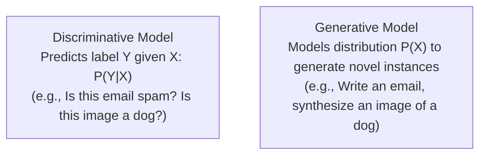
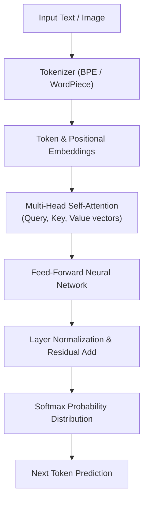
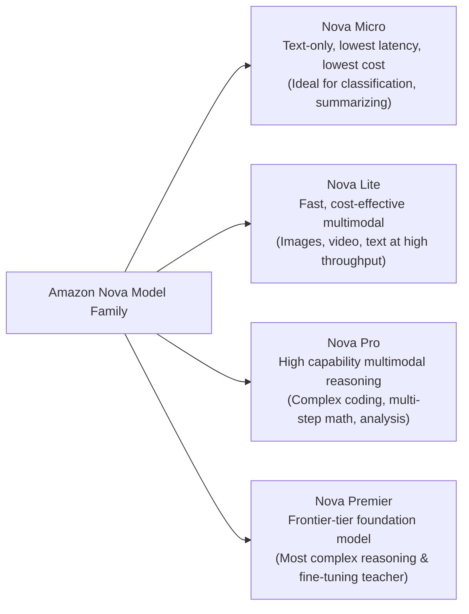
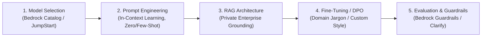
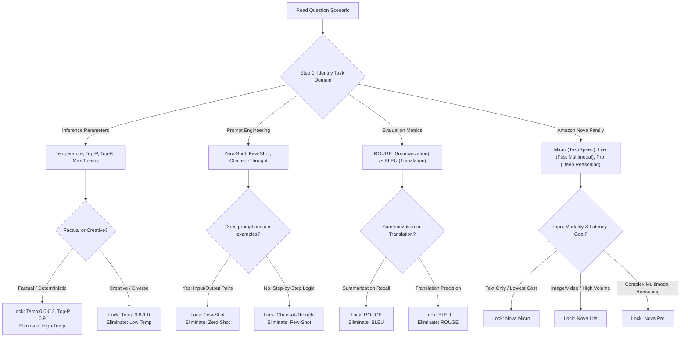
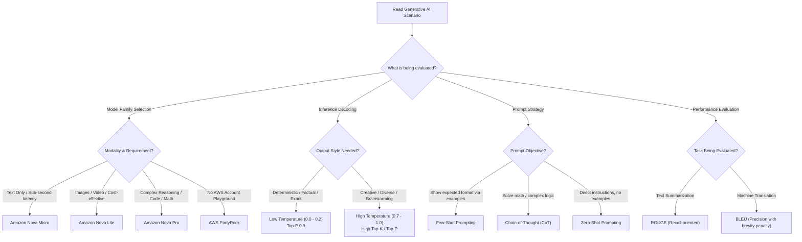

# Domain 2: Fundamentals of Generative AI

> **Weight:** 24% of Scored Exam Content  
> **Course:** AWS Certified AI Practitioner (`AIF-C01`)  
> **Exam Guide Baseline:** v1.2 (October 2026 - incorporating Amazon Nova & MCP updates)  
> **Index:** `AI/Practitioner/AIF-C01/06_Explanations/02_Domain_2_Fundamentals_of_Generative_AI.md`

---

## 🧭 Domain Overview

Domain 2 evaluates understanding of Generative AI architectures, foundation model capabilities, internal token mechanics, multi-modal generation, prompt parameters, the full Generative AI lifecycle, the Amazon Nova foundation model family, and emerging agentic paradigms including the Model Context Protocol (MCP).

---

## 💡 The Real-World Analogy (ELI5)

> **The Art Critic vs. The Master Painter:**
> - **Discriminative Traditional AI (The Art Critic):** An expert who looks at a painting and classifies it: *"This is an authentic Monet with 98% confidence."* Or detects anomalies: *"This brushstroke is counterfeit."* It analyzes, categorizes, and labels existing reality.
> - **Generative AI (The Master Painter):** An artist who spent 20 years studying every brushstroke, color palette, and texture Monet ever used. Handed a blank canvas and a prompt: *"Paint a rainy afternoon in Paris with cherry blossoms in Monet's style,"* the artist synthesizes a completely original, never-before-seen masterpiece that reflects the statistical distribution of Monet's art.
> - **Autocomplete on Steroids:** At its core, a Large Language Model (LLM) is predicting the single next most probable word (token) across billions of possibilities based on context: *"The cat sat on the... [mat / sofa / windowsill]"*.

---

## 🎯 Task Statement 2.1: Explain the concepts and capabilities of generative AI

### 1. What Defines Generative AI?
Unlike discriminative AI models that compute conditional probabilities $P(Y|X)$ to classify inputs or predict numerical targets, generative models model the joint probability distribution $P(X, Y)$ or the probability distribution over sequences $P(X)$ to generate novel data instances resembling their training data.

### 2. Taxonomy of Foundation Models (FMs)
* **Foundation Models (FMs):** Massive deep learning models trained on vast, broad-scale corpora of unlabeled data using self-supervised learning at scale. They serve as generalized base models adaptable to hundreds of downstream tasks.
* **Large Language Models (LLMs):** Text-centric foundation models trained to predict subsequent tokens in sequence (e.g., Amazon Nova, Anthropic Claude, Meta Llama).
* **Multi-Modal Foundation Models:** Models capable of simultaneously processing and synthesizing across multiple input/output modalities (text, high-resolution images, video frames, audio, and documents).
* **Diffusion Models:** Generative architectures trained to invert a gradual Gaussian noise degradation process to generate high-fidelity synthetic images and videos (e.g., Amazon Titan Image Generator G1/v2, Stable Diffusion).

---

## 🎯 Task Statement 2.2: Understand Transformer Architecture and Token Mechanics

### 1. The Transformer Architecture
Introduced in the seminal paper *"Attention Is All You Need"* (Vaswani et al., 2017), the Transformer discarded recurrent sequential processing (RNNs/LSTMs) in favor of **Self-Attention Mechanisms**, enabling massive parallelization during training across GPU clusters.

#### Core Components:
1. **Self-Attention Mechanism:** Computes pairwise relevance between every token in a sequence regardless of distance:
   $$\text{Attention}(Q, K, V) = \text{softmax}\left(\frac{QK^T}{\sqrt{d_k}}\right)V$$
   * $Q$ (Query): What the current token is seeking.
   * $K$ (Key): What each token in the sequence offers.
   * $V$ (Value): The actual information content carried by the token.
   * $\sqrt{d_k}$: Scaling factor preventing softmax gradient vanishing.
2. **Positional Encoding:** Because self-attention evaluates all tokens simultaneously without intrinsic sequential order, sinusoidal or rotary positional encodings (RoPE) are added to input vectors to preserve word order.
3. **Encoder vs. Decoder Architectures:**
   * **Encoder-Only (e.g., BERT):** Bidirectional context; ideal for classification, NER, and text embeddings.
   * **Decoder-Only (e.g., GPT, Amazon Nova, Claude, Llama):** Autoregressive causal masking; generates text token-by-token from left to right; dominant architecture for Generative AI.
   * **Encoder-Decoder (e.g., T5, BART):** Sequence-to-sequence translation and abstractive summarization.

### 2. Tokens, Embeddings, and Context Windows
* **Tokens:** The fundamental unit of text processed by an LLM. On average, 1 token ≈ 0.75 words (or 1,000 tokens ≈ 750 words in English).
* **Vector Embeddings:** High-dimensional dense numerical vectors (e.g., 1,536 dimensions for Amazon Titan Text Embeddings v2) where semantic similarity corresponds to geometric proximity (measured via Cosine Similarity or Euclidean Distance).
* **Context Window:** The maximum number of tokens (prompt input + generated output) an LLM can retain and process in a single inference call. Exceeding the context window results in truncation.
* **Hallucination:** An error mode where an LLM generates syntactically convincing, authoritative text that is factually false or ungrounded in source data. Mitigated by low temperature, Grounding via RAG, and Amazon Bedrock Guardrails.

---

## 🎯 Task Statement 2.3: Amazon Nova Foundation Model Family

In the official v1.2 exam guide, Amazon's flagship foundation model generation—the **Amazon Nova** family—is heavily emphasized. Available natively via Amazon Bedrock:

### Amazon Nova Models Breakdown
| Model | Modalities Supported | Primary Characteristics | Target Business Use Case |
|---|---|---|---|
| **Amazon Nova Micro** | Text-to-Text | Ultra-low latency, sub-second TTFT (Time to First Token), lowest cost | Query classification, text extraction, lightweight routing, edge applications |
| **Amazon Nova Lite** | Multimodal (Text, Image, Video) | Very fast, cost-optimized multimodal processing | High-volume document scanning, visual search, fast customer support |
| **Amazon Nova Pro** | Multimodal (Text, Image, Video) | Frontier balance of high accuracy, deep reasoning, agentic planning | Software development, financial reporting, complex multi-modal analysis |
| **Amazon Nova Premier** | Multimodal (Frontier scale) | Top-tier intelligence, advanced reasoning, knowledge synthesis | Complex enterprise research, high-stakes decision synthesis, distillation teacher |

---

## 🎯 Task Statement 2.4: Agentic AI Systems and Model Context Protocol (MCP)

### 1. Agentic AI vs. Standard Generative AI
Standard GenAI operates strictly in a request-response pattern. **Agentic AI** equips foundation models with autonomous reasoning loops (such as ReAct: Reasoning + Acting), persistent memory, and the capability to invoke external tools (APIs, databases, and microservices) to achieve high-level goals.

### 2. Model Context Protocol (MCP) in AWS Environments
* **Purpose:** MCP standardizes how AI agents communicate with external tools, APIs, and file systems, eliminating brittle custom API glue code.
* **Architecture:**
  * **MCP Host:** The orchestration layer (e.g., Amazon Bedrock Agent runtime or local developer assistant).
  * **MCP Server:** A lightweight microservice that publishes capabilities (tools, resources, prompt templates) via JSON-RPC.
  * **MCP Client:** Communicates with servers to dynamically discover available functions and execute them securely.
* **Integration with AWS:** Bedrock Agents utilize Action Groups backed by OpenAPI specifications or MCP server endpoints to interface with AWS Lambda functions, Amazon DynamoDB, and external SaaS platforms.

---

## 🎯 Task Statement 2.5: The Generative AI Lifecycle and Customization Spectrum

### Customization Approaches: Cost vs Effort Spectrum
1. **Prompt Engineering:**
   * Requires zero training data and zero model modifications.
   * Modifies only the input context window.
   * Lowest cost and immediate time-to-value.
2. **Retrieval Augmented Generation (RAG):**
   * Dynamically retrieves relevant text chunks from an external vector index (Amazon OpenSearch Serverless) and appends them to the user prompt.
   * Provides real-time grounding on proprietary data without model retraining.
3. **Fine-Tuning:**
   * Adjusts the internal neural weights of a base foundation model using thousands of labeled $(Prompt, Completion)$ pairs.
   * Best for teaching specific conversational tone, domain nomenclature (medical/legal), or proprietary JSON output formatting.
4. **Pre-training / Continued Pre-training:**
   * Requires billions of tokens and millions in GPU infrastructure compute.
   * Feeds raw unlabeled domain documents to adapt model vocabulary and internal statistical knowledge.

---

## 🎯 Task Statement 2.6: Inference Parameters Demystified

When invoking a Foundation Model via the Amazon Bedrock API (`InvokeModel` or `Converse`), runtime inference parameters control the randomness and output distribution:

| Parameter | Type & Range | Operational Behavior | Exam Use Case |
|---|---|---|---|
| **Temperature** | Float ($0.0$ to $1.0$) | Controls randomness. Lower values ($0.0 - 0.2$) make the output deterministic and focused; higher values ($0.7 - 1.0$) encourage creative divergence. | Use $0.0$ for factual Q&A, code generation, and financial extraction. Use $0.8$ for brainstorming. |
| **Top-P (Nucleus Sampling)** | Float ($0.0$ to $1.0$) | Restricts token selection to the smallest cumulative probability set exceeding threshold $P$. | Top-P of $0.9$ cuts off the long tail of bizarre tokens while preserving natural fluency. |
| **Top-K** | Integer (≥ 1) | Restricts selection to the top $K$ most likely next tokens. | Top-K of $1$ is equivalent to Greedy Decoding (argmax). |
| **Max Tokens** | Integer | Caps the maximum number of tokens generated in the output response. | Cost control and preventing infinite runaway generations. |
| **Stop Sequences** | Array of Strings | Specifies characters or strings (e.g., `["\n\n", "User:"]`) that immediately halt token generation. | Formatting chat transcripts and multi-turn turn enforcement. |

---

## 🔗 Related Resources
* Next: [Domain 3: Applications of Foundation Models](./03_Domain_3_Applications_of_Foundation_Models.md)
* Blueprint: [Diagram 02: Transformer Architecture and Tokenization](../05_Diagrams/Diagram_02_Transformer_Architecture_and_Tokenization.md)
* Blueprint: [Diagram 03: Amazon Bedrock Serverless Topology and Nova Models](../05_Diagrams/Diagram_03_Amazon_Bedrock_Serverless_Topology_and_Nova_Models.md)
* Lab: [Lab 01: Amazon Bedrock Model Access, Playgrounds & Prompt Engineering](../07_Hands_On_Labs/Lab_01_Amazon_Bedrock_Model_Access_Playgrounds_and_Prompt_Engineering.md)
---

## 🎯 Exam Traps & 'Clue-to-Answer' Trigger Words

| Exam Question Clue Keyword | Correct Generative AI Concept | Key Distinctions & Constraints |
| :--- | :--- | :--- |
| *'Self-attention mechanism processing tokens in parallel across long sequences'* | **Transformer Architecture** | Replaced sequential RNNs/LSTMs; foundation of modern LLMs. |
| *'Smallest discrete unit of text processed by an LLM (e.g., ~4 characters or 0.75 words)'* | **Token** | Billing and context windows are strictly measured in tokens, not words. |
| *'Controls output randomness/creativity; lower value produces deterministic answers'* | **Temperature** |  = greedy/deterministic (factual tasks);  = creative/divergent. |
| *'Limits token candidate pool to cumulative probability threshold (Nucleus sampling)'* | **Top-P** | Dynamic candidate pool based on sum of probabilities. |
| *'Limits token candidate pool to top K most probable words regardless of probability'* | **Top-K** | Fixed number of top choices. |
| *'Generates synthetic photorealistic images by iteratively removing Gaussian noise'* | **Diffusion Models** | Stability AI Stable Diffusion, Amazon Titan Image Generator. |
| *'Processes and correlates multiple disparate input data types (text, images, audio, video)'* | **Multimodal Foundation Models** | Amazon Nova (Micro, Lite, Pro), Anthropic Claude 3.5 Sonnet. |

---

## 📝 Post-Domain 2 Question Simulation & Retention Check

Test your mastery of Domain 2 with these 10 exam-style practice questions:

### Question 1
**How does Generative AI differ fundamentally from Traditional / Discriminative Machine Learning?**
- A) Discriminative AI creates novel images, while Generative AI only processes tabular numbers.
- B) Discriminative AI learns decision boundaries to classify or predict labels ($P(Y|X)$), whereas Generative AI models data distributions to synthesize new, original content ($P(X)$ or $P(X, Y)$).
- C) Discriminative AI requires GPUs; Generative AI runs strictly on CPUs.
- D) Generative AI does not use deep learning.

<b>Click to View Answer & Explanation</b>

**Correct Answer:** **B) Discriminative AI learns decision boundaries to classify or predict labels ($P(Y|X)$), whereas Generative AI models data distributions to synthesize new, original content ($P(X)$ or $P(X, Y)$).**  
- **Why it's correct:** Discriminative models separate data points into categories or predict numeric targets given inputs (e.g. classification/regression), whereas generative models learn the underlying probability distribution of training data to create brand new, synthetic data instances.
- **Distractor Analysis:**
  - *Option A is INCORRECT:* Reverses reality; Generative AI creates novel images and media, while discriminative models process tabular and numeric classification.
  - *Option B is CORRECT:* Captures the precise mathematical and functional boundary between conditional classification and generative distribution modeling.
  - *Option C is INCORRECT:* Both generative AI and discriminative deep learning require high-performance GPU acceleration for training and inference.
  - *Option D is INCORRECT:* Modern generative AI (Transformers, Diffusion models) represents the cutting edge of deep learning.

### Question 2
**Which revolutionary architectural mechanism enables Transformer models to process all tokens in a sequence in parallel and compute contextual relevance between words regardless of distance?**
- A) Convolutional Pooling
- B) Self-Attention
- C) Recurrent Hidden State Looping
- D) Bag of Words

<b>Click to View Answer & Explanation</b>

**Correct Answer:** **B) Self-Attention**  
- **Why it's correct:** The Multi-Head Self-Attention mechanism allows every token in an input sequence to attend to every other token simultaneously using Query ($Q$), Key ($K$), and Value ($V$) projections, resolving long-range semantic dependencies without sequential bottlenecks.
- **Distractor Analysis:**
  - *Option A is INCORRECT:* Convolutional pooling is used in Computer Vision (CNNs) to downsample spatial feature maps.
  - *Option B is CORRECT:* Self-attention is the signature breakthrough of the Transformer architecture (Vaswani et al., 2017).
  - *Option C is INCORRECT:* Recurrent hidden state looping is the sequential mechanism of legacy RNNs and LSTMs that suffered from vanishing gradients and prevented GPU parallelization.
  - *Option D is INCORRECT:* Bag of Words is a primitive text representation that counts word frequencies and completely discards syntax and word order.

### Question 3
**A customer service chatbot needs to answer technical software documentation questions with factual accuracy, high determinism, and minimal hallucination. Which inference parameter adjustment is most appropriate?**
- A) Increase Temperature to 1.5
- B) Decrease Temperature to 0.0 or 0.2
- C) Increase Top-K to 500
- D) Set Max Generation Length to 10

<b>Click to View Answer & Explanation</b>

**Correct Answer:** **B) Decrease Temperature to 0.0 or 0.2**  
- **Why it's correct:** Temperature controls the randomness of token selection. A low temperature ($0.0 - 0.2$) sharpens the probability distribution, compelling the model to select the highest-probability, most deterministic tokens, which reduces hallucinations in technical support.
- **Distractor Analysis:**
  - *Option A is INCORRECT:* Increasing temperature to 1.5 flattens the probability curve, introducing high randomness and severe hallucination risks.
  - *Option B is CORRECT:* Low temperature enforces factual, repeatable, and deterministic responses.
  - *Option C is INCORRECT:* Increasing Top-K to 500 expands the candidate pool of next tokens, increasing diversity and variance rather than determinism.
  - *Option D is INCORRECT:* Limiting output length to 10 tokens artificially truncates answers into unreadable sentence fragments.

### Question 4
**What does the Top-P (Nucleus Sampling) parameter control during foundation model inference?**
- A) The maximum number of tokens generated before stopping
- B) The cumulative probability threshold that dynamically limits the pool of candidate next tokens
- C) The cost per token billed by AWS Bedrock
- D) The learning rate during fine-tuning

<b>Click to View Answer & Explanation</b>

**Correct Answer:** **B) The cumulative probability threshold that dynamically limits the pool of candidate next tokens**  
- **Why it's correct:** Top-P (Nucleus Sampling) dynamically pools the smallest set of candidate tokens whose cumulative probability exceeds threshold $P$ (e.g., 0.90), filtering out the long tail of improbable tokens while adapting dynamically to the model's confidence.
- **Distractor Analysis:**
  - *Option A is INCORRECT:* The maximum number of tokens generated is controlled by `max_tokens` or `max_new_tokens`.
  - *Option B is CORRECT:* Top-P defines the cumulative probability cutoff for nucleus sampling.
  - *Option C is INCORRECT:* Token billing is determined by AWS pricing tiers per 1,000 input/output tokens, not inference sampling parameters.
  - *Option D is INCORRECT:* Learning rate is a training hyperparameter, whereas Top-P is an inference decoding parameter.

### Question 5
**Which prompt engineering technique provides the foundation model with several input-output demonstration examples within the prompt before asking it to solve the target task?**
- A) Zero-Shot Prompting
- B) Few-Shot Prompting
- C) Chain-of-Thought Prompting
- D) Prompt Injection

<b>Click to View Answer & Explanation</b>

**Correct Answer:** **B) Few-Shot Prompting**  
- **Why it's correct:** Few-shot prompting incorporates demonstration exemplars (e.g., 2 to 5 pairs of input and expected output) within the context window to condition the model's in-context attention on desired formatting and reasoning patterns.
- **Distractor Analysis:**
  - *Option A is INCORRECT:* Zero-shot prompting provides only the task instructions and query without any prior input-output examples.
  - *Option B is CORRECT:* Few-shot prompting provides explicit demonstration examples in-context.
  - *Option C is INCORRECT:* Chain-of-Thought prompting directs the model to output intermediate step-by-step reasoning steps.
  - *Option D is INCORRECT:* Prompt injection is an adversarial cyberattack seeking to bypass guardrails.

### Question 6
**An architect prompts a foundation model: "Think step-by-step to calculate the total shipping cost and explain each calculation before providing the final answer." Which prompt engineering technique is this?**
- A) Directional Stimulus Prompting
- B) Chain-of-Thought (CoT) Prompting
- C) Least-to-Most Prompting
- D) Fine-Tuning

<b>Click to View Answer & Explanation</b>

**Correct Answer:** **B) Chain-of-Thought (CoT) Prompting**  
- **Why it's correct:** Chain-of-Thought (CoT) prompting prompts the model to generate intermediate logical reasoning steps before arriving at a final deduction or calculation, dramatically reducing reasoning errors.
- **Distractor Analysis:**
  - *Option A is INCORRECT:* Directional stimulus prompting provides hints or keywords to steer output style.
  - *Option B is CORRECT:* Prompting the model to "think step by step" is the classical trigger for Chain-of-Thought reasoning.
  - *Option C is INCORRECT:* Least-to-most prompting decomposes a problem into a sequence of smaller sub-prompts sequentially.
  - *Option D is INCORRECT:* Fine-tuning involves retraining model weights via backpropagation on custom datasets.

### Question 7
**What is an "Emergent Capability" in Large Language Models?**
- A) An ability that is explicitly programmed into the software by human developers
- B) A capability (such as multi-step arithmetic, reasoning, or code debugging) that appears spontaneously as model scale crosses certain parameter and compute thresholds
- C) The ability to connect directly to the internet without APIs
- D) A technique for compressing models into 8-bit precision

<b>Click to View Answer & Explanation</b>

**Correct Answer:** **B) A capability (such as multi-step arithmetic, reasoning, or code debugging) that appears spontaneously as model scale crosses certain parameter and compute thresholds**  
- **Why it's correct:** Emergent capabilities are abilities that cannot be observed in smaller-scale models but suddenly manifest when models reach a critical threshold of parameter scale, training data volume, and compute.
- **Distractor Analysis:**
  - *Option A is INCORRECT:* Foundation models are not hardcoded with explicit rule engines; their abilities emerge statistically.
  - *Option B is CORRECT:* Emergence refers to non-linear qualitative capability jumps unlocked purely by scale.
  - *Option C is INCORRECT:* Foundation models cannot browse the live web without tool-use or API integrations.
  - *Option D is INCORRECT:* Compressing models into 8-bit precision is quantization, not an emergent capability.

### Question 8
**Which evaluation metric evaluates automated text summarization by calculating the recall of n-grams (unigrams, bigrams, longest common subsequences) between candidate summaries and reference human summaries?**
- A) BLEU
- B) ROUGE
- C) Perplexity
- D) Mean Absolute Error

<b>Click to View Answer & Explanation</b>

**Correct Answer:** **B) ROUGE**  
- **Why it's correct:** **ROUGE** (Recall-Oriented Understudy for Gisting Evaluation) evaluates text summarization by measuring n-gram overlap with a focus on recall (how much reference content was captured by the generated summary).
- **Distractor Analysis:**
  - *Option A is INCORRECT:* BLEU (Bilingual Evaluation Understudy) focuses on n-gram precision for evaluating machine translation.
  - *Option B is CORRECT:* ROUGE is the industry-standard recall-oriented metric for document summarization.
  - *Option C is INCORRECT:* Perplexity measures how well a language model predicts a sample of text (exponentiated cross-entropy loss).
  - *Option D is INCORRECT:* Mean Absolute Error is a regression error metric for continuous numbers.

### Question 9
**Which metric measures the quality of machine translation by computing n-gram precision against expert human translations and applying a brevity penalty for short sentences?**
- A) ROUGE
- B) BLEU
- C) F1-Score
- D) Perplexity

<b>Click to View Answer & Explanation</b>

**Correct Answer:** **B) BLEU**  
- **Why it's correct:** **BLEU** (Bilingual Evaluation Understudy) evaluates machine translation systems by calculating the precision of matching n-grams against reference human translations, penalizing candidate sentences that are too short via a brevity penalty.
- **Distractor Analysis:**
  - *Option A is INCORRECT:* ROUGE is recall-focused and used for summarization.
  - *Option B is CORRECT:* BLEU is precision-focused with a brevity penalty, designed specifically for machine translation.
  - *Option C is INCORRECT:* F1-score is used in classification tasks.
  - *Option D is INCORRECT:* Perplexity evaluates model uncertainty during language modeling.

### Question 10
**Which free, web-based playground powered by Amazon Bedrock allows students, beginners, and educators to create, experiment with, and remix generative AI applications using plain English without requiring an AWS account?**
- A) Amazon SageMaker Studio Lab
- B) AWS PartyRock
- C) Amazon Q Developer
- D) Amazon Bedrock Console

<b>Click to View Answer & Explanation</b>

**Correct Answer:** **B) AWS PartyRock**  
- **Why it's correct:** **AWS PartyRock** (`partyrock.aws`) is an Amazon Bedrock-powered playground that allows anyone to experiment with generative AI apps, prompt engineering, and foundation models in an intuitive UI without an AWS account or credit card.
- **Distractor Analysis:**
  - *Option A is INCORRECT:* SageMaker Studio Lab is a free Jupyter notebook service for coding ML in Python; it is not a no-code GenAI app builder.
  - *Option B is CORRECT:* AWS PartyRock is the dedicated account-free generative AI app playground.
  - *Option C is INCORRECT:* Amazon Q Developer is an AI coding assistant integrated into IDEs and the AWS Console.
  - *Option D is INCORRECT:* Amazon Bedrock Console requires an active AWS account, IAM permissions, and credit card/billing configuration.

---

## 🎓 Master MCQ Solving Blueprint: Domain 2 (Fundamentals of Generative AI)

> Mined directly from the 534-question Domain 2 bank in the master repository. Use this systematic 4-layer methodology to solve foundation model and prompt engineering questions instantly.

### Layer 1: "Clue-to-Service" Linguistic Decryption Matrix

| If Scenario Text States... | Target Concept / Service | Why (The Core Mechanism) | Decoy Trap to Avoid |
| :--- | :--- | :--- | :--- |
| **"Parallel training across GPUs / Self-attention"** | **Transformer Architecture** | Self-attention processes all sequence tokens concurrently using Query, Key, and Value matrices. | RNN/LSTM (which processed tokens sequentially, creating bottlenecks). |
| **"Synthesize high-fidelity images by reversing noise"** | **Diffusion Model** | Inverts a Gaussian noise schedule (e.g., Stable Diffusion, Titan Image Generator). | Large Language Models (autoregressive token predictors). |
| **"Make model responses deterministic and factual"** | **Low Temperature (≈ 0.0 - 0.2)** | Concentrates probability distribution on greedy, high-probability tokens. | High Temperature (which flattens distribution, increasing creative hallucinations). |
| **"Generate creative, novel, varied marketing copy"** | **High Temperature (≈ 0.7 - 1.0)** | Flattens token probability distribution, allowing diverse lexical selection. | Low Temperature (which produces repetitive, dry, deterministic outputs). |
| **"Dynamically limit pool to tokens totaling cumulative probability"** | **Top-P (Nucleus Sampling)** | Dynamically scales the selection pool based on cumulative softmax mass. | Top-K (which limits to a rigid, fixed integer number of tokens). |
| **"Limit candidate pool to a fixed integer number of top tokens"** | **Top-K Sampling** | Hard integer cutoff (e.g. top 50 tokens) regardless of probability mass. | Top-P (which is a dynamic probability percentage threshold). |
| **"Provide 2 to 5 exemplary input-output pairs in prompt"** | **Few-Shot Prompting** | In-context conditioning that guides output format and logic without weight updates. | Zero-shot prompting (no examples provided). |
| **"Direct model to break problem into step-by-step intermediate logic"** | **Chain-of-Thought (CoT)** | Generates reasoning tokens before providing the final answer. | Fine-tuning (which retrains neural weights). |
| **"Evaluate summarization quality by measuring n-gram recall"** | **ROUGE Metric** | Recall-Oriented Understudy for Gisting Evaluation. | BLEU (which measures translation precision). |
| **"Evaluate machine translation quality with brevity penalty"** | **BLEU Metric** | Bilingual Evaluation Understudy computing n-gram precision against human references. | ROUGE (which evaluates summarization recall). |
| **"Ultra-low latency, sub-second text-only routing / classification"** | **Amazon Nova Micro** | Text-only, lowest cost, optimized for fast throughput and routing. | Amazon Nova Pro (heavy multimodal reasoning model). |
| **"Fast, cost-effective multimodal (images, video, text) processing"** | **Amazon Nova Lite** | Balanced multimodal processing for high-volume documents and media. | Nova Micro (text-only; cannot process images or video). |
| **"Complex reasoning, agentic planning, and advanced coding"** | **Amazon Nova Pro / Premier** | Frontier multimodal intelligence for demanding enterprise tasks. | Nova Micro / Lite (optimized for speed/cost rather than frontier reasoning). |
| **"Free web playground to build generative AI apps with no AWS account"** | **AWS PartyRock** | Managed web sandbox powered by Amazon Bedrock for rapid no-code experimentation. | Bedrock Console (requires active AWS account and billing). |

---

### Layer 2: 3-Step Rapid Elimination Heuristic

1. **Step 1: Categorize the Question's Operational Domain:**
   - Is it tuning randomness? (Parameters)
   - Is it structuring context? (Prompt Engineering)
   - Is it measuring model accuracy? (Evaluation Metrics)
   - Is it picking an Amazon model? (Nova family)
2. **Step 2: Apply the Mathematical Polarities:**
   - *Factual/Legal/Medical:* Temperature → 0.0.
   - *Marketing/Storytelling:* Temperature → 0.9.
   - *Summarization:* ROUGE.
   - *Translation:* BLEU.
3. **Step 3: Eliminate Unnecessary Cost & Compute:**
   - If the task is simple text classification or routing, picking **Nova Pro** is a cost-inefficient trap. Pick **Nova Micro**.
   - If the task includes images or video, picking **Nova Micro** is an impossible trap (Micro is text-only). Pick **Nova Lite** or **Nova Pro**.

---

### Layer 3: High-Frequency Decoy Autopsy

#### Decoy Trap 1: Top-P (Nucleus) vs Top-K Sampling
* **The Exam Trap:** The scenario asks how to cut off improbable tokens while adjusting dynamically to the model's confidence across diverse prompts.
* **The Decoy:** Setting Top-K.
* **The Fatal Flaw:** Top-K forces a static, rigid integer count (e.g. always pick from exactly 50 tokens). If the model is 99% certain of one word, Top-K still forces 49 unlikely words into consideration. If the model is uncertain across 200 plausible words, Top-K truncates 150 valid options.
* **The Correct Choice:** **Top-P** dynamically expands and contracts the candidate pool based on cumulative probability mass ($\sum P \ge 0.90$).

#### Decoy Trap 2: BLEU vs ROUGE Confusion
* **The Exam Trap:** The question asks for an automated metric to evaluate a system that condenses 20-page legal contracts into 1-page summaries.
* **The Decoy:** Option A offers **BLEU**.
* **The Fatal Flaw:** BLEU measures *precision* in machine translation. A summary could achieve 100% BLEU precision by copying a single 5-word sentence verbatim, while completely omitting 95% of the vital contract facts.
* **The Correct Choice:** **ROUGE** measures *recall* for summarization, verifying that key concepts from reference summaries were preserved.

#### Decoy Trap 3: Amazon Nova Micro vs Nova Lite Modality Trap
* **The Exam Trap:** A company wants the lowest-cost, fastest model to analyze customer uploaded images of receipts and categorize them.
* **The Decoy:** Amazon Nova Micro (promoted as the cheapest, fastest Nova model).
* **The Fatal Flaw:** Amazon Nova Micro is **text-only**. It cannot accept images, video, or multimodal inputs.
* **The Correct Choice:** **Amazon Nova Lite** is the lowest-cost *multimodal* model in the Nova family.

---

### Layer 4: 10-Second Visual Decision Flowchart

