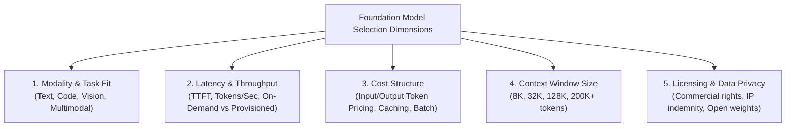
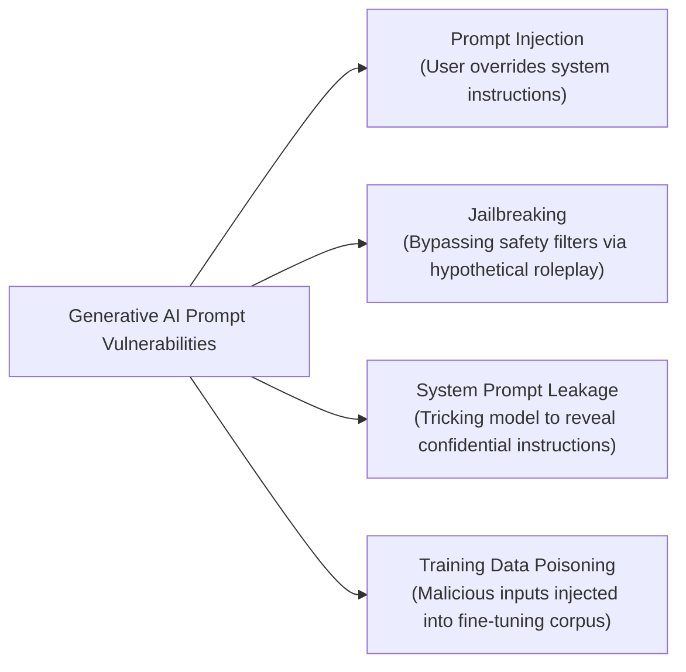
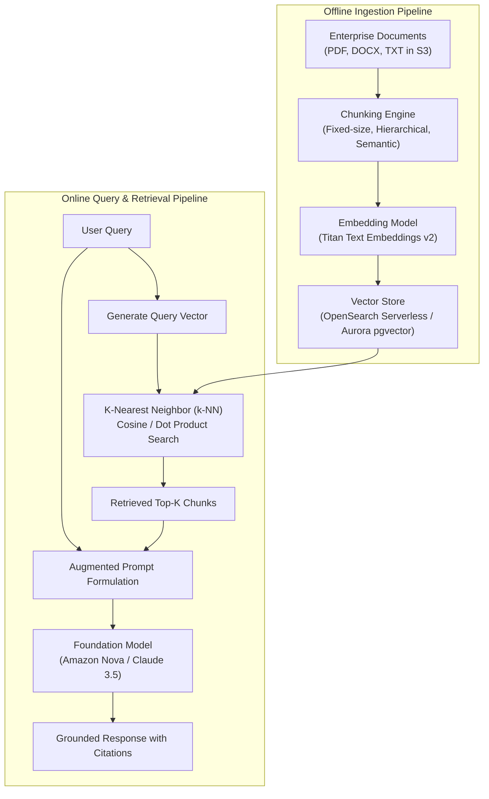
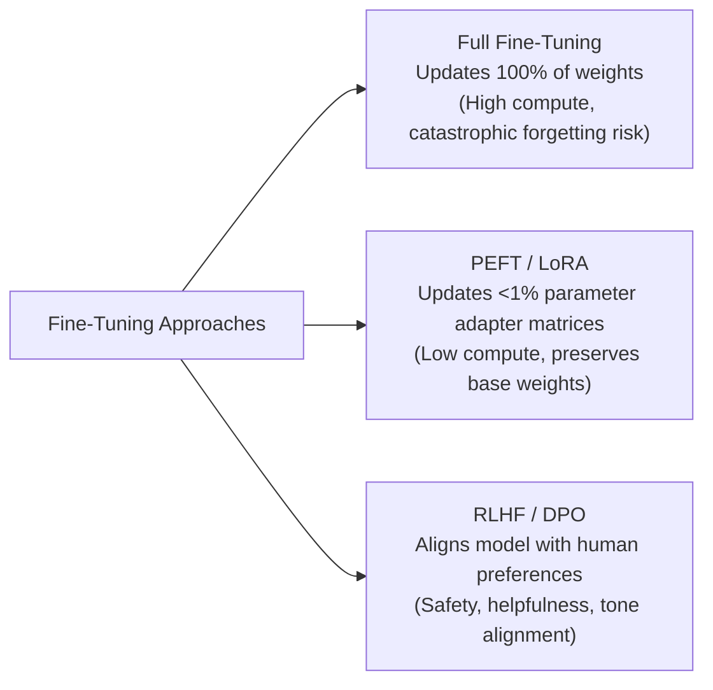
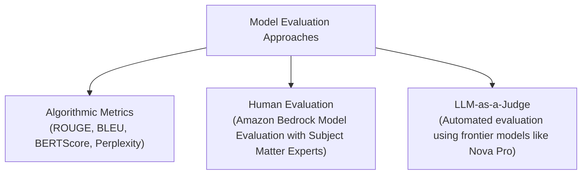
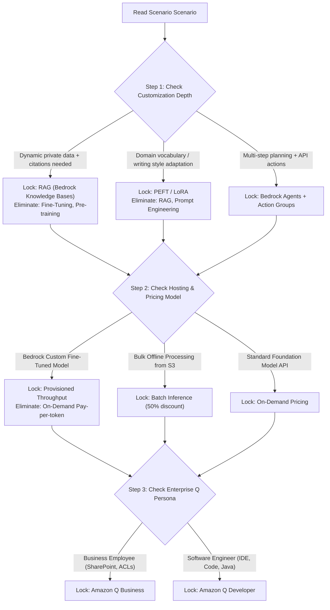
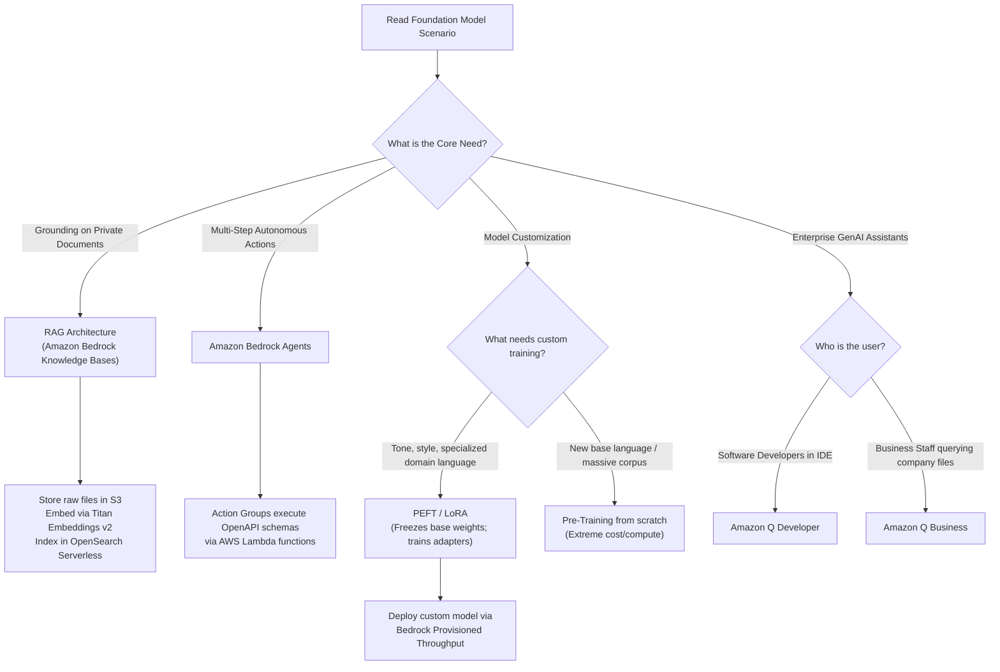

# Domain 3: Applications of Foundation Models

> **Weight:** 28% of Scored Exam Content (Highest Weighted Domain)  
> **Course:** AWS Certified AI Practitioner (`AIF-C01`)  
> **Exam Guide Baseline:** v1.2 (October 2026 - incorporating LLM-as-a-judge, Prompt Caching, and Enterprise RAG)  
> **Index:** `AI/Practitioner/AIF-C01/06_Explanations/03_Domain_3_Applications_of_Foundation_Models.md`

---

## 🧭 Domain Overview

Domain 3 represents the core operational center of the AIF-C01 certification. It tests an architect's ability to select the right foundation model, design robust prompt engineering workflows, implement Retrieval-Augmented Generation (RAG) with vector databases, orchestrate autonomous agents, fine-tune models responsibly, and systematically evaluate generative performance using both quantitative metrics and modern LLM-as-a-judge methodologies.

---

## 💡 The Real-World Analogy (ELI5)

> **The Medical Licensing Exam Spectrum:**
> - **Prompt Engineering (Better Questioning):** You give the medical student a clearer, structured question on the exam, providing 2 solved sample diagnoses (Few-Shot Prompting) and telling them to write out their diagnostic steps before answering (Chain-of-Thought). Zero changes to the student's brain.
> - **RAG (Open-Book Exam):** You allow the student to bring the hospital's internal proprietary formulary into the exam room. When asked about Drug X, the student flips to the index (semantic search), reads the exact paragraph (retrieval), and answers citing the page number (grounded generation).
> - **Fine-Tuning (Specialized Fellowship):** Sending the general physician to a 3-year pediatric cardiology residency. The specialized knowledge is permanently baked into their synaptic neural connections (model weights). Expensive, time-consuming, and risks catastrophic forgetting of general medicine.
> - **Pre-Training from Scratch (Raising a Child to Adulthood):** Training a child from infancy to adulthood on the entire corpus of human knowledge. Costs $50M–$100M+ in supercomputer GPU clusters.

---

## 🎯 Task Statement 3.1: Determine criteria for foundation model selection

When selecting a Foundation Model in Amazon Bedrock or Amazon SageMaker JumpStart, evaluate five core engineering dimensions:

### Model Selection Decision Guide
| Workload Requirement | Recommended Model | Architectural Rationale |
|---|---|---|
| High-throughput classification, routing, sub-second latency, lowest cost | **Amazon Nova Micro** | Text-optimized, ultra-low TTFT, lowest input/output token price. |
| High-volume document scanning, visual search, image summarization | **Amazon Nova Lite** | Multimodal capabilities with cost-optimized inference economics. |
| Complex enterprise reasoning, code generation, multi-step math, agent planning | **Amazon Nova Pro** or **Anthropic Claude 3.5 Sonnet** | Top-tier reasoning benchmarks, robust tool-use and JSON schema adherence. |
| High-fidelity marketing asset creation, inpainting, background replacement | **Amazon Titan Image Generator G1/v2** | Native diffusion model with automatic invisible watermarking. |
| Low-cost enterprise semantic search and dense embeddings | **Amazon Titan Text Embeddings v2** | Flexible embedding dimensions (256, 512, 1024), optimized vector storage. |
| Self-hosted, private weights with full customization control on EC2/EKS | **Meta Llama 3** (via SageMaker JumpStart) | Open-weights model deployed to dedicated GPU compute instances. |

---

## 🎯 Task Statement 3.2: Design and optimize prompt engineering workflows

Prompt engineering involves crafting inputs to guide foundation models toward desired outputs without altering model weights.

### 1. Core Prompting Techniques
1. **Zero-Shot Prompting:** Providing a prompt without examples, relying solely on pre-trained knowledge.
   * *Example:* `"Classify the sentiment of this review as Positive or Negative: The battery died in 2 hours."`
2. **Few-Shot Prompting (In-Context Learning):** Providing 2–5 structured input/output examples within the prompt context to demonstrate the desired tone, format, and structure.
3. **Chain-of-Thought (CoT) Prompting:** Instructing the model to "think step-by-step" before delivering the final answer, significantly reducing reasoning and arithmetic errors.
4. **Directional Stimulus Prompting:** Providing hints or key keywords to steer the model toward specific topics.
5. **System Prompts / Role Prompting:** Establishing persona, operational boundaries, and formatting instructions at the root level of the conversation (e.g., using Bedrock's Converse API `system` block).

### 2. Bedrock Prompt Management & Prompt Caching
* **Amazon Bedrock Prompt Management:** Allows teams to save, test, version, and share prompt templates containing dynamic variables (e.g., `{{customer_query}}`).
* **Prompt Caching:** Caches static portions of large prompts (such as long system instructions, extensive document context, or few-shot examples) in high-speed GPU memory.
  * **Benefits:** Reduces latency by up to 80% and cuts token costs by up to 50% for repetitive multi-turn dialogues.

### 3. Prompt Vulnerabilities and Security Risks

* **Mitigation:** Enforce strict separation between system instructions and user input delimiters; deploy **Amazon Bedrock Guardrails** to inspect inputs and outputs independently.

---

## 🎯 Task Statement 3.3: Architect Enterprise Retrieval-Augmented Generation (RAG)

Retrieval-Augmented Generation (RAG) grounds foundation models on an organization's proprietary, private, or real-time data without retraining the base model.

### 1. Ingestion & Chunking Strategies
* **Fixed-Size Chunking:** Splitting text into fixed token lengths (e.g., 500 tokens with 50-token overlap). Simple and fast.
* **Hierarchical Chunking (Parent-Child):** Documents are split into parent chunks (broad context) and child chunks (fine-grained sentences). Vector search searches child chunks, but retrieves the parent chunk for the LLM.
* **Semantic Chunking:** Splitting text based on natural semantic boundaries (headers, paragraphs, topic transitions) using embedding distance thresholds.

### 2. Vector Databases in AWS
* **Amazon Bedrock Knowledge Bases (Managed Solution):** Connects S3 buckets directly to automated chunking, embedding, and vector storage in **Amazon OpenSearch Serverless** without managing vector cluster infrastructure.
* **Amazon Aurora PostgreSQL with `pgvector`:** Relational ACID database storing application data and vector embeddings in the same table.
* **Amazon Neptune Analytics:** Graph database with vector search capabilities for complex interconnected entity relationships.

---

## 🎯 Task Statement 3.4: Fine-Tuning & Model Customization

When prompt engineering and RAG are insufficient to achieve domain-specific style, tone, or specialized reasoning:

### Parameter-Efficient Fine-Tuning (PEFT) and LoRA
* **Low-Rank Adaptation (LoRA):** Freezes the pre-trained model weights and injects trainable rank-decomposition matrices into each layer of the Transformer architecture.
* **Advantages:** 
  * Reduces trainable parameters by >90%.
  * Prevents **Catastrophic Forgetting** (where an LLM loses its general reasoning abilities).
  * Drastically reduces GPU memory requirements.
* **Amazon Bedrock Custom Models:** Supports PEFT fine-tuning on labeled training datasets stored in Amazon S3 (JSON Lines format with `prompt` and `completion` keys).

---

## 🎯 Task Statement 3.5: Foundation Model Evaluation

Systematic evaluation is required to measure accuracy, hallucination rates, and linguistic quality before production deployment.

### 1. Algorithmic Evaluation Metrics
* **BLEU (Bilingual Evaluation Understudy):** Measures $n$-gram precision between generated text and reference text. Standard for machine translation.
* **ROUGE (Recall-Oriented Understudy for Gesting Evaluation):** Measures $n$-gram recall. Standard for text summarization:
  * **ROUGE-1:** Unigram overlap.
  * **ROUGE-2:** Bigram overlap.
  * **ROUGE-L:** Longest Common Subsequence (LCS).
* **BERTScore:** Computes semantic similarity between generated and reference sentences using pre-trained contextual embeddings, recognizing synonyms even with zero literal word overlap.
* **Perplexity:** Measures how "surprised" a language model is by a sequence of text. Lower perplexity indicates the model is more confident in predicting the text.

### 2. LLM-as-a-Judge Methodology (v1.2 Addition)
* **Definition:** Using a high-capability frontier model (e.g., Amazon Nova Pro or Claude 3.5 Sonnet) as an automated evaluator to grade the output of a smaller, faster model (e.g., Nova Micro) based on a rubric.
* **Evaluated Criteria:** Helpfulness, faithfulness to context (hallucination scoring), toxicity, correctness, and reasoning coherence.
* **AWS Service:** **Amazon Bedrock Model Evaluation** supports automated evaluation jobs using built-in curated datasets, custom prompt datasets, and LLM-as-a-judge rubrics.

---

## 🔗 Related Resources
* Next: [Domain 4: Guidelines for Responsible AI](./04_Domain_4_Guidelines_for_Responsible_AI.md)
* Blueprint: [Diagram 04: Enterprise RAG Ingestion and Retrieval Flow](../05_Diagrams/Diagram_04_Enterprise_RAG_Ingestion_and_Retrieval_Flow.md)
* Blueprint: [Diagram 06: Model Customization Spectrum](../05_Diagrams/Diagram_06_Model_Customization_Spectrum_Prompt_to_Pretraining.md)
* Lab: [Lab 03: Enterprise RAG with Bedrock Knowledge Bases](../07_Hands_On_Labs/Lab_03_Enterprise_RAG_with_Bedrock_Knowledge_Bases_and_OpenSearch_Serverless.md)
---

## 🎯 Exam Traps & 'Clue-to-Answer' Trigger Words

| Business Requirement / Scenario | Correct Model Adaptation Strategy | Why Alternative Strategies Fail |
| :--- | :--- | :--- |
| *'Incorporate private internal company data, prevent hallucinations, zero weight updates'* | **Retrieval-Augmented Generation (RAG)** | Fine-Tuning is expensive, slow, and does NOT prevent hallucinations. |
| *'Guide model through multi-step arithmetic, logic, or symbolic reasoning problems'* | **Chain-of-Thought (CoT) Prompting** | Standard Zero-Shot prompts fail on multi-step reasoning. |
| *'Adapt model to highly specialized medical/legal vocabulary or tone with minimal compute'* | **Parameter-Efficient Fine-Tuning (PEFT / LoRA)** | Full Fine-Tuning requires massive VRAM and compute budgets. |
| *'Autonomous execution of database lookups, booking APIs, and enterprise workflows'* | **Amazon Bedrock Agents (Action Groups)** | Standard LLMs can only generate text; agents invoke live APIs. |
| *'High-dimensional vector storage and sub-second similarity search for RAG'* | **Amazon OpenSearch Serverless (Vector Engine)** | S3 is object storage (no native vector distance cosine search). |

---

## 📝 Post-Domain 3 Question Simulation & Retention Check

Test your mastery of Domain 3 with these 10 exam-style practice questions:

### Question 1
**Which fully managed AWS service provides a single unified API to access leading foundation models from Anthropic, Meta, Mistral, Cohere, AI21 Labs, Stability AI, and Amazon without managing servers?**
- A) Amazon SageMaker Canvas
- B) Amazon Bedrock
- C) AWS Lambda
- D) Amazon Rekognition

<b>Click to View Answer & Explanation</b>

**Correct Answer:** **B) Amazon Bedrock**  
- **Why it's correct:** **Amazon Bedrock** is AWS's fully managed, serverless platform providing a unified API (`InvokeModel`, `Converse`) to access high-performing foundation models from top AI labs and Amazon with zero infrastructure provisioning.
- **Distractor Analysis:**
  - *Option A is INCORRECT:* SageMaker Canvas is a visual, no-code AutoML workspace for building tabular machine learning models.
  - *Option B is CORRECT:* Bedrock is the premier serverless foundation model API gateway on AWS.
  - *Option C is INCORRECT:* AWS Lambda is a serverless compute service for running general event-driven functions, not a managed FM provider.
  - *Option D is INCORRECT:* Amazon Rekognition is a specialized computer vision service for image and video analysis.

### Question 2
**A healthcare company wants an AI assistant to answer patient questions based on constantly updated hospital clinical guidelines stored as PDFs in an Amazon S3 bucket. The answers must cite exact document page numbers and cannot hallucinate. Which architecture is best suited?**
- A) Pre-training a new LLM from scratch
- B) Retrieval Augmented Generation (RAG) using Amazon Bedrock Knowledge Bases
- C) Full parameter fine-tuning on a GPU cluster
- D) Hardcoding policies into Python regex scripts

<b>Click to View Answer & Explanation</b>

**Correct Answer:** **B) Retrieval Augmented Generation (RAG) using Amazon Bedrock Knowledge Bases**  
- **Why it's correct:** **Retrieval-Augmented Generation (RAG)** dynamically queries external vector knowledge repositories at inference time, injecting relevant document excerpts directly into the prompt to ground model responses in verified facts and generate verifiable citations without retraining.
- **Distractor Analysis:**
  - *Option A is INCORRECT:* Pre-training costs millions of dollars, takes months of compute, and permanently bakes facts into weights, failing to support constantly updating clinical guidelines.
  - *Option B is CORRECT:* Bedrock Knowledge Bases automates document ingestion, chunking, embedding, vector retrieval, and citation-backed generation for dynamic documents.
  - *Option C is INCORRECT:* Fine-tuning alters model tone and domain vocabulary, but cannot reliably cite specific source page numbers and requires retraining whenever guidelines update.
  - *Option D is INCORRECT:* Regex pattern matching is rigid and incapable of semantic comprehension across unstructured medical texts.

### Question 3
**How does Parameter-Efficient Fine-Tuning (PEFT), specifically Low-Rank Adaptation (LoRA), differ from Full Fine-Tuning?**
- A) LoRA trains all billions of model weights from random initialization.
- B) LoRA freezes the original pre-trained model weights and trains a small set of low-rank adapter matrices (< 1% of parameters), reducing GPU memory and preventing catastrophic forgetting.
- C) LoRA converts text models into image generation models.
- D) LoRA is only used during data preparation.

<b>Click to View Answer & Explanation</b>

**Correct Answer:** **B) LoRA freezes the original pre-trained model weights and trains a small set of low-rank adapter matrices (< 1% of parameters), reducing GPU memory and preventing catastrophic forgetting.**  
- **Why it's correct:** LoRA decomposes parameter weight updates into two smaller low-rank matrices (W = W₀ + B × A), freezing the original weights W₀. This slashes required GPU memory and training time by over 70% while safeguarding the base model against catastrophic forgetting.
- **Distractor Analysis:**
  - *Option A is INCORRECT:* Training all weights from scratch is pre-training, which requires massive computational resources.
  - *Option B is CORRECT:* LoRA freezes base weights and trains lightweight adapter matrices.
  - *Option C is INCORRECT:* LoRA is a parameter adaptation technique applicable to both text and vision models, not a modality converter.
  - *Option D is INCORRECT:* LoRA is an active model training algorithm, not an offline data ETL step.

### Question 4
**Which feature of Amazon Bedrock automates the end-to-end RAG workflow including document chunking, embedding generation, indexing into OpenSearch Serverless, and generating grounded responses with citations?**
- A) Amazon Bedrock Agents
- B) Amazon Bedrock Knowledge Bases
- C) Amazon Bedrock Guardrails
- D) Amazon Bedrock Model Evaluation

<b>Click to View Answer & Explanation</b>

**Correct Answer:** **B) Amazon Bedrock Knowledge Bases**  
- **Why it's correct:** **Amazon Bedrock Knowledge Bases** is the fully managed turnkey RAG service that handles document ingestion from S3, automated chunking, vector generation via Amazon Titan, indexing into vector databases (OpenSearch Serverless, Aurora pgvector, Pinecone), and semantic retrieval with attribution.
- **Distractor Analysis:**
  - *Option A is INCORRECT:* Bedrock Agents orchestrates autonomous multi-step reasoning and API actions via Action Groups and Lambda.
  - *Option B is CORRECT:* Knowledge Bases is the purpose-built turnkey RAG service on Bedrock.
  - *Option C is INCORRECT:* Bedrock Guardrails implements safety filters, toxic content blocking, and PII masking.
  - *Option D is INCORRECT:* Bedrock Model Evaluation provides automated and human benchmarks to compare model performance.

### Question 5
**An enterprise needs an autonomous AI system that can interpret multi-step customer inquiries, determine necessary API calls, query an external database via AWS Lambda, and email a confirmation to the customer. Which service fulfills this?**
- A) Amazon Bedrock Agents
- B) Amazon Polly
- C) AWS Glue
- D) Amazon Comprehend

<b>Click to View Answer & Explanation</b>

**Correct Answer:** **A) Amazon Bedrock Agents**  
- **Why it's correct:** **Amazon Bedrock Agents** automates multi-step workflows using the ReAct (Reasoning + Acting) framework. It analyzes user requests, formulates a logical execution plan, invokes Action Groups (connected to AWS Lambda functions and external APIs via OpenAPI schemas), and references Knowledge Bases to complete complex business tasks.
- **Distractor Analysis:**
  - *Option A is CORRECT:* Bedrock Agents coordinates reasoning, planning, and tool-use execution through Lambda.
  - *Option B is INCORRECT:* Amazon Polly converts text into lifelike speech.
  - *Option C is INCORRECT:* AWS Glue is a serverless data integration and ETL service.
  - *Option D is INCORRECT:* Amazon Comprehend extracts sentiment and entities from text, lacking reasoning or tool invocation abilities.

### Question 6
**When deploying a fine-tuned custom model on Amazon Bedrock, which purchasing option is required?**
- A) On-Demand Pay-per-token
- B) Provisioned Throughput (committed model units)
- C) Spot Instances
- D) Free Tier

<b>Click to View Answer & Explanation</b>

**Correct Answer:** **B) Provisioned Throughput (committed model units)**  
- **Why it's correct:** Custom fine-tuned models on Amazon Bedrock cannot be invoked via the multi-tenant On-Demand pricing pool; they require **Provisioned Throughput**, which provisions dedicated Model Units (MUs) under 1-month or 6-month commitments to guarantee capacity and performance.
- **Distractor Analysis:**
  - *Option A is INCORRECT:* On-Demand pricing is available only for base foundation models shared across multi-tenant infrastructure.
  - *Option B is CORRECT:* Custom models and strict SLA guarantees on Bedrock mandate Provisioned Throughput.
  - *Option C is INCORRECT:* Spot instances are an Amazon EC2 spare-capacity pricing model, not available on Amazon Bedrock.
  - *Option D is INCORRECT:* Custom model hosting is not included in the AWS Free Tier.

### Question 7
**Which purchasing option on Amazon Bedrock allows processing massive volumes of non-real-time text summarization prompts stored in Amazon S3 at a 50% discount compared to On-Demand pricing?**
- A) Spot Inference
- B) Batch Inference
- C) Provisioned Throughput
- D) Savings Plans

<b>Click to View Answer & Explanation</b>

**Correct Answer:** **B) Batch Inference**  
- **Why it's correct:** **Amazon Bedrock Batch Inference** allows customers to submit bulk requests stored in JSONL format on Amazon S3, processing them asynchronously within 24 hours at a 50% discount compared to real-time On-Demand pricing.
- **Distractor Analysis:**
  - *Option A is INCORRECT:* Spot inference is not a supported purchasing tier on Amazon Bedrock.
  - *Option B is CORRECT:* Batch inference processes large, non-interactive workloads asynchronously at a 50% cost savings.
  - *Option C is INCORRECT:* Provisioned Throughput provides dedicated, real-time throughput under fixed term commitments.
  - *Option D is INCORRECT:* AWS Savings Plans apply to EC2, Fargate, and Lambda, not Bedrock model tokens.

### Question 8
**Which generative AI assistant connects to 40+ enterprise repositories (SharePoint, Salesforce, Jira, Google Drive) and answers employee questions while strictly enforcing existing document-level access permissions?**
- A) Amazon Q Developer
- B) Amazon Q Business
- C) Amazon Kendra
- D) AWS PartyRock

<b>Click to View Answer & Explanation</b>

**Correct Answer:** **B) Amazon Q Business**  
- **Why it's correct:** **Amazon Q Business** is a generative AI enterprise assistant that indexes enterprise content across 40+ pre-built connectors and integrates with corporate IAM Identity Center to ensure employees only receive answers based on files they have permission to access.
- **Distractor Analysis:**
  - *Option A is INCORRECT:* Amazon Q Developer is an AI assistant tailored specifically for software development, coding, and DevOps.
  - *Option B is CORRECT:* Amazon Q Business is the enterprise knowledge assistant with enterprise permission/ACL enforcement.
  - *Option C is INCORRECT:* Amazon Kendra is an intelligent enterprise search engine returning keyword/semantic document links rather than generative synthesis.
  - *Option D is INCORRECT:* AWS PartyRock is an educational generative AI playground.

### Question 9
**Which developer tool assists software engineers with real-time AI code completion, automated unit test generation, security vulnerability scanning, and automated Java version upgrades?**
- A) Amazon Q Business
- B) Amazon Q Developer
- C) Amazon Bedrock Agents
- D) AWS Cloud9

<b>Click to View Answer & Explanation</b>

**Correct Answer:** **B) Amazon Q Developer**  
- **Why it's correct:** **Amazon Q Developer** is a generative AI assistant for software development that integrates into IDEs (VS Code, IntelliJ) and the AWS Console, generating code, reviewing PRs, scanning security vulnerabilities, and performing code transformations (e.g. migrating Java 8 to Java 17).
- **Distractor Analysis:**
  - *Option A is INCORRECT:* Amazon Q Business assists business employees with corporate documentation search, not IDE software engineering.
  - *Option B is CORRECT:* Amazon Q Developer is the dedicated coding and software engineering assistant.
  - *Option C is INCORRECT:* Amazon Bedrock Agents is an orchestration framework for custom multi-step LLM workflows.
  - *Option D is INCORRECT:* AWS Cloud9 is a cloud-based integrated development environment (IDE), not an AI coding assistant.

### Question 10
**What is the primary danger when performing full fine-tuning of an LLM on a small, narrow domain dataset without regularizing the base model weights?**
- A) Vanishing gradients
- B) Catastrophic Forgetting
- C) Inverted embeddings
- D) Model Inversion

<b>Click to View Answer & Explanation</b>

**Correct Answer:** **B) Catastrophic Forgetting**  
- **Why it's correct:** **Catastrophic Forgetting** occurs when fine-tuning over-optimizes model weights to a narrow target dataset, overwriting previously learned representations and destroying the model's generalized reasoning, language, and common-sense capabilities.
- **Distractor Analysis:**
  - *Option A is INCORRECT:* Vanishing gradients affect deep recurrent networks or poorly normalized activations during early training.
  - *Option B is CORRECT:* Catastrophic forgetting is the primary failure mode of unregularized full fine-tuning.
  - *Option C is INCORRECT:* "Inverted embeddings" is a fabricated distractor.
  - *Option D is INCORRECT:* Model inversion is a privacy cyberattack attempting to reconstruct training images from model confidence scores.

---

## 🎓 Master MCQ Solving Blueprint: Domain 3 (Applications of Foundation Models)

> Mined directly from the 510-question Domain 3 bank in the master repository (the highest-weighted exam domain at 28%). Use this systematic 4-layer methodology to resolve any foundation model application question.

### Layer 1: "Clue-to-Service" Linguistic Decryption Matrix

| If Scenario Text States... | Target Concept / Service | Why (The Core Mechanism) | Decoy Trap to Avoid |
| :--- | :--- | :--- | :--- |
| **"Unified serverless API to invoke Claude, Llama, Titan"** | **Amazon Bedrock** | Multi-vendor serverless foundation model hub with uniform `InvokeModel` API. | SageMaker JumpStart (requires deploying to dedicated EC2 compute instances). |
| **"Dynamic proprietary data / constantly updating docs / citations"** | **RAG (Bedrock Knowledge Bases)** | Grounding via semantic vector retrieval; zero retraining required; citations included. | Fine-tuning (static weights; cannot provide page citations; outdated instantly). |
| **"Convert text into dense numerical semantic vectors"** | **Amazon Titan Text Embeddings v2** | Generates 1,536-dimensional embeddings for vector similarity search. | Comprehend (extracts entities, not high-dimensional dense vectors). |
| **"Serverless vector store tightly integrated with Bedrock RAG"** | **Amazon OpenSearch Serverless** | Serverless vector database managing k-NN search without infrastructure ops. | Amazon DynamoDB (NoSQL key-value store; not optimized for dense vector cosine search). |
| **"Adapt model style / vocabulary cheaply without retraining all weights"** | **PEFT / LoRA** | Parameter-Efficient Fine-Tuning trains low-rank adapter matrices (< 1% weights). | Full Fine-Tuning (expensive, GPU-heavy, risks catastrophic forgetting). |
| **"Autonomous multi-step actions / API calls / Lambda execution"** | **Amazon Bedrock Agents** | ReAct framework decomposing user goals into Action Groups and Lambda calls. | Bedrock Knowledge Bases (retrieves documents; does not execute actions or APIs). |
| **"Open standard protocol connecting agents to tools/data over JSON-RPC"** | **Model Context Protocol (MCP)** | Standardized protocol allowing LLMs to discover tools, resources, and prompts. | Proprietary custom API wrappers for every individual tool (M × N complexity). |
| **"Deploy a custom fine-tuned model on Amazon Bedrock"** | **Provisioned Throughput** | Custom models require dedicated Model Units under 1- or 6-month commitments. | On-Demand pay-per-token (only available for shared base foundation models). |
| **"Non-real-time bulk summarization of S3 files at 50% discount"** | **Bedrock Batch Inference** | Asynchronous processing of bulk JSONL prompts from S3 within 24 hours. | Provisioned Throughput (committed real-time capacity). |
| **"Enterprise employee assistant adhering to document ACL permissions"** | **Amazon Q Business** | 40+ connectors indexing SharePoint/Drive with strict user-level access controls. | Amazon Q Developer (developer coding tool for IDEs and CLI). |
| **"AI coding assistant in IDE / code generation / unit tests / upgrade Java"** | **Amazon Q Developer** | Generative coding tool integrated into VS Code, IntelliJ, and AWS Console. | Amazon Q Business (knowledge assistant for business documents). |
| **"Loss of generalized reasoning after fine-tuning on narrow data"** | **Catastrophic Forgetting** | Base weights overwritten by narrow domain optimization. | Data Drift (shift in production input distributions). |

---

### Layer 2: 3-Step Rapid Elimination Heuristic

1. **Step 1: Determine the Adaptation Strategy:**
   - Need to incorporate new external documents that change frequently? → **RAG (Bedrock Knowledge Bases)**.
   - Need to teach the model a specific tone, jargon, or output schema where facts don't change? → **PEFT (LoRA)**.
   - Need the model to execute transactions (cancel flight, query database)? → **Bedrock Agents**.
2. **Step 2: Check Bedrock Pricing Constraints:**
   - Did the company fine-tune a model? → It **CANNOT** use On-Demand. It MUST purchase **Provisioned Throughput**.
   - Is it processing millions of backlogged documents overnight? → Look for **Batch Inference** (50% cheaper).
3. **Step 3: Disambiguate Amazon Q:**
   - Mentions developer, code completion, unit testing, git, or IDE? → **Amazon Q Developer**.
   - Mentions business users, Jira, Salesforce, SharePoint, HR policies, or access control lists (ACLs)? → **Amazon Q Business**.

---

### Layer 3: High-Frequency Decoy Autopsy

#### Decoy Trap 1: RAG vs Fine-Tuning
* **The Exam Trap:** A company has 10,000 internal policy documents that update weekly. They want a generative model to answer employee questions with citations.
* **The Decoy:** "Fine-tune an Amazon Titan model on the company documents using SageMaker."
* **The Fatal Flaw:** Fine-tuning does not provide factual citation links to source documents. Furthermore, every time a policy updates next week, the company would have to retrain the model at immense expense.
* **The Correct Choice:** **Retrieval-Augmented Generation (RAG)** via **Bedrock Knowledge Bases**. Documents in S3 are automatically re-indexed into vector storage, providing immediate real-time updates and exact citations.

#### Decoy Trap 2: Amazon Q Business vs Amazon Q Developer
* **The Exam Trap:** The question asks for an AI assistant to help employees search enterprise data across Salesforce, Confluence, and ServiceNow while respecting identity permissions.
* **The Decoy:** Amazon Q Developer.
* **The Fatal Flaw:** Amazon Q Developer is an IDE coding assistant designed for software engineers. It cannot crawl or enforce ACLs across corporate intranet document stores.
* **The Correct Choice:** **Amazon Q Business**.

#### Decoy Trap 3: Bedrock On-Demand vs Provisioned Throughput for Custom Models
* **The Exam Trap:** A company fine-tunes a model on Bedrock and wants to invoke it using the pay-per-token On-Demand pricing tier to minimize costs.
* **The Decoy:** Option A: "Select the On-Demand pricing tier for the custom model."
* **The Fatal Flaw:** Custom models on Amazon Bedrock do not support On-Demand pricing. They require **Provisioned Throughput**.
* **The Correct Choice:** Purchase **Provisioned Throughput** with dedicated Model Units.

---

### Layer 4: 10-Second Visual Decision Flowchart

