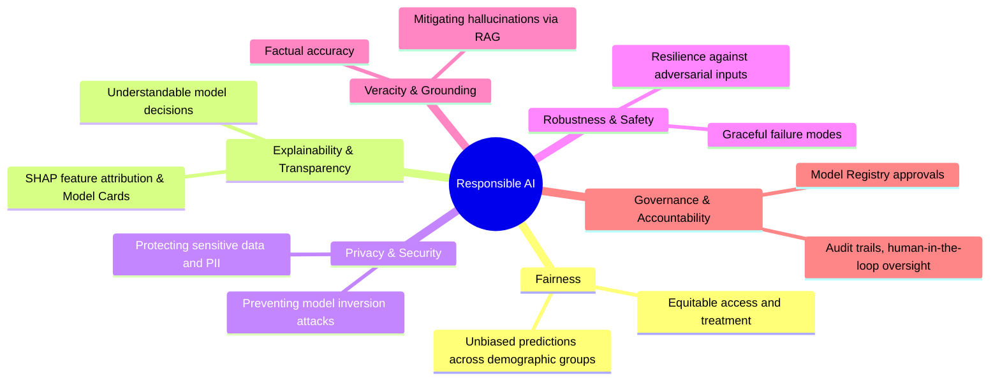
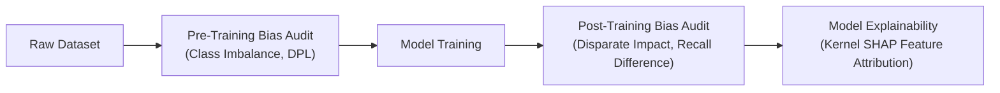
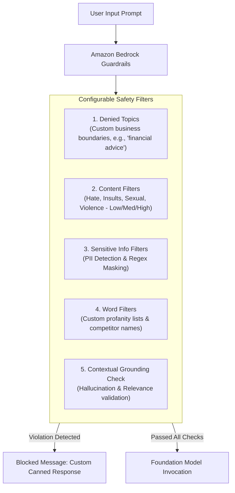
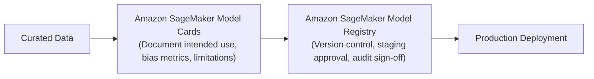
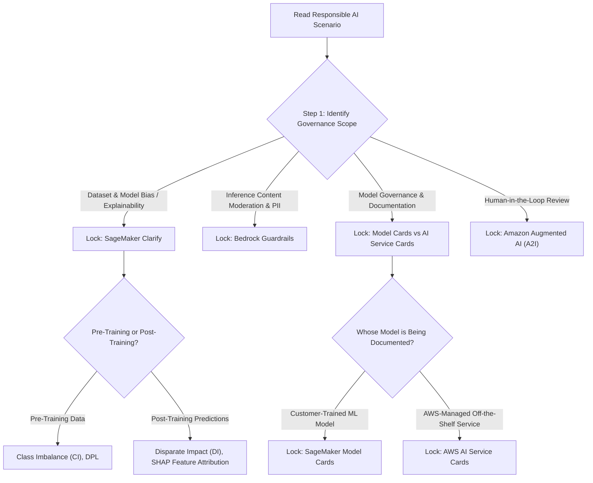
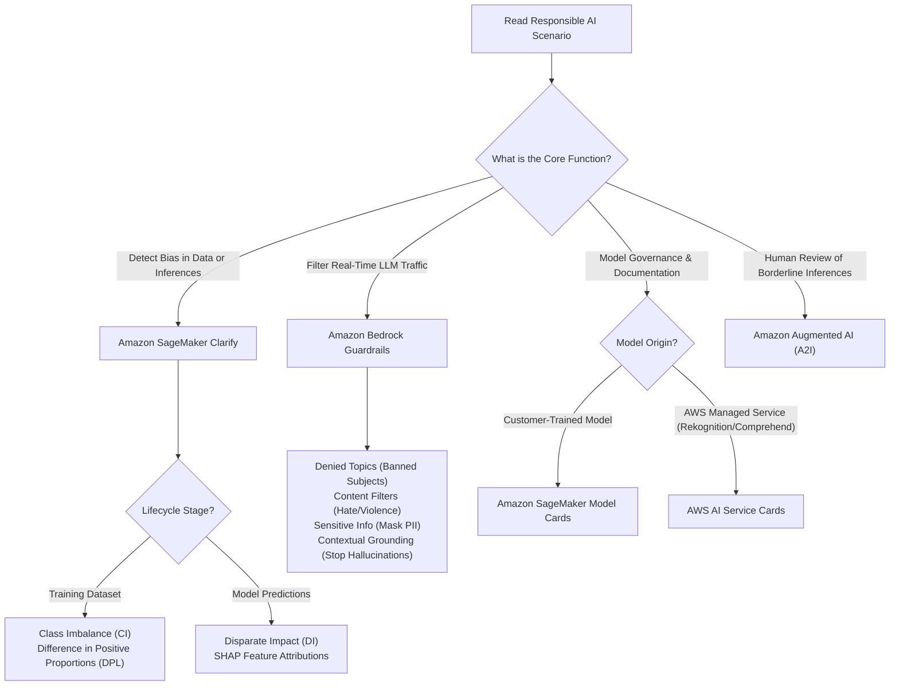

# Domain 4: Guidelines for Responsible AI

> **Weight:** 14% of Scored Exam Content  
> **Course:** AWS Certified AI Practitioner (`AIF-C01`)  
> **Exam Guide Baseline:** v1.2 (October 2026 - incorporating Bedrock Guardrails & Model Governance)  
> **Index:** `AI/Practitioner/AIF-C01/06_Explanations/04_Domain_4_Guidelines_for_Responsible_AI.md`

---

## 🧭 Domain Overview

Domain 4 assesses the practitioner's understanding of ethics, bias, fairness, transparency, and safety in AI systems. It covers the core pillars of Responsible AI, bias detection across data and models using **Amazon SageMaker Clarify**, model governance and auditing with **SageMaker Model Cards**, multi-layered content safety and PII masking with **Amazon Bedrock Guardrails**, and legal and intellectual property implications.

---

## 💡 The Real-World Analogy (ELI5)

> **The Transparent Self-Driving Car:**
> - **Explainability (SHAP Values):** When an autonomous car swerves to the left, the black box telemetry must prove *why*: *"70% weight given to pedestrian detected on right curb, 30% weight given to clear lane on left."* (SageMaker Clarify feature attributions).
> - **Fairness & Bias Detection:** Proving through empirical testing that the car detects pedestrians wearing dark winter coats just as reliably as pedestrians in bright summer clothes across all demographic zip codes (SageMaker Clarify pre/post-training bias metrics).
> - **Privacy & Protection:** The car's in-cabin dashcam automatically blurs passenger faces, credit card numbers, and house addresses before uploading footage to the cloud (Bedrock Guardrails PII masking).
> - **Transparency & Accountability:** A clear, published owner's manual detailing the car's operational design domain, speed limits, sensor limitations, and verified crash-test safety scores (SageMaker Model Cards).

---

## 🎯 Task Statement 4.1: Explain the core pillars of Responsible AI

AWS defines Responsible AI through eight fundamental dimensions:

1. **Fairness:** Ensuring models do not disproportionately disadvantage protected demographic classes (e.g., gender, race, age, religion).
2. **Explainability & Interpretability:** Providing stakeholders and regulators with clear rationales for why a specific prediction or output was generated.
3. **Transparency:** Documenting the provenance of training data, model limitations, intended use cases, and operating assumptions.
4. **Privacy & Data Protection:** Safeguarding Personally Identifiable Information (PII) throughout the data ingestion, training, and inference lifecycle.
5. **Robustness & Reliability:** Ensuring consistent, predictable behavior when exposed to adversarial perturbations, out-of-distribution inputs, or system latency spikes.
6. **Controllability & Safety:** Implementing guardrails to prevent harmful, violent, abusive, or unauthorized content generation.
7. **Veracity (Truthfulness):** Preventing fabricated information, hallucinated legal citations, or inaccurate mathematical claims.
8. **Accountability:** Establishing clear human ownership, operational escalation paths, and comprehensive audit trails.

---

## 🎯 Task Statement 4.2: Detect and mitigate bias with Amazon SageMaker Clarify

Bias can enter an AI system at any phase: historical societal biases, biased sampling during data collection, or algorithmic reinforcement during training.

### 1. Pre-Training Bias Metrics (Data Level)
Before training occurs, SageMaker Clarify evaluates the training dataset for statistical imbalances:
* **Class Imbalance (CI):** Measures the proportional disparity between the favored facet (group $a$) and the disfavored facet (group $d$). Values range from $-1$ to $1$; values near $0$ indicate balanced representation.
* **Difference in Positive Proportions in Labels (DPL):** Measures the difference in the proportion of positive target labels assigned to the favored group versus the disfavored group.
  $$\text{DPL} = q_a - q_d$$
  A high DPL indicates that historical labeling favored one demographic group over another.

### 2. Post-Training Bias Metrics (Model Prediction Level)
Evaluates whether model inferences demonstrate disparate impact across groups:
* **Disparate Impact (DI):** The ratio between the proportion of positive predictions for the disfavored group versus the favored group.
  $$\text{DI} = \frac{P(\hat{Y}=1 | D)}{P(\hat{Y}=1 | A)}$$
  In employment lending standards (the "80% rule"), a DI below $0.8$ often indicates legal bias.
* **Difference in Recall / False Positive Rates:** Detects if a model generates higher error rates for specific demographic subsets.

### 3. Model Explainability with SHAP (Shapley Additive exPlanations)
* Based on cooperative game theory, **SHAP values** quantify the exact marginal contribution of each input feature toward a specific prediction.
* **Global Feature Importance:** Identifies which features overall drive the model's behavior across the entire population.
* **Local Feature Attribution:** Explains a single individual prediction (e.g., `"Loan applicant #1042 was rejected primarily due to Debt-to-Income Ratio (+0.45 SHAP impact) and Credit Score (-0.32 SHAP impact)"`).

---

## 🎯 Task Statement 4.3: Implement multi-layered safety with Amazon Bedrock Guardrails

**Amazon Bedrock Guardrails** provides an independent, centralized safety layer applicable across all Foundation Models in Amazon Bedrock (as well as custom models or external LLMs via the Guardrail Apply API).

### Bedrock Guardrail Filtering Policies
1. **Denied Topics:** Uses natural language descriptions to define prohibited conversational domains (e.g., blocking an insurance chatbot from offering investment advice).
2. **Content Filters:** Detects and blocks harmful content across four categories: **Hate, Insults, Sexual, and Violence**. Configured across 4 severity thresholds (None, Low, Medium, High) independently for inputs and outputs.
3. **Sensitive Information Filters (PII):**
   * Predefined PII entity detection (Social Security Numbers, Credit Cards, Names, Email Addresses, Phone Numbers).
   * Supports **Masking** (replacing with `[SSN]`) or **Blocking** (terminating generation).
   * Custom Regular Expressions (Regex) for proprietary customer IDs or internal employee badges.
4. **Word Filters:** Blocks specific blacklisted keywords, slurs, or competitor brand names.
5. **Contextual Grounding Check (v1.2 Addition):**
   * Detects hallucinations in RAG applications by evaluating:
     1. **Grounding Score:** Does the model's response derive strictly from the retrieved reference documents?
     2. **Relevance Score:** Does the model's response actually address the user's original query?

---

## 🎯 Task Statement 4.4: Model Governance, Lineage, and Auditing

Enterprise regulatory compliance requires end-to-end documentation of model origins, data dependencies, and approval lifecycles.

* **Amazon SageMaker Model Cards:** Standardized digital artifacts that document critical model details:
  * Intended use cases and unsupported out-of-scope uses.
  * Training dataset parameters, preprocessing, and demographic distributions.
  * Evaluation benchmarks, Clarify bias metrics, and explainability charts.
  * Risk ratings, sign-off status, and owner contact details.
* **Amazon SageMaker Model Registry:** A central catalog for versioning models, managing approval statuses (`Approved`, `PendingManualApproval`, `Rejected`), and enforcing staging-to-production deployment gates.

---

## ⚖️ Intellectual Property and Legal Considerations
* **Training Data Copyright:** Models trained on copyrighted data can unintentionally reproduce copyrighted text or imagery.
* **Amazon Bedrock IP Indemnity:** AWS provides intellectual property indemnification for customers using Amazon Titan foundation models, protecting them against third-party copyright infringement claims.
* **Watermarking:** Amazon Titan Image Generator automatically embeds invisible, tamper-resistant digital watermarks into synthesized images to verify provenance and mitigate deepfakes.

---

## 🔗 Related Resources
* Next: [Domain 5: Security, Compliance, and Governance](./05_Domain_5_Security_Compliance_and_Governance.md)
* Blueprint: [Diagram 07: Bedrock Guardrails Multi-Layered Perimeter](../05_Diagrams/Diagram_07_Bedrock_Guardrails_Multi_Layered_Perimeter.md)
* Lab: [Lab 05: Responsible AI & PII Masking with Amazon Bedrock Guardrails](../07_Hands_On_Labs/Lab_05_Responsible_AI_and_PII_Masking_with_Amazon_Bedrock_Guardrails.md)
* Lab: [Lab 09: Model Fairness, Bias Detection & SHAP with SageMaker Clarify](../07_Hands_On_Labs/Lab_09_Model_Fairness_Bias_Detection_and_SHAP_Explainability_with_SageMaker_Clarify.md)
---

## 🎯 Exam Traps & 'Clue-to-Answer' Trigger Words

| Responsible AI Objective | Correct AWS Tool / Feature | Exam Trap Distractor |
| :--- | :--- | :--- |
| *'Detect pre-training bias in training data and post-training bias in model predictions'* | **Amazon SageMaker Clarify** | Amazon Inspector (scans for software CVEs, not statistical bias). |
| *'Explain individual predictions using SHAP (Shapley Additive exPlanations) values'* | **Amazon SageMaker Clarify** | Amazon CloudWatch (monitors system metrics, not feature attribution). |
| *'Standardized fact sheets documenting intended use, limitations, and evaluation metrics'* | **Amazon SageMaker Model Cards** | Amazon QuickSight (BI dashboard, not model governance metadata). |
| *'Continuously monitor production deployed models for data drift and concept drift'* | **Amazon SageMaker Model Monitor** | AWS CloudTrail (audits API actions, not ML model statistical drift). |
| *'Filter hate speech, profanity, PII, and custom denied topics across LLM inputs & outputs'* | **Amazon Bedrock Guardrails** | AWS WAF (WAF inspects HTTP headers/SQLi; cannot parse LLM semantic toxicity). |

---

## 📝 Post-Domain 4 Question Simulation & Retention Check

Test your mastery of Domain 4 with these 10 exam-style practice questions:

### Question 1
**Which of the following is considered a core pillar of Responsible AI?**
- A) Maximizing model parameter count
- B) Fairness, Explainability, Robustness, Privacy, and Transparency
- C) Eliminating human review completely
- D) Overclocking GPU clusters

<b>Click to View Answer & Explanation</b>

**Correct Answer:** **B) Fairness, Explainability, Robustness, Privacy, and Transparency**  
- **Why it's correct:** Responsible AI frameworks establish ethical, technical, and operational guardrails across fairness (mitigating demographic bias), explainability (interpreting decisions), robustness (withstanding adversarial attacks), privacy (safeguarding PII), and transparency (documenting system capabilities).
- **Distractor Analysis:**
  - *Option A is INCORRECT:* Parameter scale is a compute property of large models, not an ethical or responsible AI governance principle.
  - *Option B is CORRECT:* Represents the established international and AWS Responsible AI governance pillars.
  - *Option C is INCORRECT:* Human-in-the-loop oversight (e.g. Amazon A2I) is an essential safeguard of Responsible AI, not something to eliminate.
  - *Option D is INCORRECT:* Hardware overclocking is an infrastructure engineering practice unrelated to AI governance.

### Question 2
**Which AWS service allows organizations to implement custom responsible AI safeguards, block prompt injection attacks, deny prohibited conversational topics, and automatically mask PII across foundation models?**
- A) Amazon GuardDuty
- B) Amazon Bedrock Guardrails
- C) AWS WAF
- D) AWS Shield

<b>Click to View Answer & Explanation</b>

**Correct Answer:** **B) Amazon Bedrock Guardrails**  
- **Why it's correct:** **Amazon Bedrock Guardrails** provides centralized, independent content safety controls for foundation models, enabling developers to configure Denied Topics, Content Filters (hate speech, sexual, violent, insults), Sensitive Information Filters (masking or blocking PII), and Contextual Grounding Checks to eliminate hallucinations.
- **Distractor Analysis:**
  - *Option A is INCORRECT:* Amazon GuardDuty is an intelligent threat detection service monitoring AWS CloudTrail, VPC Flow Logs, and DNS logs for account compromise.
  - *Option B is CORRECT:* Bedrock Guardrails is the dedicated safety, content-moderation, and PII-masking service for GenAI.
  - *Option C is INCORRECT:* AWS WAF operates at Layer 7 to inspect HTTP/HTTPS web traffic against SQL injection and cross-site scripting (XSS), but does not inspect semantic prompt injection or redact PII entities in LLM outputs.
  - *Option D is INCORRECT:* AWS Shield protects applications against Layer 3/4 Distributed Denial of Service (DDoS) attacks.

### Question 3
**Which Amazon SageMaker AI feature detects pre-training bias in datasets, post-training bias in model predictions, and explains feature importance using SHAP (Shapley values)?**
- A) SageMaker Canvas
- B) SageMaker Clarify
- C) SageMaker Feature Store
- D) SageMaker Model Cards

<b>Click to View Answer & Explanation</b>

**Correct Answer:** **B) SageMaker Clarify**  
- **Why it's correct:** **Amazon SageMaker Clarify** detects statistical bias across demographic facets during both data preparation (pre-training Class Imbalance, DPL) and model inference evaluation (post-training Disparate Impact), and computes KernelSHAP values to provide local and global explainability.
- **Distractor Analysis:**
  - *Option A is INCORRECT:* SageMaker Canvas is a visual, no-code AutoML workspace for building predictive models.
  - *Option B is CORRECT:* SageMaker Clarify is the dedicated tool for algorithmic bias detection and SHAP model explainability.
  - *Option C is INCORRECT:* SageMaker Feature Store is a centralized registry for discovering and serving ML features.
  - *Option D is INCORRECT:* SageMaker Model Cards provide documentation templates for model governance, but do not compute bias metrics or SHAP values directly.

### Question 4
**In a mortgage loan approval model, a customer asks why their application was rejected. Which type of explainability is required to explain this single applicant's decision?**
- A) Global Explainability
- B) Local Explainability (Feature Attribution)
- C) Dimensionality Reduction
- D) Batch Transform

<b>Click to View Answer & Explanation</b>

**Correct Answer:** **B) Local Explainability (Feature Attribution)**  
- **Why it's correct:** **Local Explainability** explains a single individual prediction, quantifying the exact positive or negative contribution (SHAP value) of each input feature (e.g., Debt-to-Income ratio pushed score down by -0.45, while Credit Score pushed it up by +0.15) for that specific applicant.
- **Distractor Analysis:**
  - *Option A is INCORRECT:* Global explainability evaluates the model's overall behavior across the entire population, ranking which features are most influential in general.
  - *Option B is CORRECT:* Local explainability provides the granular feature attribution needed to explain an individual loan decision to an applicant or auditor.
  - *Option C is INCORRECT:* Dimensionality reduction (e.g. PCA) compresses feature space, obscuring rather than explaining individual decisions.
  - *Option D is INCORRECT:* Batch Transform runs offline bulk inference across large datasets without generating explainability attributions.

### Question 5
**What pre-training bias metric in SageMaker Clarify measures whether a protected demographic group is significantly underrepresented in the training dataset?**
- A) Disparate Impact (DI)
- B) Class Imbalance (CI)
- C) Mean Squared Error (MSE)
- D) Accuracy Difference

<b>Click to View Answer & Explanation</b>

**Correct Answer:** **B) Class Imbalance (CI)**  
- **Why it's correct:** **Class Imbalance (CI)** is a pre-training data metric that calculates whether the number of instances belonging to a protected demographic facet (facet $d$) is significantly lower than the favored facet (facet $a$), identifying sampling bias before model training starts.
- **Distractor Analysis:**
  - *Option A is INCORRECT:* Disparate Impact (DI) is a post-training metric that evaluates the ratio of favorable model predictions between demographic groups.
  - *Option B is CORRECT:* Class Imbalance measures demographic representation disparity in the raw training dataset.
  - *Option C is INCORRECT:* Mean Squared Error is a regression loss metric, not a demographic bias metric.
  - *Option D is INCORRECT:* Accuracy difference is a post-training performance metric.

### Question 6
**A company wants to automatically redact customer Social Security Numbers, credit cards, and email addresses from chat transcripts before logging data. Which feature in Amazon Bedrock Guardrails performs this?**
- A) Denied Topics
- B) Sensitive Information Filters (PII Redaction/Masking)
- C) Word Filters
- D) Grounding Checks

<b>Click to View Answer & Explanation</b>

**Correct Answer:** **B) Sensitive Information Filters (PII Redaction/Masking)**  
- **Why it's correct:** **Sensitive Information Filters** in Bedrock Guardrails automatically detect predefined PII entities (SSN, credit card numbers, email addresses, phone numbers) or custom regex patterns, either blocking the request or automatically masking the sensitive strings with replacement tokens (e.g. `[SSN]`).
- **Distractor Analysis:**
  - *Option A is INCORRECT:* Denied Topics block conversations about specified undesirable conceptual topics (e.g., providing legal or financial advice).
  - *Option B is CORRECT:* Sensitive Information Filters are specifically purpose-built for detecting and masking/blocking PII.
  - *Option C is INCORRECT:* Word Filters match exact profanities, offensive words, or proprietary trade secrets.
  - *Option D is INCORRECT:* Grounding Checks verify whether generated outputs are factually grounded in reference source documents to eliminate hallucinations.

### Question 7
**Which alignment technique trains a reward model based on human preference rankings and uses Proximal Policy Optimization (PPO) to align a foundation model with human values?**
- A) K-Means Clustering
- B) Reinforcement Learning from Human Feedback (RLHF)
- C) Principal Component Analysis (PCA)
- D) Unsupervised Pre-training

<b>Click to View Answer & Explanation</b>

**Correct Answer:** **B) Reinforcement Learning from Human Feedback (RLHF)**  
- **Why it's correct:** **RLHF** aligns foundation models with human expectations (helpfulness, honesty, harmlessness) by having human evaluators rank model responses, training a reward model on these preference pairs, and optimizing the base LLM policy using reinforcement learning (PPO).
- **Distractor Analysis:**
  - *Option A is INCORRECT:* K-Means is an unsupervised clustering algorithm.
  - *Option B is CORRECT:* RLHF is the standard human-aligned reinforcement learning fine-tuning methodology.
  - *Option C is INCORRECT:* PCA is a linear dimensionality reduction technique.
  - *Option D is INCORRECT:* Unsupervised pre-training trains on next-token prediction across raw text without reward models or human preference feedback.

### Question 8
**How does Constitutional AI (RLAIF) improve the efficiency of aligning foundation models compared to traditional RLHF?**
- A) It eliminates the need for foundation models.
- B) It replaces manual human feedback with automated AI-generated feedback guided by a predefined "Constitution" of ethical principles.
- C) It makes model training free of charge.
- D) It guarantees 100% accuracy on mathematical problems.

<b>Click to View Answer & Explanation</b>

**Correct Answer:** **B) It replaces manual human feedback with automated AI-generated feedback guided by a predefined "Constitution" of ethical principles.**  
- **Why it's correct:** **Constitutional AI (Reinforcement Learning from AI Feedback - RLAIF)** uses an AI model to critique and revise its own outputs against a set of written constitutional principles (rules/guidelines), drastically reducing the high cost, latency, and human labor bottlenecks of manual RLHF.
- **Distractor Analysis:**
  - *Option A is INCORRECT:* Constitutional AI trains and aligns foundation models; it does not eliminate them.
  - *Option B is CORRECT:* Replaces human rankers with AI feedback guided by written constitutional principles.
  - *Option C is INCORRECT:* Training and evaluating models still incurs substantial GPU compute and token costs.
  - *Option D is INCORRECT:* Constitutional AI guides behavioral ethics and safety, not mathematical perfection.

### Question 9
**What is the purpose of a Contextual Grounding Check in Amazon Bedrock Guardrails?**
- A) To detect if the user is using a VPN
- B) To detect and block model hallucinations by measuring factual overlap between the generated response and reference source documents
- C) To measure token billing rates
- D) To translate responses into Spanish

<b>Click to View Answer & Explanation</b>

**Correct Answer:** **B) To detect and block model hallucinations by measuring factual overlap between the generated response and reference source documents**  
- **Why it's correct:** **Contextual Grounding Checks** evaluate two critical dimensions in RAG workflows: Grounding (verifying that every claim in the model's response is directly supported by the retrieved reference chunks) and Relevance (verifying that the response directly answers the user's prompt), blocking ungrounded hallucinations before delivery.
- **Distractor Analysis:**
  - *Option A is INCORRECT:* Network inspection and VPN detection belong to VPC/WAF network tools.
  - *Option B is CORRECT:* Contextual grounding filters detect and block hallucinations by measuring factual grounding against source context.
  - *Option C is INCORRECT:* Billing metrics are tracked in AWS Cost Explorer and CloudWatch.
  - *Option D is INCORRECT:* Language translation is performed by Amazon Translate.

### Question 10
**Which service allows easily incorporating human review workflows into automated ML predictions when model confidence falls below a defined threshold?**
- A) Amazon Augmented AI (Amazon A2I)
- B) Amazon Rekognition
- C) AWS Step Functions
- D) AWS IAM

<b>Click to View Answer & Explanation</b>

**Correct Answer:** **A) Amazon Augmented AI (Amazon A2I)**  
- **Why it's correct:** **Amazon Augmented AI (Amazon A2I)** provides built-in human review workflows for machine learning models. When an ML model (e.g. Textract, Rekognition, or custom SageMaker endpoints) reports low confidence or predicts sensitive attributes, A2I routes the prediction to human reviewers (internal workforce, Amazon Mechanical Turk, or third-party vendors) for manual verification.
- **Distractor Analysis:**
  - *Option A is CORRECT:* Amazon A2I is the purpose-built service for human-in-the-loop review orchestration.
  - *Option B is INCORRECT:* Amazon Rekognition performs computer vision analysis and can route low-confidence frames to A2I, but Rekognition itself is not the human review workflow engine.
  - *Option C is INCORRECT:* AWS Step Functions is a general serverless workflow state machine; building human review workflows with it requires significant custom development compared to A2I's turnkey templates.
  - *Option D is INCORRECT:* AWS IAM manages authentication and access permissions.

---

## 🎓 Master MCQ Solving Blueprint: Domain 4 (Guidelines for Responsible AI)

> Mined directly from the 241-question Domain 4 bank in the master repository. Use this systematic 4-layer methodology to resolve any responsible AI, bias, explainability, or governance question.

### Layer 1: "Clue-to-Service" Linguistic Decryption Matrix

| If Scenario Text States... | Target Concept / Service | Why (The Core Mechanism) | Decoy Trap to Avoid |
| :--- | :--- | :--- | :--- |
| **"Detect pre/post-training bias and SHAP explainability"** | **Amazon SageMaker Clarify** | Audits datasets for demographic bias and generates KernelSHAP feature attributions. | SageMaker Canvas (builds models; does not provide standalone bias governance). |
| **"Explain an individual loan rejection to a customer"** | **Local Explainability (SHAP)** | Explains a single instance by showing exact feature impacts relative to baseline. | Global Explainability (which only ranks features across the whole population). |
| **"Pre-training metric for underrepresented demographic samples"** | **Class Imbalance (CI)** | Evaluates demographic representation disparities in raw training datasets. | Disparate Impact (which is a post-training prediction ratio). |
| **"Post-training metric for prediction disparity (80% rule)"** | **Disparate Impact (DI)** | Ratio of favorable prediction rates between disfavored and favored groups. | Class Imbalance (which measures raw sample counts before training). |
| **"Centralized safety filter, prompt injection defense, PII masking"** | **Amazon Bedrock Guardrails** | Multi-layer content filters, denied topics, PII redaction, and grounding checks. | AWS WAF (inspects HTTP headers for SQLi/XSS; unaware of semantic LLM safety). |
| **"Detect and block LLM hallucinations in RAG responses"** | **Contextual Grounding Checks** | Measures mathematical factual overlap between generated output and source docs. | Temperature adjustment alone (reduces randomness but cannot block hallucinations). |
| **"Document model intended use, limits, training data, and metrics"** | **SageMaker Model Cards** | Standardized governance fact sheets recording lifecycle metadata and evaluation results. | AWS AI Service Cards (public sheets published by AWS for AWS managed services). |
| **"Public AWS documentation on capabilities/limits of AWS AI services"** | **AWS AI Service Cards** | AWS-published documentation for managed services (Rekognition, Textract). | SageMaker Model Cards (created by customers for their own custom models). |
| **"Incorporate human review when model confidence is low"** | **Amazon Augmented AI (A2I)** | Turnkey human-in-the-loop review routing for Textract, Rekognition, and SageMaker. | AWS Step Functions (general workflow orchestrator; requires building custom UIs). |
| **"Align model with human values using human preference rankings"** | **RLHF (Human Feedback)** | Uses human ranking pairs to train a reward model optimized via PPO. | Unsupervised pre-training (next-token prediction without preference data). |
| **"Align model using automated AI critique guided by written rules"** | **RLAIF / Constitutional AI** | Uses AI-generated feedback guided by ethical rules, removing human bottlenecks. | Standard RLHF (which relies on expensive human raters). |

---

### Layer 2: 3-Step Rapid Elimination Heuristic

1. **Step 1: Determine the Operational Objective:**
   - Are you analyzing statistical bias or feature importance? → **SageMaker Clarify**.
   - Are you preventing toxic outputs, blocking prompt injection, or masking PII during live chat? → **Amazon Bedrock Guardrails**.
   - Are you documenting model metadata and risk audits? → **Model Cards / Service Cards**.
   - Are you escalating uncertain predictions to human reviewers? → **Amazon Augmented AI (A2I)**.
2. **Step 2: Differentiate Customer Artifacts vs AWS Artifacts:**
   - If the enterprise created their own model → **SageMaker Model Cards**.
   - If the enterprise is reviewing AWS's built-in services (e.g. Rekognition) → **AWS AI Service Cards**.
3. **Step 3: Check Individual vs Population Explainability:**
   - Explaining why a single applicant was rejected → **Local Explainability** (Local SHAP).
   - Explaining which features overall matter most to the algorithm → **Global Explainability**.

---

### Layer 3: High-Frequency Decoy Autopsy

#### Decoy Trap 1: SageMaker Clarify vs Amazon Bedrock Guardrails
* **The Exam Trap:** The question asks for a solution to prevent an LLM customer chatbot from revealing profanities, discussing competitor products, and leaking customer credit card numbers.
* **The Decoy:** Option A offers **Amazon SageMaker Clarify**.
* **The Fatal Flaw:** SageMaker Clarify is an offline bias detection and explainability tool used during model development and batch evaluation. It does not inspect live inference streams in real time to filter profanity or redact credit card strings.
* **The Correct Choice:** **Amazon Bedrock Guardrails** provides real-time, bidirectional content filtering, denied topics, and PII redaction.

#### Decoy Trap 2: SageMaker Model Cards vs AWS AI Service Cards
* **The Exam Trap:** An auditor requests documentation outlining the intended use, known limitations, and bias testing benchmarks for Amazon Rekognition face detection.
* **The Decoy:** SageMaker Model Cards.
* **The Fatal Flaw:** SageMaker Model Cards are custom documentation entities created by customers to document their *own* proprietary models.
* **The Correct Choice:** **AWS AI Service Cards** are public transparency resources provided by AWS specifically for AWS managed AI services.

#### Decoy Trap 3: Class Imbalance (CI) vs Disparate Impact (DI)
* **The Exam Trap:** A data science team discovers that loan rejection rates differ significantly between male and female applicants after the model is deployed to production. Which metric revealed this?
* **The Decoy:** Class Imbalance (CI).
* **The Fatal Flaw:** Class Imbalance evaluates raw demographic counts in the *unlabeled or labeled training data* prior to training. It cannot evaluate model inference decisions.
* **The Correct Choice:** **Disparate Impact (DI)** measures the ratio of favorable predictions between demographic groups generated by the trained model.

---

### Layer 4: 10-Second Visual Decision Flowchart

