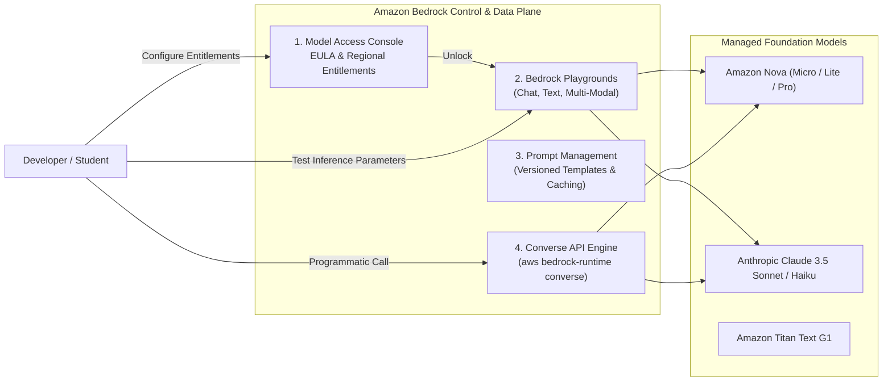

# Lab 01: Amazon Bedrock Model Access, Playgrounds & Prompt Engineering

> **Course:** AWS Certified AI Practitioner (`AIF-C01`) Track  
> **Exam Domain Alignment:** Domain 2 (Fundamentals of Generative AI) & Domain 3 (Applications of Foundation Models)  
> **Estimated Duration:** 45 minutes  
> **Cost Profile:** Minimal pay-per-token usage ($<\$0.05$ for the entire lab)  
> **AWS Region:** `eu-north-1` (Stockholm) or `us-east-1` (N. Virginia)

---

## 🎯 Lab Overview & Exam Objectives

In the official AWS Certified AI Practitioner (AIF-C01) exam, a major portion of questions evaluates your understanding of **how foundation models are accessed in Amazon Bedrock**, **how inference parameters govern generation randomness and certainty**, and **how different prompt engineering patterns resolve hallucinations**.

By completing this guided lab, you will master:
1. **Foundation Model Access Governance:** The exact console workflow for requesting and enabling models from Amazon (Titan, Nova), Anthropic (Claude), Meta (Llama), and Mistral.
2. **Inference Parameters Decoding Mechanics:** Hands-on experiments measuring the physical effects of **Temperature**, **Top-P (Nucleus Sampling)**, **Top-K**, and **Stop Sequences**.
3. **In-Context Learning Paradigms:** Step-by-step authoring of **Zero-Shot**, **Few-Shot**, and **Chain-of-Thought (CoT)** prompts to evaluate hallucination reduction.
4. **Prompt Caching & Bedrock Prompt Management:** Creating reusable, version-controlled prompt templates with prompt caching to reduce time-to-first-token (TTFT) latency by up to 80%.
5. **AWS CLI Programmatic Invocation:** Executing model inference via the unified `aws bedrock-runtime converse` API.

---

## 🏗️ Architectural Topology



---

## 🛠️ Guided Step-by-Step Console Walkthrough

### Step 1: Enable Foundation Model Access in Amazon Bedrock
In Amazon Bedrock, foundation models are **not enabled by default**. AWS mandates an explicit access request process to comply with vendor End User License Agreements (EULAs).

1. Sign in to the **AWS Management Console** and select your active region:
   - Preferred primary region: **`eu-north-1` (Stockholm)** or **`us-east-1` (N. Virginia)**.
2. In the top search bar, search for and open **Amazon Bedrock**.
3. In the left-hand navigation pane, scroll to the bottom under the **Administration** category and select **Model access**.
4. In the main pane, observe the status table listing models by provider (Amazon, Anthropic, Cohere, Meta, Mistral, Stability AI).
5. Click the orange **Modify model access** button (top right).
6. Enable the following models by selecting their checkboxes:
   - **Amazon:** 
     - `Nova Micro` (High-speed, ultra-low cost)
     - `Nova Lite` (Fast multimodal processing)
     - `Nova Pro` (Complex reasoning and multimodal understanding)
     - `Titan Text G1 - Express`
   - **Anthropic:**
     - `Claude 3.5 Sonnet`
     - `Claude 3 Haiku`
     *(Note: If prompted with an Anthropic Use Case details dialog, input standard educational details and submit).*
7. Click **Next** at the bottom right.
8. Review the End User License Agreements (EULA) summary and click **Submit**.
9. The status for selected models will immediately update to **Access granted** (green checkmark).

> [!NOTE]
> **Exam Tip:** On the AIF-C01 exam, if a question describes an IAM user with `bedrock:InvokeModel` permissions receiving an `AccessDeniedException` stating that model access is not available, the root cause is that **Model Access has not been granted at the account/region level in the Bedrock console**, not an IAM policy typo!

---

### Step 2: Explore the Chat Playground & Decoding Parameters
The Bedrock Chat Playground allows real-time interactive benchmarking of decoding parameters across different model families.

1. In the left navigation menu under **Playgrounds**, select **Chat**.
2. Click **Select model**.
   - Provider: **Amazon**
   - Model: **Amazon Nova Pro** (or **Anthropic Claude 3.5 Sonnet**)
   - Version: Keep default latest
   - Click **Apply**.
3. Expand the **Configurations** panel on the right side of the screen. Here you will see the three core decoding controls:
   - **Temperature:** Governs probability distribution flatness.
   - **Top-P (Nucleus Sampling):** Governs dynamic cumulative probability threshold.
   - **Max response length (tokens):** Hard cap on generation length.
   - **Stop sequences:** Delimiters that immediately halt generation.

---

### Step 3: Experimenting with Temperature & Determinism
Temperature scales the logits before the Softmax layer is applied:
$$P(y_i) = \frac{e^{z_i / T}}{\sum_j e^{z_j / T}}$$

#### Experiment 3A: High Temperature (Creative & Exploratory)
1. In the Configuration panel, set:
   - **Temperature:** `1.0` (Maximum exploratory randomness)
   - **Top-P:** `1.0`
   - **Max Tokens:** `250`
2. Enter the following user prompt in the chat input:
   ```text
   Generate three distinct, futuristic names for an autonomous drone logistics startup operating in 2050. Provide a one-sentence tagline for each.
   ```
3. Click **Run**.
4. Observe the response: Notice the high lexical diversity, colorful adjectives, and varied sentence structure.
5. Click **Run** again with the exact same prompt: Notice that the model produces completely different names and slogans.

#### Experiment 3B: Low Temperature (Greedy & Deterministic)
1. Now adjust the configuration parameters:
   - **Temperature:** `0.0` (Forces greedy search; strictly selects the single highest-probability token at every step)
   - **Top-P:** `1.0`
2. Enter the exact same prompt and click **Run**.
3. Record the generated names.
4. Click **Run** a second and third time.
5. **Observation:** The generated output is **100% identical and reproducible across repeated runs**.

> [!IMPORTANT]
> **Exam Distinction:** Temperature = `0.0` is mandatory for programmatic use cases such as SQL query generation, JSON data extraction, mathematical deduction, and regulatory compliance answers where variance is unacceptable. High Temperature ($0.7 - 1.0$) is reserved for creative brainstorming, marketing copy, and multi-angle problem ideation.

---

### Step 4: Experimenting with Top-P (Nucleus Sampling) & Top-K
1. Reset **Temperature** to `0.7`.
2. Reduce **Top-P** from `1.0` to `0.2`.
3. In the chat box, enter:
   ```text
   Explain how an internal combustion engine works in three bullet points.
   ```
4. **Observation:** With Top-P set to `0.2`, the model dynamically restricts the candidate pool of next tokens to only the top slice that sums to 20% cumulative probability. Notice how conservative, standard, and focused the vocabulary becomes—eliminating rare or tangential terminology.

---

### Step 5: Hands-on Prompt Engineering Patterns

#### Pattern 1: Zero-Shot vs. Few-Shot In-Context Learning
1. **Zero-Shot Test:** Clear the chat session and enter:
   ```text
   Classify the sentiment of the following customer review as POSITIVE, NEGATIVE, or NEUTRAL:
   "The battery lasted about 3 hours, which was slightly below what the box said, but customer support sent a replacement cord immediately."
   ```
   *Observe whether the model outputs only the label or verbose conversational text.*

2. **Few-Shot Prompting (Enforcing Precise Output Schema):**
   Paste the following formatted few-shot prompt into the chat box:
   ```text
   You are an automated sentiment classifier. You must only respond with valid JSON containing the keys "sentiment" and "confidence".

   Review: "This software completely crashed our server during deployment."
   {"sentiment": "NEGATIVE", "confidence": 0.98}

   Review: "The interface is intuitive and saved our team four hours this week."
   {"sentiment": "POSITIVE", "confidence": 0.95}

   Review: "The battery lasted about 3 hours, which was slightly below what the box said, but customer support sent a replacement cord immediately."
   ```
3. Click **Run**.
4. **Observation:** The model strictly adheres to the demonstrated JSON schema without conversational preamble (`{"sentiment": "NEUTRAL", "confidence": 0.72}`). This demonstrates how **Few-Shot In-Context Learning directs formatting and output structure without modifying model weights**.

#### Pattern 2: Chain-of-Thought (CoT) Prompting
1. Enter the following reasoning challenge:
   ```text
   A cloud storage bucket starts with 500 GB of data. On Monday, 150 GB is added. On Tuesday, 20% of the total data is deleted. On Wednesday, the remaining data is compressed by 50%. How much data remains in the bucket?
   
   Think through this step-by-step before providing your final answer.
   ```
2. Click **Run**.
3. **Observation:** Because of the directive *"Think through this step-by-step"*, the model explicitly articulates each calculation step (Monday total: 650 GB -> Tuesday deletion: 650 - 130 = 520 GB -> Wednesday compression: 520 × 0.5 = 260 GB).
4. **Exam Connection:** Chain-of-Thought (CoT) prompting drastically improves mathematical and logical accuracy by allowing the transformer to generate reasoning tokens prior to emitting the terminal answer.

---

### Step 6: Configure Bedrock Prompt Management & Prompt Caching
Amazon Bedrock Prompt Management allows you to save, version, and test prompts with variables.

1. In the left navigation menu under **Foundation models**, select **Prompt management**.
2. Click **Create prompt**.
3. Enter prompt name: `SupportTicketTriagePrompt`.
4. In the **Prompt configuration** section:
   - Model: Select **Amazon Nova Lite** or **Anthropic Claude 3.5 Sonnet**.
   - In the prompt editor, enter:
     ```text
     You are an expert IT Tier-1 triage assistant. 
     Analyze the following incoming employee support ticket:
     {{ticket_text}}

     Provide:
     1. Priority: [URGENT, HIGH, MEDIUM, LOW]
     2. Assigned Team: [Networking, IAM, Hardware, Billing]
     3. Recommended Initial Action
     ```
5. Click **Create draft**.
6. In the **Test prompt** pane on the right:
   - Under `ticket_text`, input: `My laptop screen is flickering and blacking out when connected to the HDMI projector in Conference Room B.`
   - Click **Run**.
   - Verify that the model fills the variable and produces the structured triage report.
7. Click **Save and create version** -> Save as Version `1`.

> [!NOTE]
> **Prompt Caching Mechanics:** When using models that support Prompt Caching (such as Anthropic Claude and Amazon Nova), Bedrock caches prompt prefixes longer than 1,024 tokens for up to 5 minutes. Subsequent invocations reusing that identical prefix bypass re-computation, resulting in **up to 80% reduction in time-to-first-token (TTFT) latency** and **50% savings on input token costs**.

---

## 💻 Programmatic Invocation via AWS CLI v2 (`converse` API)

AWS recommends the unified `converse` API over the legacy `invoke-model` API because it standardizes inputs and outputs across all model providers.

Execute the following command in your terminal:

```bash
# Invoke Amazon Nova Micro using the unified converse API
aws bedrock-runtime converse \
  --model-id "amazon.nova-micro-v1:0" \
  --messages '[{"role": "user", "content": [{"text": "Explain the difference between S3 Standard and S3 Glacier in one sentence."}]}]' \
  --inference-config '{"temperature": 0.0, "maxTokens": 100}' \
  --region eu-north-1 \
  --output json
```

### Expected JSON Output Structure:
```json
{
    "output": {
        "message": {
            "role": "assistant",
            "content": [
                {
                    "text": "S3 Standard provides high-throughput, low-latency storage for frequently accessed data, whereas S3 Glacier offers low-cost, secure archival storage designed for rarely accessed data with retrieval times ranging from minutes to hours."
                }
            ]
        }
    },
    "stopReason": "end_turn",
    "usage": {
        "inputTokens": 24,
        "outputTokens": 41,
        "totalTokens": 65
    },
    "metrics": {
        "latencyMs": 342
    }
}
```

---

## 🎯 Exam Practice: Scenarios & Traps

| Exam Scenario | Correct Recommendation | Why Distractors Fail |
|---|---|---|
| *"A financial application requires the model to generate tax calculation summaries that must never vary between identical API requests."* | **Set Temperature = 0.0** | Increasing Top-P or Top-K maintains stochastic sampling and does not guarantee determinism. Fine-tuning also does not guarantee deterministic decoding. |
| *"A company wants an LLM to output legal contracts using company-specific formatting without writing custom code or modifying model weights."* | **Few-Shot In-Context Prompting** | Fine-Tuning modifies model weights and requires thousands of labeled pairs. RAG injects facts, not formatting styles. |
| *"Developers report an AccessDeniedException when calling `bedrock:InvokeModel` via the CLI, despite having full IAM administrative permissions."* | **Enable Model Access in the Amazon Bedrock console for that specific region** | IAM permissions allow the user to make the call, but Bedrock enforces an account-level entitlement check where EULAs must be accepted first. |
| *"An enterprise chatbot processes complex multi-step accounting problems and consistently makes logical calculation errors."* | **Implement Chain-of-Thought (CoT) prompting** | Raising temperature increases hallucination. CoT forces step-by-step intermediate token generation, resolving reasoning errors. |

---

## 🧹 Cost Safeguard & Cleanup

1. Amazon Bedrock Playgrounds and the Converse API are **purely pay-per-token**. When you are not actively sending prompts, **ongoing cost is $0.00**.
2. Saved prompts in Prompt Management incur negligible storage fees (<$0.01/month). If desired, you can delete `SupportTicketTriagePrompt` via:
   - **Bedrock Console** > **Prompt management** > Select `SupportTicketTriagePrompt` > Click **Actions** > **Delete prompt**.
3. No EC2 instances, provisioned throughput, or serverless vector collections were created in this lab.
