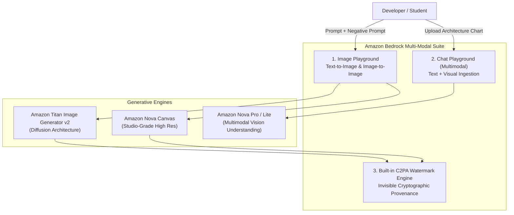

# Lab 02: Multi-Modal Generation with Amazon Nova & Titan Image Generator

> **Course:** AWS Certified AI Practitioner (`AIF-C01`) Track  
> **Exam Domain Alignment:** Domain 2 (Fundamentals of Generative AI) & Domain 3 (Applications of Foundation Models)  
> **Estimated Duration:** 45 minutes  
> **Cost Profile:** Pay-per-image and pay-per-token ($<\$0.15$ total)  
> **AWS Region:** `eu-north-1` (Stockholm) or `us-east-1` (N. Virginia)

---

## 🎯 Lab Overview & Exam Objectives

Multi-modal Generative AI represents one of the highest-weight frontiers on the AIF-C01 exam. Candidates must understand how foundation models process and generate non-text modalities (images, diagrams, video, audio) and how AWS enforces provenance and safety using **digital watermarking**.

By completing this guided lab, you will master:
1. **Diffusion Model Image Generation:** Generating photorealistic synthetic imagery using **Amazon Titan Image Generator v2** and **Amazon Nova Canvas**.
2. **Advanced Image Editing Operations:** Detailed console procedures for **Inpainting** (mask-based targeted modification), **Outpainting** (canvas boundary expansion), and **Negative Prompting**.
3. **Cryptographic & Digital Watermarking:** How Amazon Bedrock embeds invisible, tamper-resistant **C2PA-compliant watermarks** in synthetic imagery to detect AI-generated content.
4. **Multi-Modal Document & Chart Understanding:** Using **Amazon Nova Lite / Pro** to parse complex architectural diagrams and financial charts into structured JSON.
5. **Deterministic Image Generation:** Controlling randomness using **Seed** values.

---

## 🏗️ Architectural Topology



---

## 🛠️ Guided Step-by-Step Console Walkthrough

### Step 1: Text-to-Image Synthesis with Negative Prompting
Diffusion models generate images by iteratively removing Gaussian noise from a random latent canvas conditioned on your text prompt.

1. In the **AWS Management Console**, navigate to **Amazon Bedrock**.
2. In the left navigation pane under **Playgrounds**, select **Image**.
3. Click **Select model**:
   - Provider: **Amazon**
   - Model: **Titan Image Generator G1/v2** (or **Amazon Nova Canvas**)
   - Click **Apply**.
4. In the configuration side panel on the right, set the following parameters:
   - **Mode:** `Generate` (Text-to-Image)
   - **Number of images:** `1`
   - **Quality:** `Standard` (512x512 or 1024x1024)
   - **Aspect ratio:** `1:1 (Square)`
   - **CFG Scale (Prompt Strength):** `8.0` *(Higher values force the model to adhere more strictly to the prompt)*
   - **Seed:** `42` *(Setting a specific integer seed ensures reproducible results)*
5. In the **Prompt** text box, enter:
   ```text
   A high-tech enterprise server room with glowing server racks, subtle blue and amber fiber optic cables, clean reflections on the polished floor, hyperrealistic, 8k photography.
   ```
6. Expand **Negative prompt** and enter:
   ```text
   blurry, low resolution, people, messy wires, cluttered, cartoon, distorted
   ```
   > [!NOTE]
   > **Exam Concept:** A **Negative Prompt** instructs the diffusion model on visual concepts, artifacts, or styles to actively suppress during the reverse-diffusion denoising process.
7. Click **Generate**.
8. In 5–10 seconds, the generated high-resolution image appears in the gallery.

---

### Step 2: Inpainting (Mask-Based Object Replacement)
Inpainting allows you to modify a specific localized region of an existing image without altering the rest of the composition.

1. Click on the generated server room image to expand it.
2. In the top toolbar above the image, click **Inpaint / Outpaint**.
3. Select the **Inpaint** tab.
4. Choose the **Brush** tool:
   - Set brush size to medium (~`30px`).
   - Paint a mask over the center foreground floor area where you want to add an object.
5. In the modification prompt box, enter:
   ```text
   A sleek, autonomous white security inspection drone resting on the floor with subtle green LED indicators.
   ```
6. In the **Inpainting Mode**, observe the two available settings:
   - **Replace:** Completely replaces masked pixels with the new concept.
   - **Insert:** Blends new elements seamlessly while respecting background lighting.
7. Select **Insert** and click **Generate**.
8. **Observation:** The background server racks, ceiling lights, and reflections remain 100% intact, while the autonomous drone is rendered with consistent lighting and shadow cast on the floor.

---

### Step 3: Outpainting (Canvas Expansion)
Outpainting extends the canvas boundaries beyond the original frame while maintaining stylistic, lighting, and geometric continuity.

1. In the image editing toolbar, select **Outpaint**.
2. Select **Expand canvas**.
3. Use the corner handles to drag the canvas outwards on the left and right sides by 20%.
4. In the prompt box, select **Auto-fill** (or enter: *"Continue the rows of server racks extending into an infinite hallway"*).
5. Click **Generate**.
6. **Observation:** The model extrapolates the perspective lines and ambient lighting smoothly into the newly created canvas area.

---

### Step 4: Digital Watermarking & Synthetic AI Detection (C2PA)
A cornerstone of AWS Responsible AI is content provenance: ensuring that synthetic images can be identified to combat deepfakes and intellectual property fraud.

1. Inspect the configuration panel under **Watermarking**.
2. Notice that Amazon Titan Image Generator and Amazon Nova Canvas **automatically embed an invisible digital watermark by default**.
3. **Mechanics of the Watermark:**
   - **Invisible to the Human Eye:** Does not degrade image quality or alter perceptible pixels.
   - **Tamper-Resistant:** Survives common image manipulations including cropping, lossy JPEG re-compression, color adjustments, and modest resizing.
   - **C2PA Standard Alignment:** Conforms to the Coalition for Content Provenance and Authenticity (C2PA) standard.
4. **Verification:** Any organization can upload an image to Amazon Bedrock's watermark detection API to verify whether it originated from an Amazon foundation model.

---

### Step 5: Multi-Modal Document & Chart Understanding with Amazon Nova
Multi-modal understanding involves using large vision-language models (LVLMs) to reason across text and imagery simultaneously.

1. Navigate to **Amazon Bedrock** > **Playgrounds** > **Chat**.
2. Click **Select model** > **Amazon** > **Amazon Nova Pro** (or **Anthropic Claude 3.5 Sonnet**). Click **Apply**.
3. In the chat input toolbar, click the **Attachment / Image icon** (paperclip or image icon).
4. Upload any local architecture diagram, bar chart, or screenshot (or use the sample provided below).
5. In the accompanying prompt box, enter:
   ```text
   Examine this architecture diagram. 
   1. Identify all AWS services depicted.
   2. List any Single Point of Failure (SPOF) in the networking tier.
   3. Output a recommended remediation in bullet points.
   ```
6. Click **Run**.
7. **Observation:** The model performs optical layout analysis, reads text labels embedded inside boxes, traces interconnecting arrows, and deduces architectural resiliency gaps.

---

## 💻 Programmatic Multi-Modal Invocation via AWS CLI v2

You can send base64-encoded images along with text prompts directly to Amazon Nova using the `converse` API:

```bash
# 1. Base64 encode your input image (Linux/macOS)
IMAGE_BASE64=$(base64 -w 0 architecture_sample.png)

# 2. Invoke Amazon Nova Pro with multi-modal content
aws bedrock-runtime converse \
  --model-id "amazon.nova-pro-v1:0" \
  --messages "[
    {
      \"role\": \"user\",
      \"content\": [
        {
          \"image\": {
            \"format\": \"png\",
            \"source\": {
              \"bytes\": \"$IMAGE_BASE64\"
            }
          }
        },
        {
          \"text\": \"Describe the architecture shown in this diagram and verify if it follows Multi-AZ high availability best practices.\"
        }
      ]
    }
  ]" \
  --inference-config '{"temperature": 0.0, "maxTokens": 300}' \
  --region eu-north-1 \
  --output json
```

---

## 🎯 Exam Practice: Scenarios & Traps

| Exam Scenario | Correct Recommendation | Why Distractors Fail |
|---|---|---|
| *"A news publishing company must verify whether an image submitted by a freelance journalist was synthetically created by Amazon Bedrock."* | **Use Bedrock's Watermark Detection API to check for the invisible C2PA digital watermark** | Looking for visual distortion or running image classification models does not provide definitive provenance. Amazon Titan/Nova embeds cryptographic C2PA watermarks. |
| *"A marketing designer wants to replace a product on a table with a newer model without changing the table, background, or lighting."* | **Inpainting with a mask (Insert mode)** | Outpainting extends outer borders. Complete regeneration will alter the background and lighting. |
| *"A developer needs to ensure that generating images from the exact same prompt produces identical images every time for regression testing."* | **Set a fixed Seed integer value** | Temperature is a text decoding parameter, not a diffusion parameter. Fixing the Seed fixes the initial random noise tensor. |
| *"A financial analyst needs an automated system to extract revenue tables from scanned quarterly earnings PDF charts and output JSON."* | **Amazon Nova Pro / Lite or Claude 3.5 Sonnet (Multimodal Vision)** | Traditional OCR (standard Textract without queries) cannot perform semantic financial reasoning or structural chart interpretation. |

---

## 🧹 Cost Safeguard & Cleanup

1. Image generation models are charged strictly **per generated image** (~$0.01 to $0.04 per image depending on resolution).
2. Because no provisioned throughput, endpoints, or persistent EC2 instances were launched, **ongoing cost is $0.00**.
