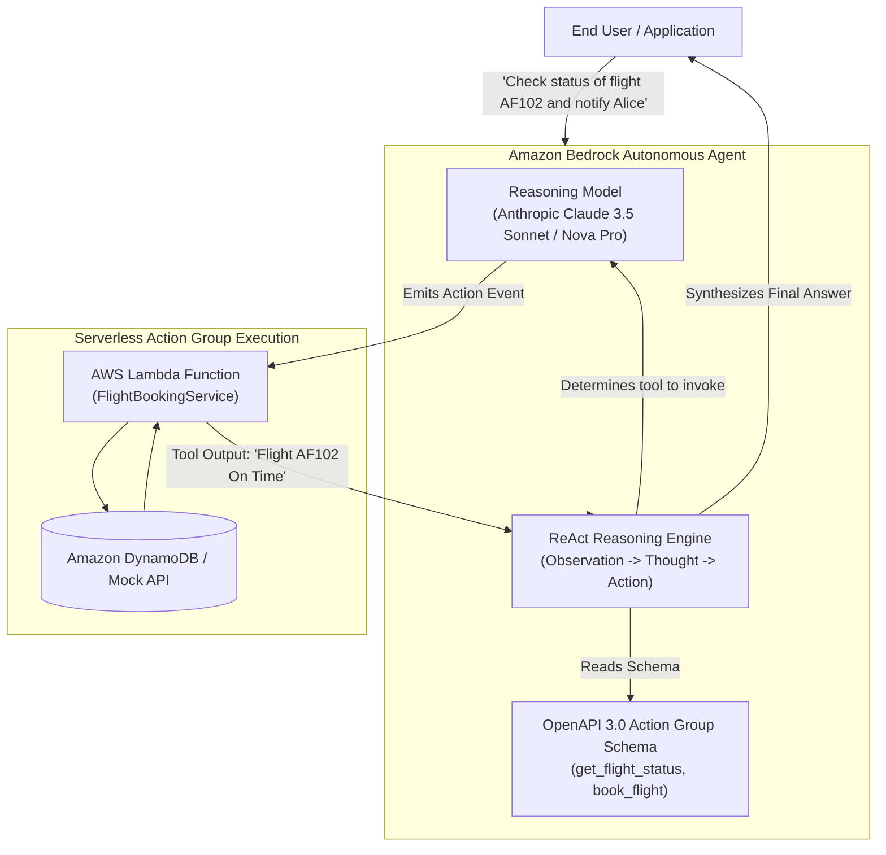

# Lab 04: Autonomous AI Agents with Bedrock Agents, Action Groups & MCP

> **Course:** AWS Certified AI Practitioner (`AIF-C01`) Track  
> **Exam Domain Alignment:** Domain 2 (Fundamentals of Generative AI) & Domain 3 (Applications of Foundation Models)  
> **Estimated Duration:** 60 minutes  
> **Cost Profile:** Pay-per-token + Free Tier AWS Lambda ($<\$0.10$ total)  
> **AWS Region:** `eu-north-1` (Stockholm) or `us-east-1` (N. Virginia)

---

## 🎯 Lab Overview & Exam Objectives

In modern enterprise architectures, Generative AI is evolving from passive Q&A chatbots into **Autonomous Agents** capable of planning multi-step workflows, invoking APIs, querying enterprise databases, and taking real-world actions.

By completing this guided lab, you will master:
1. **The ReAct (Reasoning + Acting) Agent Pattern:** How Amazon Bedrock Agents break user requests into logical reasoning steps, determine required actions, and synthesize results.
2. **Action Groups & OpenAPI 3.0 Schemas:** Defining functions using standard OpenAPI specifications so the foundation model knows *when* and *how* to call specific business tools.
3. **AWS Lambda Tool Execution:** Authoring an AWS Lambda function that parses the agent's action group event payload, executes business logic, and returns formatted responses.
4. **Model Context Protocol (MCP) Architectural Concepts:** The open standard for Client-Host-Server tool integration.
5. **Agent Session & State Management:** Handling multi-turn stateful conversations via the `InvokeAgent` API.

---

## 🏗️ Architectural Topology



---

## 🛠️ Guided Step-by-Step Console Walkthrough

### Step 1: Create the Action Group AWS Lambda Function
The Lambda function serves as the "hands" of the agent, executing the underlying business logic when the agent decides to invoke an action.

1. In the **AWS Management Console**, navigate to **AWS Lambda**.
2. Click the orange **Create function** button.
3. Configure the function:
   - **Function name:** `BedrockFlightActionHandler`
   - **Runtime:** `Python 3.12`
   - **Architecture:** `x86_64`
   - Keep default execution role permissions (Lambda will log to CloudWatch).
4. Click **Create function**.
5. In the **Code source** editor, replace the default code with the following Python handler:

```python
import json

def lambda_handler(event, context):
    print("Received event from Bedrock Agent:", json.dumps(event))
    
    # 1. Extract action group and function metadata from the Bedrock event
    action_group = event.get('actionGroup')
    function = event.get('function')
    parameters = event.get('parameters', [])
    
    # Convert parameters list into a clean dictionary
    param_dict = {p['name']: p['value'] for p in parameters}
    
    # 2. Route based on the function name defined in OpenAPI schema
    if function == 'check_flight_status':
        flight_number = param_dict.get('flight_number', 'UNKNOWN')
        
        # Mock database lookup
        mock_database = {
            "AF102": {"status": "ON TIME", "gate": "B14", "departure": "14:30"},
            "BA204": {"status": "DELAYED 45 MIN", "gate": "A08", "departure": "16:15"},
            "SK901": {"status": "BOARDING", "gate": "C02", "departure": "13:00"}
        }
        
        flight_data = mock_database.get(flight_number, {"status": "NOT FOUND", "gate": "N/A", "departure": "N/A"})
        response_body = {"flight_number": flight_number, "details": flight_data}
        
    else:
        response_body = {"error": f"Function {function} not recognized."}

    # 3. Format response in the strict structure required by Bedrock Agent runtime
    action_response = {
        'actionGroup': action_group,
        'function': function,
        'functionResponse': {
            'responseBody': {
                'TEXT': {
                    'body': json.dumps(response_body)
                }
            }
        }
    }
    
    return {
        'messageVersion': '1.0',
        'response': action_response
    }
```
6. Click **Deploy** to save the Lambda function.

---

### Step 2: Grant Bedrock Permission to Invoke the Lambda Function
Amazon Bedrock needs explicit IAM resource-based permission to invoke your Lambda function.

1. On the Lambda function page, navigate to the **Configuration** tab > **Permissions** sub-tab.
2. Scroll down to the **Resource-based policy statements** section.
3. Click **Add permissions**:
   - Select **AWS service**.
   - Service: **Other**.
   - Statement ID: `AllowBedrockToInvokeFlightHandler`.
   - Principal: `bedrock.amazonaws.com`.
   - Action: `lambda:InvokeFunction`.
4. Click **Save**.

---

### Step 3: Create the Amazon Bedrock Agent
1. Navigate to **Amazon Bedrock** > in the left menu under **Builder tools**, select **Agents**.
2. Click **Create agent**.
3. **Agent details:**
   - **Agent name:** `AirlineConciergeAgent`
   - **Description:** `Autonomous concierge agent capable of querying real-time flight statuses and assisting passengers.`
   - **User input:** Enabled.
   - **IAM Role:** Select **Create and use a new service role**.
4. **Select Foundation Model:**
   - Select **Anthropic Claude 3.5 Sonnet** (or **Amazon Nova Pro**).
5. **Instructions for the Agent:**
   The instructions guide the agent's behavior and planning loop. Enter:
   ```text
   You are an elite, polite airline customer service concierge assistant.
   When a user asks about a flight, use the check_flight_status tool from your action group.
   Always verify the flight number format before calling the tool.
   If the flight is delayed, offer sincere apologies and advise the user on their options.
   Never invent flight statuses or gates; only report data returned by your tools.
   ```
6. Click **Save**.

---

### Step 4: Configure the Action Group
1. On the Agent page, scroll down to the **Action groups** section.
2. Click **Add**.
3. Configure the Action Group:
   - **Action group name:** `FlightStatusActionGroup`
   - **Action group type:** Select **Define with API schemas** (or select *Define with function details*).
   - **Action group invocation:** Select **Select an existing Lambda function**.
   - **Lambda function:** Select `BedrockFlightActionHandler`.
4. **Action group schema:**
   - Select **Define with in-line OpenAPI schema**.
   - Paste the following OpenAPI 3.0 JSON specification into the schema editor:

```json
{
  "openapi": "3.0.0",
  "info": {
    "title": "Flight Status API",
    "version": "1.0.0",
    "description": "API for checking commercial airline flight operational statuses."
  },
  "paths": {
    "/flight-status": {
      "get": {
        "summary": "Check real-time flight status",
        "description": "Retrieves the real-time departure status, gate number, and departure time for a flight number.",
        "operationId": "check_flight_status",
        "parameters": [
          {
            "name": "flight_number",
            "in": "query",
            "description": "The alphanumeric flight code (e.g. AF102, BA204, SK901).",
            "required": true,
            "schema": {
              "type": "string"
            }
          }
        ],
        "responses": {
          "200": {
            "description": "Flight operational status successfully retrieved",
            "content": {
              "application/json": {
                "schema": {
                  "type": "object",
                  "properties": {
                    "flight_number": { "type": "string" },
                    "details": { "type": "object" }
                  }
                }
              }
            }
          }
        }
      }
    }
  }
}
```
5. Click **Create** to attach the Action Group to the Agent.

---

### Step 5: Prepare and Test the Agent
Before an Agent can be tested, its working draft must be compiled into a runtime package.

1. At the top of the Agent overview page, click the orange **Prepare** button.
   *(The agent compiles the instructions, schemas, and prompts into a testable working alias).*
2. Locate the **Test agent** panel on the right side of the screen.
3. In the chat box, enter:
   ```text
   Hi, my family is taking flight AF102 this afternoon. Can you tell me if it's on schedule and what gate we should head to?
   ```
4. Click **Run**.
5. **Inspect the ReAct Reasoning Trace:**
   - Click the **Show trace** link under the agent's response.
   - **Observation:** Notice the agent's internal thought process:
     - *Rationale:* User is asking about flight AF102.
     - *Selected Action:* Invokes `check_flight_status` with `flight_number="AF102"`.
     - *Observation:* Lambda returned `{"status": "ON TIME", "gate": "B14", "departure": "14:30"}`.
     - *Final Synthesized Response:* *"Flight AF102 is currently on time with departure scheduled for 14:30. You should proceed to Gate B14."*
6. **Test Error Handling:**
   - Ask: *"What about flight ZZ999?"*
   - Verify the trace: Lambda returns `NOT FOUND`, and the agent politely explains that flight ZZ999 could not be located in the flight directory.

---

## 💻 Programmatic Agent Invocation via AWS CLI v2

Execute an interactive agent turn using the `invoke-agent` CLI command:

```bash
aws bedrock-agent-runtime invoke-agent \
  --agent-id "YOUR_AGENT_ID" \
  --agent-alias-id "TSTALIASID" \
  --session-id "student-session-001" \
  --input-text "What is the status of flight BA204?" \
  --region eu-north-1 \
  agent_output.txt

# Read the streaming output response
cat agent_output.txt
```

---

## 🎯 Exam Practice: Scenarios & Traps

| Exam Scenario | Correct Recommendation | Why Distractors Fail |
|---|---|---|
| *"An application needs an LLM to automatically look up order statuses in an external MySQL database and process refunds when requested by a customer."* | **Amazon Bedrock Agent with an Action Group backed by AWS Lambda** | RAG only retrieves static unstructured documents; it cannot execute stateful transactions or call external APIs. Fine-tuning cannot execute tools. |
| *"What standard specification does Amazon Bedrock use to allow foundation models to understand tool names, descriptions, and input parameters?"* | **OpenAPI 3.0 Schema** | WSDL is legacy XML. Swagger 2.0 is outdated. Bedrock standardizes on OpenAPI 3.0 (JSON or YAML). |
| *"How does a developer inspect why an Agent chose to call a specific tool or what parameters it extracted from the user's prompt?"* | **Inspect the Agent Trace (ReAct loop steps)** | CloudWatch Metrics only show invocation counts and error rates, not the cognitive prompt rationale steps. |
| *"What is the architectural role of the Model Context Protocol (MCP) in multi-agent systems?"* | **An open client-host-server protocol that standardizes how agents discover and query external data sources and tools across environments** | MCP is an open interoperability protocol, not a proprietary AWS encryption mechanism or vector index. |

---

## 🧹 Cost Safeguard & Cleanup

1. In **Amazon Bedrock** > **Agents** > Select `AirlineConciergeAgent` > Click **Delete**.
2. In **AWS Lambda** > Select `BedrockFlightActionHandler` > Click **Actions** > **Delete**.
3. Bedrock Agents incur zero ongoing costs when not in active test sessions.
