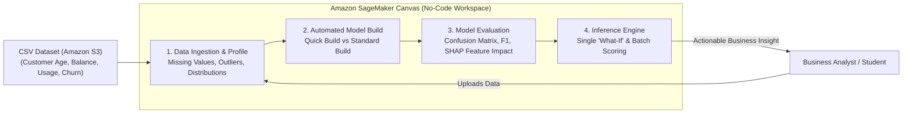

# Lab 06: No-Code Predictive Machine Learning with Amazon SageMaker Canvas

> **Course:** AWS Certified AI Practitioner (`AIF-C01`) Track  
> **Exam Domain Alignment:** Domain 1 (Fundamentals of AI and ML) & Domain 4 (Guidelines for Responsible AI)  
> **Estimated Duration:** 45 minutes  
> **Cost Profile:** Free Tier eligible (2 free months of SageMaker Canvas per year under AWS Free Tier); ⚠️ **Must explicitly log off / shut down Canvas session post-lab!**  
> **AWS Region:** `eu-north-1` (Stockholm) or `us-east-1` (N. Virginia)

---

## 🎯 Lab Overview & Exam Objectives

Not every machine learning project requires authoring thousands of lines of Python code in Jupyter notebooks. **Amazon SageMaker Canvas** provides a visual, point-and-click AutoML environment designed for business analysts and AI practitioners to build, evaluate, and deploy predictive ML models.

By completing this guided lab, you will master:
1. **SageMaker Canvas Problem Types:** Navigating **Binary Classification**, **Multi-class Classification**, **Numeric Regression**, and **Time-Series Forecasting**.
2. **Build Modes Contrast:** The operational and accuracy trade-offs between **Quick Build** (minutes) and **Standard Build** (hours).
3. **Model Evaluation Metrics:** Interpreting the **Confusion Matrix**, **Precision**, **Recall**, **F1-Score**, **AUC-ROC**, and **Accuracy**.
4. **Feature Attribution & Explainability:** Analyzing **Feature Importance (SHAP values)** to discover which columns drive predictions.
5. **No-Code Single & Batch Predictions:** Generating interactive "What-If" scenario predictions and exporting batch prediction datasets.

---

## 🏗️ Architectural Topology



---

## 🛠️ Guided Step-by-Step Console Walkthrough

### Step 1: Launch Amazon SageMaker Canvas
1. In the **AWS Management Console**, navigate to **Amazon SageMaker**.
2. In the left navigation pane under **Applications**, select **Canvas**.
3. Under your user profile, click **Open Canvas**.
   *(Canvas will launch a web workspace in a new browser tab. Initialization takes ~1–2 minutes).*

---

### Step 2: Prepare and Import the Customer Churn Dataset
We will model a classic **Binary Classification** problem: predicting whether a bank customer will close their account (`Churn = 1`) or stay (`Churn = 0`).

1. Download or create a local CSV file named `bank_customer_churn.csv` with the following header and sample records:
```csv
CustomerID,CreditScore,Geography,Gender,Age,Tenure,Balance,NumOfProducts,HasCrCard,IsActiveMember,EstimatedSalary,Exited
15634602,619,France,Female,42,2,0.00,1,1,1,101348.88,1
15647311,608,Spain,Female,41,1,83807.86,1,0,1,112542.58,0
15619304,502,France,Female,42,8,159660.80,3,1,0,113931.57,1
15701354,699,France,Female,39,1,0.00,2,0,0,93826.63,0
15737888,850,Spain,Female,43,2,125510.82,1,1,1,79084.10,0
15574012,645,Spain,Male,44,8,113755.78,2,1,0,149756.71,1
15592389,822,France,Male,50,7,0.00,2,1,1,10062.80,0
15656148,376,Germany,Female,29,4,115046.74,4,1,0,119346.88,1
15792365,501,France,Male,44,4,142051.07,2,0,1,74940.50,0
15592531,684,France,Male,27,2,134603.84,1,1,1,71725.73,0
```
2. In SageMaker Canvas, select the **Datasets** tab on the left navigation bar.
3. Click **Import data** > Select **Local upload** > Upload `bank_customer_churn.csv`.
4. Name the dataset: `CustomerChurnData` and click **Import data**.

---

### Step 3: Inspect Data Profile & Target Selection
1. Click on `CustomerChurnData` in the dataset table.
2. Canvas renders automated distribution histograms, data types, missing value percentages, and outlier statistics.
3. In the left navigation menu, click **My models** > Click **New model**.
4. Model name: `CustomerChurnPredictor` > Click **Create**.
5. Select the `CustomerChurnData` dataset > Click **Select dataset**.

---

### Step 4: Configure the Target Variable & Select Build Mode
1. In the model design screen, locate the **Target column** dropdown.
2. Select **`Exited`** as the target.
   - Canvas immediately inspects the data and automatically configures:
     - **Model type:** **2-category prediction (Binary Classification)**.
3. Under the features column list:
   - Deselect `CustomerID` (unique identifier column that must not be used as a predictive feature).
4. Notice the two build buttons at the top right:
   - **Quick Build:** Builds a prototype model in 2–15 minutes using heuristic parameter search. Ideal for fast feasibility testing.
   - **Standard Build:** Takes 2–4 hours. Runs full AutoML across multiple algorithms (AutoGluon, XGBoost, CatBoost), performs automated feature engineering, hyperparameter tuning, and cross-validation to produce a production-ready model.
5. Click **Quick Build** to generate results rapidly for this lab.

---

### Step 5: Evaluate Model Quality & Explainability (SHAP Values)
Once the build completes, Canvas opens the **Analyze** tab:

1. **Overall Accuracy & F1 Score:**
   - Canvas displays model performance metrics (e.g. `Accuracy: 86.4%`, `F1-Score: 0.74`).
2. **Feature Importance (Global Explainability):**
   - Canvas plots a horizontal bar chart showing the predictive weight of each input feature calculated via **SHAP (Shapley Additive exPlanations)** values:
     - `Age`: ~38% impact (older customers show significantly higher churn propensity).
     - `NumOfProducts`: ~24% impact (customers with 3+ products show distinct usage patterns).
     - `IsActiveMember`: ~18% impact.
     - `Balance`: ~10% impact.
3. **The Confusion Matrix:**
   - Click on the **Scoring** tab to view the Confusion Matrix:
     - **True Positives (TP):** Correctly predicted churners.
     - **False Positives (FP):** Predicted to churn, but actually stayed.
     - **True Negatives (TN):** Correctly predicted loyal customers.
     - **False Negatives (FN):** Predicted to stay, but actually churned (Type II error).
   - Adjust the **Probability Threshold slider** (default 0.50):
     - Notice how increasing the threshold reduces False Positives (improving **Precision**) but increases False Negatives (lowering **Recall**).

---

### Step 6: Generate Single "What-If" Predictions
1. Click on the **Predict** tab at the top.
2. Select **Single prediction**.
3. Canvas loads the default values of an average customer.
4. **Run a "What-If" Scenario:**
   - Change `Age` from `35` to `58`.
   - Change `IsActiveMember` from `1` to `0`.
   - Notice how the prediction gauge updates in real time: Probability of Churn increases from `14%` to `78%`!
   - This empowers non-technical domain stakeholders to understand model behavior intuitively.

---

## 🎯 Exam Practice: Scenarios & Traps

| Exam Scenario | Correct Recommendation | Why Distractors Fail |
|---|---|---|
| *"A business analyst with zero coding experience wants to train a model to forecast monthly retail sales using historical data stored in a spreadsheet."* | **Amazon SageMaker Canvas (Time-Series Forecasting)** | SageMaker Studio notebooks require Python programming. Amazon QuickSight visualizes historical data, it does not build custom ML models. |
| *"A healthcare team building a classification model in SageMaker Canvas must prove to auditors which patient features contributed most to predicted risks."* | **Inspect Feature Importance (SHAP Values) in Canvas** | Model accuracy only proves overall performance, not interpretability. Feature importance explains the contribution of individual variables. |
| *"When should an ML practitioner choose Standard Build over Quick Build in SageMaker Canvas?"* | **When building a final production model requiring exhaustive AutoML algorithm tuning and maximum accuracy** | Quick Build is strictly for fast feasibility prototyping and does not perform full hyperparameter optimization. |
| *"A fraud detection model has low Recall. What does this mean for the business?"* | **The model is missing fraudulent transactions (high False Negatives)** | Low Precision means too many false alarms (False Positives). Low Recall means the model fails to catch the actual positive cases. |

---

## 🧹 Cost Safeguard & Cleanup (CRITICAL!)

> [!WARNING]
> **SageMaker Canvas Session Charges:** Canvas charges for workspace instance hours while the session is active. **Simply closing your browser tab does NOT terminate the session!** You must explicitly log off.

1. In the SageMaker Canvas workspace, look at the bottom-left navigation bar.
2. Click the **Log out / Sign out** icon (or click your profile icon > **Sign out**).
3. In the AWS Management Console, navigate to **Amazon SageMaker** > **Applications** > **Canvas**.
4. Confirm that the application status displays **Deleted** or **Stopped**.
