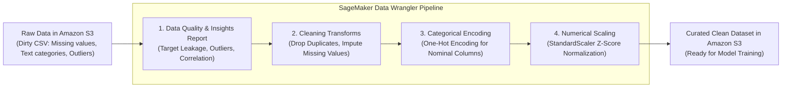

# Lab 07: Data Preparation & Feature Engineering with SageMaker Data Wrangler

> **Course:** AWS Certified AI Practitioner (`AIF-C01`) Track  
> **Exam Domain Alignment:** Domain 1 (Fundamentals of AI and ML)  
> **Estimated Duration:** 45 minutes  
> **Cost Profile:** Free Tier eligible compute usage  
> **AWS Region:** `eu-north-1` (Stockholm) or `us-east-1` (N. Virginia)

---

## 🎯 Lab Overview & Exam Objectives

In real-world machine learning, data scientists and ML engineers spend up to 80% of their time on **data cleaning, imputation, transformation, and feature engineering**. Machine learning algorithms cannot natively process raw, messy data containing missing values, textual categories, or skewed numerical distributions.

By completing this guided lab, you will master:
1. **Automated Data Quality & Insights Reporting:** Generating comprehensive data health reports in **Amazon SageMaker Data Wrangler** to detect **target leakage**, **outliers**, and **imbalanced distributions**.
2. **Missing Value Imputation:** Applying statistical imputation strategies (Mean, Median, Mode) versus record dropping.
3. **Categorical Encoding:** Choosing and applying **One-Hot Encoding** (for low-cardinality nominal categories) versus **Ordinal Encoding**.
4. **Feature Scaling & Normalization:** Understanding when to apply **Min-Max Normalization** ($[0, 1]$ bounds) versus **Z-Score Standardization** (μ=0, σ=1).
5. **Feature Store Export:** Exporting curated feature pipelines to **Amazon S3** and **SageMaker Feature Store**.

---

## 🏗️ Architectural Topology



---

## 🛠️ Guided Step-by-Step Console Walkthrough

### Step 1: Upload Raw Training Data to S3
1. Create a local file named `customer_raw_telecom.csv` containing missing values (`NA`), string categories, and unscaled numbers:

```csv
CustomerID,State,AccountLength,MonthlyCharge,TotalCharges,CustomerServiceCalls,PaymentMethod,Churn
1001,CA,120,70.50,8460.0,2,ElectronicCheck,0
1002,NY,45,NA,1350.0,5,CreditCard,1
1003,TX,8,20.10,160.8,0,BankTransfer,0
1004,FL,65,85.00,5525.0,3,ElectronicCheck,1
1005,CA,NA,50.00,1200.0,1,CreditCard,0
1006,WA,210,110.00,23100.0,7,ElectronicCheck,1
1007,OR,12,19.50,234.0,1,BankTransfer,0
1008,TX,95,65.00,6175.0,NA,CreditCard,0
1009,NY,3,89.00,267.0,4,ElectronicCheck,1
1010,CA,180,95.50,17190.0,2,CreditCard,0
```
2. In the **AWS Management Console**, navigate to **Amazon S3** and upload `customer_raw_telecom.csv` to your lab bucket.

---

### Step 2: Create a Data Wrangler Flow in SageMaker Studio / Canvas
1. In the AWS Management Console, navigate to **Amazon SageMaker** > **Studio** (or **Canvas**).
2. Click **Open Studio**.
3. In the left navigation menu under **Data**, select **Data Wrangler**.
4. Click **New flow**.
5. Save the flow name as: `TelecomChurnPreprocessFlow`.

---

### Step 3: Import Data and Generate the Data Quality & Insights Report
1. In the Data Wrangler canvas, select **Import data** > Choose **Amazon S3**.
2. Browse to your bucket and select `customer_raw_telecom.csv`.
3. In the preview window, observe the raw columns, then click **Import**.
4. In the visual flow graph, click the `+` icon next to the dataset node > Select **Get data insights**.
5. Configure the report:
   - **Target column:** `Churn`
   - **Problem type:** `Classification`
6. Click **Create report**.
7. **Examine the Insights Report Output:**
   - **Target Leakage Warning:** The report analyzes correlation between features and the target. *(If a feature like `CancellationDate` were present, Data Wrangler would flag it as Target Leakage because it only exists after churn occurs).*
   - **Missing Values Analysis:** Highlights that `AccountLength`, `MonthlyCharge`, and `CustomerServiceCalls` contain missing cells.
   - **Outliers:** Flags `TotalCharges` for Customer `1006` ($23,100) as a potential extreme outlier.

---

### Step 4: Add Data Transformation Steps in the Visual Flow

#### Step 4A: Handle Missing Values (Imputation)
1. Click the `+` icon next to the dataset node > Select **Add transform**.
2. In the transform catalog on the right side, select **Handle missing values**:
   - **Transform:** `Impute missing`
   - **Input column:** `MonthlyCharge`
   - **Imputing strategy:** Select **Median** *(Median is preferred over Mean when data contains skewed outliers)*.
3. Click **Preview**, then click **Add**.
4. Repeat for `CustomerServiceCalls`:
   - Set strategy to **Mode (Most frequent)** (since service call count is an integer count). Click **Add**.

#### Step 4B: Categorical Encoding (One-Hot Encoding)
Machine learning algorithms cannot multiply strings like `"CreditCard"` or `"ElectronicCheck"`.

1. In the transform catalog, select **Encode categorical**.
2. **Transform:** `One-hot encode`.
3. **Input column:** `PaymentMethod`.
4. **Output style:** `Columns`.
5. Click **Preview**, then click **Add**.
6. **Observation:** The single `PaymentMethod` column is transformed into three binary indicator columns:
   - `PaymentMethod_CreditCard` (1 or 0)
   - `PaymentMethod_ElectronicCheck` (1 or 0)
   - `PaymentMethod_BankTransfer` (1 or 0)

> [!IMPORTANT]
> **Exam Distinction: One-Hot vs. Ordinal Encoding:**
> - **One-Hot Encoding:** Use for **nominal** categories where no natural ranking or order exists (e.g., Colors: Red, Blue, Green; or Payment Methods).
> - **Ordinal Encoding:** Use for **ordinal** categories where a distinct mathematical hierarchy exists (e.g., Education: HighSchool = 1, Bachelor = 2, Master = 3, PhD = 4; or Shirt Size: S, M, L, XL).

#### Step 4C: Feature Scaling (StandardScaler)
Features with huge numerical ranges (like `TotalCharges` up to $23,000) will overpower features with small ranges (like `CustomerServiceCalls` between 0 and 7) unless scaled.

1. In the transform catalog, select **Scale values**.
2. **Transform:** `Standardize (Z-score)`.
3. Formula:

   $$
   z = \frac{x - \mu}{\sigma}
   $$

   *(Transforms the distribution to have a mean of 0 and a standard deviation of 1).*
4. **Input column:** `TotalCharges`.
5. Click **Preview**, then click **Add**.

---

### Step 5: Export the Curated Flow to S3
1. In the flow graph, click the `+` icon after your final transformation step.
2. Select **Add destination** > Choose **Amazon S3**.
3. Select your output S3 bucket path.
4. Set output format to **Parquet** (or CSV).
5. Click **Add destination**.
6. Click **Create job** to execute the transformation pipeline across the entire dataset.

---

## 🎯 Exam Practice: Scenarios & Traps

| Exam Scenario | Correct Recommendation | Why Distractors Fail |
|---|---|---|
| *"A training dataset has missing values in a heavily skewed income column with severe billionaire outliers. What imputation technique should be used?"* | **Impute with the Median value** | The Mean is heavily pulled by extreme outliers, resulting in distorted imputations. The Median is robust to outliers. |
| *"An engineer uses Ordinal Encoding on a 'CountryOfOrigin' feature (USA=1, Germany=2, Japan=3). Why is this an anti-pattern?"* | **It introduces an artificial mathematical ordering (implying Japan > Germany > USA) where none exists. Use One-Hot Encoding instead.** | Ordinal encoding is only valid for naturally ranked categorical scales (e.g., Low, Medium, High). |
| *"A model achieves 99.8% training accuracy on insurance claim fraud, but completely fails in production. Investigation shows a 'ClaimApprovedDate' column was included in features. What occurred?"* | **Target Leakage** | Target leakage occurs when data that will NOT be available at inference time is accidentally leaked into training features. |
| *"Which scaling technique bounds all numerical feature values strictly between 0.0 and 1.0?"* | **Min-Max Normalization (MinMaxScaler)** | StandardScaler centers around mean 0 with standard deviation 1, allowing negative numbers and values greater than 1. |

---

## 🧹 Cost Safeguard & Cleanup

1. In SageMaker Studio / Canvas, close your active Data Wrangler flow.
2. In the AWS Management Console, navigate to **Amazon SageMaker** > **Studio** > Check your user profile and ensure all running applications (Data Wrangler instances) are **Stopped**.
