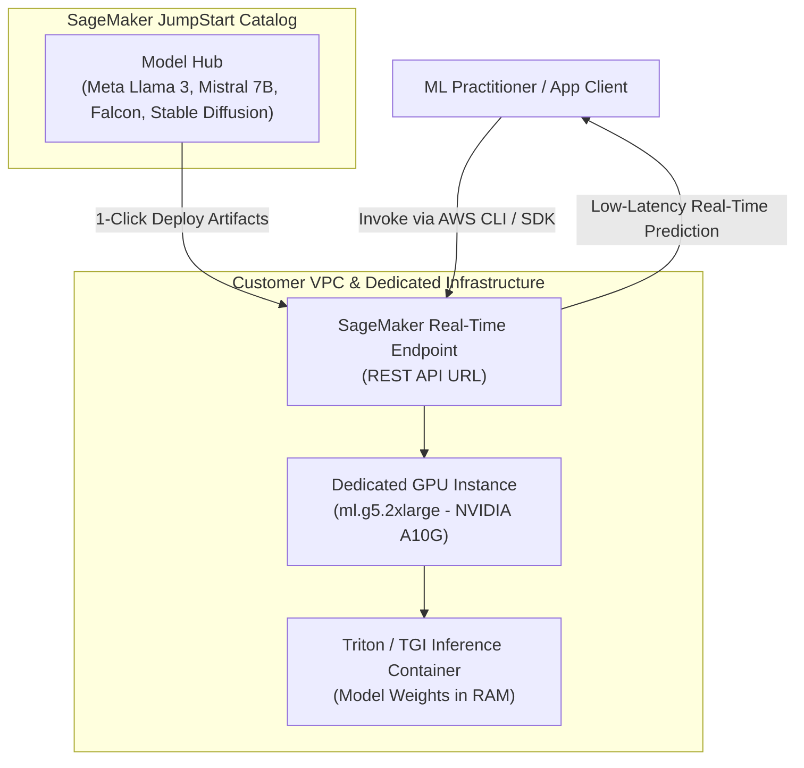

# Lab 08: Pre-Trained Foundation Model Deployment with SageMaker JumpStart

> **Course:** AWS Certified AI Practitioner (`AIF-C01`) Track  
> **Exam Domain Alignment:** Domain 3 (Applications of Foundation Models) & Domain 1 (Fundamentals of AI and ML)  
> **Estimated Duration:** 45 minutes  
> **Cost Profile:** Hourly instance compute pricing (~$1.20/hour for `ml.g5.2xlarge`); ⚠️ **Mandatory endpoint deletion immediately post-test!**  
> **AWS Region:** `eu-north-1` (Stockholm) or `us-east-1` (N. Virginia)

---

## 🎯 Lab Overview & Exam Objectives

While Amazon Bedrock provides fully managed serverless APIs for foundation models, many organizations require **direct access to open-weights models**, **custom deployment containers**, or **hosting inside private isolated VPCs**. **Amazon SageMaker JumpStart** provides an enterprise machine learning hub of pre-trained models (Meta Llama, Mistral, Hugging Face transformers, Stable Diffusion) that can be deployed to dedicated endpoints or fine-tuned with a single click.

By completing this guided lab, you will master:
1. **SageMaker JumpStart vs. Amazon Bedrock:** Understanding the critical architectural decision boundary between **Serverless Managed APIs (Bedrock)** and **Dedicated Self-Hosted Endpoints (JumpStart)**.
2. **Deploying Open-Weights Foundation Models:** Step-by-step provisioning of a pre-trained open model onto accelerated GPU instances (`ml.g5`).
3. **Inference Component Architecture:** How SageMaker hosts model artifacts, inference containers, and endpoints.
4. **Programmatic Endpoint Invocation:** Invoking a SageMaker endpoint using the `aws sagemaker-runtime invoke-endpoint` CLI.
5. **Cost Management & Rapid Teardown:** Terminating endpoints to prevent ongoing per-instance hourly charges.

---

## 🏗️ Architectural Topology



---

## ⚖️ SageMaker JumpStart vs. Amazon Bedrock: Exam Comparison

| Architectural Dimension | Amazon SageMaker JumpStart | Amazon Bedrock |
|---|---|---|
| **Deployment Model** | **Dedicated Infrastructure:** Deploys onto specific EC2 instances (`ml.g5`, `ml.c6i`). | **100% Serverless:** Managed API endpoints (`InvokeModel`, `Converse`). |
| **Model Weights Access** | ✅ **Full Access:** Customer can inspect, export, and download open-source model weights. | ❌ **No Direct Weight Access:** Weights are managed securely by AWS and model partners. |
| **Billing Mechanism** | **Per Instance-Hour:** Billed 24/7 as long as the endpoint is in `InService` status (regardless of traffic). | **Pay-Per-Token:** Billed strictly for input and output tokens processed (zero idle cost). |
| **Network Isolation** | Runs inside your private VPC subnets with custom Security Groups. | Serverless endpoint accessible via AWS PrivateLink VPC Endpoints. |
| **Best Used For** | Regulatory mandates requiring dedicated single-tenant hardware, custom container hooks, or open-source weight fine-tuning. | Enterprise applications wanting zero server management, fastest time-to-market, and pay-as-you-go economics. |

---

## 🛠️ Guided Step-by-Step Console Walkthrough

### Step 1: Browse the SageMaker JumpStart Catalog
1. In the **AWS Management Console**, navigate to **Amazon SageMaker**.
2. In the left navigation pane under **Models and algorithms**, select **JumpStart**.
3. Observe the vast catalog organized by category:
   - *Foundation Models:* Text Generation, Text-to-Image, Code Generation, Embedding Models.
   - *Featured Providers:* Meta (Llama), Mistral AI, Stability AI, Cohere, Hugging Face.
   - *Tabular Algorithms:* LightGBM, CatBoost, XGBoost.
4. In the search box, search for: `Mistral 7B Instruct` (or `Llama 3.2 1B / 3B Instruct`).
5. Click on the model card to view its detailed model hub documentation.

---

### Step 2: Configure and Deploy the Foundation Model Endpoint
1. On the model details page, review the architecture specifications:
   - **Task:** Text Generation
   - **Recommended instance type:** `ml.g5.2xlarge` (Single NVIDIA A10G Tensor Core GPU with 24 GB VRAM).
2. Locate the **Deploy** panel on the right side:
   - **Endpoint name:** `jumpstart-text-endpoint-[your-initials]`
   - **Instance type:** `ml.g5.2xlarge`
   - **Initial instance count:** `1`
3. Click the orange **Deploy** button.
4. **Behind the Scenes:**
   - SageMaker downloads the model weights from the secure JumpStart S3 bucket.
   - It pulls the optimized inference container (e.g., Hugging Face Text Generation Inference - TGI).
   - It provisions an `ml.g5.2xlarge` EC2 instance, mounts the container, and performs health checks.
5. In 5–8 minutes, the endpoint status updates from *Creating* to **InService** (green).

---

### Step 3: Test Real-Time Inference in the Console
1. Once the endpoint is **InService**, scroll down to the **Test endpoint** section on the model page.
2. In the **Request body** JSON editor, enter:
   ```json
   {
     "inputs": "Explain the concept of AWS Shared Responsibility Model in two clear sentences.",
     "parameters": {
       "max_new_tokens": 100,
       "temperature": 0.1,
       "top_p": 0.9
     }
   }
   ```
3. Click **Send request**.
4. **Inspect the Output:**
   - The response appears in milliseconds:
     ```json
     [
       {
         "generated_text": "Under the AWS Shared Responsibility Model, AWS is responsible for the security 'of' the cloud, which includes the physical infrastructure, hardware, and core networking facilities. Customers are responsible for security 'in' the cloud, including customer data, operating system configurations, firewall rules, and IAM access management."
       }
     ]
     ```

---

## 💻 Programmatic Invocation via AWS CLI v2

Invoke your dedicated JumpStart endpoint via the command line:

```bash
# 1. Create a local input payload file
cat << 'EOF' > input.json
{
  "inputs": "What is the difference between Amazon S3 and Amazon EBS?",
  "parameters": {
    "max_new_tokens": 80,
    "temperature": 0.0
  }
}
EOF

# 2. Invoke the SageMaker Real-Time Endpoint
aws sagemaker-runtime invoke-endpoint \
  --endpoint-name "jumpstart-text-endpoint-[your-initials]" \
  --content-type "application/json" \
  --body file://input.json \
  --region eu-north-1 \
  output.json

# 3. Print the generated response
cat output.json
```

---

## 🎯 Exam Practice: Scenarios & Traps

| Exam Scenario | Correct Recommendation | Why Distractors Fail |
|---|---|---|
| *"A defense contractor has strict security rules requiring open-weights LLMs to run on dedicated, isolated single-tenant GPU instances where model weights are owned by the client."* | **Deploy the model using Amazon SageMaker JumpStart on dedicated instances in a private VPC** | Amazon Bedrock is a multi-tenant managed API where underlying instance hardware and weights cannot be directly accessed. |
| *"A startup wants to prototype an LLM chatbot with zero upfront infrastructure costs, no server management, and paying only when queries are executed."* | **Amazon Bedrock (Pay-per-token API)** | SageMaker JumpStart endpoints incur ongoing hourly compute costs ($1+/hr) 24/7 as long as the endpoint is running, even with zero incoming traffic. |
| *"A company wants to fine-tune an open-source Llama model using their own domain-specific dataset without authoring custom PyTorch training scripts."* | **SageMaker JumpStart 1-Click Fine-Tuning** | SageMaker Studio notebooks require manual script authoring. Bedrock does not support fine-tuning for all external open-source models. |

---

## 🧹 Cost Safeguard & Cleanup (MANDATORY & URGENT!)

> [!CAUTION]
> **Real-Time Endpoints Incur 24/7 Charges:** An active `ml.g5.2xlarge` endpoint costs approximately **\$1.20 per hour (\$28+ per day)** regardless of whether you send requests. You **MUST** delete the endpoint immediately after completing this lab!

1. In the **AWS Management Console**, navigate to **Amazon SageMaker**.
2. In the left navigation pane under **Inference**, select **Endpoints**.
3. Select your endpoint: `jumpstart-text-endpoint-[your-initials]`.
4. Click **Actions** > **Delete** > Type `delete` to confirm.
5. In the left menu under **Inference**, select **Endpoint configurations** > Delete the corresponding endpoint configuration.
6. Under **Inference**, select **Models** > Delete the corresponding model artifact.
