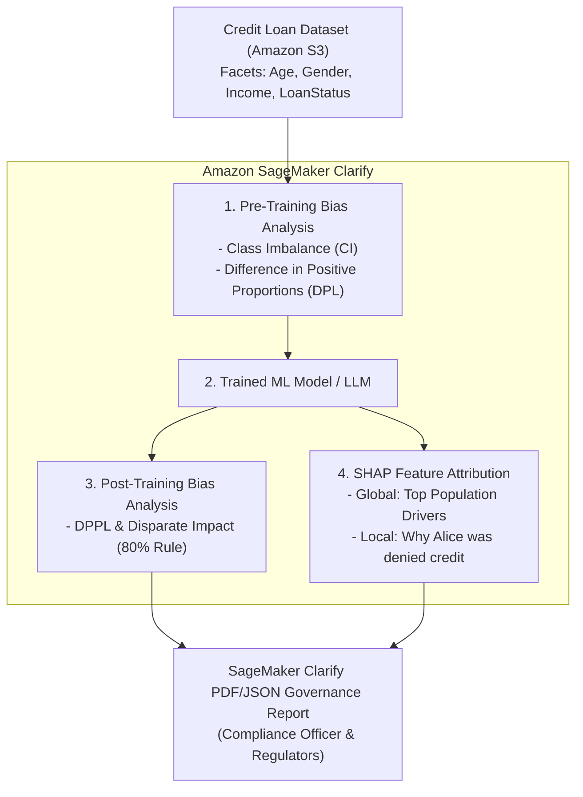

# Lab 09: Model Fairness, Bias Detection & SHAP Explainability with SageMaker Clarify

> **Course:** AWS Certified AI Practitioner (`AIF-C01`) Track  
> **Exam Domain Alignment:** Domain 4 (Guidelines for Responsible AI)  
> **Estimated Duration:** 45 minutes  
> **Cost Profile:** Minimal compute charges (<$0.10)  
> **AWS Region:** `eu-north-1` (Stockholm) or `us-east-1` (N. Virginia)

---

## 🎯 Lab Overview & Exam Objectives

Responsible AI is a central pillar of the AIF-C01 blueprint. Regulatory frameworks (such as the EU AI Act and US Equal Credit Opportunity Act) legally require enterprises to **audit machine learning models for demographic bias** and provide **adverse action explanations** when algorithmic decisions affect individuals.

By completing this guided lab, you will master:
1. **Pre-Training Bias Metrics:** Using **Amazon SageMaker Clarify** to calculate **Class Imbalance (CI)** and **Difference in Positive Proportions in Labels (DPL)** on raw training datasets.
2. **Post-Training Bias Metrics:** Auditing trained models using **Difference in Positive Proportions in Predicted Labels (DPPL)** and **Disparate Impact (DI)**.
3. **The 80% Rule for Disparate Impact:** Evaluating whether $0.80 \le DI \le 1.25$ to confirm regulatory fairness compliance.
4. **SHAP (Shapley Additive exPlanations) Explainability:** Differentiating between **Global Feature Attribution** (overall model mechanics) and **Local Feature Attribution** (individual decision explanations).
5. **Foundation Model Evaluation (FMEval):** Using Clarify to benchmark LLMs on **toxicity**, **factual knowledge**, and **stereotyping**.

---

## 🏗️ Architectural Topology



---

## 🧮 Mathematical Foundations of Clarify Bias Metrics

### 1. Class Imbalance ($CI$)
Measures whether one demographic group is underrepresented in the training data:
$$CI = \frac{n_a - n_d}{n_a + n_d}$$
- Where $n_a$ is the count of privileged facet members (e.g. `Age >= 40`), and $n_d$ is the unprivileged group (`Age < 40`).
- If $CI > 0$, the privileged group dominates the training data. A value near $0.0$ indicates perfect balance.

### 2. Difference in Positive Proportions in Labels ($DPL$)
Measures the historical difference in positive outcomes between groups:
$$DPL = q_a - q_d$$
- Where $q_a$ is the proportion of privileged applicants who received loans, and $q_d$ is the proportion of unprivileged applicants who received loans.
- A value significantly greater than $0.0$ indicates historical training bias favoring group $a$.

### 3. Disparate Impact ($DI$) & The 80% Rule of Thumb
The ratio of positive prediction rates:
$$DI = \frac{q_d}{q_a}$$
- **The Legal 80% Rule:** Under US Federal EEOC guidelines, a selection rate for any group which is less than four-fifths (80%) of the rate for the group with the highest rate is evidence of adverse impact:
  $$0.80 \le DI \le 1.25$$
  - If $DI < 0.80$: Severe disparate adverse impact against the unprivileged group.

---

## 🛠️ Guided Step-by-Step Console Walkthrough

### Step 1: Upload the Loan Underwriting Dataset to S3
1. Create a local CSV file named `credit_loan_fairness.csv` containing demographic facets:

```csv
ApplicantID,Age,Gender,AnnualIncome,CreditScore,DebtToIncome,LoanApproved
101,45,Male,85000,720,0.22,1
102,24,Female,38000,590,0.45,0
103,52,Male,120000,780,0.18,1
104,22,Male,31000,610,0.38,0
105,48,Female,92000,740,0.20,1
106,23,Female,35000,600,0.42,0
107,39,Male,75000,690,0.28,1
108,21,Female,29000,580,0.50,0
109,55,Male,110000,760,0.15,1
110,25,Female,42000,630,0.35,1
```
2. In the **Amazon S3 Console**, upload `credit_loan_fairness.csv` to your lab bucket.

---

### Step 2: Configure a SageMaker Clarify Processing Job
1. In the **AWS Management Console**, navigate to **Amazon SageMaker**.
2. In the left navigation menu under **Studio**, open your Studio workspace (or navigate to **SageMaker Clarify**).
3. Under **Jobs and analysis**, select **Clarify bias and explainability**.
4. Click **Create analysis job**:
   - **Job name:** `LoanFairnessAuditJob`
   - **Input dataset:** Select `s3://[your-bucket]/credit_loan_fairness.csv`.
   - **Target column:** `LoanApproved`.
   - **Favorable label:** `1` (Loan approved).
   - **Unfavorable label:** `0` (Loan denied).

---

### Step 3: Configure Sensitive Facets (Demographics)
Clarify needs to know which demographic attribute to evaluate for disparate treatment.

1. Under **Facets to evaluate**:
   - **Facet name:** `Gender`
   - **Privileged value:** `Male`
   - **Unprivileged value:** `Female`
2. Under **Bias metrics to calculate**:
   - Enable **Pre-training bias metrics** (CI, DPL, KL divergence).
   - Enable **Post-training bias metrics** (DPPL, Disparate Impact).
3. Under **Explainability (SHAP)**:
   - Check **Calculate SHAP feature attribution**.
   - Number of baseline samples: `50`.
4. Click **Submit job**.

---

### Step 4: Interpret the Clarify Bias & Explainability Report

Once the Clarify analysis job completes, open the generated **Clarify Report** tab:

#### 1. Inspecting Pre-Training Bias
- **Class Imbalance (CI):** Observe $CI = 0.20$.
  - *Analysis:* Males represent 60% of the sample, while Females represent 40%. The dataset exhibits mild class representation imbalance.
- **Difference in Positive Proportions (DPL):** Observe $DPL = 0.45$.
  - *Analysis:* 83% of male applicants in the historical training set were approved, compared to only 38% of female applicants. This flags severe historical training data bias!

#### 2. Inspecting Post-Training Disparate Impact ($DI$)
- **Disparate Impact Score:** $DI = 0.62$.
- *Regulatory Assessment:* Because $0.62 < 0.80$, the model fails the 80% rule of thumb! It exhibits disparate adverse impact against female applicants. Remediation (re-weighting or collecting balanced data) is required before production deployment.

#### 3. Analyzing SHAP Feature Attribution (Explainability)
- **Global SHAP Chart:**
  - `AnnualIncome`: 42% predictive weight
  - `CreditScore`: 31% predictive weight
  - `DebtToIncome`: 19% predictive weight
  - `Gender`: 8% predictive weight  
  *(Audit finding: Gender should ideally contribute 0.0% weight in a compliant credit model).*
- **Local SHAP Explanation for Applicant #102:**
  - Applicant #102 (Denied): Clarify provides a waterfall chart demonstrating that while her low `DebtToIncome` helped her score, her `CreditScore` (590) and `AnnualIncome` ($38,000) pushed her score below the approval threshold.
  - This provides the legally required **Adverse Action Notice explanation**!

---

## 🎯 Exam Practice: Scenarios & Traps

| Exam Scenario | Correct Recommendation | Why Distractors Fail |
|---|---|---|
| *"An applicant is denied a mortgage by an automated ML model and demands a detailed legal explanation of which specific financial factors led to rejection."* | **Use SageMaker Clarify Local SHAP Feature Attribution** | Global SHAP only explains population trends. Confusion matrices show model accuracy, not individual decision rationales. |
| *"A bank calculates a Disparate Impact (DI) ratio of 0.68 for loan approvals across age demographics. How should this result be interpreted?"* | **The model exhibits disparate adverse impact because DI is below the 0.80 threshold (80% rule)** | Any DI score below 0.80 is statistically considered disparate impact under regulatory guidelines. |
| *"What is the primary difference between pre-training bias and post-training bias in SageMaker Clarify?"* | **Pre-training bias audits historical training data before modeling; post-training bias audits model predictions after training** | Both are handled by Clarify, but pre-training focuses on data skew, while post-training evaluates algorithmic predictions. |
| *"Which tool should an enterprise use to benchmark a foundation model on toxicity, factual accuracy, and semantic robustness?"* | **SageMaker Clarify Foundation Model Evaluation (FMEval)** | Model Dashboard monitors drift on tabular endpoints; FMEval specifically evaluates LLM generative quality metrics. |

---

## 🧹 Cost Safeguard & Cleanup

1. SageMaker Clarify processing jobs run on transient compute instances that automatically terminate when the report is rendered.
2. Delete the generated report artifacts from your S3 bucket when testing is complete.
