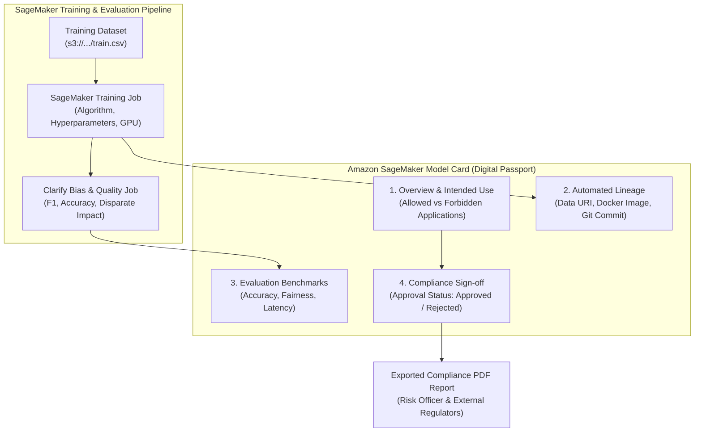

# Lab 10: Model Governance, Lineage Tracking & Auditing with SageMaker Model Cards

> **Course:** AWS Certified AI Practitioner (`AIF-C01`) Track  
> **Exam Domain Alignment:** Domain 4 (Guidelines for Responsible AI) & Domain 5 (Security, Compliance, and Governance)  
> **Estimated Duration:** 45 minutes  
> **Cost Profile:** Free Tier eligible ($0.00)  
> **AWS Region:** `eu-north-1` (Stockholm) or `us-east-1` (N. Virginia)

---

## 🎯 Lab Overview & Exam Objectives

In regulated industries (banking, healthcare, government), deploying machine learning models into production requires rigorous **governance sign-offs, data lineage tracking, and compliance documentation**. **Amazon SageMaker Model Cards** provides a standardized, single-source-of-truth artifact capturing a model's entire lifecycle from data prep to ethical risk assessments.

By completing this guided lab, you will master:
1. **Model Card Architecture:** Authoring standardized model cards documenting **intended uses**, **out-of-scope anti-patterns**, **risk ratings**, and **evaluation benchmarks**.
2. **Automated Lineage Tracking:** How SageMaker automatically tracks the exact S3 training data URIs, algorithms, hyperparameters, and container images used to build a model.
3. **Governance Workflow & Approval States:** Managing model review stages from **Draft** to **Pending Review**, **Approved**, or **Archived**.
4. **Model Cards vs. Model Dashboard:** Memorizing the critical architectural distinction between documentation artifacts (Model Cards) and live endpoint monitoring (Model Dashboard).
5. **Auditing & PDF Export:** Exporting compliant governance reports for external regulatory submission.

---

## 🏗️ Architectural Topology

---

## ⚖️ SageMaker Model Cards vs. Model Dashboard: Exam Comparison

| Dimension | Amazon SageMaker Model Cards | Amazon SageMaker Model Dashboard |
|---|---|---|
| **Primary Role** | **Governance Documentation Artifact** (The model's "passport" or "nutrition label"). | **Real-Time Operational Monitoring** (Centralized air traffic control room for all deployed models). |
| **Key Contents** | Intended use, out-of-scope uses, training data lineage, evaluation benchmarks, risk ratings, human approvals. | Live hosted endpoints, Model Monitor drift violations (data drift, concept drift, bias drift), latency, and 4xx/5xx errors. |
| **Intervention Type** | Static / Versioned compliance sign-off document (exportable as PDF). | Dynamic operational alerting via Amazon CloudWatch and EventBridge. |
| **Exam Metaphor** | A birth certificate and medical history document for a single vehicle. | A fleet operations control screen tracking 100 active trucks on the highway in real time. |

---

## 🛠️ Guided Step-by-Step Console Walkthrough

### Step 1: Navigate to SageMaker Governance in the Console
1. In the **AWS Management Console**, navigate to **Amazon SageMaker**.
2. In the left navigation pane under **Governance**, select **Model Cards**.
3. In the main pane, observe the Model Cards inventory showing model names, risk ratings, approval statuses, and creation dates.
4. Click the orange **Create model card** button.

---

### Step 2: Configure Model Overview & Intended Use
Regulatory frameworks require companies to explicitly define where a model is authorized to operate and where its use is prohibited.

1. **Model card details:**
   - **Model card name:** `CreditUnderwritingRiskModel-v2`
   - **Model overview:** `Automated credit scoring algorithm designed to estimate 12-month default probabilities for personal loan applicants.`
2. **Problem details:**
   - **Problem type:** `Binary Classification`
3. **Intended uses:**
   - **Intended use:** `Assisting loan officers in assessing risk for unsecured personal loans under $50,000 USD for adult domestic applicants.`
   - **Out-of-scope uses (Prohibited Applications):** `Under no circumstances may this model be used for commercial enterprise loans, mortgage underwriting, or automated rejection of applicants without human loan officer secondary review.`
4. **Risk rating:**
   - Select **High** *(Financial models determining credit access are classified as High Risk under the EU AI Act and US FTC frameworks)*.
5. Click **Next**.

---

### Step 3: Document Training Details & Lineage Tracking
1. **Training details:**
   - **Objective:** `Minimize binary cross-entropy loss while maintaining a Disparate Impact ratio above 0.80.`
2. **Model lineage:**
   - In a production SageMaker environment, if you select a previous SageMaker Training Job, SageMaker **automatically populates** the input S3 bucket URIs, algorithm container image URI, and hyperparameters.
   - For this guided lab, manually verify the metadata fields:
     - *Training dataset:* `s3://corporate-compliance-data/credit_training_v2.csv`
     - *Algorithm:* `Amazon SageMaker XGBoost (v1.7)`
     - *Instance type:* `ml.m5.2xlarge`
3. Click **Next**.

---

### Step 4: Attach Evaluation Metrics & Fairness Benchmarks
1. On the **Evaluation details** screen, click **Add evaluation job**:
   - **Evaluation name:** `BaselineValidationAndFairnessAudit`
   - **Evaluation type:** `Pre-deployment Validation`
2. **Performance Metrics:**
   - Add Metric: `Accuracy` = `0.874`
   - Add Metric: `F1-Score` = `0.812`
   - Add Metric: `AUC-ROC` = `0.895`
3. **Responsible AI & Fairness Metrics (from Clarify):**
   - Add Metric: `Disparate Impact (Gender)` = `0.88` *(Complies with the 80% rule)*
   - Add Metric: `Class Imbalance (Age)` = `0.04`
4. Click **Next**.

---

### Step 5: Manage Governance Approvals & Export Compliance PDF
1. **Review and Approval Status:**
   - Observe the available approval states:
     - **Draft:** Model is still being developed or evaluated.
     - **Pending review:** Awaiting sign-off from compliance or legal officers.
     - **Approved:** Authorized for production deployment.
     - **Archived:** Deprecated model version.
2. Select **Pending review** (or **Approved**).
3. Click **Create model card**.
4. **Generate the Regulatory PDF Document:**
   - On the newly created Model Card overview page, locate the top-right action bar.
   - Click **Actions** > **Export to PDF**.
   - Download the generated PDF.
   - **Inspect the Document:** Notice how SageMaker synthesizes the intended uses, risk rating, training lineage, evaluation graphs, and approval timestamps into an audit-ready executive dossier.

---

## 🎯 Exam Practice: Scenarios & Traps

| Exam Scenario | Correct Recommendation | Why Distractors Fail |
|---|---|---|
| *"An enterprise risk management committee requires a standardized governance document outlining model intended uses, limitations, and bias metrics before approving deployment."* | **Amazon SageMaker Model Cards** | SageMaker Model Dashboard tracks real-time endpoint latency and drift, it does not document intended use or compliance text. |
| *"Auditors require proof of which exact S3 training dataset and container image version was used to build a model that was deployed 6 months ago."* | **Inspect Model Lineage in the SageMaker Model Card** | CloudTrail logs API calls (e.g. `CreateModel`), but does not track the internal ML lineage graph linking datasets to model artifacts. |
| *"How does a compliance team ensure an ML model is not used for unapproved purposes (such as evaluating medical diagnosis data)?"* | **Document Out-of-Scope Uses in the SageMaker Model Card** | Technical guardrails intercept prompts, but formal organizational compliance mandates documenting out-of-scope applications in Model Cards. |
| *"What is the primary operational function of the Amazon SageMaker Model Dashboard?"* | **Providing a unified dashboard to monitor data drift, concept drift, and model quality across all active production endpoints** | Model Cards document model design and evaluation; Model Dashboard provides real-time operational monitoring of running endpoints. |

---

## 🧹 Cost Safeguard & Cleanup

1. Amazon SageMaker Model Cards is an artifact and documentation metadata service.
2. It incurs **zero per-hour compute charges**.
3. To delete the model card: In **Amazon SageMaker** > **Governance** > **Model Cards** > Select `CreditUnderwritingRiskModel-v2` > Click **Actions** > **Delete**.
