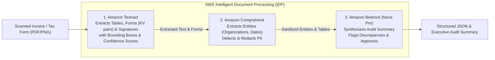

# Lab 11: Applied Document Intelligence with Textract, Comprehend & Bedrock

> **Course:** AWS Certified AI Practitioner (`AIF-C01`) Track  
> **Exam Domain Alignment:** Domain 1 (Fundamentals of AI and ML) & Domain 3 (Applications of Foundation Models)  
> **Estimated Duration:** 45 minutes  
> **Cost Profile:** Minimal pay-per-document and pay-per-token usage (<$0.10)  
> **AWS Region:** `eu-north-1` (Stockholm) or `us-east-1` (N. Virginia)

---

## 🎯 Lab Overview & Exam Objectives

Enterprises handle millions of unstructured documents annually: scanned invoices, mortgage applications, tax receipts, and medical charts. Building an enterprise document intelligence pipeline requires orchestrating specialized pre-trained AI services—**Amazon Textract** for OCR and structural table extraction, **Amazon Comprehend** for NLP entity and PII detection, and **Amazon Bedrock** for executive synthesis.

By completing this guided lab, you will master:
1. **Amazon Textract Document Capabilities:** Extracting **Raw Text**, **Key-Value Form Pairs**, **Tables**, **Signatures**, and executing **Textract Queries**.
2. **Textract vs. Bedrock Multimodal Vision:** Understanding when to use deterministic OCR (Textract) versus semantic reasoning (Bedrock).
3. **Amazon Comprehend NLP Analysis:** Detecting **Entities**, **Sentiment**, **Key Phrases**, and identifying **Personally Identifiable Information (PII)**.
4. **Hybrid Orchestration:** Combining Textract structural extraction with Amazon Bedrock (Nova / Claude) to generate automated document audit summaries.
5. **AWS CLI Command Line Execution:** Running document analysis directly via the AWS CLI.

---

## 🏗️ Architectural Topology



---

## ⚖️ Amazon Textract vs. Amazon Bedrock Vision: Exam Distinction

| Capability | Amazon Textract | Amazon Bedrock Multimodal (Nova / Claude) |
|---|---|---|
| **Core Architecture** | Specialized computer vision & document layout models trained on billions of physical documents. | Large Vision-Language Models (LVLMs) trained on broad multimodal concepts. |
| **Primary Strength** | **Deterministic Precision:** Extracts exact tabular cells, rows, columns, checkboxes, signatures, and Key-Value pairs with precise bounding box coordinates and confidence percentages. | **Semantic Reasoning:** Synthesizes abstractive summaries, interprets complex infographics, correlates chart trends, and answers high-level logic questions. |
| **Output Format** | Structured JSON with hierarchy (PAGE -> LINE -> WORD -> TABLE -> CELL). | Natural language prose, code, or custom JSON. |
| **Best Used For** | Processing dense 100-page scanned invoices, tax forms, passports, and loan applications where exact cell layout matters. | Analyzing architectural diagrams, marketing flyers, reasoning over visual trends, and open-ended Q&A. |

---

## 🛠️ Guided Step-by-Step Console Walkthrough

### Step 1: Analyze Invoices with Amazon Textract
1. In the **AWS Management Console**, navigate to **Amazon Textract**.
2. In the left navigation pane under **Analyze Document**, click **Analyze Document**.
3. In the sample document viewer, observe the four analysis modes:
   - **Raw text:** Extracts contiguous lines and words.
   - **Forms:** Extracts Key-Value pairs (e.g. `Invoice Number:` -> `INV-2026-9081`, `Due Date:` -> `March 15, 2026`).
   - **Tables:** Detects tabular structures, preserving row and column indices even when borders or gridlines are missing.
   - **Queries:** Allows natural language extraction questions directly:
     - Click **Add query** > Enter: `What is the total balance due?`
     - Textract executes the query and extracts the exact numerical string `$4,850.00` with a confidence score of `99.2%`.
4. Inspect the **Signatures** tab:
   - Notice that Textract highlights the signature field, returning `Signature detected: Present (Confidence: 98.7%)`.

---

### Step 2: Extract Entities & PII with Amazon Comprehend
Amazon Comprehend uses deep learning to understand unstructured text without training custom models.

1. In the AWS Management Console, navigate to **Amazon Comprehend**.
2. In the left navigation menu under **Analysis**, select **Real-time analysis**.
3. In the **Input text** editor, paste the following customer communication snippet:
   ```text
   On February 14, 2026, John Doe from Global Logistics Inc. contacted support regarding Invoice INV-9081. He requested a credit refund of $1,200.00 transferred to his corporate checking account ending in 8841. He can be reached at john.doe@globallogistics.com or by phone at (555) 019-2834.
   ```
4. Click **Analyze**.
5. **Inspect the Extracted Tabs:**
   - **Entities Tab:**
     - `John Doe` -> `PERSON` (Confidence: 99%)
     - `Global Logistics Inc.` -> `ORGANIZATION` (Confidence: 98%)
     - `February 14, 2026` -> `DATE` (Confidence: 99%)
     - `$1,200.00` -> `QUANTITY` (Confidence: 99%)
   - **Key Phrases Tab:**
     - Identifies noun phrases: *"Invoice INV-9081"*, *"credit refund"*, *"corporate checking account"*.
   - **Personally Identifiable Information (PII) Tab:**
     - Detects:
       - `john.doe@globallogistics.com` -> `EMAIL`
       - `(555) 019-2834` -> `PHONE`
       - `John Doe` -> `NAME`
       - `8841` -> `BANK_ACCOUNT_NUMBER` (partial)

---

### Step 3: Complete the Pipeline with Bedrock Synthesis
Once Textract and Comprehend structure the document, Amazon Bedrock interprets the business meaning.

1. Navigate to **Amazon Bedrock** > **Playgrounds** > **Chat**.
2. Select model: **Amazon Nova Pro** (or **Claude 3.5 Sonnet**).
3. In the chat box, enter:
   ```text
   You are an automated accounts payable auditor.
   Analyze the following structured document extraction:
   
   - Vendor: Global Logistics Inc.
   - Invoice Total: $4,850.00
   - Line Items:
     1. Fuel Surcharge: $850.00
     2. Cross-Country Freight Transport: $4,000.00
   - Stated Terms: Net 30 days
   - Client Audit Note: Client claims they were promised a 10% discount on freight transport for signing early.
   
   Task:
   1. Calculate if the 10% freight discount was applied.
   2. Compute the correct adjusted balance.
   3. Draft a polite email to the vendor requesting an updated invoice.
   ```
4. Click **Run**.
5. **Observation:** Bedrock performs mathematical deduction ($10\% \times \$4,000 = \$400$ discount -> Correct total: $\$4,450.00$), flags that the original $\$4,850.00$ invoice omitted the agreed discount, and drafts a professional vendor email citing the contract terms.

---

## 💻 Programmatic Textract Invocation via AWS CLI v2

Run document analysis using the AWS CLI:

```bash
# Analyze document forms and tables from a local image
aws textract analyze-document \
  --document '{"Bytes": "'$(base64 -w 0 sample_invoice.png)'"}' \
  --feature-types '["TABLES", "FORMS", "SIGNATURES"]' \
  --region eu-north-1 \
  --output json
```

---

## 🎯 Exam Practice: Scenarios & Traps

| Exam Scenario | Correct Recommendation | Why Distractors Fail |
|---|---|---|
| *"A mortgage processing company needs an automated solution to extract tabular data from 10,000 scanned PDFs, verifying whether applicants physically signed page 12."* | **Amazon Textract with Tables and Signatures feature types** | Amazon Rekognition analyzes general photos/video, not documents. Amazon Comprehend performs NLP text analysis, it cannot inspect physical document signatures. |
| *"A healthcare portal needs to identify patient names, dates of birth, and medical conditions from doctors' unformatted clinical notes."* | **Amazon Comprehend Medical** | Standard Comprehend identifies general entities; Comprehend Medical is specialized with HIPAA compliance for medical conditions, dosages, and anatomy. |
| *"What is the primary architectural advantage of Textract Queries over standard OCR?"* | **Queries allow developers to extract specific data fields using natural language questions (e.g. 'What is the policy number?') without needing to map bounding box coordinates** | Standard OCR returns all text in reading order, requiring fragile regular expressions to parse specific fields. |
| *"A company wants to detect whether customer support emails express positive or negative sentiment and route angry emails to managers."* | **Amazon Comprehend Sentiment Analysis** | Amazon Lex builds conversational chatbots; Amazon Comprehend performs text sentiment classification. |

---

## 🧹 Cost Safeguard & Cleanup

1. Amazon Textract and Amazon Comprehend are **purely serverless, pay-per-request APIs**.
2. If you uploaded sample invoices to an S3 bucket, delete the files when testing concludes to avoid ongoing storage charges.
