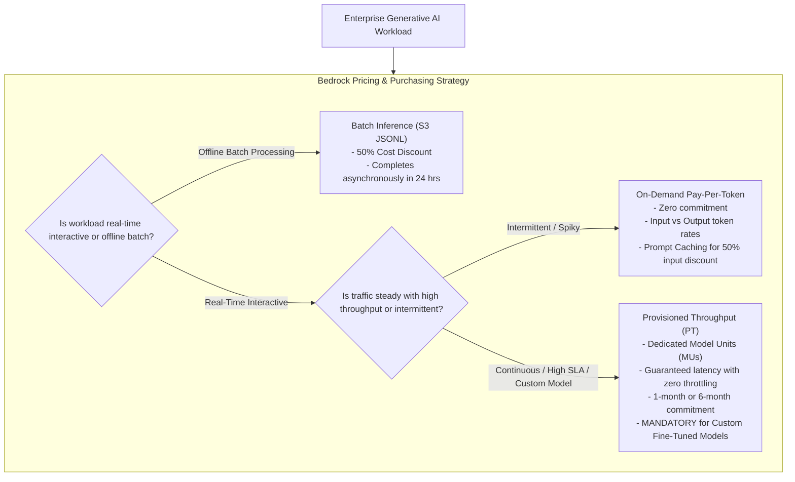

# Lab 12: Generative AI FinOps, Token Pricing, Quotas & Provisioned Throughput

> **Course:** AWS Certified AI Practitioner (`AIF-C01`) Track  
> **Exam Domain Alignment:** Domain 5 (Security, Compliance, and Governance) & Domain 3 (Applications of Foundation Models)  
> **Estimated Duration:** 45 minutes  
> **Cost Profile:** $0.00 (Purely observational governance, billing analysis, and CloudWatch metrics configuration)  
> **AWS Region:** `eu-north-1` (Stockholm) or `us-east-1` (N. Virginia)

---

## 🎯 Lab Overview & Exam Objectives

Managing Generative AI costs (GenAI FinOps) is one of the newest and most critical skills tested on the AIF-C01 exam. Unlike traditional compute (billed per instance-hour) or databases (billed per GB/month), foundation models introduce unique billing variables: **input vs. output token divergence**, **prompt caching discounts**, **batch inference pricing**, and **Provisioned Throughput commitments**.

By completing this guided lab, you will master:
1. **The Three Bedrock Pricing Models:** Comprehending the architectural and economic trade-offs between **On-Demand (Pay-Per-Token)**, **Batch Inference (50% Discount)**, and **Provisioned Throughput (Model Units)**.
2. **Input vs. Output Token Asymmetry:** Understanding why output generation tokens cost 3x to 5x more than input prompt tokens.
3. **Provisioned Throughput Rules:** Memorizing that **Provisioned Throughput is mandatory for custom fine-tuned models on Bedrock**.
4. **Service Quotas & Cross-Region Inference:** Managing **Tokens Per Minute (TPM)** quotas and configuring **Cross-Region Inference Profiles** to avoid throttling.
5. **FinOps Monitoring:** Tracking token consumption via **Amazon CloudWatch Metrics** and setting up **AWS Budgets** alerts.

---

## 🏗️ Architectural Topology

---

## 🧮 Mathematical Foundations of GenAI Pricing

### 1. Input Tokens vs. Output Tokens (Why Output is 3x–5x More Expensive)
- **Input Tokens (Prompt Processing):** The model processes all input prompt tokens in parallel using GPU matrix multiplications. This is compute-efficient.
- **Output Tokens (Autoregressive Generation):** The model generates text sequentially **one token at a time**, re-running the entire neural network for every single generated token:
  $$\text{Latency} \propto N_{\text{output}} \times \text{Transformer Depth}$$
- *Example Pricing (Claude 3.5 Sonnet / Nova Pro):*
  - Input tokens: $\approx \$3.00$ per million tokens.
  - Output tokens: $\approx \$15.00$ per million tokens (5x higher!).

### 2. Prompt Caching Economics
- When a prompt prefix exceeds 1,024 tokens and is reused within 5 minutes:
  - Cache write token price: $\approx \$3.75$ per million tokens.
  - Cache read token price: $\approx \$0.30$ per million tokens (**90% discount on cached tokens!**).

### 3. Batch Inference Economics
- Submitting thousands of requests via an S3 JSONL file gives you an **automatic 50% discount** compared to on-demand pricing in exchange for asynchronous 24-hour turnaround.

---

## 🛠️ Guided Step-by-Step Console Walkthrough

### Step 1: Inspect Bedrock Service Quotas & Throttling Limits
1. In the **AWS Management Console**, search for and open **Service Quotas**.
2. In the left navigation pane, select **AWS services**.
3. In the search box, search for: `Amazon Bedrock`.
4. Observe the quotas assigned to your account:
   - **Tokens Per Minute (TPM):** Hard limit on the aggregate number of input + output tokens processed per minute per model.
   - **Requests Per Minute (RPM):** Hard limit on total API calls per minute.
5. Notice that if an application experiences sudden traffic surges exceeding these limits, Bedrock returns a `ThrottlingException` (HTTP 429).
6. To request an increase, you would select the specific model quota and click **Request quota increase**.

---

### Step 2: Explore Cross-Region Inference Profiles
To prevent regional throttling during large traffic spikes without waiting for manual quota approvals, AWS provides **Cross-Region Inference Profiles**.

1. In the AWS Management Console, navigate to **Amazon Bedrock**.
2. In the left navigation pane under **Foundation models**, select **Cross-region inference**.
3. Observe the predefined system profiles (e.g. `US Anthropic Claude 3.5 Sonnet` or `EU Amazon Nova Pro`).
4. **How It Works:**
   - Instead of routing requests to a single regional endpoint (e.g. `eu-north-1`), your application calls the Cross-Region Profile ID.
   - Bedrock dynamically routes traffic across multiple participating regions (e.g., `eu-west-1`, `eu-central-1`, `eu-north-1`) based on real-time capacity and latency.
   - This delivers **higher effective throughput limits** and enhanced failover availability at zero additional cost!

---

### Step 3: Inspect Provisioned Throughput & Custom Model Hosting Rules
1. In the Amazon Bedrock console left menu, select **Provisioned throughput**.
2. Click **Purchase Provisioned Throughput**.
3. Review the configuration options:
   - **Model selection:** You can select base foundation models OR **Custom fine-tuned models**.
   - **Model Units (MU):** The unit of capacity. 1 Model Unit provides a fixed guaranteed rate of input/output tokens per minute with zero throttling.
   - **Commitment options:**
     - *No commitment* (hourly, can be cancelled anytime where supported).
     - *1-month commitment* (discounted rate).
     - *6-month commitment* (maximum discounted rate).

> [!CRITICAL]
> **Essential Exam Fact:** When you fine-tune a foundation model in Amazon Bedrock (creating a **Custom Model**), the resulting custom model **CANNOT be invoked using On-Demand pay-per-token pricing**. You **MUST** purchase Provisioned Throughput (at least 1 Model Unit) to deploy and invoke a custom fine-tuned model!

---

### Step 4: Monitor Token Consumption via Amazon CloudWatch
1. In the AWS Management Console, navigate to **Amazon CloudWatch**.
2. In the left navigation pane, select **Metrics** > **All metrics**.
3. Select the **AWS/Bedrock** namespace:
   - Click **ModelId, ModelType**.
4. Observe the four core operational and financial metrics:
   - `Invocations`: Total number of API requests.
   - `InputTokenCount`: Total prompt tokens ingested (maps directly to input billing).
   - `OutputTokenCount`: Total generated tokens produced (maps to output billing).
   - `InvocationLatency`: Round-trip duration in milliseconds.
5. In the top graph controls, change the statistic from *Average* to **Sum**, and set the period to **1 Minute** or **1 Hour** to track total token burn rates.

---

### Step 5: Configure an AWS Budget Alert for Generative AI
1. In the AWS Management Console, navigate to **AWS Billing and Cost Management**.
2. In the left navigation pane under **Cost Management**, select **Budgets**.
3. Click **Create budget**:
   - Budget setup: Select **Customize (advanced)** > **Cost budget**.
   - **Budget name:** `BedrockGenAIMonthlyBudget`
   - **Period:** `Monthly`
   - **Budget amount:** `$50.00`
4. **Scope the budget to Amazon Bedrock:**
   - In the **Filters** card, select **Service** > Check **Amazon Bedrock**.
5. Set alert thresholds:
   - *Alert 1:* When **Actual cost** exceeds `80%` ($40.00), send an email to your administrator.
   - *Alert 2:* When **Forecasted cost** exceeds `100%` ($50.00), send an email warning that current burn rate will breach the budget before month-end.
6. Click **Create budget**.

---

## 🎯 Exam Practice: Scenarios & Traps

| Exam Scenario | Correct Recommendation | Why Distractors Fail |
|---|---|---|
| *"A machine learning team fine-tunes an Amazon Titan model on internal financial data in Bedrock. What must they do before their application can invoke this custom model?"* | **Purchase Provisioned Throughput (allocate at least 1 Model Unit) for the custom model** | Custom fine-tuned models in Amazon Bedrock do NOT support On-Demand pay-per-token pricing. Provisioned Throughput is mandatory. |
| *"A media company processes 500,000 video transcripts every weekend. The jobs are submitted on Saturday night and must be completed by Monday morning at the lowest possible cost."* | **Use Amazon Bedrock Batch Inference** | Batch inference provides an automatic 50% cost discount compared to On-Demand pricing for asynchronous jobs that can tolerate up to 24-hour completion windows. |
| *"An enterprise chatbot in `us-east-1` frequently fails with HTTP 429 ThrottlingException errors during peak hours due to regional token-per-minute limits."* | **Configure an Amazon Bedrock Cross-Region Inference Profile** | Fine-tuning does not increase token rate limits. Cross-Region profiles dynamically route excess traffic across multiple regions to absorb peaks. |
| *"Why is text generation (output tokens) billed at a significantly higher rate than prompt ingestion (input tokens) in foundation models?"* | **Output tokens are generated sequentially one by one (autoregressive decoding), requiring a full forward neural pass for every token, whereas input tokens are processed in parallel** | It has nothing to do with network bandwidth or storage; it is fundamentally driven by autoregressive compute complexity. |

---

## 🧹 Cost Safeguard & Cleanup

1. This lab did not purchase Provisioned Throughput or launch dedicated instances.
2. If you created the AWS Budget, it is free under the AWS Free Tier (up to 2 free budgets per account). You can delete it via:
   - **Billing Console** > **Budgets** > Select `BedrockGenAIMonthlyBudget` > Click **Actions** > **Delete**.
