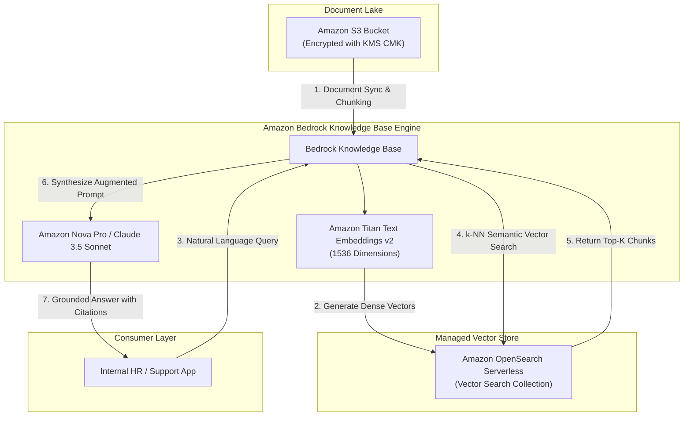

# Tutorial 01: Enterprise RAG Knowledge Base Architecture

> **Architecture Build Tutorial:** `Tutorial_01_Enterprise_RAG_Knowledge_Base_Architecture.md`  
> **Course:** AWS Certified AI Practitioner (`AIF-C01`)  
> **Services Integrated:** Amazon S3, Amazon Bedrock Knowledge Bases, Amazon Titan Text Embeddings v2, Amazon OpenSearch Serverless, AWS IAM, AWS KMS  
> **Level:** Advanced Multi-Service Production Implementation

---

## 🏛️ Architecture Overview

Retrieval-Augmented Generation (RAG) grounds foundation models on proprietary organizational data without model retraining. This tutorial builds a production-grade, secure RAG architecture using **Amazon Bedrock Knowledge Bases** backed by a vector index in **Amazon OpenSearch Serverless**.



---

## 🛠️ Step-by-Step Implementation Guide

### Step 1: Provision the Encrypted S3 Document Bucket
Create a private S3 bucket to store company policy PDFs:
```bash
aws s3api create-bucket \
    --bucket enterprise-rag-knowledge-base-corp \
    --region eu-north-1 \
    --create-bucket-configuration LocationConstraint=eu-north-1

# Enforce default server-side encryption with KMS
aws s3api put-bucket-encryption \
    --bucket enterprise-rag-knowledge-base-corp \
    --server-side-encryption-configuration '{
        "Rules": [{
            "ApplyServerSideEncryptionByDefault": {
                "SSEAlgorithm": "aws:kms"
            }
        }]
    }'
```

### Step 2: Configure OpenSearch Serverless Vector Collection
1. In the AWS Management Console, navigate to **Amazon OpenSearch Service** > **Serverless collections**.
2. Click **Create collection**:
   * **Name:** `bedrock-knowledge-base-collection`
   * **Collection type:** `Vector search`
   * **Encryption:** AWS owned key or Customer Managed Key (KMS).
3. Define the Network Policy: Allow private access or select VPC endpoints.
4. Define the Data Access Policy: Grant permissions (`aoss:*`) to the Bedrock execution role.

### Step 3: Create the Bedrock Knowledge Base Service Role
Create an IAM role (`BedrockKnowledgeBaseRole`) with the trust policy:
```json
{
  "Version": "2012-10-17",
  "Statement": [
    {
      "Effect": "Allow",
      "Principal": {
        "Service": "bedrock.amazonaws.com"
      },
      "Action": "sts:AssumeRole"
    }
  ]
}
```

Attach policies granting:
* `s3:GetObject`, `s3:ListBucket` on `arn:aws:s3:::enterprise-rag-knowledge-base-corp/*`
* `bedrock:InvokeModel` on `arn:aws:bedrock:eu-north-1::foundation-model/amazon.titan-embed-text-v2:0`
* `aoss:APIAccessAll` on the OpenSearch collection ARN.

### Step 4: Configure the Knowledge Base in Bedrock
1. Navigate to **Amazon Bedrock** > **Knowledge bases** > **Create knowledge base**.
2. **Knowledge base details:**
   * Name: `Corp-HR-Policies-KB`
   * IAM role: Use existing role (`BedrockKnowledgeBaseRole`).
3. **Data source:**
   * Point to S3 URI: `s3://enterprise-rag-knowledge-base-corp/`
   * Chunking strategy: Choose **Default chunking** (300 tokens, 20% overlap) or **Hierarchical chunking**.
4. **Select embeddings model:**
   * Select **Titan Text Embeddings v2** (1,536 dimensions).
5. **Vector database:**
   * Select the OpenSearch Serverless collection created in Step 2.
6. Click **Create knowledge base** and then click **Sync** to begin document ingestion.

### Step 5: Test Retrieval and Grounding via AWS CLI
```bash
aws bedrock-agent-runtime retrieve-and-generate \
    --input '{"text": "What is the annual corporate leave rollover policy?"}' \
    --retrieve-and-generate-configuration '{
        "type": "KNOWLEDGE_BASE",
        "knowledgeBaseConfiguration": {
            "knowledgeBaseId": "YOUR_KB_ID",
            "modelArn": "arn:aws:bedrock:eu-north-1::foundation-model/amazon.nova-pro-v1:0"
        }
    }'
```

---

## 🔒 Enterprise Production Considerations

1. **Incremental Syncing:** Re-sync the knowledge base whenever S3 documents are added, updated, or removed.
2. **Contextual Grounding Check:** Attach **Amazon Bedrock Guardrails** to the knowledge base to inspect retrieved chunks and verify factual adherence before answering the user.
3. **Auditability:** Enable AWS CloudTrail Data Events for `RetrieveAndGenerate` to track query sources and ensure compliance.


---

## 4. 🎯 Authentic Architecture Exam Practice
> Practice real-world scenarios tested on official AWS examinations that directly apply the architectural patterns built in this tutorial.

### Scenario Practice 1: AIF-C01-ET-Q029
**Question:**  
Which feature of Amazon OpenSearch Service gives companies the ability to build vector database applications?

**Options:**
- A) Integration with Amazon S3 for object storage
- B) Support for geospatial indexing and queries
- C) Scalable index management and nearest neighbor search capability
- D) Ability to perform real-time analysis on streaming data

<details>
<summary><b>View Verified Answer & Solution Analysis</b></summary>

**Correct Answer:** `C`  
**Peer Consensus:** `100%` agreement.  

**Architectural Breakdown & Distractor Analysis:**  
Community Most Voted: C (100%). Contributor Answer: C.

Community Rationale & Discussion:
Selected Answer: C
Scalable index management and nearest neighbor search capability: Amazon OpenSearch Service provides built-in support for vector search, which allows for efficient nearest neighbor search (such as k-nearest neighbors or k-NN) in large datasets. This is essential for vector databases, which store high-dimensional data (such as embeddings from machine learning models) and support fast similarity search. The scalable index management ensures that these searches can be performed efficiently even with large datasets.
---
Selected Answer: C
Scalable index management and k-NN algorithms which support to build and handle the recommendation systems, semantic search and anomalies detection.
---
Selected Answer: C
C: Scalable index management and nearest neighbor search capability

Explanation:
The Amazon OpenSearch Service supports building vector database applications by enabling nearest neighbor search capability. This feature allows the service to efficiently perform similarity searches, which is crucial for applications that rely on vector embeddings (e.g., recommendation systems, image or text similarity searches). Combined with scalable index management, this makes OpenSearch an excellent choice for vector database applications.

</details>

### Scenario Practice 2: AIF-C01-ET-Q005
**Question:**  
A company has developed a generative text summarization model by using Amazon Bedrock. The company will use Amazon Bedrock automatic model evaluation capabilities.

Which metric should the company use to evaluate the accuracy of the model?

**Options:**
- A) Area Under the ROC Curve (AUC) score
- B) F1 score
- C) BERTScore
- D) Real world knowledge (RWK) score

<details>
<summary><b>View Verified Answer & Solution Analysis</b></summary>

**Correct Answer:** `C`  
**Peer Consensus:** `100%` agreement.  

**Architectural Breakdown & Distractor Analysis:**  
Community Most Voted: C (100%). Contributor Answer: C.

Community Rationale & Discussion:
Selected Answer: C
BERTScore: This metric leverages the capabilities of a pre-trained BERT model to assess the semantic similarity between the generated summaries and the reference text, providing a more accurate evaluation of the model's ability to capture the key points of the original text, which is crucial for text summarization.
---
Selected Answer: C
The correct answer is C. BERTScore is specifically designed for evaluating text generation quality.
---
Selected Answer: C
BERTScore is the most appropriate metric for evaluating the accuracy of a generative text summarization model because it compares semantic similarity in a manner that aligns well with the goal of text summarization.

</details>
