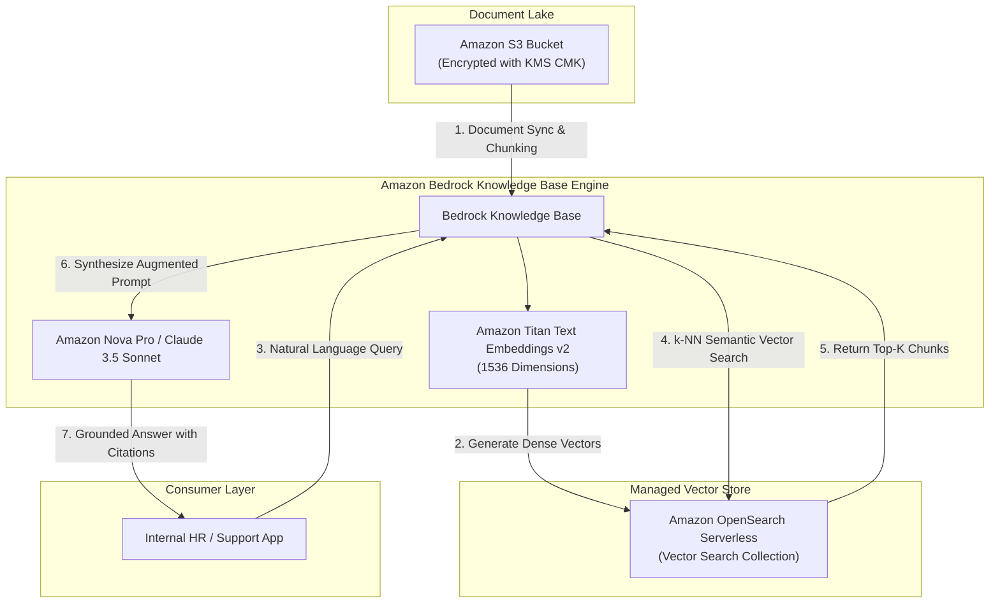
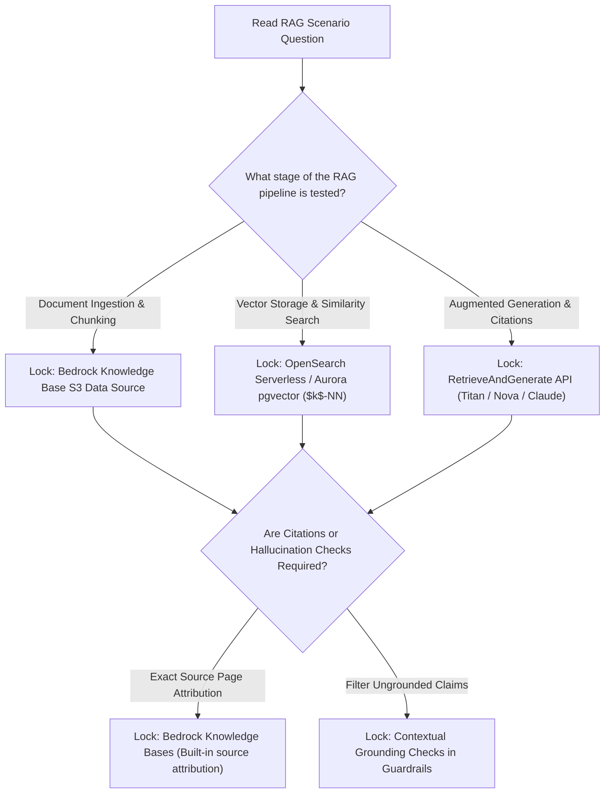
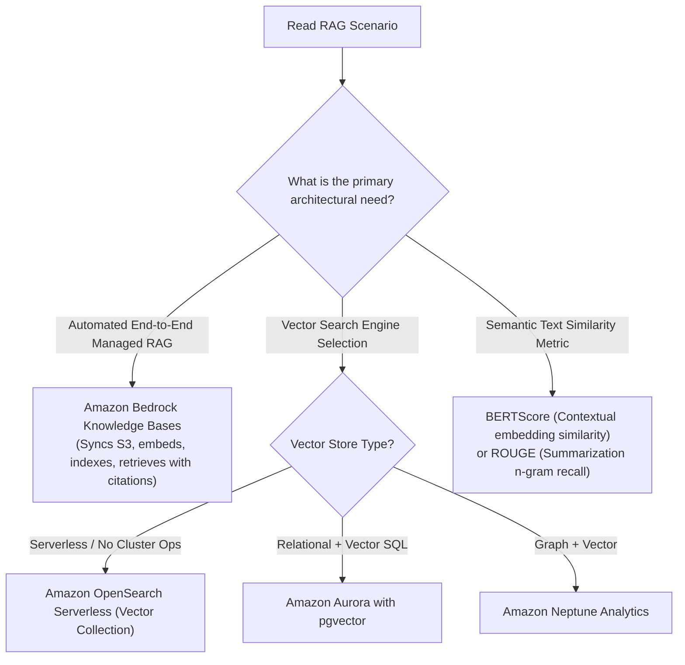

# Tutorial 01: Enterprise RAG Knowledge Base Architecture

> **Architecture Build Tutorial:** `Tutorial_01_Enterprise_RAG_Knowledge_Base_Architecture.md`  
> **Course:** AWS Certified AI Practitioner (`AIF-C01`)  
> **Services Integrated:** Amazon S3, Amazon Bedrock Knowledge Bases, Amazon Titan Text Embeddings v2, Amazon OpenSearch Serverless, AWS IAM, AWS KMS  
> **Level:** Advanced Multi-Service Production Implementation

---

## 🏛️ Architecture Overview

Retrieval-Augmented Generation (RAG) grounds foundation models on proprietary organizational data without model retraining. This tutorial builds a production-grade, secure RAG architecture using **Amazon Bedrock Knowledge Bases** backed by a vector index in **Amazon OpenSearch Serverless**.



---

## 🛠️ Step-by-Step Implementation Guide

### Step 1: Provision the Encrypted S3 Document Bucket
Create a private S3 bucket to store company policy PDFs:
```bash
aws s3api create-bucket \
    --bucket enterprise-rag-knowledge-base-corp \
    --region eu-north-1 \
    --create-bucket-configuration LocationConstraint=eu-north-1

# Enforce default server-side encryption with KMS
aws s3api put-bucket-encryption \
    --bucket enterprise-rag-knowledge-base-corp \
    --server-side-encryption-configuration '{
        "Rules": [{
            "ApplyServerSideEncryptionByDefault": {
                "SSEAlgorithm": "aws:kms"
            }
        }]
    }'
```

### Step 2: Configure OpenSearch Serverless Vector Collection
1. In the AWS Management Console, navigate to **Amazon OpenSearch Service** > **Serverless collections**.
2. Click **Create collection**:
   * **Name:** `bedrock-knowledge-base-collection`
   * **Collection type:** `Vector search`
   * **Encryption:** AWS owned key or Customer Managed Key (KMS).
3. Define the Network Policy: Allow private access or select VPC endpoints.
4. Define the Data Access Policy: Grant permissions (`aoss:*`) to the Bedrock execution role.

### Step 3: Create the Bedrock Knowledge Base Service Role
Create an IAM role (`BedrockKnowledgeBaseRole`) with the trust policy:
```json
{
  "Version": "2012-10-17",
  "Statement": [
    {
      "Effect": "Allow",
      "Principal": {
        "Service": "bedrock.amazonaws.com"
      },
      "Action": "sts:AssumeRole"
    }
  ]
}
```

Attach policies granting:
* `s3:GetObject`, `s3:ListBucket` on `arn:aws:s3:::enterprise-rag-knowledge-base-corp/*`
* `bedrock:InvokeModel` on `arn:aws:bedrock:eu-north-1::foundation-model/amazon.titan-embed-text-v2:0`
* `aoss:APIAccessAll` on the OpenSearch collection ARN.

### Step 4: Configure the Knowledge Base in Bedrock
1. Navigate to **Amazon Bedrock** > **Knowledge bases** > **Create knowledge base**.
2. **Knowledge base details:**
   * Name: `Corp-HR-Policies-KB`
   * IAM role: Use existing role (`BedrockKnowledgeBaseRole`).
3. **Data source:**
   * Point to S3 URI: `s3://enterprise-rag-knowledge-base-corp/`
   * Chunking strategy: Choose **Default chunking** (300 tokens, 20% overlap) or **Hierarchical chunking**.
4. **Select embeddings model:**
   * Select **Titan Text Embeddings v2** (1,536 dimensions).
5. **Vector database:**
   * Select the OpenSearch Serverless collection created in Step 2.
6. Click **Create knowledge base** and then click **Sync** to begin document ingestion.

### Step 5: Test Retrieval and Grounding via AWS CLI
```bash
aws bedrock-agent-runtime retrieve-and-generate \
    --input '{"text": "What is the annual corporate leave rollover policy?"}' \
    --retrieve-and-generate-configuration '{
        "type": "KNOWLEDGE_BASE",
        "knowledgeBaseConfiguration": {
            "knowledgeBaseId": "YOUR_KB_ID",
            "modelArn": "arn:aws:bedrock:eu-north-1::foundation-model/amazon.nova-pro-v1:0"
        }
    }'
```

---

## 🔒 Enterprise Production Considerations

1. **Incremental Syncing:** Re-sync the knowledge base whenever S3 documents are added, updated, or removed.
2. **Contextual Grounding Check:** Attach **Amazon Bedrock Guardrails** to the knowledge base to inspect retrieved chunks and verify factual adherence before answering the user.
3. **Auditability:** Enable AWS CloudTrail Data Events for `RetrieveAndGenerate` to track query sources and ensure compliance.


---

## 4. 🎯 Authentic Architecture Exam Practice
> Practice real-world scenarios tested on official AWS examinations that directly apply the architectural patterns built in this tutorial.

### Scenario Practice 1: AIF-C01-ET-Q029
**Question:**  
Which feature of Amazon OpenSearch Service gives companies the ability to build vector database applications?

**Options:**
- A) Integration with Amazon S3 for object storage
- B) Support for geospatial indexing and queries
- C) Scalable index management and nearest neighbor search capability
- D) Ability to perform real-time analysis on streaming data

<details>
<summary><b>View Verified Answer & Solution Analysis</b></summary>

**Correct Answer:** `C`  
**Peer Consensus:** `100%` agreement.  

**Architectural Breakdown & Distractor Analysis:**
- **Option A is INCORRECT:** While OpenSearch can take snapshots to Amazon S3, S3 integration alone does not enable high-dimensional vector search or semantic similarity calculations.
- **Option B is INCORRECT:** Geospatial indexing supports latitude/longitude queries, which is unrelated to embedding vector spaces.
- **Option C is CORRECT:** **Amazon OpenSearch Service** (and OpenSearch Serverless) includes native $k$-nearest neighbors ($k$-NN) search and scalable index management, allowing applications to index dense vector embeddings and execute fast vector similarity queries (Cosine, Euclidean, Dot Product) for RAG.
- **Option D is INCORRECT:** Real-time streaming analytics is performed by OpenSearch Ingestion or Amazon Managed Service for Apache Flink, not the core vector search engine capability.

</details>

### Scenario Practice 2: AIF-C01-ET-Q005
**Question:**  
A company has developed a generative text summarization model by using Amazon Bedrock. The company will use Amazon Bedrock automatic model evaluation capabilities.

Which metric should the company use to evaluate the accuracy of the model?

**Options:**
- A) Area Under the ROC Curve (AUC) score
- B) F1 score
- C) BERTScore
- D) Real world knowledge (RWK) score

<details>
<summary><b>View Verified Answer & Solution Analysis</b></summary>

**Correct Answer:** `C`  
**Peer Consensus:** `100%` agreement.  

**Architectural Breakdown & Distractor Analysis:**
- **Option A is INCORRECT:** AUC (Area Under the ROC Curve) is an evaluation metric for binary classification models, not generative natural language summarization.
- **Option B is INCORRECT:** Standard F1-Score evaluates token-level classification or named entity recognition, failing to evaluate abstractive semantic summary quality.
- **Option C is CORRECT:** **BERTScore** evaluates generative text quality by calculating semantic similarity between contextual embeddings of the generated text and human reference text using a pre-trained BERT model, making it ideal for automatic summarization evaluation in Amazon Bedrock.
- **Option D is INCORRECT:** "Real world knowledge (RWK) score" is a fabricated distractor.

</details>

---

## 🎓 Master Architecture MCQ Blueprint: Enterprise RAG & Vector Databases

> Pattern recognition rules mined from the master question bank to solve RAG, Bedrock Knowledge Bases, and Vector Store questions in under 15 seconds.

### Layer 1: "Clue-to-Service" Linguistic Decryption Matrix

| If Scenario Text Mentions... | Target Architecture / Service | Why (The Core Mechanism) | Decoy Trap to Avoid |
| :--- | :--- | :--- | :--- |
| **"Ground model answers on dynamic corporate documents with citations"** | **Amazon Bedrock Knowledge Bases (RAG)** | Automated document sync, chunking, embedding generation, vector search, and citation generation. | Fine-tuning (static weights; cannot provide source page citations). |
| **"Dense numerical vector similarity search ($k$-NN)"** | **Amazon OpenSearch Serverless (Vector Collection)** | Serverless vector index executing cosine/dot-product distance queries without managing clusters. | DynamoDB (key-value store; not built for dense vector indexing). |
| **"Convert enterprise text into semantic vector embeddings"** | **Amazon Titan Text Embeddings v2** | Generates 1,536-dimensional embeddings with flexible output dimensions (256, 512, 1024). | Amazon Comprehend (extracts entities, not dense vector embeddings). |
| **"Split long documents into semantically coherent fragments"** | **Document Chunking Strategy** | Fixed-size (300 tokens + overlap), hierarchical (child-parent), or semantic chunking. | Feeding 500-page raw PDF directly into prompt without chunking. |
| **"Verify generated response is substantiated by retrieved chunks"** | **Contextual Grounding Checks (Bedrock Guardrails)** | Evaluates grounding and relevance scores to detect and block ungrounded hallucinations. | Lowering temperature alone (reduces randomness but cannot verify factual grounding). |

---

### Layer 2: 3-Step Rapid Elimination Heuristic



1. **Step 1: Check Dynamic vs. Static Data:**
   - Needs daily/weekly document updates? $\to$ **RAG (Bedrock Knowledge Bases)**.
   - Needs domain vocabulary or tone changes? $\to$ **Fine-Tuning (PEFT/LoRA)**.
2. **Step 2: Check Vector Storage Architecture:**
   - Serverless vector search for Bedrock? $\to$ **Amazon OpenSearch Serverless**.
   - Relational database with vector extension? $\to$ **Amazon Aurora PostgreSQL (`pgvector`)**.
3. **Step 3: Check Verification & Citations:**
   - Must show the user where the answer came from? $\to$ RAG provides **grounding citations**.

---

### Layer 3: High-Frequency Decoy Autopsy

#### Decoy Trap: Fine-Tuning vs. Retrieval-Augmented Generation (RAG)
* **The Exam Trap:** A multinational bank wants an AI system that answers customer questions regarding fluctuating interest rates and newly published loan policies updated daily, citing exact document sources.
* **The Decoy:** Option B: "Fine-tune an Amazon Titan foundation model daily on newly uploaded policy documents."
* **The Fatal Flaw:** Fine-tuning is static, computationally expensive to run daily, and **cannot provide verifiable citation links** to the source documents.
* **The Correct Choice:** Use **Retrieval-Augmented Generation (RAG)** via **Amazon Bedrock Knowledge Bases**. Newly uploaded S3 documents are automatically vectorized, and queries retrieve current excerpts with direct source attribution.

---

### Layer 4: 10-Second Visual Decision Flowchart


