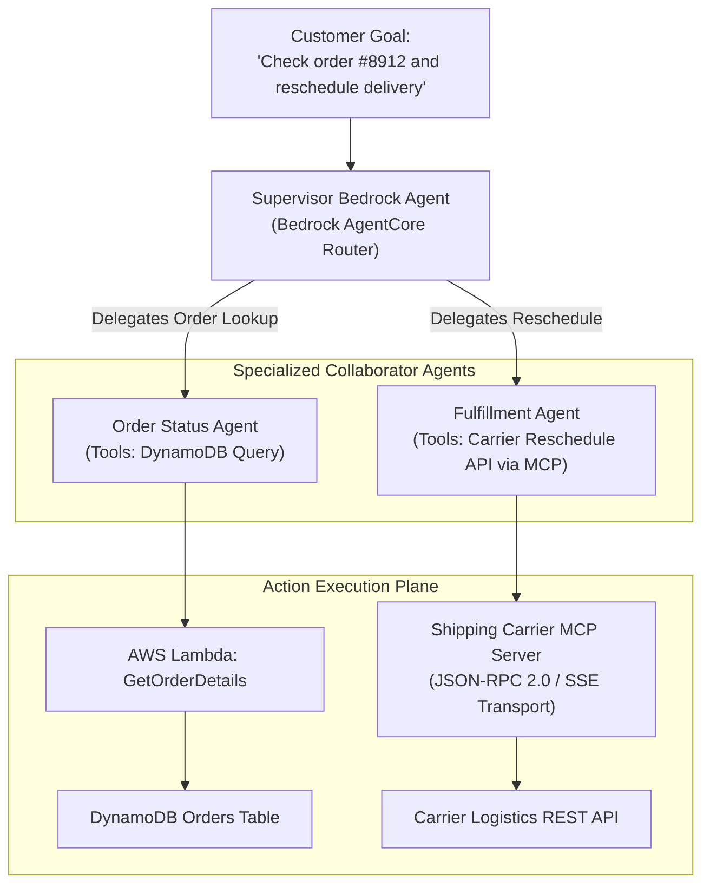
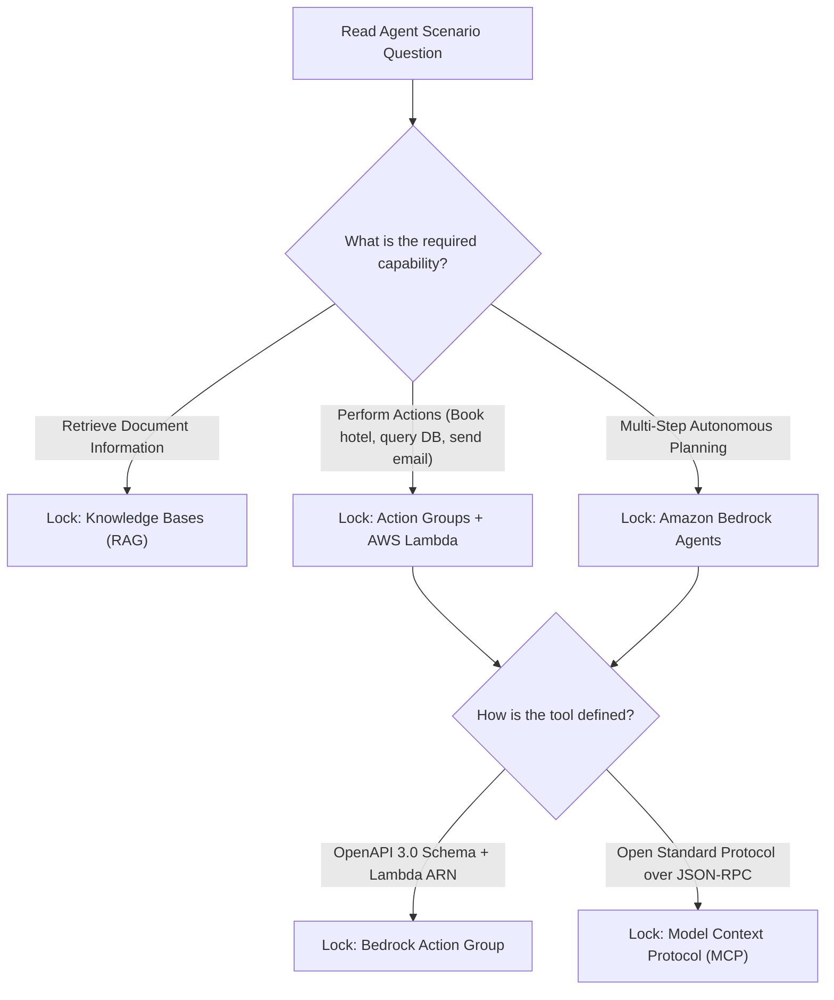
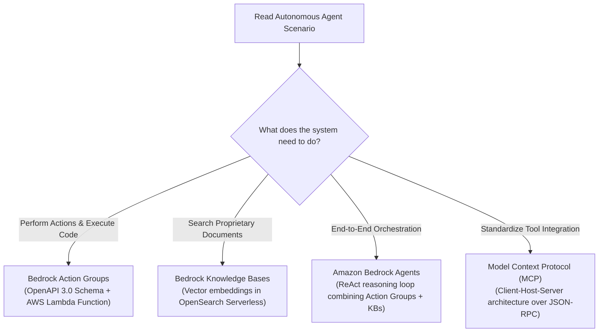

# Tutorial 02: Multi-Agent Autonomous System with Bedrock AgentCore and MCP

> **Architecture Build Tutorial:** `Tutorial_02_Multi_Agent_Autonomous_System_with_Bedrock_AgentCore_and_MCP.md`  
> **Course:** AWS Certified AI Practitioner (`AIF-C01`)  
> **Services Integrated:** Amazon Bedrock Agents, AgentCore, AWS Lambda, Amazon DynamoDB, Model Context Protocol (MCP), AWS IAM  
> **Level:** Advanced Multi-Service Autonomous System

---

## 🏛️ Architecture Overview

Modern enterprise AI systems decompose complex workflows into specialized autonomous agents. This tutorial implements an autonomous multi-agent customer service and fulfillment system using **Amazon Bedrock AgentCore**, **AWS Lambda Action Groups**, and the **Model Context Protocol (MCP)**.



---

## 🛠️ Step-by-Step Implementation Guide

### Step 1: Create the DynamoDB Orders Table
```bash
aws dynamodb create-table \
    --table-name CustomerOrders \
    --attribute-definitions AttributeName=OrderId,AttributeType=S \
    --key-schema AttributeName=OrderId,KeyType=HASH \
    --billing-mode PAY_PER_REQUEST \
    --region eu-north-1

# Seed test order record
aws dynamodb put-item \
    --table-name CustomerOrders \
    --item '{
        "OrderId": {"S": "8912"},
        "CustomerName": {"S": "Jane Doe"},
        "Status": {"S": "In-Transit"},
        "DeliveryDate": {"S": "2026-11-20"},
        "Address": {"S": "123 Cloud Way, Stockholm"}
    }' \
    --region eu-north-1
```

### Step 2: Create the Lambda Function for Action Groups
Author `order_lookup_lambda.py`:
```python
import json
import boto3

dynamodb = boto3.resource('dynamodb')
table = dynamodb.Table('CustomerOrders')

def lambda_handler(event, context):
    print("Received event:", json.dumps(event))
    
    agent = event['agent']
    actionGroup = event['actionGroup']
    function = event['function']
    parameters = event.get('parameters', [])
    
    order_id = None
    for param in parameters:
        if param['name'] == 'orderId':
            order_id = param['value']
            
    if not order_id:
        response_body = {"error": "Missing orderId parameter"}
    else:
        res = table.get_item(Key={'OrderId': order_id})
        response_body = res.get('Item', {"error": "Order not found"})
        
    action_response = {
        'actionGroup': actionGroup,
        'function': function,
        'functionResponse': {
            'responseBody': {
                'TEXT': {
                    'body': json.dumps(response_body)
                }
            }
        }
    }
    
    return {'response': action_response, 'messageVersion': '1.0'}
```

Deploy the Lambda function and grant permission to Amazon Bedrock:
```bash
aws lambda add-permission \
    --function-name GetOrderDetails \
    --statement-id AllowBedrockInvocation \
    --action lambda:InvokeFunction \
    --principal bedrock.amazonaws.com \
    --source-arn "arn:aws:bedrock:eu-north-1:*:agent/*"
```

### Step 3: Define the OpenAPI Schema for the Action Group
Save as `order_actions_schema.json`:
```json
{
  "openapi": "3.0.0",
  "info": {
    "title": "Customer Orders Service",
    "version": "1.0.0",
    "description": "APIs to query order tracking and status."
  },
  "paths": {
    "/order": {
      "get": {
        "summary": "Get Order By ID",
        "description": "Retrieves the shipping status, customer name, and scheduled delivery date.",
        "operationId": "getOrderById",
        "parameters": [
          {
            "name": "orderId",
            "in": "query",
            "description": "The unique 4-digit order identifier",
            "required": true,
            "schema": {
              "type": "string"
            }
          }
        ],
        "responses": {
          "200": {
            "description": "Order details payload",
            "content": {
              "application/json": {
                "schema": {
                  "type": "object"
                }
              }
            }
          }
        }
      }
    }
  }
}
```

### Step 4: Configure the Model Context Protocol (MCP) Server for Fulfillment
Create a lightweight MCP server implementing the carrier rescheduling tool:
```json
{
  "name": "carrier_rescheduler",
  "description": "Reschedules parcel delivery window with external logistics carrier",
  "inputSchema": {
    "type": "object",
    "properties": {
      "orderId": {"type": "string"},
      "newDate": {"type": "string", "format": "date"}
    },
    "required": ["orderId", "newDate"]
  }
}
```

### Step 5: Build and Test the Bedrock Agent
1. In the Amazon Bedrock Console, navigate to **Agents** > **Create agent**.
2. **Name:** `CustomerCareOrchestrator`.
3. **Foundation model:** `Amazon Nova Pro` or `Anthropic Claude 3.5 Sonnet`.
4. **Instruction prompt:**
   > "You are an autonomous customer care supervisor. Analyze the user request. If they ask about order status, invoke the Order Action Group. If they want to change the delivery date, invoke the Fulfillment tool via the MCP connection. Always confirm actions to the user."
5. Attach the Action Group pointing to the Lambda ARN and S3 OpenAPI schema.
6. Click **Prepare agent** and test in the interactive testing console.

---

## 🔒 Security & Governance Safeguards
* **AgentCore Least Privilege:** Ensure the Agent IAM role only has permissions to invoke specific Lambda ARNs.
* **Bedrock Guardrail Attachment:** Attach an active Guardrail to redact PII (phone numbers, addresses) from the conversational agent transcript.
* **Audit Traces:** Inspect the Amazon CloudWatch log groups created for the agent to review intermediate reasoning thoughts and tool invocations.


---

## 4. 🎯 Authentic Architecture Exam Practice
> Practice real-world scenarios tested on official AWS examinations that directly apply the architectural patterns built in this tutorial.

### Scenario Practice 1: AIF-C01-ET-Q099
**Question:**  
A large retailer receives thousands of customer support inquiries about products every day. The customer support inquiries need to be processed and responded to quickly. The company wants to implement Agents for Amazon Bedrock.
What are the key benefits of using Amazon Bedrock agents that could help this retailer?

**Options:**
- A) Generation of custom foundation models (FMs) to predict customer needs
- B) Automation of repetitive tasks and orchestration of complex workflows
- C) Automatically calling multiple foundation models (FMs) and consolidating the results
- D) Selecting the foundation model (FM) based on predefined criteria and metrics

<details>
<summary><b>View Verified Answer & Solution Analysis</b></summary>

**Correct Answer:** `B`  
**Peer Consensus:** `86%` agreement.  

**Architectural Breakdown & Distractor Analysis:**
- **Option A is INCORRECT:** Foundation models are pre-trained base models accessed via Bedrock; Bedrock Agents do not "generate custom foundation models" to predict customer needs.
- **Option B is CORRECT:** **Amazon Bedrock Agents** automate repetitive enterprise tasks and orchestrate complex multi-step workflows by utilizing the ReAct (Reasoning + Acting) loop to decompose customer requests into logical sub-tasks, query knowledge bases, and invoke APIs.
- **Option C is INCORRECT:** While routing patterns exist in advanced frameworks, Bedrock Agents is not primarily a multi-model aggregator; it is an orchestration engine that pairs a foundation model with Action Groups.
- **Option D is INCORRECT:** Model evaluation and selection is handled by Bedrock Model Evaluation, not autonomous runtime agents.

</details>

### Scenario Practice 2: AIF-C01-U1075
**Question:**  
A company uses Amazon Bedrock Agents to automate order processing. The agent needs to call an internal database to check inventory availability during customer conversations.

Which component should the company configure to integrate the database query with the agent?

**Options:**
- A) Amazon Bedrock Knowledge Bases
- B) An Action Group connected to an AWS Lambda function
- C) Amazon Bedrock Guardrails
- D) AWS Systems Manager Parameter Store

<details>
<summary><b>View Verified Answer & Solution Analysis</b></summary>

**Correct Answer:** `B`  
**Peer Consensus:** `100%` agreement.  

**Architectural Breakdown & Distractor Analysis:**
- **Option A is INCORRECT:** Knowledge Bases provide read-only semantic vector search over static or dynamic unstructured documents (RAG); they do not execute live transactional database queries or mutate business state.
- **Option B is CORRECT:** **Action Groups** define the actions and external tool integrations an agent can take. Each Action Group specifies an OpenAPI schema defining available functions and connects directly to an **AWS Lambda function** that executes the database query and returns the live inventory count to the agent.
- **Option C is INCORRECT:** Amazon Bedrock Guardrails filters toxic language, blocks prompt injections, and masks PII; it does not execute API actions or query external systems.
- **Option D is INCORRECT:** Systems Manager Parameter Store stores configuration parameters and passwords, not dynamic database query integrations for AI agents.

</details>

---

## 🎓 Master Architecture MCQ Blueprint: Autonomous Agents, Action Groups & MCP

> Pattern recognition rules mined from the master question bank to solve Bedrock Agents, Action Groups, ReAct loops, and Model Context Protocol (MCP) questions in under 15 seconds.

### Layer 1: "Clue-to-Service" Linguistic Decryption Matrix

| If Scenario Text Mentions... | Target Architecture / Service | Why (The Core Mechanism) | Decoy Trap to Avoid |
| :--- | :--- | :--- | :--- |
| **"Autonomous multi-step actions / Break tasks into steps"** | **Amazon Bedrock Agents (ReAct Loop)** | Analyzes natural language intent, determines logical execution sequence, invokes tools. | Bedrock Knowledge Bases (retrieves text; does not plan or execute API actions). |
| **"Connect Bedrock Agent to an external API or database"** | **Action Groups + AWS Lambda** | Defines tool capabilities via OpenAPI schema; executes business logic in Lambda. | Hardcoding database connection strings into the prompt. |
| **"Standardized open protocol connecting LLMs to tools via JSON-RPC"** | **Model Context Protocol (MCP)** | Standardized protocol allowing foundation models to discover tools, resources, and prompts. | Custom one-off REST API wrappers for each individual tool (M × N complexity). |
| **"Give an agent factual corporate guidelines during conversations"** | **Associate a Knowledge Base with the Agent** | Turnkey RAG integration: Agent automatically queries the KB when questions require policy facts. | Embedding 1,000 pages of text directly into the agent system prompt. |
| **"Safety boundaries on autonomous agent outputs"** | **Amazon Bedrock Guardrails** | Intercepts agent reasoning traces and user inputs to prevent unauthorized topic exploration. | Hoping the LLM obeys natural language constraints without guardrails. |

---

### Layer 2: 3-Step Rapid Elimination Heuristic



1. **Step 1: Action vs. Retrieval Triage:**
   - Reading documents, searching policies, answering FAQs? → **Knowledge Bases**.
   - Writing to database, executing transactions, calling REST endpoints? → **Action Groups + Lambda**.
2. **Step 2: Check Planning Requirement:**
   - Multi-turn conversation that requires reasoning, step-by-step tool invocation, and decision making? → **Amazon Bedrock Agents**.
3. **Step 3: Protocol Identification:**
   - Open standard protocol for agent-tool connectivity? → **Model Context Protocol (MCP)**.

---

### Layer 3: High-Frequency Decoy Autopsy

#### Decoy Trap: Bedrock Knowledge Base vs. Action Group
* **The Exam Trap:** A company wants an AI assistant that can both check flight schedules from static travel brochures AND book flight reservations in an airline ticketing database.
* **The Decoy:** Option A: "Use Bedrock Knowledge Bases to both search schedules and execute ticket bookings."
* **The Fatal Flaw:** Knowledge Bases are **read-only semantic search stores**. They cannot make transactional API calls, run SQL update statements, or trigger external state mutations.
* **The Correct Choice:** Use an **Amazon Bedrock Agent** configured with a **Knowledge Base** for schedule lookups AND an **Action Group** connected to an **AWS Lambda function** to execute booking transactions.

---

### Layer 4: 10-Second Visual Decision Flowchart


