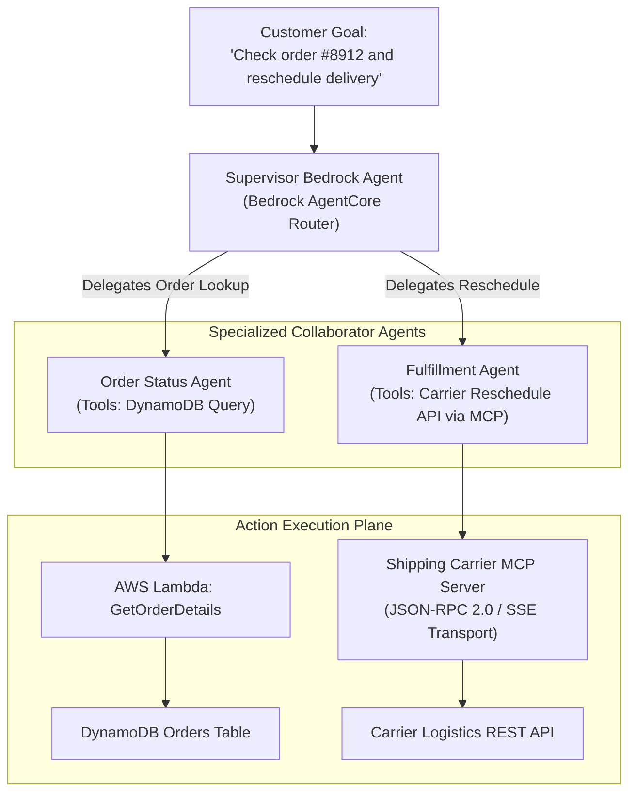

# Tutorial 02: Multi-Agent Autonomous System with Bedrock AgentCore and MCP

> **Architecture Build Tutorial:** `Tutorial_02_Multi_Agent_Autonomous_System_with_Bedrock_AgentCore_and_MCP.md`  
> **Course:** AWS Certified AI Practitioner (`AIF-C01`)  
> **Services Integrated:** Amazon Bedrock Agents, AgentCore, AWS Lambda, Amazon DynamoDB, Model Context Protocol (MCP), AWS IAM  
> **Level:** Advanced Multi-Service Autonomous System

---

## 🏛️ Architecture Overview

Modern enterprise AI systems decompose complex workflows into specialized autonomous agents. This tutorial implements an autonomous multi-agent customer service and fulfillment system using **Amazon Bedrock AgentCore**, **AWS Lambda Action Groups**, and the **Model Context Protocol (MCP)**.



---

## 🛠️ Step-by-Step Implementation Guide

### Step 1: Create the DynamoDB Orders Table
```bash
aws dynamodb create-table \
    --table-name CustomerOrders \
    --attribute-definitions AttributeName=OrderId,AttributeType=S \
    --key-schema AttributeName=OrderId,KeyType=HASH \
    --billing-mode PAY_PER_REQUEST \
    --region eu-north-1

# Seed test order record
aws dynamodb put-item \
    --table-name CustomerOrders \
    --item '{
        "OrderId": {"S": "8912"},
        "CustomerName": {"S": "Jane Doe"},
        "Status": {"S": "In-Transit"},
        "DeliveryDate": {"S": "2026-11-20"},
        "Address": {"S": "123 Cloud Way, Stockholm"}
    }' \
    --region eu-north-1
```

### Step 2: Create the Lambda Function for Action Groups
Author `order_lookup_lambda.py`:
```python
import json
import boto3

dynamodb = boto3.resource('dynamodb')
table = dynamodb.Table('CustomerOrders')

def lambda_handler(event, context):
    print("Received event:", json.dumps(event))
    
    agent = event['agent']
    actionGroup = event['actionGroup']
    function = event['function']
    parameters = event.get('parameters', [])
    
    order_id = None
    for param in parameters:
        if param['name'] == 'orderId':
            order_id = param['value']
            
    if not order_id:
        response_body = {"error": "Missing orderId parameter"}
    else:
        res = table.get_item(Key={'OrderId': order_id})
        response_body = res.get('Item', {"error": "Order not found"})
        
    action_response = {
        'actionGroup': actionGroup,
        'function': function,
        'functionResponse': {
            'responseBody': {
                'TEXT': {
                    'body': json.dumps(response_body)
                }
            }
        }
    }
    
    return {'response': action_response, 'messageVersion': '1.0'}
```

Deploy the Lambda function and grant permission to Amazon Bedrock:
```bash
aws lambda add-permission \
    --function-name GetOrderDetails \
    --statement-id AllowBedrockInvocation \
    --action lambda:InvokeFunction \
    --principal bedrock.amazonaws.com \
    --source-arn "arn:aws:bedrock:eu-north-1:*:agent/*"
```

### Step 3: Define the OpenAPI Schema for the Action Group
Save as `order_actions_schema.json`:
```json
{
  "openapi": "3.0.0",
  "info": {
    "title": "Customer Orders Service",
    "version": "1.0.0",
    "description": "APIs to query order tracking and status."
  },
  "paths": {
    "/order": {
      "get": {
        "summary": "Get Order By ID",
        "description": "Retrieves the shipping status, customer name, and scheduled delivery date.",
        "operationId": "getOrderById",
        "parameters": [
          {
            "name": "orderId",
            "in": "query",
            "description": "The unique 4-digit order identifier",
            "required": true,
            "schema": {
              "type": "string"
            }
          }
        ],
        "responses": {
          "200": {
            "description": "Order details payload",
            "content": {
              "application/json": {
                "schema": {
                  "type": "object"
                }
              }
            }
          }
        }
      }
    }
  }
}
```

### Step 4: Configure the Model Context Protocol (MCP) Server for Fulfillment
Create a lightweight MCP server implementing the carrier rescheduling tool:
```json
{
  "name": "carrier_rescheduler",
  "description": "Reschedules parcel delivery window with external logistics carrier",
  "inputSchema": {
    "type": "object",
    "properties": {
      "orderId": {"type": "string"},
      "newDate": {"type": "string", "format": "date"}
    },
    "required": ["orderId", "newDate"]
  }
}
```

### Step 5: Build and Test the Bedrock Agent
1. In the Amazon Bedrock Console, navigate to **Agents** > **Create agent**.
2. **Name:** `CustomerCareOrchestrator`.
3. **Foundation model:** `Amazon Nova Pro` or `Anthropic Claude 3.5 Sonnet`.
4. **Instruction prompt:**
   > "You are an autonomous customer care supervisor. Analyze the user request. If they ask about order status, invoke the Order Action Group. If they want to change the delivery date, invoke the Fulfillment tool via the MCP connection. Always confirm actions to the user."
5. Attach the Action Group pointing to the Lambda ARN and S3 OpenAPI schema.
6. Click **Prepare agent** and test in the interactive testing console.

---

## 🔒 Security & Governance Safeguards
* **AgentCore Least Privilege:** Ensure the Agent IAM role only has permissions to invoke specific Lambda ARNs.
* **Bedrock Guardrail Attachment:** Attach an active Guardrail to redact PII (phone numbers, addresses) from the conversational agent transcript.
* **Audit Traces:** Inspect the Amazon CloudWatch log groups created for the agent to review intermediate reasoning thoughts and tool invocations.


---

## 4. 🎯 Authentic Architecture Exam Practice
> Practice real-world scenarios tested on official AWS examinations that directly apply the architectural patterns built in this tutorial.

### Scenario Practice 1: AIF-C01-ET-Q099
**Question:**  
A large retailer receives thousands of customer support inquiries about products every day. The customer support inquiries need to be processed and responded to quickly. The company wants to implement Agents for Amazon Bedrock.
What are the key benefits of using Amazon Bedrock agents that could help this retailer?

**Options:**
- A) Generation of custom foundation models (FMs) to predict customer needs
- B) Automation of repetitive tasks and orchestration of complex workflows
- C) Automatically calling multiple foundation models (FMs) and consolidating the results
- D) Selecting the foundation model (FM) based on predefined criteria and metrics

<details>
<summary><b>View Verified Answer & Solution Analysis</b></summary>

**Correct Answer:** `B`  
**Peer Consensus:** `86%` agreement.  

**Architectural Breakdown & Distractor Analysis:**  
Community Most Voted: B (86%). Contributor Answer: B.

Community Rationale & Discussion:
Selected Answer: B
B. Main advantage of using Amazon Bedrock Agent is the automation of repetitive tasks and the orchestration of complex workflows. Customer support inquiries are often patterned and repetitive. By using Amazon Bedrock Agent, you can automate the initial response to such routine inquiries and information gathering. In addition, even in cases where the workflow is somewhat complex and the response required varies depending on the inquiry content, Amazon Bedrock can flexibly respond by combining multiple AI models. This will enable quick and accurate customer support while optimally utilizing human resources. It will lead to efficient processing of large volumes of inquiries, which will lead to improved customer satisfaction.
---
Selected Answer: B
Amazon Bedrock agents are designed to help automate and manage complex workflows, such as orchestrating multiple tasks and interacting with other systems, making them particularly suitable for automating repetitive tasks. In the case of the retailer, this would help in efficiently processing customer support inquiries and responding to them quickly.
---
Selected Answer: B
Amazon Bedrock agents are specifically designed to automate tasks and orchestrate workflows
They can handle repetitive customer support inquiries efficiently
They can break down complex customer requests into smaller steps and execute them in sequence
This directly addresses the retailer's need to process thousands of inquiries quickly

</details>

### Scenario Practice 2: AIF-C01-ET-Q005
**Question:**  
A company has developed a generative text summarization model by using Amazon Bedrock. The company will use Amazon Bedrock automatic model evaluation capabilities.

Which metric should the company use to evaluate the accuracy of the model?

**Options:**
- A) Area Under the ROC Curve (AUC) score
- B) F1 score
- C) BERTScore
- D) Real world knowledge (RWK) score

<details>
<summary><b>View Verified Answer & Solution Analysis</b></summary>

**Correct Answer:** `C`  
**Peer Consensus:** `100%` agreement.  

**Architectural Breakdown & Distractor Analysis:**  
Community Most Voted: C (100%). Contributor Answer: C.

Community Rationale & Discussion:
Selected Answer: C
BERTScore: This metric leverages the capabilities of a pre-trained BERT model to assess the semantic similarity between the generated summaries and the reference text, providing a more accurate evaluation of the model's ability to capture the key points of the original text, which is crucial for text summarization.
---
Selected Answer: C
The correct answer is C. BERTScore is specifically designed for evaluating text generation quality.
---
Selected Answer: C
BERTScore is the most appropriate metric for evaluating the accuracy of a generative text summarization model because it compares semantic similarity in a manner that aligns well with the goal of text summarization.

</details>
